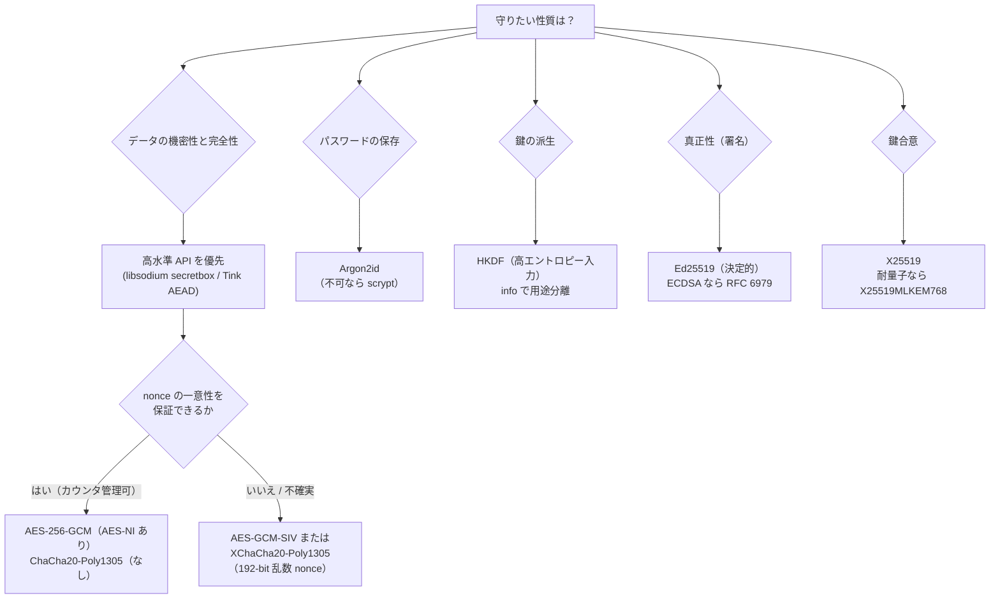
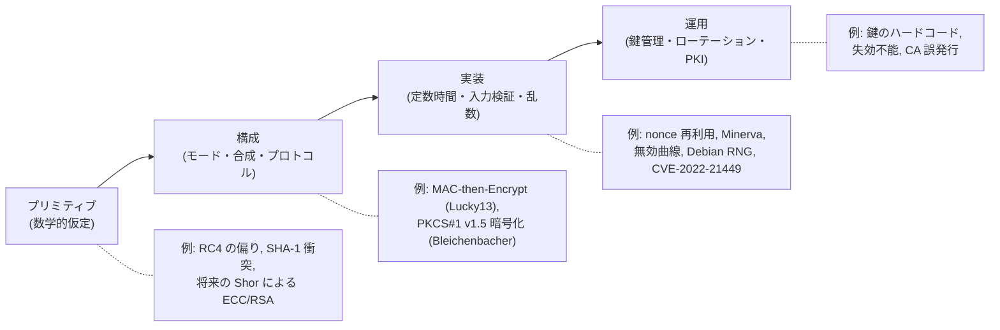
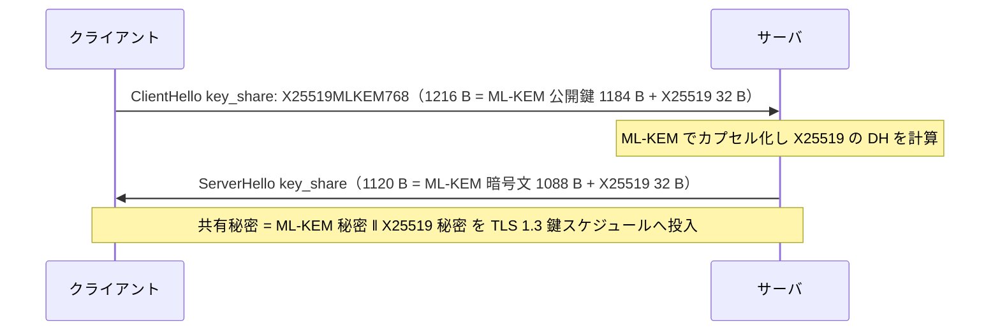

# 応用暗号工学 (Applied Cryptographic Engineering: Primitive Selection, Implementation Pitfalls & PQC Migration)

## 概要 (Overview)

暗号が破れるとき、壊れているのは数学ではなく工学であることがほとんどである。AES や楕円曲線の離散対数問題が破られたわけではないのに、Sony PS3 の署名鍵は流出し、Debian の OpenSSL は 2 年間推測可能な鍵を生成し続け、2016 年には 184 台の HTTPS サーバが AES-GCM の nonce を使い回していた。本ドキュメントは、暗号プリミティブを**選び・組み合わせ・実装し・運用する**層、すなわち応用暗号工学 (applied cryptographic engineering) を扱う。

中心テーゼは、**現代の暗号工学は「正しく使えば安全」から「誤用しにくい形でしか提供しない」へ移行した**、ということ。AEAD は暗号化と認証の合成ミスを根絶し、RFC 6979 と Ed25519 は署名の乱数依存を断ち、X25519 は点検証の書き忘れを構造的に不可能にし、libsodium と Tink は API の表面から危険な選択肢を消した。この流れは [`../networking/tls-internals.md`](../networking/tls-internals.md) が描く「TLS 1.3 は削って安全になった」の一般化である。

もう一つの軸は**時間**である。鍵は漏れ、アルゴリズムは陳腐化し、量子計算機は将来の脅威として今日の暗号文に遡及する。鍵ローテーション、暗号の俊敏性 (crypto agility)、耐量子暗号 (PQC) への移行は、どれも「いつか暗号を差し替える日が来る」ことを前提に設計する規律である。

本書は (1) プリミティブ選択の指針、(2) 実装の落とし穴（nonce 再利用・タイミングサイドチャネル・パディングオラクル・無効曲線攻撃・乱数生成の失敗）、(3) 誤用耐性 API、(4) 鍵管理とローテーション、(5) PKI と Certificate Transparency、(6) 耐量子移行、を扱う。分析深度は Level 3。

## 方法論 (Methodology)

- 各プリミティブ・API 設計を「どの事故への応答か」で説明する。暗号工学の進歩は、ほぼ全てが実際の破綻事例の否定形として読める。
- 仕様は RFC・NIST FIPS/SP を一次資料とし、攻撃は査読付き論文と一次の開示（勧告・カンファレンス発表）で裏付ける。インターネット規模の実測（Mining Your Ps and Qs、Nonce-Disrespecting Adversaries、ROBOT）は、「理論上の弱点」が「実在する弱点」であることの証拠として重視する。
- **プリミティブの欠陥・構成の欠陥・実装の欠陥・運用の欠陥**を峻別する。対策は層ごとに全く異なる。
- 数論的な基礎（群、離散対数、RSA の正しさ）は [`../../foundations/mathematics/number-theory-algebra/public-key-cryptography.md`](../../foundations/mathematics/number-theory-algebra/public-key-cryptography.md) に、有限体の演算は [`../../foundations/mathematics/number-theory-algebra/finite-fields-coding.md`](../../foundations/mathematics/number-theory-algebra/finite-fields-coding.md) に、ハードウェア側のサイドチャネルと TEE は [`../../hardware/security/side-channels-tee-secure-boot.md`](../../hardware/security/side-channels-tee-secure-boot.md) に委ねる。
- 標準化状況など時間とともに変わる事実は 2026-10-04 時点として明記し、仕様の成立と実装の展開を区別する。

## 発見事項 (Findings)

1. **破綻の大半はプリミティブではなく「使い方」で起きる。** 本書で扱う事故（PS3、Debian、GCM nonce 再利用、Lucky13、ROBOT、Java の「サイキック署名」）は、どれも基礎となる数学的仮定を破っていない。破れたのは nonce の一意性、乱数の質、定数時間性、入力検証という**プリミティブの前提条件**であり、これを利用者に委ねる設計そのものがリスクである。
2. **nonce は「秘密でなくてよいが、絶対に繰り返してはならない」値であり、その違反は破滅的である。** AES-GCM で nonce を 1 回再利用すると認証鍵 H が回復され、偽造が可能になる[^joux][^bock-gcm]。ECDSA で署名ノンス k を 2 回使うと、秘密鍵そのものが代数的に求まる[^ps3]。わずか数ビットの偏りでも格子攻撃で鍵が復元される[^minerva]。つまり「1 回のミスで全損」という非対称性が設計上の最大の問題である。
3. **誤用耐性は 2 方向から達成された。** (a) 前提条件そのものを不要にするプリミティブ（決定的署名 RFC 6979/Ed25519[^rfc6979][^ed25519]、nonce 誤用耐性のある AES-GCM-SIV[^rfc8452]、全入力が有効な点になる X25519[^rfc7748]）、(b) 危険な選択肢を API から消すライブラリ（libsodium、Tink[^libsodium][^tink]）である。両者は補完関係にあり、後者は前者を既定値として採用する。
4. **サイドチャネルは「正しい計算」をしていても秘密を漏らす。** 実行時間・エラー種別・応答の有無の違いは、すべて神託 (oracle) になる。Bleichenbacher (1998) の攻撃は ROBOT (2018) として 20 年後の主要サイトで再発した[^bleichenbacher][^robot]。この事実は、**対策が「エラーを均一化する」という運用規律に依存する限り再発する**ことを示し、TLS 1.3 が RSA 鍵輸送と CBC を削除した根拠になっている。
5. **乱数の失敗は静かで、広範で、遡及する。** Debian の事故は 2006-09 から 2008-05 まで約 20 か月、検出されないまま鍵を生成し続けた[^dsa1571]。2012 年の調査では TLS ホストの 0.50% の RSA 秘密鍵が素因数の共有から計算できた[^heninger]。乱数の不良は出力を見ても分からないため、**検査ではなく設計（OS の CSPRNG への一本化、決定的ノンス）で防ぐしかない**。
6. **鍵は必ず漏れ、アルゴリズムは必ず古くなる、という前提で設計する。** 鍵 ID 付きの鍵セット（Tink の keyset）やエンベロープ暗号化はローテーションを日常業務にし、暗号の俊敏性は PQC 移行の前提条件になる。NIST は量子脆弱アルゴリズムを 2030 年以降に非推奨 (deprecated)、2035 年以降に禁止 (disallowed) とする移行案を示している[^nistir8547]。
7. **耐量子移行は鍵交換が先行し、署名が後を追う。** 「今盗って後で解く」(harvest now, decrypt later) 脅威は鍵交換にだけ遡及する。そのためハイブリッド鍵交換 X25519MLKEM768 は 2026-08 に RFC 10024 として標準化され[^rfc10024]、OpenSSL 3.5 の既定値にもなった[^openssl35]。一方、PQ 署名は証明書チェーンのサイズ増という別の工学問題を抱え、展開は鍵交換より遅れている。

## アーキテクチャ (Architecture)

### プリミティブ選択の決定木

利用者が「何を守りたいか」から出発し、プリミティブを選ぶ順序を示す。原則は**自分で組み合わせない**ことである。高水準 API があればそれを使い、なければ以下の既定値を選ぶ。

### 破綻の層構造

同じ「暗号が破れた」でも、どの層で破れたかで対策が異なる。

凡例: 実線は「上位層は下位層の前提の上に立つ」依存関係、点線は各層の代表的な破綻事例である。

## 技術詳細 (Technical Details)

### 1. 認証付き暗号 (AEAD) の選択

AEAD (Authenticated Encryption with Associated Data) は、暗号化と改竄検知を 1 つのプリミティブに統合する。Encrypt-then-MAC を利用者が自前で組む時代に頻発した合成順序の誤り（MAC-then-Encrypt によるパディングオラクル）を、構成の層で根絶したのが AEAD の意義である。

| 方式 | nonce 長 | nonce 再利用時の帰結 | 長所 | 適所 |
|---|---|---|---|---|
| AES-GCM[^sp80038d] | 96 bit | 平文の XOR が漏洩し、GHASH 鍵 H が回復されて偽造が可能になる（破滅的）[^joux] | AES-NI/PCLMULQDQ で極めて高速、FIPS 承認 | ハードウェア AES がある環境の既定値 |
| ChaCha20-Poly1305[^rfc8439] | 96 bit | 平文の XOR が漏洩し、その nonce の Poly1305 鍵が露出して偽造が可能になる（破滅的） | ソフトウェアで定数時間かつ高速 | AES 命令のないモバイル・組込み |
| XChaCha20-Poly1305 | 192 bit | 同上。ただし乱数 nonce の衝突確率が無視できる | 乱数 nonce を安全に使える[^libsodium] | カウンタ管理が困難な分散環境 |
| AES-GCM-SIV[^rfc8452] | 96 bit | 同一 (nonce, 平文) の組が同一暗号文になる事実のみ漏れる（優雅な劣化） | nonce 誤用耐性 (MRAE) | nonce の一意性を保証できない場面、鍵ラップ |

- **乱数 nonce の上限**: 96-bit nonce を乱数で生成する場合、誕生日境界により同一鍵での暗号化回数は NIST SP 800-38D で 2^32 回に制限される[^sp80038d]。Böck らは 2016 年の調査で、nonce を繰り返す HTTPS サーバ 184 台に加え、大量送信時に衝突しうる乱数 nonce を使うサーバ約 70,000 台を発見した[^bock-gcm]。
- **AES-GCM-SIV のコスト**: 平文を 2 パスで処理する（先に認証タグを計算し、それを IV として暗号化する）ため、ストリーミング暗号化には向かない。RFC 8452 は誤用耐性を持ちながらも、乱数 nonce の使用を推奨している[^rfc8452]。
- **libsodium の現行推奨**: AES ハードウェアがあれば AEGIS-256、なければ XChaCha20-Poly1305-IETF である[^libsodium]。いずれも「nonce を乱数で生成してよい」ことを既定の使い方にする選択である。

### 2. 鍵派生 (HKDF) とパスワードハッシュ

二つは混同されやすいが、入力のエントロピーが根本的に異なる。

- **HKDF**[^rfc5869] は、**既に高エントロピーな秘密**（DH 共有秘密など）から複数の鍵を派生する。Extract（ソルト付き HMAC で一様な擬似乱数鍵 PRK に濃縮）と Expand（`info` を入れて用途別の鍵を伸長）の 2 段からなる。`info` に用途ラベルを入れることが**鍵分離 (key separation)** であり、TLS 1.3 の鍵スケジュールはこの連鎖そのものである（[`../networking/tls-internals.md`](../networking/tls-internals.md)）。
- **パスワードハッシュ**は**低エントロピーな秘密**を扱うため、総当たりのコストを意図的に上げる必要がある。ここで HKDF や SHA-256 を使うと、GPU による高速な辞書攻撃に晒される。
  - **Argon2id**[^rfc9106] — メモリ困難関数 (memory-hard function)。RFC 9106 の第一推奨は t=1、p=4、m=2 GiB、第二推奨（メモリ制約環境）は t=3、p=4、m=64 MiB である。Argon2id はデータ非依存アクセス（サイドチャネル耐性）とデータ依存アクセス（時間-メモリ取引への耐性）を組み合わせる。
  - **scrypt**[^rfc7914] — Argon2 以前のメモリ困難関数。Argon2id が使えない場合の選択肢である。
  - 実務の最低線として、OWASP は Argon2id で 19 MiB・2 反復・並列度 1、scrypt で N=2^17・r=8・p=1、FIPS 準拠が必要なら PBKDF2-HMAC-SHA256 で 600,000 反復以上を挙げる[^owasp-pw]。
  - RFC 9106 の推奨値と OWASP の最低値は 100 倍以上離れている。前者は「攻撃者コストの最大化」、後者は「ログインのたびに払える上限」を基準にしており、**どちらも正しく、サーバの同時ログイン数とメモリ予算から決める**べきパラメータである。

### 3. 署名と nonce 再利用の破滅

ECDSA の署名は `s = k⁻¹(e + r·d) mod n`（d は秘密鍵、e はメッセージハッシュ、r は kG の x 座標）である。k は**秘密かつ一意かつ一様**でなければならない。

- **k の再利用 (PS3, 2010)**: 同じ k で 2 つのメッセージに署名すると r が一致し、`k = (e₁ − e₂)/(s₁ − s₂)`、続いて `d = (s·k − e)/r` が求まる。fail0verflow は 27C3 (2010-12-29) の講演で、Sony の PS3 署名が同一の乱数を使い回していたことからこの計算で署名鍵を復元した[^ps3]。
- **k の偏り (Minerva, 2020)**: k を完全に再利用しなくても、k のビット長がスカラー倍算の実行時間に漏れるだけで、多数の署名から隠れ数問題 (Hidden Number Problem) を格子で解き、秘密鍵を復元できる。Jancar らは FIPS 140-2 認証のスマートカードチップと libgcrypt・wolfSSL・MatrixSSL・SunEC・Crypto++ の 5 ライブラリでこれを示した[^minerva]。
- **決定的署名による根治**: RFC 6979 は k を `HMAC_DRBG(秘密鍵, メッセージハッシュ)` から決定的に生成する。署名時の乱数源への依存がなくなり、テストベクタでの検証も可能になり、既存の検証器とも互換である[^rfc6979]。Ed25519 は設計段階から k = H(秘密鍵由来の prefix ‖ M) とし、さらにスカラー倍算を定数時間で実装しやすい曲線形 (twisted Edwards) を選んでいる[^ed25519][^rfc8032]。
- **検証側の破綻 (CVE-2022-21449)**: Java 15〜18 の ECDSA 検証は r, s が 0 でないことを検査しなかった。そのため (r, s) = (0, 0) が任意の鍵・任意のメッセージに対して有効になり、TLS 証明書・JWT・SAML・WebAuthn のアサーションまで偽造可能になった[^psychic]。署名は**生成と検証の双方**に前提条件があることの実例である。

### 4. 鍵交換と無効曲線攻撃

- **無効曲線攻撃 (invalid-curve attack)**: 短ワイエルシュトラス形の ECDH で受信した点が曲線上にあるかを検査しないと、攻撃者は位数の小さい別の曲線上の点を送り込める。応答から秘密鍵を小さな法ごとに求め、中国剰余定理で組み立てる。Jager らは 2015 年に、Bouncy Castle と Oracle JSSE の TLS-ECDH 実装に対してこの攻撃を実証した[^jager-invalid]。
- **X25519 による構造的回避**: X25519 は Montgomery 曲線上の x 座標のみのラダーで計算し、任意の 32 バイト列を有効な入力として扱う。曲線とその二次ツイストの双方が安全になるよう選ばれているため、点検証の書き忘れという失敗モードそのものが存在しない[^rfc7748]。残る注意点は、小位数点による共有秘密が全ゼロになる場合の検査であり、RFC 7748 はこの検査を実装が行ってよい (MAY) としている。
- **前方秘匿性 (forward secrecy)**: 鍵交換は一時鍵 (ephemeral) で行い、長期鍵は署名にだけ使う。RSA 鍵輸送ではサーバ鍵が漏れると過去の全通信が復号されるため、TLS 1.3 はこれを削除した（[`../networking/tls-internals.md`](../networking/tls-internals.md)）。

### 5. 定数時間実装とタイミングサイドチャネル

- **原理**: Kocher (1996) は、べき乗剰余の実行時間が秘密指数のビットに依存することから、DH・RSA・DSS の秘密鍵が復元できることを示した[^kocher]。対策は**秘密に依存する分岐・メモリアクセス・可変時間命令を使わない**ことである。言語や比較関数のレベルでは、MAC 比較を `memcmp` ではなく定数時間比較（`sodium_memcmp`、`CRYPTO_memcmp`）で行うことにあたる。
- **Lucky13 (2013)**: TLS/DTLS の CBC モードは MAC-then-Encrypt であり、パディング長によって MAC 計算のブロック数が変わる。そのわずかな時間差から平文を回復できた[^lucky13]。対策パッチは複雑な定数時間化を要し、最終的な解決は TLS 1.3 による CBC の削除だった。
- **Minerva (2020)**: 前節のとおり、スカラー倍算のループ回数がノンスのビット長に依存するという一行の非定数時間性が、格子攻撃の入力になった[^minerva]。
- **ハードウェアとの境界**: ソフトウェアが定数時間でも、キャッシュ・分岐予測・投機実行・電力・電磁波は別の漏洩路になる。これらとハードウェア側の対策（AES-NI による表引きの排除、TEE）は [`../../hardware/security/side-channels-tee-secure-boot.md`](../../hardware/security/side-channels-tee-secure-boot.md) が扱う。

### 6. パディングオラクル (Padding Oracles)

| 攻撃 | 対象 | 神託 (oracle) | 帰結 | 根治策 |
|---|---|---|---|---|
| Bleichenbacher (1998)[^bleichenbacher] | RSA PKCS#1 v1.5 暗号化 | 復号後のパディングが正しいかどうか（エラー種別・時間） | 約 100 万回の問い合わせで 1 つの暗号文（TLS のプリマスタシークレット）を復号 | RSA-OAEP、TLS 1.3 での RSA 鍵輸送の削除 |
| Vaudenay (2002)[^vaudenay] | CBC モードのパディング | パディング検証エラーと MAC エラーの区別 | 1 バイトあたり最大 256 回の問い合わせで平文を回復 | Encrypt-then-MAC、AEAD |
| ROBOT (2018)[^robot] | TLS の RSA 鍵交換（Bleichenbacher の再発） | TCP リセット・タイムアウト・重複アラート | Alexa 上位 100 ドメインの約 3 分の 1 が脆弱で、Facebook の証明書鍵で署名を作成 | RSA 鍵交換の無効化 |

ROBOT の教訓は、Bleichenbacher の対策が「全エラーを区別不能にせよ」という**実装者への要求**だった点にある。F5・Citrix・Cisco などの実装は、20 年間この要求を満たせなかった[^robot]。構成の層で神託を消す（AEAD、OAEP、鍵輸送の廃止）以外に、恒久的な対策はない。

### 7. 乱数生成の失敗

- **Debian OpenSSL (CVE-2008-0166)**: Debian 固有の OpenSSL への変更によって、乱数生成器が予測可能になった。0.9.8c-1 (2006-09-17) 以降に生成された SSH 鍵・OpenVPN 鍵・DNSSEC 鍵・X.509 鍵はすべて推測可能になった。DSA 鍵は、弱い乱数で**署名しただけ**でも危殆化した[^dsa1571]。
- **Mining Your Ps and Qs (2012)**: Heninger らのインターネット全体調査では、TLS 証明書の 0.75% がエントロピー不足で鍵を共有していた。さらに TLS ホストの 0.50%、SSH ホストの 0.03% の RSA 秘密鍵が公開鍵間の公約数から計算でき、SSH ホストの 1.03% の DSA 秘密鍵が署名乱数の不足から復元できた。原因の大半はヘッドレス機器・組込み機器であり、Linux 乱数生成器の起動直後のエントロピー不足が特定された[^heninger]。
- **設計上の教訓**: アプリケーションは独自の PRNG を持たず、OS の CSPRNG（`getrandom(2)`、`getentropy`、`BCryptGenRandom`）に一本化する。署名は決定的ノンスにして乱数依存を減らす。組込み機器では初回起動時の鍵生成を避けるか、ハードウェア乱数源 (TRNG) を使う。

### 8. 誤用耐性 API — libsodium と Tink

| 設計判断 | libsodium[^libsodium] | Tink[^tink] |
|---|---|---|
| アルゴリズム選択 | 関数名に既定の組合せを固定（`crypto_secretbox` = XSalsa20-Poly1305 など） | 鍵テンプレート（`AES256_GCM` 等）で指定し、プリミティブ名ではなくインタフェース（AEAD、MAC、署名）で使う |
| nonce | 192-bit nonce の構成を推奨し、乱数生成を既定にする | 多くのプリミティブで nonce を内部生成し、利用者に渡さない |
| 鍵ローテーション | 利用者の責任 | keyset（鍵 ID 付きの鍵の集合と 1 つの primary 鍵）を第一級の概念にし、暗号文に 5 バイトの鍵 ID 接頭辞を付ける |
| KMS 連携 | 範囲外 | keyset を KMS の鍵で包む (envelope) 機能を内蔵 |

Tink の keyset 設計の根拠は、「分散システムで鍵を原子的に切り替えることは不可能」という前提にある[^tink]。新しい鍵を「有効だが primary ではない」状態で全台に配布し、全台が復号できるようになってから primary に昇格させる。この 3 段階によって、ローテーションは無停止の日常作業になる。なお鍵 ID 接頭辞は認証されない**ヒント**にすぎず、検索の高速化以上の意味を持たせてはならない。

### 9. 鍵管理とローテーション

- **エンベロープ暗号化**: データはデータ鍵 (DEK) で暗号化し、DEK は KMS/HSM 内の鍵暗号鍵 (KEK) で包む。ローテーション時に再暗号化が要るのは包まれた DEK だけで、データ本体には手を付けずに済む。クラウド KMS の内部構造、HSM の信頼境界、機密コンピューティングとの統合は [`../cloud/cloud-kms-confidential-computing.md`](../cloud/cloud-kms-confidential-computing.md) が扱う。
- **暗号期間 (cryptoperiod)**: NIST SP 800-57 Part 1 は、鍵種別ごとに使用期間を定め、「保護に使う期間」と「処理（復号・検証）に使う期間」を分けて管理することを求める[^sp80057]。前者を過ぎた鍵は復号専用に残す。これは Tink の非 primary 鍵と同じ考え方である。
- **使用量の上限**: AES-GCM の乱数 nonce で 2^32 回（前述）のように、鍵には暗号学的な寿命もある。時間ではなく**使用量でローテーションを発火させる**設計が必要な場合がある。
- **鍵の非露出**: 署名鍵・ルート鍵は HSM・TEE から出さず、アプリケーションには操作 API だけを渡す。漏洩時の影響範囲は「鍵が存在した場所の数」に比例する。

### 10. PKI と Certificate Transparency（要約）

公開鍵の真正性を保証する PKI は、暗号ではなく制度の層である。詳細は [`../networking/tls-internals.md`](../networking/tls-internals.md) に譲り、ここでは応用暗号工学から見た要点に絞る。

- **Certificate Transparency (CT)**: 証明書の発行を追記専用の Merkle 木ログに記録させ、誤発行を「防ぐ」のではなく「隠せなくする」[^rfc6962][^rfc9162]。ドメイン所有者はログを監視し、意図しない発行を検出できる。
- **短寿命化**: CA/Browser Forum は 2025-04-11 に Ballot SC081v3 を可決し、TLS 証明書の最大有効期間を 2026-03 から 2029-03 にかけて段階的に 398 日から 47 日へ短縮することを決めた[^sc081]。失効が実務上機能しない以上、寿命を縮めることが次善の策であり、ACME による自動化が前提になる。この短縮は、PQ 証明書への切り替えを含む**鍵とアルゴリズムの更新頻度**を上げる効果も持つ。

### 11. 耐量子暗号への移行 (Post-Quantum Migration)

#### 標準化の現在地（2026-10-04 時点）

| 標準 | 方式 | 由来 | 用途 | 状況 |
|---|---|---|---|---|
| FIPS 203 | ML-KEM | CRYSTALS-Kyber | 鍵カプセル化 (KEM) | 2024-08-13 承認[^fips-pqc] |
| FIPS 204 | ML-DSA | CRYSTALS-Dilithium | 署名 | 2024-08-13 承認[^fips-pqc] |
| FIPS 205 | SLH-DSA | SPHINCS+ | 署名（ハッシュベース、保守的） | 2024-08-13 承認[^fips-pqc] |
| FIPS 206 | FN-DSA | FALCON | 署名（小さい署名） | 策定中[^fips-pqc] |
| SP 800-227 | KEM の利用推奨 | — | KEM の性質・実装指針 | 2025-09 最終版[^sp800227] |
| NIST IR 8547 | 移行計画 | — | 量子脆弱方式の非推奨化日程 | 初期公開草案 (2024-11)[^nistir8547] |
| RFC 10024 | TLS 1.3 ハイブリッド鍵合意 | — | X25519MLKEM768 ほか | 2026-08 Proposed Standard[^rfc10024] |

#### ハイブリッド鍵交換 X25519MLKEM768

- RFC 10024 は 3 つのハイブリッド群を定義し、IANA で推奨 (Recommended) とされたのは X25519MLKEM768 (0x11EC) だけである。SecP256r1MLKEM768 (0x11EB) と SecP384r1MLKEM1024 (0x11ED) は非推奨扱いになっている[^rfc10024]。ハイブリッドにする理由は、ML-KEM に未知の弱点や実装欠陥があっても X25519 が守り、量子計算機が実現しても ML-KEM が守る、という**どちらか一方が生き残れば安全**の保険にある。
- **展開状況（実装側）**: OpenSSL 3.5.0 (2025-04-08) は ML-KEM・ML-DSA・SLH-DSA を実装し、既定の key share を X25519MLKEM768 と X25519 に変更した[^openssl35]。Cloudflare は 2026-04 時点で「人間由来のトラフィックの 65% 超が耐量子暗号化されている」と報告し、2029 年までに認証を含む完全な耐量子化を目標に掲げている[^cf-2029]。この数値は単一事業者の観測値であり、インターネット全体の比率ではない点に注意する。
- **工学的な副作用**: ClientHello が約 1.2 KB 増えて複数パケットに分割され、これを処理できない中間装置 (middlebox) が露見した（硬直化 (ossification) の再演、[`../networking/tls-internals.md`](../networking/tls-internals.md)）。

#### 「今盗って後で解く」と移行の優先順位

- **鍵交換が最優先**: 今日記録された暗号文は、将来の量子計算機で鍵交換が破られれば遡って復号される。機密性の保持期間が長いデータ（医療・国家・長期の知財）ほど緊急度が高い。
- **署名は後でよいが準備は今**: 署名の偽造は量子計算機が実現した時点以降にしか起きない。ただし、ファームウェアのルート鍵・セキュアブートの検証鍵のように**数十年交換できない鍵**は、出荷時点で PQ 化（あるいは SLH-DSA のような保守的方式の併用）を検討する必要がある。PQ 署名は ML-DSA でも数 KB 規模になり、証明書チェーン全体のサイズ増が課題になる。
- **NIST の日程案**: IR 8547 初期草案は、112-bit 安全性の量子脆弱方式（RSA-2048、P-256 の ECDSA/ECDH など）を 2030 年以降非推奨、量子脆弱方式全体を 2035 年以降禁止とする[^nistir8547]。これは草案段階の計画であり、最終版で変更されうる。

#### 暗号の俊敏性 (Crypto Agility)

- **アルゴリズム識別子を持つ**: 暗号文・署名・鍵に方式と版の識別子を付ける（Tink の鍵テンプレート、TLS の named group）。識別子がなければ、移行時に「これは何で暗号化されたか」を判別できない。
- **棚卸し (cryptographic inventory)**: どこでどの方式・鍵長が使われているかの目録が移行の出発点になる。ライブラリ呼び出し・証明書・プロトコル設定・HSM 内の鍵を網羅する。
- **ネゴシエーションはダウングレード攻撃面を伴う**: 俊敏性とは選択肢を残すことであり、選択肢は FREAK/Logjam 型のダウングレード攻撃面になる。古い方式を**期限付きで削除する**計画と対にしなければ、俊敏性は脆弱性になる。

## セキュリティ考察 (Security Considerations)

- **最大の脅威は「正しいアルゴリズムの誤った使用」である。** 選定段階でいくら強い方式を選んでも、nonce 管理・乱数・入力検証・エラー処理のいずれか 1 つの欠陥で全体が崩れる。自前実装を避け、監査済みの高水準ライブラリを既定にすることが最も費用対効果の高い対策である。
- **神託を作らない。** 復号失敗・パディング不正・MAC 不一致は、外部から区別できない単一の失敗として扱う。エラーメッセージ、応答時間、接続の切り方（TCP リセットかアラートか）のすべてが神託になりうることを ROBOT が示した[^robot]。
- **検証側の前提条件も検査する。** 署名検証での範囲検査 (0 < r, s < n)、ECDH での点の曲線上検査、証明書でのホスト名検査は、省略しても「正常系」では動いてしまう。CVE-2022-21449 のように、不正な境界値（ゼロ、範囲外、曲線外の点）を含むテストベクタで検証側を試験することが必要である。
- **鍵の寿命と使用量を設計に含める。** ローテーション不能な鍵（ハードコード鍵、交換手段のない組込み機器の鍵）は、漏洩時に回復手段がない。ローテーション経路は鍵の導入と同時に設計する。
- **量子脅威の時間軸を誤らない。** 鍵交換は今日の通信が将来復号されるため**既に遅れている**問題であり、署名は実現時点までに移行すれば足りる問題である。両者を同じ優先度で扱うと、緊急の前者が遅れるか、未成熟な PQ 署名を拙速に導入するかのどちらかになる。
- **ハイブリッド期間の複雑性**: ハイブリッド方式は安全性の保険である一方、実装・相互運用・パケットサイズの複雑性を増やす。新実装の ML-KEM 自体にもタイミングサイドチャネルがありうるため、古典暗号と同じ定数時間の規律を適用する必要がある。

## 結論 (Conclusions)

- 暗号の破綻は数学ではなく工学の層、すなわち nonce・乱数・定数時間性・入力検証・エラー処理という**プリミティブの前提条件の違反**で起きる。PS3、Debian、GCM nonce 再利用、Lucky13、ROBOT、Minerva、CVE-2022-21449 はどれもこの型に収まる。
- 現代の暗号工学の答えは、前提条件を**利用者の規律から設計の性質へ移す**ことである。AEAD は合成順序を、決定的署名は乱数依存を、X25519 は点検証を、AES-GCM-SIV と XChaCha20 は nonce 管理の負担を、libsodium/Tink は選択そのものを、それぞれ利用者から取り上げた。
- 鍵管理は「鍵は漏れる、アルゴリズムは古くなる」を前提にした変更管理の規律である。鍵 ID 付き keyset、エンベロープ暗号化、短寿命証明書は、ローテーションを例外処理から日常業務に変える仕組みである。
- 耐量子移行は、鍵交換（ハイブリッド X25519MLKEM768、RFC 10024 として 2026-08 に標準化）が先行し、署名が後を追う二段構えで進んでいる。暗号の俊敏性と方式の棚卸しは、PQC 移行の前提条件であると同時に、次の移行に備える恒久的な能力でもある。

### 次の接続先 (Related Topics)

- [`../networking/tls-internals.md`](../networking/tls-internals.md) — 本書のプリミティブが組み合わさる代表的プロトコル。鍵スケジュール・PKI・耐量子ハイブリッドの実装先。
- [`../cloud/cloud-kms-confidential-computing.md`](../cloud/cloud-kms-confidential-computing.md) — エンベロープ暗号化・HSM・鍵の非露出を担うクラウド基盤。
- [`../../hardware/security/side-channels-tee-secure-boot.md`](../../hardware/security/side-channels-tee-secure-boot.md) — キャッシュ・電力・投機実行のサイドチャネルと、鍵を守る TEE・secure boot。
- [`../../foundations/mathematics/number-theory-algebra/public-key-cryptography.md`](../../foundations/mathematics/number-theory-algebra/public-key-cryptography.md) — RSA・DH・楕円曲線の数論的基礎。
- [`../../foundations/mathematics/number-theory-algebra/finite-fields-coding.md`](../../foundations/mathematics/number-theory-algebra/finite-fields-coding.md) — GHASH（GF(2^128) 上の乗算）や AES の S-box が依拠する有限体。
- [`../apis/webauthn-passkeys-specification.md`](../apis/webauthn-passkeys-specification.md) — 署名プリミティブの応用としての公開鍵認証。

## 参考文献 (References)

**一次資料 — 標準・仕様 (Primary — Standards & Specifications)**

[^rfc5869]: Krawczyk, H., & Eronen, P. (2010). HMAC-based Extract-and-Expand Key Derivation Function (HKDF). *RFC 5869*. [rfc-editor.org](https://www.rfc-editor.org/rfc/rfc5869) — Accessed: 2026-10-04
[^rfc8439]: Nir, Y., & Langley, A. (2018). ChaCha20 and Poly1305 for IETF Protocols. *RFC 8439*. [rfc-editor.org](https://www.rfc-editor.org/rfc/rfc8439) — Accessed: 2026-10-04
[^rfc8452]: Gueron, S., Langley, A., & Lindell, Y. (2019). AES-GCM-SIV: Nonce Misuse-Resistant Authenticated Encryption. *RFC 8452*. [rfc-editor.org](https://www.rfc-editor.org/rfc/rfc8452) — Accessed: 2026-10-04
[^rfc7748]: Langley, A., Hamburg, M., & Turner, S. (2016). Elliptic Curves for Security. *RFC 7748*. [rfc-editor.org](https://www.rfc-editor.org/rfc/rfc7748) — Accessed: 2026-10-04
[^rfc8032]: Josefsson, S., & Liusvaara, I. (2017). Edwards-Curve Digital Signature Algorithm (EdDSA). *RFC 8032*. [rfc-editor.org](https://www.rfc-editor.org/rfc/rfc8032) — Accessed: 2026-10-04
[^rfc6979]: Pornin, T. (2013). Deterministic Usage of the Digital Signature Algorithm (DSA) and Elliptic Curve Digital Signature Algorithm (ECDSA). *RFC 6979*. [rfc-editor.org](https://www.rfc-editor.org/rfc/rfc6979) — Accessed: 2026-10-04
[^rfc9106]: Biryukov, A., Dinu, D., Khovratovich, D., & Josefsson, S. (2021). Argon2 Memory-Hard Function for Password Hashing and Proof-of-Work Applications. *RFC 9106*. [rfc-editor.org](https://www.rfc-editor.org/rfc/rfc9106) — Accessed: 2026-10-04
[^rfc7914]: Percival, C., & Josefsson, S. (2016). The scrypt Password-Based Key Derivation Function. *RFC 7914*. [rfc-editor.org](https://www.rfc-editor.org/rfc/rfc7914) — Accessed: 2026-10-04
[^rfc6962]: Laurie, B., Langley, A., & Kasper, E. (2013). Certificate Transparency. *RFC 6962*. [rfc-editor.org](https://www.rfc-editor.org/rfc/rfc6962) — Accessed: 2026-10-04
[^rfc9162]: Laurie, B., Messeri, E., & Stradling, R. (2021). Certificate Transparency Version 2.0. *RFC 9162*. [rfc-editor.org](https://www.rfc-editor.org/rfc/rfc9162) — Accessed: 2026-10-04
[^rfc10024]: Kwiatkowski, K., Kampanakis, P., Westerbaan, B. E., & Stebila, D. (2026). Post-Quantum Traditional (PQ/T) Hybrid Key Agreement Mechanisms for TLS 1.3. *RFC 10024*（draft-ietf-tls-ecdhe-mlkem から発行、Proposed Standard）. [datatracker.ietf.org](https://datatracker.ietf.org/doc/draft-ietf-tls-ecdhe-mlkem/)、[rfc-editor.org](https://www.rfc-editor.org/info/rfc10024) — Accessed: 2026-10-04
[^sp80038d]: Dworkin, M. (2007). Recommendation for Block Cipher Modes of Operation: Galois/Counter Mode (GCM) and GMAC. *NIST SP 800-38D*. [csrc.nist.gov](https://csrc.nist.gov/pubs/sp/800/38/d/final) — Accessed: 2026-10-04
[^sp80057]: Barker, E. (2020). Recommendation for Key Management: Part 1 – General. *NIST SP 800-57 Part 1 Rev. 5*. [csrc.nist.gov](https://csrc.nist.gov/pubs/sp/800/57/pt1/r5/final) — Accessed: 2026-10-04
[^fips-pqc]: NIST. (2024-08-13). [NIST Releases First 3 Finalized Post-Quantum Encryption Standards (FIPS 203, 204, 205)](https://csrc.nist.gov/news/2024/postquantum-cryptography-fips-approved) — Accessed: 2026-10-04
[^sp800227]: Alagic, G., Barker, E., Chen, L., Moody, D., Robinson, A., Silberg, H., & Waller, N. (2025). Recommendations for Key-Encapsulation Mechanisms. *NIST SP 800-227*. [csrc.nist.gov](https://csrc.nist.gov/pubs/sp/800/227/final) — Accessed: 2026-10-04
[^nistir8547]: Moody, D., Perlner, R., Regenscheid, A., Robinson, A., & Cooper, D. (2024). Transition to Post-Quantum Cryptography Standards (Initial Public Draft). *NIST IR 8547 ipd*. [csrc.nist.gov](https://csrc.nist.gov/pubs/ir/8547/ipd) — Accessed: 2026-10-04（2026-10-04 時点で確認できたのは初期公開草案）
[^sc081]: CA/Browser Forum. (2025-04-11). [Ballot SC081v3: Introduce Schedule of Reducing Validity and Data Reuse Periods](https://cabforum.org/2025/04/11/ballot-sc081v3-introduce-schedule-of-reducing-validity-and-data-reuse-periods/) — Accessed: 2026-10-04

**一次資料 — 論文・開示 (Primary — Papers & Disclosures)**

[^joux]: Joux, A. (2006). Authentication Failures in NIST version of GCM. NIST へのパブリックコメント. [csrc.nist.gov](https://csrc.nist.gov/csrc/media/projects/block-cipher-techniques/documents/bcm/joux_comments.pdf) — Accessed: 2026-10-04
[^bock-gcm]: Böck, H., Zauner, A., Devlin, S., Somorovsky, J., & Jovanovic, P. (2016). Nonce-Disrespecting Adversaries: Practical Forgery Attacks on GCM in TLS. *10th USENIX Workshop on Offensive Technologies (WOOT 16)*. [usenix.org](https://www.usenix.org/conference/woot16/workshop-program/presentation/bock) — Accessed: 2026-10-04
[^ps3]: bushing, marcan, segher, & sven (fail0verflow). (2010-12-29). Console Hacking 2010: PS3 Epic Fail. *27th Chaos Communication Congress (27C3)*. [fahrplan.events.ccc.de](https://fahrplan.events.ccc.de/congress/2010/Fahrplan/events/4087.en.html)（スライド: [PDF](https://fahrplan.events.ccc.de/congress/2010/Fahrplan/attachments/1780_27c3_console_hacking_2010.pdf)） — Accessed: 2026-10-04
[^minerva]: Jancar, J., Sedlacek, V., Svenda, P., & Sys, M. (2020). Minerva: The curse of ECDSA nonces. *IACR Transactions on Cryptographic Hardware and Embedded Systems*, 2020(4), 281–308. DOI: 10.13154/tches.v2020.i4.281-308
[^ed25519]: Bernstein, D. J., Duif, N., Lange, T., Schwabe, P., & Yang, B.-Y. (2012). High-speed high-security signatures. *Journal of Cryptographic Engineering*, 2(2), 77–89. DOI: 10.1007/s13389-012-0027-1
[^jager-invalid]: Jager, T., Schwenk, J., & Somorovsky, J. (2015). Practical Invalid Curve Attacks on TLS-ECDH. *ESORICS 2015*, LNCS, 407–425. DOI: 10.1007/978-3-319-24174-6_21
[^kocher]: Kocher, P. C. (1996). Timing Attacks on Implementations of Diffie-Hellman, RSA, DSS, and Other Systems. *CRYPTO '96*, LNCS 1109, 104–113. DOI: 10.1007/3-540-68697-5_9
[^lucky13]: Al Fardan, N. J., & Paterson, K. G. (2013). Lucky Thirteen: Breaking the TLS and DTLS Record Protocols. *2013 IEEE Symposium on Security and Privacy*, 526–540. DOI: 10.1109/SP.2013.42
[^bleichenbacher]: Bleichenbacher, D. (1998). Chosen Ciphertext Attacks Against Protocols Based on the RSA Encryption Standard PKCS #1. *CRYPTO '98*, LNCS 1462, 1–12. DOI: 10.1007/BFb0055716
[^vaudenay]: Vaudenay, S. (2002). Security Flaws Induced by CBC Padding — Applications to SSL, IPSEC, WTLS... *EUROCRYPT 2002*, LNCS 2332, 534–545. DOI: 10.1007/3-540-46035-7_35
[^robot]: Böck, H., Somorovsky, J., & Young, C. (2018). Return Of Bleichenbacher's Oracle Threat (ROBOT). *27th USENIX Security Symposium*. [usenix.org](https://www.usenix.org/conference/usenixsecurity18/presentation/bock) — Accessed: 2026-10-04
[^heninger]: Heninger, N., Durumeric, Z., Wustrow, E., & Halderman, J. A. (2012). Mining Your Ps and Qs: Detection of Widespread Weak Keys in Network Devices. *21st USENIX Security Symposium*. [usenix.org](https://www.usenix.org/conference/usenixsecurity12/technical-sessions/presentation/heninger)、[factorable.net](https://factorable.net/weakkeys12.extended.pdf) — Accessed: 2026-10-04
[^dsa1571]: Debian Security Team. (2008-05-13). [DSA-1571-1 openssl — predictable random number generator (CVE-2008-0166)](https://lists.debian.org/debian-security-announce/2008/msg00152.html) — Accessed: 2026-10-04

**一次資料 — 実装・ライブラリ文書 (Primary — Implementation Docs)**

[^libsodium]: libsodium documentation. [Authenticated Encryption with Additional Data](https://doc.libsodium.org/secret-key_cryptography/aead) — Accessed: 2026-10-04
[^tink]: Google. Tink documentation. [Keysets](https://developers.google.com/tink/design/keysets) — Accessed: 2026-10-04
[^openssl35]: OpenSSL Project. (2025-04-08). [OpenSSL 3.5 Release Notes](https://openssl-library.org/news/openssl-3.5-notes/) — Accessed: 2026-10-04

**二次資料 (Secondary)**

[^psychic]: Madden, N. (2022-04-19). [CVE-2022-21449: Psychic Signatures in Java](https://neilmadden.blog/2022/04/19/psychic-signatures-in-java/) — Accessed: 2026-10-04（発見者本人による開示。影響版は OpenJDK 勧告に基づく）
[^owasp-pw]: OWASP. [Password Storage Cheat Sheet](https://cheatsheetseries.owasp.org/cheatsheets/Password_Storage_Cheat_Sheet.html) — Accessed: 2026-10-04
[^cf-2029]: Cloudflare. (2026-04-07). [Cloudflare targets 2029 for full post-quantum security](https://blog.cloudflare.com/post-quantum-roadmap/) — Accessed: 2026-10-04（単一事業者による自社網の観測値）
