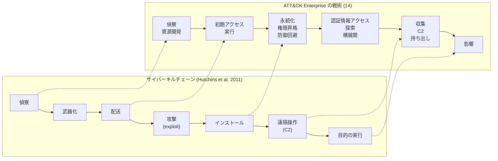
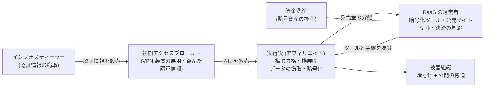

# 攻撃のライフサイクル (Attack Lifecycle: Kill Chain, ATT&CK, APT, Ransomware & DDoS)

## 概要 (Overview)

本ドキュメントは、攻撃者が侵入してから目的を果たすまでの流れと、その代表的な形を扱う。対象は攻撃を段階で捉えるモデル (サイバーキルチェーン、MITRE ATT&CK)、標的型の長期的な侵入 (APT)、初期侵入から横移動までの手口、ランサムウェアとその産業化、そして DDoS である。[`perimeter-defense-zero-trust.md`](perimeter-defense-zero-trust.md) と [`detection-incident-response.md`](detection-incident-response.md) が防御と検知の側から描いた世界を、攻撃者の側から読み直す位置にある。

中心テーゼは、**現代の攻撃は個別の技術の組み合わせではなく、分業された工程であり、防御は工程のどこか 1 か所で止めれば足りる**ということである。初期侵入を専門にする者が入口を売り、別の者が権限を広げ、ランサムウェアの運営者が暗号化のツールと交渉と決済を提供する。攻撃者は正規の管理ツールを使って痕跡を目立たなくし (環境寄生、living off the land)、侵入から発見までの日数の中央値は 2 週間前後に及ぶ。

段階で捉えるモデルの意味はここにある。キルチェーンは攻撃を 7 段階に分け、防御側はどの段階で止めても攻撃全体を失敗させられると示した。ATT&CK は実際に観測された手口を戦術ごとに並べた辞書で、検知の網羅性を測る共通の言葉になった。一方、DDoS は侵入を伴わず、可用性だけを狙う。反射と増幅、乗っ取った IoT 機器のボットネットによって、攻撃の規模は 2025 年に 30 Tbps を超えた。分析深度は Level 3。

## 方法論 (Methodology)

- **一次資料**: キルチェーンは原典の Hutchins, Cloppert & Amin (2011)、ATT&CK は MITRE の設計文書 (Strom et al. 2018) と公式サイト、ボットネットは Mirai の実測論文 (Antonakakis et al. 2017) を使う。反射型攻撃の増幅率は CISA の注意喚起 (TA14-017A) の値を使う。
- **統計は出どころと対象の年を明記する**: ランサムウェアの支払額は Chainalysis がブロックチェーン上で追跡できた支払いの推計で、下限値である。初期侵入の手口の割合は Mandiant が扱った案件の集計である。DDoS の最大規模は Cloudflare などの事業者が自社で観測した値である。いずれも業界全体の値ではないため、出どころと年を付ける。
- **攻撃の手順は防御のために必要な粒度にとどめる**: 本書は手口の仕組みと、それを検知・阻止する手がかりを説明する。攻撃の実行手順やツールの使い方は扱わない (AGENTS.md の Security & Ethics)。
- **担当範囲**: 検知と対応は [`detection-incident-response.md`](detection-incident-response.md)、通信の遮断と境界の機器は [`perimeter-defense-zero-trust.md`](perimeter-defense-zero-trust.md)、メールによる初期侵入は [`../networking/email-delivery-authentication.md`](../networking/email-delivery-authentication.md)、ソフトウェアの供給網を通じた侵入は [`software-supply-chain-security.md`](software-supply-chain-security.md)、メモリ破壊による exploit は [`memory-safety-exploit-mitigations.md`](memory-safety-exploit-mitigations.md) に委ねる。

## 発見事項 (Findings)

1. **キルチェーンの価値は防御側に「どこか 1 か所で止めればよい」と示したことにある。** Hutchins et al. (2011) は、標的型の侵入を偵察、武器化、配送、攻撃 (exploit)、インストール、遠隔操作 (C2)、目的の実行の 7 段階に分けた。攻撃者は全段階を成功させなければならないが、防御側はどこか 1 段階で止めれば攻撃全体を失敗させられる。段階ごとに検知・拒否・妨害などの対策を割り当て、同じ攻撃者の別の攻撃との共通点から次の攻撃を予測する、という情報主導の防御を提案した。
2. **ATT&CK は攻撃の「流れ」ではなく「手口の辞書」である。** MITRE ATT&CK は実際の侵入で観測された手口を、攻撃者の目的 (戦術、tactic) ごとに整理した知識ベースである。Enterprise の版は偵察から影響 (Impact) までの 14 の戦術を持ち、各戦術の下に技術 (technique) と副技術が並ぶ。2025 年 10 月の v18 では、検知の記述が「検知戦略」と「分析」という新しい項目に作り直された。どの手口を検知できていて、どれができていないかを測る共通の地図として使われる。
3. **初期侵入の手口は脆弱性の悪用と認証情報の入手に集中している。** Mandiant の調査では初期侵入の手口で最も多いのは脆弱性の悪用で、2024 年は 33%、2025 年は 32% だった。2024 年は盗まれた認証情報が 16% で 2 位、2025 年は電話によるソーシャルエンジニアリング (ボイスフィッシング) が 11% で 2 位になった。インターネットに公開された VPN 装置やファイアウォールの脆弱性、情報窃取型マルウェア (インフォスティーラー) で盗まれたパスワード、ヘルプデスクをだましての認証の再設定が、入口の典型である。
4. **侵入後の攻撃者は正規の道具で動く。** 攻撃者は自前のマルウェアの代わりに、OS に標準で入っている管理ツール (PowerShell、WMI、リモートデスクトップ、PsExec など) を使い、正規の管理者の操作に紛れ込む。CISA・NSA・FBI と各国の機関は 2024 年 2 月に、この環境寄生型の手口 (living off the land) の検知と緩和に関する共同の指針を、米国の重要インフラに潜伏した Volt Typhoon の分析とともに公表した。マルウェアのシグネチャでは見つからないため、振る舞いと平常時からの外れで捉える必要がある。
5. **ランサムウェアは分業された産業になった。** 初期のランサムウェアは個人の端末を暗号化して少額を要求した。現在は、ランサムウェアの開発と運営を担う者がツールと交渉と決済の基盤を提供し、実行役 (アフィリエイト) が侵入と展開を行って身代金を分け合う (RaaS: Ransomware as a Service)。侵入の入口を売買する初期アクセスブローカーもいる。暗号化の前にデータを盗み、払わなければ公開すると脅す二重恐喝が標準になり、暗号化をせずに盗んだデータの公開だけで脅す手口も増えた。
6. **身代金を払う組織は減っているが、攻撃は増えている。** Chainalysis の推計では、ブロックチェーン上で追跡できたランサムウェアの支払額は 2025 年に約 8.2 億ドルで、前年の推計 (約 8.9 億ドル) から 8% 減った。一方、データの公開サイトに掲載された被害の件数は約 8,000 件で、前年より約 50% 増えた。払う割合が下がり、支払額の中央値が上がっている。バックアップと復旧の備え、法執行機関による資金洗浄の基盤の摘発、大きな組織が払わない方針を取るようになったことが理由に挙げられている。
7. **DDoS の規模は、増幅と IoT のボットネットによって桁が上がり続けている。** 反射型の DDoS は送信元を被害者に偽装した小さな要求を公開サーバに送り、大きな応答を被害者に返させる。増幅率は、CISA の注意喚起で DNS が 28〜54 倍、NTP が約 557 倍、memcached が 1 万〜5 万 1 千倍である。乗っ取った大量の IoT 機器からの直接の攻撃も大規模化し、Cloudflare は 2025 年第 4 四半期に 31.4 Tbps の攻撃 (35 秒間) を報告した。同じ時期のボットネットの攻撃は半数以上が 1〜2 分で終わったと報じられており、人の判断を待つ対策は間に合わない。

## アーキテクチャ (Architecture)

### キルチェーンと ATT&CK の対応

凡例: 点線はおおよその対応を示す。キルチェーンは侵入の前半 (配送と exploit) を細かく分け、侵入後を「目的の実行」にまとめている。ATT&CK は侵入後の活動 (永続化、権限昇格、認証情報の窃取、探索、横展開) を細かく分けており、侵入後に長く潜伏する現代の攻撃の記述に向く。

### ランサムウェアの分業

分業によって、各役割の参入の障壁が下がった。法執行機関が 1 つの運営者を摘発しても、実行役は別の RaaS に移って活動を続けることが多い。

### DDoS の 3 つの層

| 層 | 狙うもの | 代表的な手口 | 主な対策 |
|---|---|---|---|
| 帯域 (L3/L4 の量) | 回線の容量 | UDP フラッド、反射・増幅 (DNS、NTP、memcached) | 上流での吸収 (エニーキャストの分散、スクラビング)、送信元の偽装の防止 |
| プロトコル (L3/L4 の状態) | 機器の状態の表 | SYN フラッド、断片化の悪用 | SYN cookies、状態を持たない処理、レート制限 |
| アプリケーション (L7) | サーバの処理能力 | HTTP フラッド、HTTP/2 Rapid Reset、重い検索の連打 | レート制限、ボット判定、キャッシュ、WAF |

帯域を狙う攻撃は自分の回線より大きければ自分では防げないため、上流の事業者やクラウドの防御サービスで吸収する。アプリケーション層の攻撃は少ない帯域でもサーバを止められ、正当なリクエストとの区別が難しい。

## 技術詳細 (Technical Details)

### 1. 攻撃を段階で捉えるモデル

- **サイバーキルチェーン** (Hutchins et al. 2011): Lockheed Martin の研究者が、軍の標的捕捉の手順から着想して、標的型の侵入を 7 段階に分けた。各段階に検知・拒否・妨害・劣化・欺瞞・破壊の 6 つの対策を割り当てる表 (行動方針の表) を作り、どの段階のどの対策が欠けているかを洗い出す。もう 1 つの要点は侵入を「キャンペーン」として分析することである。同じ攻撃者は武器化の手法や C2 の基盤を使い回すため、ある攻撃の痕跡から次の攻撃を事前に止められる。
- **ATT&CK** (Strom et al. 2018): 侵入後の攻撃者の行動を記述するために MITRE が作った知識ベースで、公開された脅威レポートや調査をもとに手口を収録している。戦術は攻撃者の目的 (なぜ)、技術はその目的を果たす方法 (どうやって) を表す。各技術には、使った攻撃者のグループ、使われたソフトウェア、緩和策、検知の手がかりが結び付けられている。v18 (2025 年 10 月) ではCI/CD のパイプライン、クラウドのデータベース、Kubernetes を狙う手口と、ランサムウェアの準備段階の行動が追加された。
- **ATT&CK の使い方と限界**: 自組織の検知の規則が ATT&CK のどの技術に対応するかを地図に塗ると、検知できていない手口が見える。ただし、技術の欄を塗ったことは、その技術のあらゆる実行方法を検知できることを意味しない。地図の網羅率を目標にすると、検知の質ではなく数を追うことになる。攻撃者に実際に使われている手口から優先して対応するのが現実的である。
- **ダイヤモンドモデル** (Caltagirone et al. 2013): 1 つの侵入の出来事を、攻撃者、能力 (ツール)、基盤 (サーバやドメイン)、被害者の 4 つの頂点で記述する。ある頂点の情報から他の頂点へたどる (同じ基盤を使った別の被害者を探すなど) 分析の枠組みで、キルチェーンや ATT&CK と組み合わせて使われる。

### 2. APT と初期侵入

- **APT** (Advanced Persistent Threat): 国家の支援を受けるなどして、特定の組織を長期間にわたって狙う攻撃者を指す。目的は情報の窃取 (諜報) か、将来の妨害のための潜伏である。発見されにくさを優先し、侵入後は環境寄生型の手口で長く潜む。Mandiant の M-Trends 2026 では、諜報と北朝鮮の IT 労働者による侵入の発見までの日数の中央値は 122 日だった。
- **脆弱性の悪用**: インターネットに公開された機器とサービス (VPN 装置、ファイアウォール、ファイル転送製品、メールサーバ) の脆弱性は、認証なしで入口を開く。公表から悪用までの時間は短くなっており、公表前の脆弱性 (ゼロデイ) が使われることもある ([`../networking/vpn-tunneling.md`](../networking/vpn-tunneling.md)、[`perimeter-defense-zero-trust.md`](perimeter-defense-zero-trust.md))。
- **認証情報の入手**: インフォスティーラーは感染した端末のブラウザに保存されたパスワードやセッションの Cookie を盗み、闇市場で売られる。2024 年には多要素認証を設定していないアカウントの盗まれた認証情報を使って、クラウドのデータ基盤 Snowflake を利用する多数の組織からデータが盗まれた (Mandiant は約 165 の組織が影響を受けた可能性があると報告した)。パスワードの使い回しはあるサービスの漏えいを別のサービスへの侵入に変える (クレデンシャルスタッフィング)。
- **ソーシャルエンジニアリング**: フィッシングメールに加えて、電話で社員やヘルプデスクをだます手口が増えている。多要素認証の承認の通知を大量に送り、うっかり承認させる「MFA 疲労」攻撃 (2022 年の Uber の侵害) や、ヘルプデスクに社員を装って電話し、多要素認証の再設定をさせる手口 (2023 年の MGM Resorts の侵害で報じられた Scattered Spider の手口) がある。いずれも技術的な脆弱性ではなく、本人確認の手続きの弱さを突く。フィッシングに強い認証 (パスキー、[`../apis/webauthn-passkeys-specification.md`](../apis/webauthn-passkeys-specification.md)) と、再設定の手続きでの厳格な本人確認が対策になる。

### 3. 侵入後の活動

- **永続化と権限昇格**: 再起動しても戻れるよう、自動起動の設定、スケジュールされたタスク、新しいアカウント、Web シェルを仕込む。脆弱性や設定の不備を使って管理者の権限を得る。クラウドでは、アクセスキーの作成や IAM のポリシーの変更が永続化の手段になる ([`../cloud/cloud-iam-authorization.md`](../cloud/cloud-iam-authorization.md))。
- **認証情報の窃取と横展開**: 管理者の権限を得た攻撃者は、端末のメモリから他の利用者の認証情報 (パスワードのハッシュ値や Kerberos のチケット) を取り出し、それを使って別の端末やサーバに移動する。Windows のドメインではハッシュ値をそのまま認証に使う pass-the-hash や、サービスアカウントのチケットを取得してオフラインでパスワードを解析する手口が知られている。ドメインの管理者権限に到達すると、組織全体の端末を操作できる。横展開の経路を断つには、管理者のアカウントを用途ごとに分け、管理用の端末を限定し、端末どうしの不要な通信を止める (マイクロセグメンテーション)。
- **環境寄生**: PowerShell、WMI、リモートデスクトップ、正規の遠隔管理ツールなど、組織が日常的に使っている道具で活動する。新しい実行ファイルを持ち込まないため、ファイルのシグネチャでは検知できない。CISA などの 2024 年の共同の指針は、詳細なログの記録 (コマンドラインを含む)、平常時の振る舞いの把握、管理ツールの使用の制限を対策に挙げている ([`detection-incident-response.md`](detection-incident-response.md))。
- **遠隔操作と持ち出し**: 侵入した端末は外部の C2 サーバに定期的に接続して命令を受け取る (ビーコン)。正規のクラウドサービスや DNS の問い合わせに通信を紛れ込ませることもある ([`../networking/dns-resolution.md`](../networking/dns-resolution.md) の DNS トンネリング)。データは圧縮・暗号化して、正規のクラウドストレージや C2 の経路で外に送る。外向きの通信の制限と、通常と違う量や宛先の通信の監視が手がかりになる。

### 4. ランサムウェア

- **系譜**: 2013 年の CryptoLocker は、強い暗号と暗号資産による支払いを組み合わせ、身代金を取る仕組みとして成立させた。2017 年の WannaCry は Windows の SMB の脆弱性 (EternalBlue) で自動的に広がり、世界中の組織を同時に止めた。その後、攻撃者は無差別な感染から、組織のネットワークに人が侵入して管理者権限を得てから一斉に暗号化する「人手による」攻撃へ移った。2019 年ごろから、暗号化の前にデータを盗んで公開すると脅す二重恐喝が広まった。
- **社会的な影響**: 2021 年の Colonial Pipeline の事件では、米国東海岸の燃料のパイプラインが操業を止めた。2024 年の Change Healthcare の事件では、米国の医療費の請求の処理が広く止まった。日本でも、2023 年の名古屋港のコンテナターミナルの停止や、2024 年の KADOKAWA のサービスの停止とデータの流出が起きた。業務を止めることで支払いの圧力をかけるため、病院や物流のように止まると影響が大きい組織が狙われやすい。
- **攻撃の工程**: 初期侵入 (VPN 装置の脆弱性、盗まれた認証情報) のあと、権限を広げ、バックアップの場所と仕組みを調べて削除や暗号化を行い、データを持ち出し、最後に多数の端末で同時に暗号化を始める。暗号化そのものは最後の数時間で行われることが多く、その前の段階 (権限の昇格、バックアップへのアクセス、大量のデータの持ち出し) で気づければ止められる。
- **防御**: 侵入の入口を減らす (公開機器の更新、多要素認証)、横展開を難しくする (管理者権限の分離、セグメンテーション)、バックアップを攻撃者が触れない場所に置く (書き換えできない保存、切り離した保存)、復旧の手順を試しておく。暗号化からの復旧がバックアップで可能でも、盗まれたデータの公開という脅迫は残るため、データの持ち出しの検知も要る。
- **支払いの動向**: Chainalysis の推計では、追跡できた支払額は 2025 年に約 8.2 億ドル (前年の改定値は約 8.9 億ドル) で、被害の公開件数は約 8,000 件と前年から約 50% 増えた。支払う割合は下がり、支払額の中央値は約 1 万 2,700 ドルから約 5 万 9,600 ドルへ上がった。この推計は公開されたブロックチェーン上で追跡できた支払いだけを数えた下限値である。

### 5. DDoS

- **反射と増幅**: UDP は送信元のアドレスを確かめないため、攻撃者は送信元を被害者のアドレスに偽装した要求を、公開されたサーバ (オープンリゾルバ、NTP サーバ、memcached など) に送る。サーバは要求より大きな応答を被害者に返す。CISA の注意喚起 (TA14-017A、2019 年改訂) は帯域の増幅率を、DNS で 28〜54 倍、NTP で約 557 倍、SSDP で約 31 倍、CharGEN で約 359 倍、memcached で 1 万〜5 万 1 千倍としている。根本の対策は送信元の偽装を入口で捨てること (BCP 38、[`../networking/ip-addressing-icmp-dhcp-nat.md`](../networking/ip-addressing-icmp-dhcp-nat.md)) と、増幅に使えるサービスをインターネットに公開しないことである。
- **ボットネット**: 2016 年の Mirai は初期パスワードのままの IoT 機器 (監視カメラ、ルータ) を乗っ取り、数十万台規模のボットネットを作った (Antonakakis et al. 2017)。同年には DNS 事業者の Dyn への攻撃で多くの大手サイトがつながりにくくなった。現在も、更新されない IoT 機器や非公式の Android TV 端末を乗っ取ったボットネットが最大規模の攻撃の源になっている。Cloudflare は 2025 年第 4 四半期に 31.4 Tbps の攻撃を報告し、報道はこれを Aisuru/Kimwolf と呼ばれるボットネットによるものと伝えている。
- **アプリケーション層の攻撃**: HTTP のリクエストを大量に送り、サーバの処理能力や後段のデータベースを使い切らせる。2023 年 10 月に公表された HTTP/2 Rapid Reset (CVE-2023-44487) は、HTTP/2 のストリームを開いてすぐ取り消す操作を繰り返し、少ない接続数で大量のリクエストを処理させた。Google は毎秒 3 億 9,800 万リクエストの攻撃を観測したと報告した ([`../networking/http-quic-evolution.md`](../networking/http-quic-evolution.md))。
- **対策**: 自分の回線を超える量の攻撃は、上流で吸収するしかない。CDN やクラウドの防御サービスはエニーキャストで攻撃を世界中の拠点に分散させ、各拠点で攻撃のパケットを捨てる ([`../networking/cdn-edge-delivery.md`](../networking/cdn-edge-delivery.md))。Cloudflare の 2026 年上半期の報告では、1 Tbps を超える攻撃がその半年で 935 回あった。大規模な攻撃は数十秒から数分で終わることがあるため、検知と遮断は自動で行う必要がある。カーネルの手前でパケットを捨てる XDP のような仕組みは、この処理を安くする ([`../networking/kernel-network-stack.md`](../networking/kernel-network-stack.md))。

## セキュリティ考察 (Security Considerations)

攻撃の工程を段階で捉えると、防御の手を打てる場所が見える。

| 段階 | 攻撃者の典型的な行動 | 防御の手がかり |
|---|---|---|
| 初期侵入 | 公開機器の脆弱性の悪用、盗んだ認証情報、ヘルプデスクへの電話 | 公開機器の迅速な更新、フィッシングに強い認証、再設定の手続きでの本人確認 |
| 実行と永続化 | スクリプトの実行、自動起動の設定、Web シェル | 実行の制限 (許可したものだけ実行)、自動起動の設定の変更の監視 |
| 権限昇格と認証情報の窃取 | 認証情報を保持するプロセスのメモリの読み取り、チケットの取得 | 認証情報の保護機能、管理者権限の分離、異常なチケット要求の検知 |
| 横展開 | リモートデスクトップ、遠隔管理ツール、管理共有 | 端末どうしの通信の制限、管理用端末の限定、通常と違うログオンの検知 |
| 防御回避 | EDR の停止、ログの消去 | 監視の停止の検知、ログの外部保存 ([`detection-incident-response.md`](detection-incident-response.md)) |
| 持ち出しと影響 | 大量のデータの外部送信、バックアップの削除、一斉の暗号化 | 外向き通信の監視と制限、書き換えできないバックアップ、復旧の訓練 |
| DDoS | 増幅攻撃、ボットネット、HTTP の大量リクエスト | 上流での吸収、自動の遮断、送信元の偽装の防止 |

- 攻撃者の手口の分析は防御のための知識である。ATT&CK のような公開の知識ベースは攻撃者にも読めるが、攻撃者はすでに手口を知っている。公開によって防御側が得る共通の言葉と網羅の地図の価値のほうが大きい、というのが ATT&CK を公開する考え方である。本書も同じ立場で、手口の仕組みと防御の手がかりを扱い、実行の手順は扱わない。
- 身代金の支払いには追加の危険がある。払っても復号のツールが正しく動く保証はなく、盗まれたデータが削除される保証もない。支払いは攻撃者の資金になり、同じ組織が再び狙われることもある。制裁の対象になっている者への支払いは、国によっては法令に違反する。支払いの判断は事前に方針を決め、法務と捜査機関に相談したうえで行う。
- 防御の 1 段階に頼らない。キルチェーンが示したとおり、攻撃者は全段階を成功させなければならないが、防御側がどこか 1 段階に頼り切ると、その段階を回避されたときに何も残らない。初期侵入を防ぐ対策、横展開を難しくする対策、早期に検知する対策、被害から復旧する対策を重ねる。
- DDoS は陽動にも使われる。大規模な DDoS で運用者の注意を引きつけ、その間に別の侵入を行う事例が報告されている。DDoS への対応中も他の警報への監視を止めないようにする。

## 結論 (Conclusions)

- 攻撃を段階で捉えるモデルは、防御側に手を打つ場所を示す。キルチェーンは攻撃全体を 7 段階に分け、どこか 1 段階で止めればよいと示した。ATT&CK は観測された手口の辞書として、検知の網羅性を測る共通の言葉になった。
- 現代の侵入は公開機器の脆弱性の悪用と認証情報の入手から始まり、正規の管理ツールを使った横展開で広がる。発見まで 2 週間前後潜伏するのが中央値で、マルウェアのシグネチャではなく振る舞いで捉える必要がある。
- ランサムウェアは入口の販売、実行、ツールと決済の提供が分業された産業になった。払う組織は減ったが攻撃は増えており、暗号化の前の段階での検知と、攻撃者が触れられないバックアップが防御の要になる。
- DDoS は侵入を伴わずに可用性を狙い、反射と増幅、IoT のボットネットによって 30 Tbps を超える規模に達した。攻撃は短時間で終わるため、上流での吸収と自動の遮断が前提になる。

### 次の接続先 (Related Topics)

- [`detection-incident-response.md`](detection-incident-response.md) — 攻撃の痕跡を見つけて対応する側。ATT&CK を使った検知の網羅性。
- [`perimeter-defense-zero-trust.md`](perimeter-defense-zero-trust.md) — 初期侵入の入口になる境界の機器と、横展開を難しくするセグメンテーション。
- [`software-supply-chain-security.md`](software-supply-chain-security.md) — ソフトウェアの供給網を通じた初期侵入。
- [`../networking/email-delivery-authentication.md`](../networking/email-delivery-authentication.md) — フィッシングと BEC の入口になるメール。
- [`../networking/ip-addressing-icmp-dhcp-nat.md`](../networking/ip-addressing-icmp-dhcp-nat.md) — 反射型 DDoS の前提となる送信元の偽装と BCP 38。
- [`../networking/cdn-edge-delivery.md`](../networking/cdn-edge-delivery.md) — DDoS を吸収するエニーキャストと CDN。
- [`../apis/webauthn-passkeys-specification.md`](../apis/webauthn-passkeys-specification.md) — フィッシングと MFA 疲労攻撃に強い認証。

## 参考文献 (References)

**一次資料 (論文・技術文書)**

- Hutchins, E. M., Cloppert, M. J., & Amin, R. M. (2011). Intelligence-Driven Computer Network Defense Informed by Analysis of Adversary Campaigns and Intrusion Kill Chains. *Proceedings of the 6th International Conference on Information Warfare and Security (ICIW 2011)*. Lockheed Martin Corporation.
- Strom, B. E., Applebaum, A., Miller, D. P., Nickels, K. C., Pennington, A. G., & Thomas, C. B. (2018). *MITRE ATT&CK: Design and Philosophy*. The MITRE Corporation, MP180360.
- Caltagirone, S., Pendergast, A., & Betz, C. (2013). *The Diamond Model of Intrusion Analysis*. Center for Cyber Intelligence Analysis and Threat Research.
- Antonakakis, M., April, T., Bailey, M., Bernhard, M., Bursztein, E., Cochran, J., Durumeric, Z., Halderman, J. A., Invernizzi, L., Kallitsis, M., Kumar, D., Lever, C., Ma, Z., Mason, J., Menscher, D., Seaman, C., Sullivan, N., Thomas, K., & Zhou, Y. (2017). Understanding the Mirai Botnet. *26th USENIX Security Symposium*, 1093–1110.
- [MITRE ATT&CK](https://attack.mitre.org/) — Accessed: 2026-10-18。Enterprise の戦術と技術、v18 (2025 年 10 月) での変更。

**公的機関の文書**

- [UDP-Based Amplification Attacks (TA14-017A), CISA (last revised 2019-12-18)](https://www.cisa.gov/news-events/alerts/2014/01/17/udp-based-amplification-attacks) — Accessed: 2026-10-18。プロトコルごとの帯域の増幅率。
- [Identifying and Mitigating Living Off the Land Techniques, CISA ほか (2024-02-07)](https://www.cisa.gov/resources-tools/resources/identifying-and-mitigating-living-land-techniques) — Accessed: 2026-10-18。環境寄生型の手口の検知と緩和の共同の指針。

**統計・事例 (時期で変わる値)**

- [M-Trends 2026, Google Cloud (Mandiant)](https://cloud.google.com/blog/topics/threat-intelligence/m-trends-2026) — Accessed: 2026-10-18。2025 年の初期侵入の手口 (脆弱性の悪用 32%、ボイスフィッシング 11%)、諜報などの発見までの日数 122 日。
- [M-Trends 2025, Google Cloud (Mandiant)](https://cloud.google.com/blog/topics/threat-intelligence/m-trends-2025/) — Accessed: 2026-10-18。2024 年の初期侵入の手口 (脆弱性の悪用 33%、盗まれた認証情報 16%)。
- [Ransomware payment rate drops to record low despite attack surge, BleepingComputer (2026)](https://www.bleepingcomputer.com/news/security/ransomware-payment-rate-drops-to-record-low-despite-attack-surge) — Accessed: 2026-10-18。Chainalysis 2026 Crypto Crime Report の要約 (2025 年の支払額約 8.2 億ドル、公開件数約 8,000 件)。
- [DDoS threat report for 2025 Q4, Cloudflare](https://blog.cloudflare.com/ddos-threat-report-2025-q4/) — Accessed: 2026-10-18。31.4 Tbps、35 秒間の攻撃。
- [Cloudflare DDoS Threat Report H1 2026, Cloudflare (2026-08-11)](https://blog.cloudflare.com/ddos-threat-report-2026-h1/) — Accessed: 2026-10-18。1 Tbps を超える攻撃が半年で 935 回。
- [UNC5537 Targets Snowflake Customer Instances for Data Theft and Extortion, Google Cloud (Mandiant) (2024-06-10)](https://cloud.google.com/blog/topics/threat-intelligence/unc5537-snowflake-data-theft-extortion) — Accessed: 2026-10-18。盗まれた認証情報による約 165 組織への影響の可能性。
- [Google mitigated the largest DDoS attack to date, peaking above 398 million rps, Google Cloud (2023-10-10)](https://cloud.google.com/blog/products/identity-security/google-cloud-mitigated-largest-ddos-attack-peaking-above-398-million-rps) — Accessed: 2026-10-18。HTTP/2 Rapid Reset。
