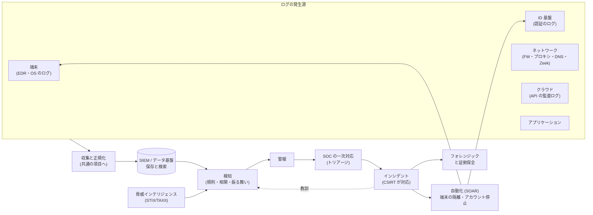

# 検知とインシデント対応 (Detection & Incident Response: Logging, SIEM, EDR, SOC/CSIRT, NIST SP 800-61 & Forensics)

## 概要 (Overview)

本ドキュメントは侵入を見つけ、調べ、封じ込め、元に戻すまでの仕組みを扱う。対象はログの収集、SIEM による相関分析、EDR/XDR による端末の検知、脅威インテリジェンスとハンティング、SOC と CSIRT の体制、インシデント対応の流れ (NIST SP 800-61)、フォレンジックと証拠保全、そして法令にもとづく報告である。[`perimeter-defense-zero-trust.md`](perimeter-defense-zero-trust.md) が扱った「通信を検査して止める」防御を突破された後の層にあたる。

中心テーゼは、**検知はデータの問題であり、対応は組織の手順の問題であって、どちらも事前に用意したものしか使えない**ということである。記録していないログは後から調べられない。時刻がそろっていないログは、出来事の順序を組み立てられない。誰が封じ込めを決めるのか、連絡にどの手段を使うのかを事前に決めていなければ、インシデントの最中に決めることになる。Mandiant の調査では、侵入から発見までの日数の中央値は 2024 年に 11 日、2025 年に 14 日だった。攻撃者はその間に権限を広げ、データを集め、痕跡を消そうとする。

NIST は 2025 年 4 月に SP 800-61 を改訂し (Rev. 3)、インシデント対応を独立した 4 段階の手順としてではなく、サイバーセキュリティのリスク管理全体 (CSF 2.0 の 6 つの機能) の一部として描き直した。旧版の時代のインシデントはまれで、範囲が狭く、1〜2 日で片付くことが多かった。現在のインシデントは頻繁で、長く続き、組織のあらゆる部分に及ぶ。分析深度は Level 3。

## 方法論 (Methodology)

- **一次資料**: インシデント対応は NIST SP 800-61 Rev. 3 (2025) と旧版の Rev. 2 (2012)、証拠の収集は RFC 3227 (Guidelines for Evidence Collection and Archiving) を使う。脅威情報の共有は OASIS の STIX/TAXII と FIRST の TLP を使う。
- **業界の統計は出どころと対象を明記する**: 侵入から発見までの日数や初期侵入の手口は、Mandiant (Google) の M-Trends のように、調査会社が自社で扱った案件をもとに集計した値である。業界全体の値ではないため、報告書の名前と対象の年を付ける。
- **法令は所管官庁の文書で確かめる**: 日本の個人情報保護法の報告義務は個人情報保護委員会の資料で確かめ、解説記事の値だけには頼らない。期限は改正されうるため、確認した日付を付ける。
- **担当範囲**: 通信の検査と遮断は [`perimeter-defense-zero-trust.md`](perimeter-defense-zero-trust.md)、時刻同期の仕組みは [`../../hardware/timekeeping/clocks-time-synchronization.md`](../../hardware/timekeeping/clocks-time-synchronization.md)、クラウドのログとメトリクスの基盤は [`../cloud/cloud-observability.md`](../cloud/cloud-observability.md)、変更の配布による障害の防ぎ方は [`../cloud/deployment-safety-progressive-delivery.md`](../cloud/deployment-safety-progressive-delivery.md) に委ねる。攻撃者の手口の分類 (ATT&CK) と攻撃の流れは、別の文書で扱う予定である。

## 発見事項 (Findings)

1. **調べられるのは、事前に記録したものだけである。** 認証のログ、端末のプロセスの起動、DNS の問い合わせ、プロキシの記録、クラウドの API 呼び出しの記録が残っていなければ、侵入の経路も範囲も分からない。保存期間が侵入から発見までの日数より短ければ、侵入の始まりのログはすでに消えている。ログの時刻がずれていれば、複数の機器の記録を 1 本の時系列に並べられない。
2. **SIEM の難しさは集めることより絞ることにある。** SIEM はさまざまな形式のログを共通の項目に正規化し、複数のログを組み合わせた規則 (相関) で警報を出す。取り込むログが増えるほど費用が増え、規則が増えるほど警報も増える。誤検知が多いと分析者は警報を処理しきれず、本物を見落とす ([`perimeter-defense-zero-trust.md`](perimeter-defense-zero-trust.md) の基準率の誤謬)。検知の規則をコードとして管理し、試験してから配布する考え方 (detection as code) と、ベンダーに依存しない規則の記述形式 (Sigma) が広まった。
3. **検知の重心はネットワークから端末へ移った。** 通信の暗号化が進んでネットワーク上の検査で中身が見えなくなり、社員は社外から働くようになった。EDR (Endpoint Detection and Response) は端末の中でプロセスの起動、ファイルの変更、ネットワーク接続、メモリの操作を記録し、振る舞いから攻撃を検知し、端末をネットワークから切り離すといった対応を遠隔で行う。EDR はカーネルに近い権限で動くため、それ自体の不具合や侵害の影響も大きい。2024 年 7 月 19 日の CrowdStrike の更新の不具合では、約 850 万台の Windows 端末が起動できなくなった。
4. **攻撃者にとって変えにくい特徴ほど、検知に使う価値が高い。** ファイルのハッシュ値や IP アドレスは、攻撃者がすぐに変えられる。ツールや手口 (TTP: Tactics, Techniques, and Procedures) は変えるのに手間がかかる。Bianco (2013) の「痛みのピラミッド (Pyramid of Pain)」はこの違いを階層で示し、手口にもとづく検知が攻撃者に最も大きな負担を強いると論じた。
5. **NIST SP 800-61 Rev. 3 は、インシデント対応をリスク管理全体の一部として描き直した。** 旧版 (Rev. 2) は準備、検知と分析、封じ込め・根絶・復旧、事後対応の 4 段階の循環を示していた。Rev. 3 は、旧版の時代にはインシデントがまれで範囲が狭く 1〜2 日で終わることが多かったと振り返り、CSF 2.0 の 6 つの機能 (統治、特定、防御、検知、対応、復旧) にもとづくモデルを示した。統治・特定・防御は事前の準備として常に行い、検知・対応・復旧で得た教訓を、改善としてすべての機能に戻す。
6. **封じ込めは速さと証拠と相手の反応の間の取引である。** 侵害された端末をすぐに切り離せば被害の広がりは止まるが、メモリ上の証拠が失われ、攻撃者に気づかれて別の経路に移られることがある。様子を見て範囲を調べてから一斉に封じ込めれば、根絶の確実性は上がるが、その間の被害は続く。ランサムウェアのように時間が被害を拡大させる場合は、速さが優先される。どちらを選ぶかは、インシデントの種類ごとに事前に決めておく。
7. **証拠は揮発しやすいものから集める。** RFC 3227 はレジスタとキャッシュ、経路表・ARP キャッシュ・プロセスの一覧・メモリ、一時ファイルシステム、ディスク、遠隔のログ、物理的な構成、記録媒体の順に集めるよう求めている。端末の電源を切るとメモリ上の情報 (実行中のプロセス、ネットワーク接続、ディスクに書かれないマルウェア) が失われる。集めた証拠は、誰がいつどこで集め、誰が保管し、いつ誰に渡したかを記録する (証拠保全の連鎖、chain of custody)。
8. **報告の期限は、調査が終わる前にやってくる。** 日本の個人情報保護法は2022 年 4 月の改正で、一定の漏えい等について個人情報保護委員会への報告と本人への通知を義務にした。速報は事態を知ってから速やかに (目安は 3〜5 日以内)、確報は原則 30 日以内 (不正の目的によるおそれがある場合は 60 日以内) である。EU の GDPR は監督機関への通知を 72 時間以内、米国 SEC は上場企業に重要なインシデントの開示を重要性の判断から 4 営業日以内に求めている。全容が分からない段階で、分かっている範囲を報告する準備が要る。

## アーキテクチャ (Architecture)

### 検知から対応までの流れ

凡例: 実線はデータと作業の流れ、点線は改善のための戻り。ハンティング (仮説にもとづく能動的な探索) は、警報を待たずに SIEM と EDR のデータを直接調べる別の入口である。

### インシデント対応のモデルの変化 (NIST SP 800-61)

| Rev. 2 (2012) の段階 | Rev. 3 (2025) の CSF 2.0 の機能との対応 (概略) | Rev. 3 での位置づけ |
|---|---|---|
| 準備 | 統治 (GV)、特定 (ID)、防御 (PR) | 事前の準備として常に行う活動 |
| 検知と分析 | 検知 (DE) | インシデント対応の活動 |
| 封じ込め・根絶・復旧 | 対応 (RS)、復旧 (RC) | インシデント対応の活動 |
| 事後対応 (教訓) | 特定 (ID) の改善 | すべての機能に教訓を戻す継続的な改善 |

Rev. 3 は旧版の段階と CSF 2.0 の機能の対応を表で示している (Rev. 3 の Table 1)。上の表はその概略である。旧版が「別のチームが行う別の活動」として描いた対応を、Rev. 3 は組織全体のリスク管理に組み込んだ。

### 体制と役割

| 体制 | 役割 | 主な相手 |
|---|---|---|
| SOC (Security Operations Center) | 警報の監視と一次対応、ハンティング | 社内の IT 部門、MSS/MDR 事業者 |
| CSIRT (Computer Security Incident Response Team) | インシデントの調査、対応の指揮、関係者との調整 | 経営、法務、広報、外部の CSIRT、捜査機関 |
| PSIRT (Product Security Incident Response Team) | 自社製品の脆弱性の受付と修正、公表 | 製品の利用者、脆弱性の発見者、調整機関 |
| MDR (Managed Detection and Response) | 監視と対応を外部の事業者が行うサービス | 契約した組織の SOC・CSIRT |
| 調整機関 (JPCERT/CC など) | 組織や国をまたぐ連絡と調整、注意喚起 | 各組織の CSIRT、ベンダー |

## 技術詳細 (Technical Details)

### 1. ログの収集

- **何を集めるか**: 優先度の高い発生源はID 基盤の認証のログ (成功と失敗、多要素認証、権限の変更)、端末のプロセスの起動とコマンドライン、DNS の問い合わせ、プロキシとファイアウォールの記録、クラウドの API 呼び出しの監査ログ、メールの送受信の記録である。Windows ではログオン (イベント ID 4624) やプロセスの作成 (4688) の監査を有効にし、標準の監査ログで足りない部分を Sysmon のような追加の記録で補うことが多い。既定の設定では記録されない項目が多いため、何を記録するかを決めて有効にする作業が要る。
- **時刻**: 複数の機器のログを 1 本の時系列に並べるには、すべての機器の時刻を同期させ、ログにタイムゾーンを含めて記録する必要がある ([`../../hardware/timekeeping/clocks-time-synchronization.md`](../../hardware/timekeeping/clocks-time-synchronization.md))。数秒のずれでも、どちらの出来事が先かを誤る。
- **保存期間と改ざん防止**: 侵入から発見までの日数の中央値が 2 週間前後で、長い案件は数か月に及ぶ。保存期間がそれより短いと、侵入の始まりを調べられない。攻撃者はログを消そうとするため、発生源の機器だけでなく、別の場所 (SIEM や書き換えできないストレージ) にすぐ送っておく。Windows の監査ログの消去はそれ自体がイベント (1102) として記録されるため、消去の記録を監視することも検知の手がかりになる。
- **費用の設計**: ログの量は膨大で、すべてを高速に検索できる場所に長期間置くと費用がかさむ。直近のログは高速な検索基盤に、古いログは安価なストレージに移し、必要なときに検索する、という段階を設けることが多い ([`../cloud/data-lakehouse-analytics.md`](../cloud/data-lakehouse-analytics.md))。

### 2. SIEM と相関分析

- **正規化**: 機器ごとに形式の違うログを、共通の項目 (時刻、送信元、宛先、利用者、操作、結果) に変換する。項目の定義をそろえる共通スキーマとして、Elastic Common Schema (ECS) や OCSF (Open Cybersecurity Schema Framework) がある。正規化がそろっていないと、同じ利用者の活動を複数のログにまたがって追えない。
- **相関**: 1 つのログだけでは判断できない出来事を、複数のログの組み合わせで捉える。たとえば「短時間に多数の認証の失敗のあと、同じアカウントで成功し、普段と違う国から管理者の操作がある」といった規則である。利用者や端末ごとの平常時の振る舞いを学習して外れを見つける UEBA (User and Entity Behavior Analytics) もある。
- **検知をコードとして扱う**: 検知の規則をバージョン管理し、過去のデータや攻撃の再現で試験してから配布する。Sigma はSIEM の製品に依存しない形式で検知の規則を書き、各製品の検索言語に変換するための記述形式である。規則に「何を検知するか」「どの手口に対応するか」「誤検知の典型」を書いておくと、警報を受けた分析者の判断が速くなる。
- **警報の運用**: 警報には重大度と確度を付け、確度の低い警報は単独では人に回さず、他の警報と組み合わさったときだけ上げる。誤検知が多い規則は、調整するか廃止する。警報の数を減らすことは、検知を弱めることではなく、本物の警報に分析者の時間を回すことである。

### 3. EDR、XDR、MDR

- **EDR の仕組み**: 端末にエージェントを入れ、OS のカーネルから得られる情報 (プロセスの起動と親子関係、ファイルとレジストリの変更、ネットワーク接続、メモリへの書き込み) を記録して送る。署名のない実行ファイル、Office のプロセスからのシェルの起動、認証情報を保持するプロセス (Windows の LSASS) のメモリの読み取りといった振る舞いを、既知の手口と照合して警報にする。対応として、端末をネットワークから隔離する、プロセスを止める、ファイルを隔離する、調査用のデータを取得する、といった操作を遠隔で行える。
- **XDR**: 端末だけでなく、メール、ID 基盤、ネットワーク、クラウドのデータを同じ基盤で相関させる製品の分類名である (標準の定義はない)。SIEM と重なる部分が大きく、違いはデータを製品の側で前提として結びつけるか、利用者が規則を書いて結びつけるかにある。
- **MDR**: EDR などの監視と初動の対応を、外部の事業者が 24 時間体制で行うサービスである。自前で SOC を持てない組織が使う。事業者が端末を隔離するなどの操作を行う権限の範囲と、夜間の連絡の手順を契約で決めておく必要がある。
- **エージェントの危うさ**: EDR はカーネルに近い権限で全端末に入り、ベンダーから頻繁に更新される。2024 年 7 月 19 日、CrowdStrike の Falcon の設定の更新に不具合があり、Microsoft の推計で約 850 万台の Windows 端末が起動できなくなった。検知の仕組みを全端末へ一斉に配ることの危うさは、[`../cloud/deployment-safety-progressive-delivery.md`](../cloud/deployment-safety-progressive-delivery.md) で扱う段階的な配布の問題そのものである。攻撃者の側も脆弱な署名付きドライバを持ち込んで EDR を止める手口 (BYOVD: Bring Your Own Vulnerable Driver) を使う。

### 4. 脅威インテリジェンスとハンティング

- **痛みのピラミッド** (Bianco 2013): 検知に使う特徴を、ハッシュ値、IP アドレス、ドメイン名、ネットワークや端末に残る痕跡、ツール、手口 (TTP) の順に積み上げ、上に行くほど攻撃者が変えるのに手間がかかると示した。ハッシュ値や IP アドレス (IoC: Indicator of Compromise) による検知は手軽だが、攻撃者はすぐに変えられる。手口による検知は作るのが難しいが、攻撃者は手口を変えるために作業のやり方そのものを変えなければならない。
- **共有の形式**: STIX (Structured Threat Information Expression) は攻撃者、手口、IoC、それらの関係を記述する形式で、TAXII はそれを交換するためのプロトコルである。どちらも OASIS が標準化している。情報をどこまで共有してよいかは TLP (Traffic Light Protocol) で示す。FIRST が定める TLP 2.0 (2022 年) は CLEAR、GREEN、AMBER、AMBER+STRICT、RED の段階を持つ。
- **ハンティング**: 警報を待たずに、「この手口で侵入されていたら、こういう痕跡が残るはずだ」という仮説を立て、SIEM と EDR のデータを調べる。見つかれば検知の規則にし、見つからなくても、そのデータで調べられることが確かめられる。ハンティングは、検知の規則が拾えていない部分を見つけ、規則を増やしていく作業でもある。

### 5. SOC と CSIRT

- **SOC の階層**: 警報を受けて一次的に判断する担当 (誤検知か、さらに調べるべきか)、詳しく調べて対応を判断する担当、ハンティングや検知の規則の開発を行う担当に分けることが多い。一次対応の多くは定型の確認作業であり、SOAR (Security Orchestration, Automation and Response) でプレイブックとして自動化できる。たとえば、警報が出たら関連するログを集め、IP アドレスの評判を調べ、確度が高ければ端末を隔離して担当者に知らせる、といった手順である。
- **CSIRT**: インシデントの対応を指揮し、技術的な調査だけでなく、経営への報告、法務の判断、広報、顧客や取引先への連絡、捜査機関や監督官庁への届け出を調整する。インシデントの最中に誰が何を決めるか (端末を止める、サービスを止める、身代金の要求にどう向き合うか) を、事前に決めておく。
- **外部との連携**: 組織をまたぐ連携の場として、国際的な CSIRT の団体である FIRST、日本の JPCERT/CC のような調整機関がある。同じ業界の組織が情報を共有する ISAC (Information Sharing and Analysis Center) もある。自社製品の脆弱性は PSIRT が受け付け、調整機関を通じて公表の時期を合わせる。

### 6. インシデント対応の流れ

- **準備**: 対応の計画と体制、連絡先の一覧、権限の割り当て、ログの収集、バックアップ、訓練 (机上演習) を整える。Rev. 3 では、これらは CSF 2.0 の統治・特定・防御の機能として、インシデントの有無にかかわらず常に行う活動である。電子メールやチャットが侵害されている可能性に備え、それとは別の連絡手段を用意しておく。
- **検知と分析**: 警報や外部からの通報を受けて、本当にインシデントか、どの範囲に及ぶか、どの程度深刻かを判断する。最初の段階では情報が足りないため、判断を記録し、分かったことに応じて見直す。重大度の判断が誰に知らせ、どの手順で対応するかを決める。
- **封じ込め**: 被害の広がりを止める。端末の隔離、アカウントの停止とセッションの無効化、外部の指令サーバとの通信の遮断、侵入に使われた入口 (VPN 装置など) の切り離しを行う。すぐに封じ込めるか、範囲を調べてから一斉に行うかは、インシデントの種類と被害の進み方で決める (発見事項 6)。
- **根絶と復旧**: 攻撃者が残したバックドアや追加のアカウントを取り除き、侵入の原因 (脆弱性、盗まれた認証情報) を解消する。認証情報は侵害されたアカウントだけでなく、攻撃者が触れた可能性のある範囲で再設定する。システムは侵害される前の状態だと確かめられたバックアップや、作り直したイメージから戻す。バックアップそのものが攻撃者に消されたり暗号化されたりしないよう、書き換えできない形や切り離した形で持っておく。
- **教訓と改善**: 何が起きたか、どこで気づけたはずか、何がうまくいかなかったかを、個人の責任を問わない形でまとめ、検知の規則、手順、設計の変更に反映する。Rev. 3 はこれを、すべての機能に戻る継続的な改善として位置づけている。

### 7. フォレンジックと証拠保全

- **揮発性の順序** (RFC 3227): 揮発しやすいものから集める。メモリには、実行中のプロセス、ネットワーク接続、復号された状態のデータ、ディスクに書かれないマルウェアが残っている。電源を切る前にメモリを取得し、Volatility のようなツールで解析する。
- **ディスクの保全**: ディスクは書き込み防止の装置を通して丸ごと複製し、複製のハッシュ値を記録して、以後の解析は複製に対して行う。ハッシュ値は、解析の途中で証拠が変わっていないことを示す根拠になる。
- **タイムライン**: ファイルの作成・変更の時刻、イベントログ、ブラウザの履歴、レジストリの記録などを 1 本の時系列にまとめ、攻撃者の行動を順に再構成する。攻撃者はファイルの時刻を書き換えることがあるため、複数の記録の食い違いからも推定する。
- **証拠保全の連鎖** (RFC 3227): 証拠をどこで、いつ、誰が見つけて集めたか、誰が扱い調べたか、誰がどの期間どのように保管したか、いつどのように引き渡したかを記録する。訴訟や捜査に使う可能性があるなら、この記録が証拠の信頼性を支える。
- **クラウドでの調査**: クラウドの仮想マシンはディスクのスナップショットで保全でき、コンテナやサーバレスの関数は短時間で消えるため、事後に端末そのものを調べることが難しい。その分、API 呼び出しの監査ログが主な証拠になる。監査ログの記録を有効にし、攻撃者が無効にできないよう別のアカウントに集めておくことが、クラウドでの調査の前提になる。

### 8. 報告と開示 (2026-10-18 時点で確認)

| 制度 | 対象 | 期限 |
|---|---|---|
| 個人情報保護法 (日本、2022 年 4 月から義務化) | 要配慮個人情報、財産的被害のおそれ、不正の目的によるおそれ、1,000 人を超える漏えい等 | 速報は速やかに (目安は知ってから 3〜5 日以内)、確報は原則 30 日以内 (不正の目的によるおそれがある事態は 60 日以内) |
| GDPR (EU) 第 33 条 | 個人データの侵害 | 監督機関へ、知ってから 72 時間以内 (遅れる場合は理由を添える) |
| SEC Form 8-K Item 1.05 (米国、2023 年 12 月から) | 上場企業の重要なサイバーセキュリティインシデント | 重要と判断してから 4 営業日以内 |

報告の期限は、調査が終わるのを待たずにやってくる。分かっていることと分かっていないことを区別して報告し、続報で補う手順を、事前に法務と決めておく。

## セキュリティ考察 (Security Considerations)

検知と対応の仕組みそのものも攻撃の対象になる。

| 攻撃・失敗 | 何が起きるか | 対策 |
|---|---|---|
| ログの消去と改ざん | 侵入の痕跡が消え、調査ができない | ログを発生源から別の場所へすぐ送る、書き換えできない保存、消去の記録の監視 |
| EDR の停止 (BYOVD など) | 端末の監視が止まり、攻撃が見えなくなる | 脆弱なドライバの読み込みの禁止、エージェントの停止の検知と警報 |
| SIEM・EDR の管理画面の乗っ取り | 攻撃者が警報を消し、全端末に命令を配れる | 管理者権限の分離、フィッシングに強い認証、管理操作の監査 |
| 警報の洪水 | 大量の偽の警報で、本物を埋もれさせる | 警報の集約と優先度付け、確度の低い警報の自動処理 |
| 対応の連絡の傍受 | 侵害されたメールやチャットで対応の計画が攻撃者に漏れる | 事前に用意した別の連絡手段 |
| 検知エージェントの不具合 | 全端末への一斉の更新が業務を止める | 段階的な配布、更新の時期を組織が選べる設定 |
| テレメトリの過剰な収集 | 監視のデータそのものが個人情報の塊になる | 収集の目的と範囲の明文化、アクセスの制限と保存期間 |

- 攻撃者は検知の仕組みを先に狙う。侵入した攻撃者はEDR を止め、ログを消し、監査の設定を無効にしてから本来の目的に進むことがある。これらの操作自体を検知の対象にしておけば、攻撃の早い段階で気づける。「監視が止まったこと」を監視する仕組みが要る。
- 検知と対応のツールは高い権限を持つ。EDR、SIEM、SOAR は全端末への命令やアカウントの停止ができる。これらが乗っ取られれば、攻撃者は防御の側の道具で組織全体を操作できる。管理者のアカウントを日常の業務と分け、フィッシングに強い認証を使い、管理操作を別の場所に記録する。
- 証拠の扱いには法的な制約がある。社員の端末やメールを調べるときは、就業規則や個人情報保護の規定に沿う必要がある。訴訟の可能性があれば、関係する記録を消さずに保全する義務 (リーガルホールド) が生じる。調査の手順を法務と事前に決めておくことは、証拠の信頼性を保つためにも必要である。

## 結論 (Conclusions)

- 検知はデータの問題である。事前に記録し、時刻をそろえ、侵入から発見までの日数より長く保存したログだけが、調査の材料になる。SIEM は集めることより絞ることが難しく、検知の規則をコードとして試験し、警報の量を分析者が扱える範囲に保つことが要る。
- 通信の暗号化と働き方の変化で、検知の重心は端末に移った。EDR は端末の振る舞いを記録して対応まで行うが、高い権限で全端末に入ることの危うさを持つ。攻撃者にとって変えにくい手口にもとづく検知ほど、価値が高い。
- インシデント対応はNIST SP 800-61 Rev. 3 で、独立した 4 段階の手順からリスク管理全体の一部へと描き直された。準備は常に行う活動であり、封じ込めは速さと証拠と相手の反応の間の判断であり、教訓はすべての活動に戻す。
- 証拠は揮発しやすいものから集め、扱いの記録を残す。報告の期限は調査の完了を待たないため、分かっている範囲で報告する手順を事前に用意しておく。

### 次の接続先 (Related Topics)

- [`perimeter-defense-zero-trust.md`](perimeter-defense-zero-trust.md) — 通信を検査し止める防御と、IDS の基準率の誤謬。
- [`../../hardware/timekeeping/clocks-time-synchronization.md`](../../hardware/timekeeping/clocks-time-synchronization.md) — ログの時系列を支える時刻同期。
- [`../cloud/cloud-observability.md`](../cloud/cloud-observability.md) — クラウドのログ、メトリクス、トレースの基盤。
- [`../cloud/deployment-safety-progressive-delivery.md`](../cloud/deployment-safety-progressive-delivery.md) — 検知エージェントや規則の一斉配布による障害と、段階的な配布。
- [`../cloud/data-lakehouse-analytics.md`](../cloud/data-lakehouse-analytics.md) — 大量のログを安価に保存して検索する基盤。
- [`../networking/vpn-tunneling.md`](../networking/vpn-tunneling.md) — 侵入の入口になる VPN 装置と、侵害を前提にした調査。

## 参考文献 (References)

**一次資料 (標準・RFC)**

- Nelson, A., Rekhi, S., Souppaya, M., & Scarfone, K. (2025). *Incident Response Recommendations and Considerations for Cybersecurity Risk Management: A CSF 2.0 Community Profile*. NIST Special Publication 800-61 Rev. 3. https://doi.org/10.6028/NIST.SP.800-61r3 — CSF 2.0 の機能にもとづくライフサイクルのモデル、旧版の段階との対応表。
- Cichonski, P., Millar, T., Grance, T., & Scarfone, K. (2012). *Computer Security Incident Handling Guide*. NIST Special Publication 800-61 Rev. 2. https://doi.org/10.6028/NIST.SP.800-61r2 — 4 段階のライフサイクル (Rev. 3 で置き換え)。
- Brezinski, D., & Killalea, T. (2002). Guidelines for Evidence Collection and Archiving. *RFC 3227* (BCP 55). — 揮発性の順序と証拠保全の連鎖。
- OASIS. (2021). *STIX Version 2.1* / *TAXII Version 2.1*. OASIS Standard.
- FIRST. (2022). *Traffic Light Protocol (TLP) Version 2.0*. https://www.first.org/tlp/
- Bianco, D. J. (2013). [The Pyramid of Pain](https://detect-respond.blogspot.com/2013/03/the-pyramid-of-pain.html) — Accessed: 2026-10-18。検知に使う特徴と攻撃者の負担の階層 (著者のブログ。業界で広く参照されている概念の原典として挙げる)。
- [Sigma: Generic Signature Format for SIEM Systems](https://github.com/SigmaHQ/sigma) — Accessed: 2026-10-18。

**統計・事例・法令 (時期で変わる値)**

- [M-Trends 2026: Data, Insights, and Strategies From the Frontlines, Google Cloud (Mandiant)](https://cloud.google.com/blog/topics/threat-intelligence/m-trends-2026) — Accessed: 2026-10-18。2025 年の調査で侵入から発見までの日数の中央値 14 日、初期侵入の手口。
- [M-Trends 2025, Google Cloud (Mandiant)](https://cloud.google.com/blog/topics/threat-intelligence/m-trends-2025/) — Accessed: 2026-10-18。2024 年の調査で中央値 11 日。
- [Helping our customers through the CrowdStrike outage, Microsoft (2024-07-20)](https://blogs.microsoft.com/blog/2024/07/20/helping-our-customers-through-the-crowdstrike-outage/) — Accessed: 2026-10-18。影響を受けた Windows 端末の推計 約 850 万台。
- [漏えい等の対応とお役立ち資料, 個人情報保護委員会](https://www.ppc.go.jp/personalinfo/legal/leakAction/) — Accessed: 2026-10-18。報告対象の事態、速報と確報の期限。
- [Regulation (EU) 2016/679 (General Data Protection Regulation), Article 33](https://eur-lex.europa.eu/eli/reg/2016/679/oj) — Accessed: 2026-10-18。監督機関への 72 時間以内の通知。
- [SEC Adopts Rules on Cybersecurity Risk Management, Strategy, Governance, and Incident Disclosure by Public Companies, U.S. SEC (2023-07-26)](https://www.sec.gov/newsroom/press-releases/2023-139) — Accessed: 2026-10-18。Form 8-K Item 1.05、重要性の判断から 4 営業日以内の開示。
