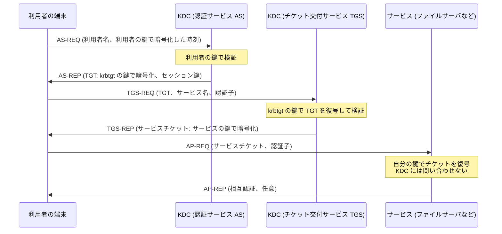
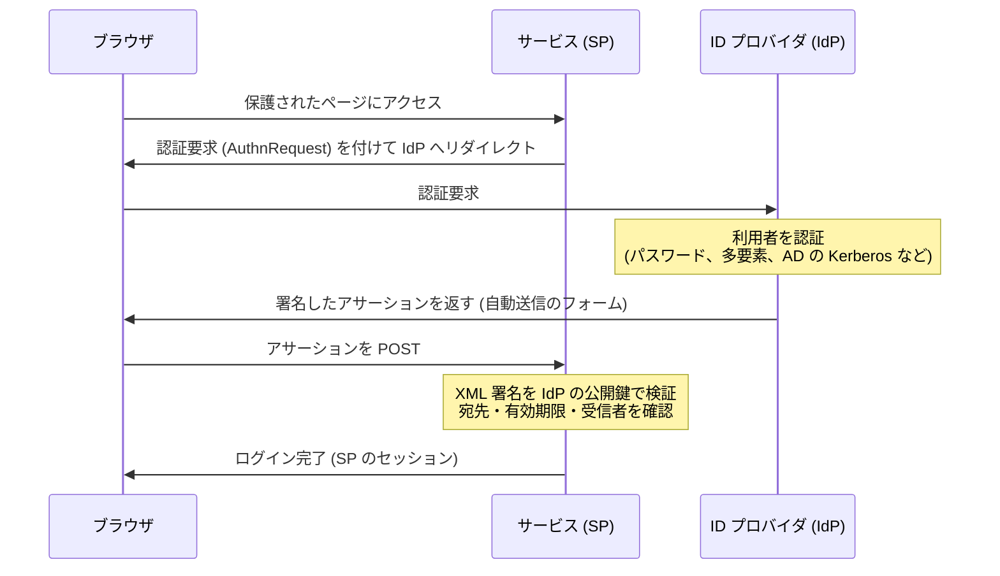
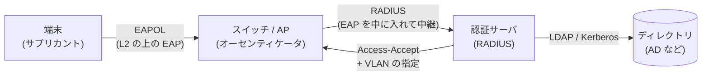

# 企業の認証基盤 (Enterprise Authentication: Kerberos, NTLM, LDAP & Active Directory, SAML, 802.1X & RADIUS)

## 概要 (Overview)

本ドキュメントは組織の中で「この人は誰か」「この端末は接続してよいか」を判断する認証基盤を扱う。対象は Kerberos と NTLM、ディレクトリを読み書きする LDAP、それらを束ねた Active Directory (AD)、組織をまたいでシングルサインオンを実現する SAML、ネットワークへの接続を認証する 802.1X・EAP・RADIUS である。Web とモバイルの時代の認証 (OAuth、OpenID Connect、パスキー) は [`../apis/authentication-tokens-specification.md`](../apis/authentication-tokens-specification.md) と [`../apis/webauthn-passkeys-specification.md`](../apis/webauthn-passkeys-specification.md) が扱っており、本書はその前の世代から今も組織の中心で動いている仕組みを受け持つ。

中心テーゼは、**企業の認証基盤は「1 か所で認証し、その結果を多くの場所で信じる」ために作られ、その信頼の起点を握られると組織全体が攻撃者のものになる**ということである。Kerberos では、鍵配布センター (KDC) が発行したチケットを、各サーバがパスワードを確かめ直さずに信じる。AD では、ドメインコントローラが組織のすべての利用者と端末の鍵を持つ。SAML では、ID プロバイダ (IdP) が署名したアサーションを、各サービスが信じる。どれも利便性と一元管理の仕組みとして優れているが、KDC の鍵 (krbtgt)、ドメイン管理者の権限、IdP の署名鍵を奪われれば、攻撃者は誰にでもなりすませる。

もう 1 つの論点は古い暗号と古い方式の長い後始末である。NTLM はパスワードのハッシュ値そのものが認証に使えてしまう設計で、Microsoft は 2024 年に NTLM 全体を非推奨にした。Kerberos の RC4 についても、Microsoft は 2026 年の更新プログラムで KDC の既定の暗号から段階的に外している。RADIUS は 1990 年代の MD5 にもとづく応答の認証を使い続け、2024 年に MD5 の衝突を使った応答の偽造 (Blast-RADIUS) が実証された。分析深度は Level 3。

## 方法論 (Methodology)

- **一次資料**: Kerberos は原理の原典 (Needham & Schroeder 1978) と仕様 (RFC 4120)、LDAP は RFC 4511、SAML は OASIS の SAML 2.0 仕様、EAP は RFC 3748、RADIUS は RFC 2865 を使う。攻撃は査読付き論文 (SAML の署名の回避は Somorovsky et al. 2012、Blast-RADIUS は Goldberg et al. 2024) と、発見者の技術文書 (AD CS の悪用は Schroeder & Christensen 2021) を使う。
- **ベンダーの予定は時期と出どころを付ける**: Microsoft による NTLM と RC4 の廃止の予定は、Microsoft の発表と報道で確かめ、確認した時点を明記する。予定は変わりうる。
- **事件の分析は公的な報告を使う**: 2023 年の Storm-0558 の事件は米国の Cyber Safety Review Board (CSRB) の 2024 年 3 月の報告 (2024 年 4 月 2 日公表) の原文で確かめる。
- **攻撃の手順は扱わない**: 本書は認証の仕組みと、どこを奪われると何が起きるか、どう守るかを説明する。攻撃のツールの使い方は扱わない (AGENTS.md の Security & Ethics)。
- **担当範囲**: L2 での接続の制御は [`../networking/ethernet-lan-switching.md`](../networking/ethernet-lan-switching.md)、Wi-Fi の暗号化は [`../../hardware/peripherals/wifi-architecture.md`](../../hardware/peripherals/wifi-architecture.md)、クラウドの IAM は [`../cloud/cloud-iam-authorization.md`](../cloud/cloud-iam-authorization.md)、ゼロトラストの考え方は [`perimeter-defense-zero-trust.md`](perimeter-defense-zero-trust.md)、侵入後の横展開の全体像は [`attack-lifecycle.md`](attack-lifecycle.md) に委ねる。

## 発見事項 (Findings)

1. **Kerberos はパスワードをネットワークに流さずに、一度の認証で多くのサービスを使えるようにした。** 利用者は最初に KDC に認証してチケット交付チケット (TGT) を受け取り、以後は TGT を示してサービスごとのチケットを受け取る。各サービスは自分の鍵で暗号化されたチケットを復号できれば、KDC が認証した利用者だと信じる。原理は Needham & Schroeder (1978) の共通鍵による認証プロトコルにさかのぼり、時刻にもとづく有効期限で再送攻撃を防ぐ。
2. **Kerberos の安全性は鍵の強さと、KDC の鍵を誰も持っていないことに依存する。** サービスのチケットはサービスのアカウントの鍵 (パスワードから作った鍵) で暗号化されるため、誰でも取得したチケットを持ち帰って、パスワードをオフラインで総当たりできる (Kerberoasting)。KDC の鍵 (AD の krbtgt アカウントの鍵) を奪われると、攻撃者は任意の利用者の TGT を自分で作れる (ゴールデンチケット)。krbtgt の鍵は侵害が疑われたら 2 回変更する必要がある。
3. **NTLM は、パスワードのハッシュ値がそのまま認証の鍵になる。** NTLM のチャレンジ・レスポンスでは、パスワードそのものではなくハッシュ値から応答を計算するため、ハッシュ値を盗めばパスワードを知らなくても認証できる (pass-the-hash)。応答を別のサーバに中継する攻撃 (NTLM リレー) にも弱い。Microsoft は 2024 年 6 月に NTLM のすべての版を非推奨にし、NTLMv1 は Windows 11 24H2 と Windows Server 2025 から削除した。
4. **AD の攻撃は権限の関係をたどるグラフの探索になった。** AD では、利用者、グループ、端末、権限の委任、証明書のテンプレートが複雑に結びつき、管理者が把握していない経路で一般の利用者がドメイン管理者に到達できることがある。2016 年に公開された BloodHound は、この関係をグラフにして最短の攻撃経路を探す道具で、攻撃者にも防御者にも使われている。AD CS (証明書サービス) の設定の不備を突くと、一般の利用者が他人の名前で証明書を取得し、それで認証できる (Schroeder & Christensen 2021)。
5. **SAML の安全性はXML 署名を正しく検証することにかかっている。** SAML では、IdP が利用者の認証結果をアサーションとして XML で書き、署名して、サービス (SP) に渡す。XML 署名は文書の一部だけに署名できるため、署名された部分を残したまま、検証の対象と処理の対象を別の要素にすり替える攻撃 (XML 署名ラッピング) が成り立つ。Somorovsky et al. (2012) は、調べた SAML の実装 14 のうち 11 がこの攻撃に弱いことを示した。
6. **IdP やトークンの署名鍵は組織をまたいで影響する最大の資産である。** IdP の署名鍵を盗まれると、攻撃者は任意の利用者のアサーションを作り、連携しているすべてのサービスに入れる (Golden SAML)。2023 年の Storm-0558 の事件では、攻撃者が Microsoft の消費者向けアカウントの古い署名鍵を手に入れ、トークンの検証の不備と組み合わせて、企業向けの Exchange Online のメールにアクセスした。CSRB は 2024 年 3 月の報告で、一連の防げたはずの失敗の連鎖だったと結論づけ、鍵がどのように盗まれたかは特定できていないとした。
7. **802.1X はネットワークへの接続を、つないだ場所ではなく利用者と端末で許可する。** 端末 (サプリカント) がスイッチやアクセスポイント (オーセンティケータ) につながると、EAP のやり取りで認証サーバ (RADIUS) に認証され、認証が済むまで通信は通らない。認証の結果に応じて VLAN を割り当てることもできる。RADIUS は UDP の上で MD5 にもとづく応答の認証を使い続けており、Goldberg et al. (2024) は、MD5 の選択プレフィックス衝突で拒否の応答を許可の応答に偽造する攻撃 (Blast-RADIUS、CVE-2024-3596) を実証した。

## アーキテクチャ (Architecture)

### Kerberos のやり取り

要点: サービスは KDC に問い合わせず、自分の鍵で復号できたことを根拠に利用者を信じる。したがって、krbtgt の鍵を持つ者は任意の TGT を、サービスの鍵を持つ者はそのサービスの任意のチケットを作れる。認証子に時刻を含めるため、端末とサーバの時刻のずれが許容範囲 (既定で 5 分) を超えると認証に失敗する ([`../../hardware/timekeeping/clocks-time-synchronization.md`](../../hardware/timekeeping/clocks-time-synchronization.md))。

### SAML によるシングルサインオン

アサーションはブラウザを経由して運ばれるため、SP は XML 署名、宛先 (Audience)、有効期限、要求との対応 (InResponseTo) をすべて検証しなければならない。

### 802.1X の構成

オーセンティケータは EAP の中身を理解せずに中継し、認証の判断は RADIUS サーバが行う。EAP-TLS では、端末と RADIUS サーバが TLS で互いの証明書を確かめる。

### 方式の比較

| 方式 | 何を証明するか | 信頼の起点 | 典型的な弱点 |
|---|---|---|---|
| Kerberos | KDC が利用者を認証したこと | KDC の鍵 (krbtgt) | 弱いサービスアカウントのパスワード、RC4、krbtgt の鍵の窃取、時刻のずれ |
| NTLM | 利用者がパスワードのハッシュ値を知っていること | パスワードのハッシュ値そのもの | pass-the-hash、リレー |
| LDAP の bind | 利用者がディレクトリのパスワードを知っていること | ディレクトリ | 平文の simple bind、署名のない通信 |
| SAML | IdP が利用者を認証したこと | IdP の署名鍵 | 署名の検証の不備 (ラッピング)、署名鍵の窃取 |
| 802.1X (EAP-TLS) | 端末が組織の証明書を持つこと | 組織の認証局 | 証明書の管理の手間、RADIUS の通信の保護 |
| 802.1X (PEAP) | 利用者がパスワードを知っていること | RADIUS サーバの証明書の検証 | 端末が RADIUS サーバの証明書を検証しないと偽のサーバに認証情報を渡す |

## 技術詳細 (Technical Details)

### 1. Kerberos

- **成り立ち**: MIT の Project Athena で開発され (Neuman & Ts'o 1994)、現行の仕様は RFC 4120 (Kerberos V5) である。原理は Needham & Schroeder (1978) の共通鍵のプロトコルで、信頼できる第三者 (KDC) が、互いに鍵を共有していない 2 者のためにセッション鍵を配る。Windows の AD は 2000 年から Kerberos を標準の認証方式にしている。
- **チケット**: TGT は krbtgt (KDC 自身のアカウント) の鍵で、サービスチケットはサービスのアカウントの鍵で暗号化される。チケットの中には利用者の名前、セッション鍵、有効期限が入り、AD では利用者のグループの所属を表す PAC (Privilege Attribute Certificate) も入る。サービスは PAC を見てアクセスを判断する。
- **事前認証**: 利用者は最初の要求で、自分の鍵で暗号化した時刻を送る (事前認証)。事前認証を無効にしたアカウントは、誰でもそのアカウント用の応答を取得でき、応答の暗号文からパスワードをオフラインで総当たりされる (AS-REP roasting)。
- **Kerberoasting**: AD のどの利用者も任意のサービスのチケットを要求できる。チケットはサービスのアカウントの鍵で暗号化されているため、取得したチケットを持ち帰れば、サービスのアカウントのパスワードをオフラインで総当たりできる。人が設定した短いパスワードのサービスアカウントは破られやすい。対策はサービスアカウントに長い乱数のパスワードを使うか、パスワードを自動で管理するアカウント (gMSA) を使い、AES の暗号だけを許すことである。チケットの要求の急増は検知の手がかりになる。
- **ゴールデンチケットとシルバーチケット**: krbtgt の鍵を持つ攻撃者は任意の利用者、任意のグループの所属を書いた TGT を作れる (ゴールデンチケット)。サービスの鍵を持つ攻撃者はそのサービスの任意のチケットを作れる (シルバーチケット)。krbtgt の鍵はドメインコントローラを侵害されたり、ディレクトリの複製の権限を悪用して鍵を取り出されたり (DCSync) すると盗まれる。鍵を 1 回変えても、直前の鍵で作られたチケットはしばらく有効なため、侵害の後は間を空けて 2 回変える。
- **委任**: 利用者の代わりに別のサービスにアクセスする必要があるサービス (Web サーバが利用者としてデータベースにアクセスする) のために、Kerberos は委任の仕組みを持つ。制約のない委任を許したサーバは、接続してきた利用者の TGT を保持するため、そのサーバを侵害されると管理者の TGT まで盗まれる。委任の範囲を特定のサービスに限る (制約付きの委任) 設定にする。
- **暗号の移行**: 古い AD との互換のために残っていた RC4 の暗号は、Kerberoasting を容易にする。Microsoft は 2025 年 12 月に、2026 年半ばまでにドメインコントローラが前提とする暗号の種類の既定を変える方針を示した。KB5073381 によれば、2026 年 1 月の更新で RC4 の使用を記録する監査のイベントが加わり、2026 年 4 月の更新で、暗号の種類を明示していないアカウントに対する KDC の既定が AES-SHA1 だけになった (この段階ではレジストリで元に戻せる)。2026 年 7 月の更新で強制の段階に移り、元に戻す設定はなくなるとされた。7 月の更新で強制が始まったことは第三者の報告では確認できたが、Microsoft の文書では確認できなかった (2026-11-23 時点)。RC4 に依存する古いシステムを事前に洗い出しておく必要がある。

### 2. NTLM

- **仕組み**: サーバが乱数 (チャレンジ) を送り、クライアントはパスワードのハッシュ値を鍵にしてチャレンジから応答を計算して返す。ドメインの環境では、サーバは応答をドメインコントローラに送って確かめてもらう。
- **pass-the-hash**: 応答の計算にはパスワードのハッシュ値しか使わないため、端末のメモリなどからハッシュ値を盗めば、パスワードを知らなくても認証できる。管理者が多数の端末に同じパスワードでログインしていると、1 台から盗んだハッシュ値で他の端末にも入れる。ローカルの管理者のパスワードを端末ごとに変える仕組み (LAPS) は、この横展開を防ぐ。
- **NTLM リレー**: NTLM の応答はどのサーバに向けたものかを強く結びつけていない。攻撃者は被害者の端末に自分への認証を起こさせ、その応答をそのまま別のサーバに中継して、被害者として認証できる。SMB 署名、LDAP 署名とチャネルバインディング、HTTP の拡張保護 (EPA) が対策である。
- **廃止の動き**: Microsoft は 2024 年 6 月、LANMAN、NTLMv1、NTLMv2 を含む NTLM のすべての版を非推奨にし、アプリケーションは Kerberos を優先する Negotiate を使うよう求めた。NTLMv1 は Windows 11 24H2 と Windows Server 2025 から削除された。NTLM は Kerberos が使えない場面 (IP アドレスでの接続、ドメインに参加していない端末) の代わりとして広く残っており、移行は、監査のログで NTLM が使われている場所を把握することから始める。

### 3. LDAP と Active Directory

- **LDAP** (RFC 4511): ディレクトリ (利用者、グループ、端末の情報を木構造で持つデータベース) を検索し、更新するためのプロトコルである。項目は識別名 (DN、`CN=Alice,OU=Sales,DC=example,DC=com` のような形) で指定する。接続して利用者として認証する操作を bind と呼ぶ。パスワードを送る simple bind は、TLS (LDAPS か StartTLS) で通信を守らないとパスワードが平文で流れる。アプリケーションが LDAP の検索フィルタを利用者の入力から組み立てると、LDAP インジェクションが起きる ([`web-application-vulnerabilities.md`](web-application-vulnerabilities.md))。
- **AD の構成**: AD はLDAP によるディレクトリ、Kerberos と NTLM による認証、DNS、グループポリシー (端末の設定の一括配布) を組み合わせた Windows の認証基盤である。ドメインコントローラがディレクトリの複製を持ち、ドメインは信頼関係で結ばれてフォレストを作る。グループポリシーで全端末に設定やスクリプトを配れるため、ドメインの管理者権限は全端末の管理者権限に等しい。
- **攻撃経路のグラフ**: 利用者 A が グループ B のメンバーで、グループ B が端末 C の管理者で、端末 C にドメイン管理者 D がログインしている、という関係をたどれば、A から D の認証情報に到達できる。BloodHound はこうした関係をグラフに集めて最短経路を求める。防御側も同じ道具で、意図しない経路を見つけて断てる。
- **AD CS の悪用** (Schroeder & Christensen 2021): AD の証明書サービスは証明書による認証 (スマートカードのログオンなど) を可能にする。証明書のテンプレートで、要求者が証明書の名前 (誰の証明書か) を自分で指定できる設定になっていると、一般の利用者がドメイン管理者の名前で証明書を取得し、その証明書で Kerberos の認証ができる。報告者はこうした設定の不備を ESC1 から ESC8 として分類した。証明書は有効期限まで使えるため、パスワードを変えても攻撃者の認証は止まらない。
- **管理の階層化**: ドメイン管理者のアカウントで一般の端末にログインすると、その端末のメモリに認証情報が残り、端末を侵害されれば盗まれる。管理者の権限を、ドメインコントローラなどの中核、サーバ、一般の端末の階層に分け、上の階層の資格情報を下の階層の端末で使わない (Microsoft の階層モデル、現在の Enterprise Access Model) のが基本の対策である。管理作業は専用の端末 (PAW: Privileged Access Workstation) から行う。
- **クラウドとの連携**: 多くの組織はオンプレミスの AD を Microsoft Entra ID (2023 年に Azure AD から改称) などのクラウドの ID 基盤と同期し、クラウドのサービスへのシングルサインオンに使っている。同期の仕組みやフェデレーションのサーバはオンプレミスとクラウドの両方への権限を持つため、どちらかの侵害がもう一方に広がる経路になる。

### 4. SAML

- **構成** (OASIS SAML 2.0、2005 年): IdP は利用者を認証し、「この利用者を、いつ、どの方法で認証した」「この利用者の属性は」というアサーションを XML で書いて署名する。SP は IdP の公開鍵を事前に登録しておき、ブラウザ経由で届いたアサーションの署名を検証して、利用者をログインさせる。利用者が SP から始める流れ (SP-initiated) と、IdP のポータルから始める流れ (IdP-initiated) がある。
- **検証すべき項目**: 署名の正しさに加えて、アサーションの宛先 (Audience) が自分であること、有効期限内であること、受信者の URL、自分が送った要求への応答であること (InResponseTo)、同じアサーションを二度受け付けないこと、を確かめる。IdP-initiated の流れは要求との対応がないため、再送や他のサービス向けのアサーションの流用に注意が要る。
- **XML 署名ラッピング** (Somorovsky et al. 2012): XML 署名は文書の中の ID で指定した要素に署名する。署名の検証のコードと、アサーションの内容を読むコードが別々に要素を探すと、攻撃者は署名された正規の要素を文書の別の場所に移し、読まれる場所に偽の要素を置ける。検証は通り、処理は偽の要素に対して行われる。対策は署名の検証で確かめた要素そのものだけを処理に使うこと、XML のスキーマを厳格に検証することである。XML の正規化やコメントの扱いの違いによる回避も、実装で繰り返し見つかっている。
- **Golden SAML**: IdP (AD FS など) のトークン署名の秘密鍵を盗んだ攻撃者は任意の利用者、任意の属性のアサーションを作り、連携しているすべての SP に入れる。多要素認証は IdP での認証の段階で行われるため、偽造したアサーションには効かない。2020 年に発覚した SolarWinds の事件で使われた手口の 1 つとして知られる。署名鍵をハードウェア (HSM) に置き、IdP のサーバを最上位の資産として管理する。
- **SAML と OpenID Connect**: 新しいサービスでは、JSON と JWT を使う OpenID Connect が主流になりつつある。ただし、企業向けの SaaS のシングルサインオンでは SAML が今も広く使われている。どちらも「IdP の署名を信じる」構造は同じで、署名鍵の保護と検証の正しさが要点である ([`../apis/authentication-tokens-specification.md`](../apis/authentication-tokens-specification.md))。利用者のアカウントの作成と削除を IdP からサービスへ自動で反映する仕組みとして SCIM (RFC 7643・RFC 7644) があり、退職者のアカウントが SaaS に残る問題を減らす。

### 5. トークンの署名鍵の管理と Storm-0558

- **事件の概要**: 2023 年、攻撃者 (Microsoft は Storm-0558 と呼ぶ) は Microsoft の消費者向けアカウント (MSA) のトークン署名鍵を手に入れ、その鍵で企業向けのトークンを偽造して、米国政府機関などの Exchange Online のメールにアクセスした。消費者向けの鍵で企業向けのトークンが受け付けられたのは、トークンの検証の不備による。
- **CSRB の指摘** (2024 年 3 月): 盗まれたのは 2016 年に作られた鍵で、2021 年以降も鍵の交換を続けていれば 2023 年には使えなくなっていた。消費者向けのシステムの鍵の交換は手作業で行われていたが、大規模な障害のあと 2021 年に止められていた。鍵が古くなったことを知らせる仕組みや、自社の生成方式に合わない偽造トークンを検知する仕組みがあれば防げたとし、鍵がどのように盗まれたかは特定できていないとした。
- **教訓**: 署名鍵は定期的に自動で交換し、用途 (消費者向けと企業向け) ごとに分け、検証の側でも発行元と用途を厳格に確かめる。署名鍵の侵害は多要素認証もパスワードも関係なく、あらゆる利用者になりすませる最悪の事態である。

### 6. 802.1X、EAP、RADIUS

- **役割の分担**: 端末 (サプリカント) はスイッチやアクセスポイント (オーセンティケータ) に EAPOL (L2 の上の EAP) で認証情報を送る。オーセンティケータは EAP の中身を RADIUS に入れて認証サーバに中継し、許可の応答 (Access-Accept) を受けたらポートを開く。応答に VLAN の番号を含めて、利用者や端末の種類ごとに接続先のネットワークを分けることもできる。有線のポートの制御の位置づけは [`../networking/ethernet-lan-switching.md`](../networking/ethernet-lan-switching.md)、Wi-Fi の WPA2/WPA3-Enterprise は [`../../hardware/peripherals/wifi-architecture.md`](../../hardware/peripherals/wifi-architecture.md) で扱う。
- **EAP の方式**: EAP (RFC 3748) は認証方式を入れる枠組みで、中身の方式を選べる。EAP-TLS (RFC 5216、TLS 1.3 は RFC 9190) は端末と RADIUS サーバが互いに証明書で認証し、パスワードを使わないため最も強い。PEAP や EAP-TTLS はRADIUS サーバの証明書で TLS のトンネルを作り、その中で利用者のパスワードを使う。端末が RADIUS サーバの証明書を正しく検証しないと、攻撃者の偽のアクセスポイントと偽の RADIUS サーバに接続して、パスワードの応答 (MS-CHAPv2) を渡してしまう。MS-CHAPv2 の応答はオフラインで解読できる ([`../networking/vpn-tunneling.md`](../networking/vpn-tunneling.md) の PPTP と同じ弱点)。
- **MAC 認証バイパス**: 802.1X に対応しないプリンタや IoT 機器は、MAC アドレスを ID として RADIUS に問い合わせて許可する (MAB)。MAC アドレスは偽装できるため、許可した機器の MAC アドレスを名乗れば接続できる。MAB の機器は専用の VLAN に隔離し、通信先を制限する。
- **RADIUS の弱さ** (RFC 2865): RADIUS は UDP で動き、クライアント (スイッチなど) とサーバで共有した秘密鍵と MD5 で応答を認証する。パスワードの属性も MD5 にもとづく方式で隠すだけで、通信全体は暗号化されない。Blast-RADIUS (Goldberg et al. 2024、CVE-2024-3596) は、クライアントとサーバの間にいる攻撃者が、MD5 の選択プレフィックス衝突を計算して、拒否の応答 (Access-Reject) を許可の応答 (Access-Accept) に偽造できることを示した。共有の秘密鍵も利用者のパスワードも知る必要がない。短期の対策はすべての要求と応答に Message-Authenticator 属性 (HMAC-MD5) を必須にし、応答の先頭に置くことで、長期の対策は RADIUS を TLS か DTLS の中で動かすことである (IETF で標準化が進められている)。

## セキュリティ考察 (Security Considerations)

| 攻撃 | 何を悪用するか | 主な防御 |
|---|---|---|
| Kerberoasting・AS-REP roasting | サービスアカウントの弱いパスワード、事前認証の無効化 | 長い乱数のパスワード、gMSA、AES のみ許可、事前認証を必須に |
| ゴールデンチケット | krbtgt の鍵の窃取 (DCSync、ドメインコントローラの侵害) | 複製の権限の厳格な管理、侵害時の krbtgt の 2 回の変更、異常なチケットの検知 |
| pass-the-hash・NTLM リレー | NTLM の設計 | NTLM の削減、SMB/LDAP の署名とチャネルバインディング、LAPS |
| 攻撃経路のグラフの悪用 | 意図しない権限の連鎖 | 経路の定期的な分析、管理の階層化、PAW |
| AD CS の悪用 | 証明書テンプレートの設定の不備 | テンプレートの監査、名前の指定を許さない、証明書の発行の監視 |
| XML 署名ラッピング | SAML の検証の実装の不備 | 検証した要素だけを処理、実績のあるライブラリ、スキーマの検証 |
| Golden SAML・トークンの偽造 | IdP やトークンの署名鍵の窃取 | 署名鍵の HSM での保管、自動の定期交換、用途ごとの鍵の分離、偽造トークンの検知 |
| 偽の RADIUS サーバ | 端末が RADIUS サーバの証明書を検証しない | 証明書の検証を必須にする設定の配布、EAP-TLS |
| Blast-RADIUS | RADIUS/UDP の MD5 による応答の認証 | Message-Authenticator の必須化、RADIUS over TLS、管理ネットワークでの隔離 |

- 認証基盤は最上位の資産として扱う。ドメインコントローラ、IdP、AD CS、RADIUS サーバ、ID の同期サーバは、侵害されれば組織全体のなりすましにつながる。これらのサーバへの管理者のアクセスを最小限にし、専用の端末から行い、操作を記録して監視する ([`detection-incident-response.md`](detection-incident-response.md))。
- 侵害の後の復旧は認証基盤から始める。ランサムウェアなどでドメインの管理者権限を奪われた場合、端末を作り直しても、攻撃者が krbtgt の鍵、証明書、IdP の署名鍵を持っていれば再び入られる。復旧の手順にはkrbtgt の鍵の 2 回の変更、管理者アカウントのパスワードの変更、不正に発行された証明書の失効、署名鍵の交換を含める ([`attack-lifecycle.md`](attack-lifecycle.md))。
- 古い方式の削減は計画的に行う。NTLM、RC4、RADIUS/UDP、PEAP-MSCHAPv2 は、互換性のために残され続けてきた。いきなり無効にすると業務が止まるため、まず監査のログで使われている場所を洗い出し、移行し、最後に無効にする。Microsoft による RC4 の既定の変更と NTLM の廃止の予定は、この作業の期限になる。
- ID はゼロトラストの前提でもある。ゼロトラストではネットワーク上の位置ではなく ID で判断するため、ID 基盤の侵害の影響はさらに大きくなる ([`perimeter-defense-zero-trust.md`](perimeter-defense-zero-trust.md))。フィッシングに強い認証 (パスキーやスマートカード) と、署名鍵の厳格な管理が、その前提である。

## 結論 (Conclusions)

- 企業の認証基盤は1 か所で認証してその結果を多くの場所で信じる仕組みである。Kerberos のチケット、SAML のアサーション、RADIUS の許可の応答は、どれも信頼の起点 (KDC の鍵、IdP の署名鍵、RADIUS の通信) が守られていることを前提にしている。
- Kerberos は弱いサービスアカウントのパスワードと krbtgt の鍵の窃取に、NTLM はハッシュ値がそのまま鍵になる設計に弱い。AD では権限の関係がグラフになり、意図しない経路でドメイン管理者に到達できるため、経路の分析と管理の階層化が要る。
- SAML の安全性は XML 署名の正しい検証と署名鍵の保護にかかっており、署名鍵の侵害は Golden SAML や Storm-0558 のように、組織をまたいであらゆる利用者へのなりすましを許す。
- 802.1X は接続を利用者と端末で許可するが、端末での RADIUS サーバの証明書の検証と、RADIUS の通信そのものの保護 (Blast-RADIUS への対策) が欠かせない。NTLM、RC4、RADIUS/UDP といった古い方式の計画的な削減が、2024〜2026 年の現実の課題になっている。

### 次の接続先 (Related Topics)

- [`../apis/authentication-tokens-specification.md`](../apis/authentication-tokens-specification.md) — OAuth・OpenID Connect・JWT。SAML の次の世代のフェデレーション。
- [`../apis/webauthn-passkeys-specification.md`](../apis/webauthn-passkeys-specification.md) — フィッシングに強い認証。IdP での認証を強くする手段。
- [`../networking/ethernet-lan-switching.md`](../networking/ethernet-lan-switching.md) — 802.1X によるポートの制御と MACsec。
- [`../../hardware/peripherals/wifi-architecture.md`](../../hardware/peripherals/wifi-architecture.md) — WPA2/WPA3-Enterprise と 802.1X。
- [`../cloud/cloud-iam-authorization.md`](../cloud/cloud-iam-authorization.md) — クラウドの IAM と、オンプレミスの ID 基盤との連携。
- [`attack-lifecycle.md`](attack-lifecycle.md) — 認証情報の窃取と横展開の全体像。
- [`perimeter-defense-zero-trust.md`](perimeter-defense-zero-trust.md) — ID を判断の中心に置くゼロトラスト。

## 参考文献 (References)

**一次資料 (仕様・論文)**

- Needham, R. M., & Schroeder, M. D. (1978). Using Encryption for Authentication in Large Networks of Computers. *Communications of the ACM*, 21(12), 993–999. https://doi.org/10.1145/359657.359659
- Neuman, B. C., & Ts'o, T. (1994). Kerberos: An Authentication Service for Computer Networks. *IEEE Communications Magazine*, 32(9), 33–38. https://doi.org/10.1109/35.312841
- Neuman, C., Yu, T., Hartman, S., & Raeburn, K. (2005). The Kerberos Network Authentication Service (V5). *RFC 4120*.
- Sermersheim, J. (Ed.). (2006). Lightweight Directory Access Protocol (LDAP): The Protocol. *RFC 4511*.
- OASIS. (2005). *Assertions and Protocols for the OASIS Security Assertion Markup Language (SAML) V2.0*. OASIS Standard.
- Hunt, P., Grizzle, K., Wahlstroem, E., & Mortimore, C. (2015). System for Cross-domain Identity Management: Core Schema. *RFC 7643*. / Hunt, P., Grizzle, K., Ansari, M., Wahlstroem, E., & Mortimore, C. (2015). System for Cross-domain Identity Management: Protocol. *RFC 7644*.
- Aboba, B., Blunk, L., Vollbrecht, J., Carlson, J., & Levkowetz, H. (Ed.). (2004). Extensible Authentication Protocol (EAP). *RFC 3748*.
- Simon, D., Aboba, B., & Hurst, R. (2008). The EAP-TLS Authentication Protocol. *RFC 5216*. / Preuß Mattsson, J., & Sethi, M. (2022). Using EAP-TLS with TLS 1.3 (EAP-TLS 1.3). *RFC 9190*.
- Rigney, C., Willens, S., Rubens, A., & Simpson, W. (2000). Remote Authentication Dial In User Service (RADIUS). *RFC 2865*.
- Somorovsky, J., Mayer, A., Schwenk, J., Kampmann, M., & Jensen, M. (2012). On Breaking SAML: Be Whoever You Want to Be. *21st USENIX Security Symposium*.
- Goldberg, S., Haller, M., Heninger, N., Milano, M., Shumow, D., Stevens, M., & Suhl, A. (2024). RADIUS/UDP Considered Harmful. *33rd USENIX Security Symposium*.
- Schroeder, W., & Christensen, L. (2021). *Certified Pre-Owned: Abusing Active Directory Certificate Services*. SpecterOps.

**ベンダーの告知・公的な報告・事例 (時期で変わる内容)**

- [Blast-RADIUS](https://blastradius.fail/) — Accessed: 2026-10-18。攻撃の概要と、Message-Authenticator と RADIUS over (D)TLS による対策。
- [Upcoming changes to NTLMv1 in Windows 11, version 24H2 and Windows Server 2025, Microsoft Support (KB5066470)](https://support.microsoft.com/help/5066470) — Accessed: 2026-10-18。NTLM の非推奨と NTLMv1 の削除。
- [Beyond RC4 for Windows authentication, Microsoft Windows Server Blog (2025-12-03, 2026-02-04 更新)](https://www.microsoft.com/windows-server/blog/2025/12/03/beyond-rc4-for-windows-authentication/) — Accessed: 2026-11-23。2026 年半ばまでにドメインコントローラが前提とする暗号の種類の既定を変える方針。
- [How to manage Kerberos KDC usage of RC4 for service account ticket issuance changes related to CVE-2026-20833, Microsoft Support (KB5073381)](https://support.microsoft.com/en-us/kb/5073381) — Accessed: 2026-11-23。2026 年 1 月 (監査)、4 月 (既定の変更、元に戻せる)、7 月 (強制) の段階。KB の本文には強制が 2026 年 4 月以降の更新で自動で有効になるという記述もあり、段階の表 (7 月) と食い違う。本書は段階の表に従った。
- [Microsoft to Kill RC4 in Kerberos by 2026, BankInfoSecurity (2025-12)](https://www.bankinfosecurity.com/microsoft-to-kill-rc4-in-kerberos-by-2026-a-30304) — Accessed: 2026-10-18。Kerberos の KDC の既定で RC4 を無効にする予定。
- Cyber Safety Review Board. (2024). *Review of the Summer 2023 Microsoft Exchange Online Intrusion* (表紙の日付 2024-03-20). https://www.cisa.gov/sites/default/files/2025-03/CSRBReviewOfTheSummer2023MEOIntrusion508.pdf — Accessed: 2026-11-23。p. ii「a cascade of security failures at Microsoft」、p. iii 2016 年の鍵と、鍵の入手の方法と時期が分からないこと、p. 6 と p. 17 手作業の鍵の交換と 2021 年の停止、p. 17 と p. 26 交換を続けていれば 2016 年の鍵は 2023 年に有効でなかったこと。
- [A "cascade" of errors let Chinese hackers into US government inboxes, Help Net Security (2024-04-03)](https://www.helpnetsecurity.com/2024/04/03/microsoft-storm-0558-key/) — Accessed: 2026-10-18。CSRB の Storm-0558 の報告の要約。
- [Analysis of Storm-0558 techniques for unauthorized email access, Microsoft (2023-07-14)](https://www.microsoft.com/en-us/security/blog/2023/07/14/analysis-of-storm-0558-techniques-for-unauthorized-email-access/) — Accessed: 2026-10-18。
- [BloodHound, SpecterOps](https://github.com/SpecterOps/BloodHound) — Accessed: 2026-10-18。AD の攻撃経路のグラフ分析。
