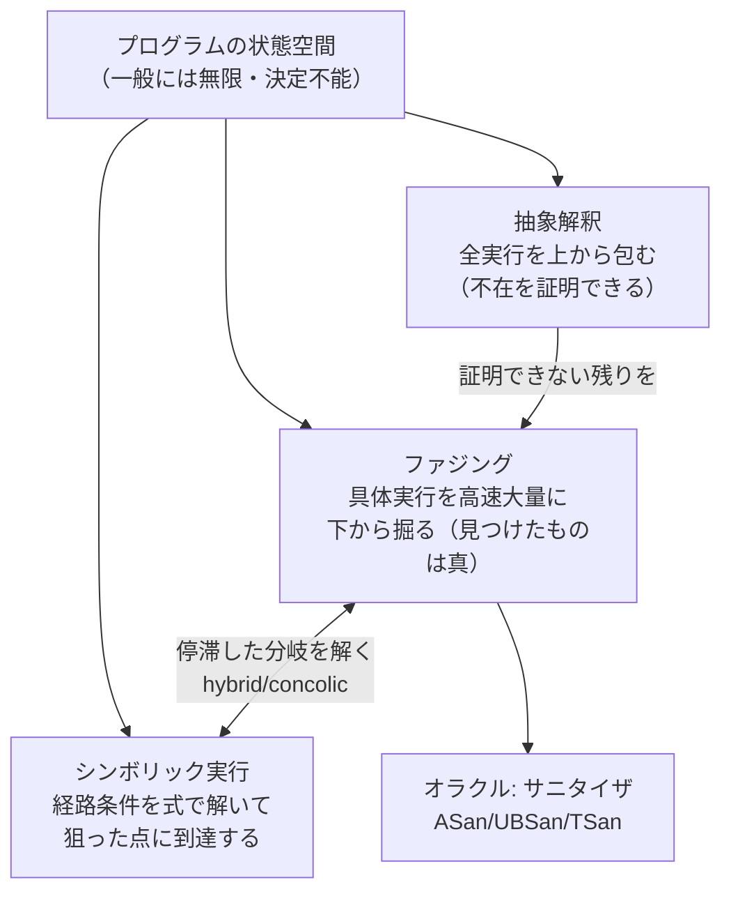

# ファジングとプログラム解析 (Fuzzing & Program Analysis)

## 概要 (Overview)

[`memory-safety-exploit-mitigations.md`](memory-safety-exploit-mitigations.md) は緩和（バグを exploit にさせない）と根絶（言語で消す）を扱った。本ドキュメントはその手前、**バグを攻撃者より先に見つける検出系**の内部機構を扱う。主役は過去 15 年でセキュリティテストの主戦力になった**カバレッジ誘導ファジング (coverage-guided fuzzing)** である。これは、ランダムな入力生成をカバレッジという報酬に導かれた進化的探索に変えた技法である。主役にはさらに、それを支える**サニタイザ**（沈黙する破壊をクラッシュに変える）、補完する**シンボリック実行**（経路を論理式として解く）、そして対極にある**静的解析・抽象解釈**（実行せずに全挙動を上から近似する）が加わる。

これらは別々の道具ではなく、**「プログラムの状態空間をどの方向から削るか」の異なる選択**として一つの地図に載る: ファジングは具体実行の高速な試行で下から掘り、シンボリック実行は経路条件を式で解いて狙い撃ち、抽象解釈は全実行を包む上界を計算する。そして OSS-Fuzz が示したとおり、決定打は個々の技法の賢さではなく**計算資源を注ぎ続ける継続的な運用**だった。[`../compilers-runtimes/`](../compilers-runtimes/) のコンパイラ基盤（計装はコンパイラの仕事である）、[`realtime-fundamentals.md`](../embedded/realtime-fundamentals.md) の WCET 解析（抽象解釈の同根の応用）と接続する。防御的観点に徹し、分析深度は Level 3。

## 方法論 (Methodology)

- 各技法を **「探索の駆動力」と「バグと判定する根拠（オラクル）」の2成分**に分解する。この分解で、ファジング（駆動力: カバレッジ進化 / オラクル: クラッシュ+サニタイザ）と静的解析（駆動力: 網羅 / オラクル: 性質の違反）が同じ座標系に載る。
- 理論的限界（Rice の定理: 自明でない意味的性質は決定不能。理論側は [`automata-formal-languages.md`](../../foundations/mathematics/discrete-logic/automata-formal-languages.md) §5）を先に置き、すべての実務ツールが**健全性 (soundness) か 完全性 (completeness) のどちらかを捨てている**ことを明示する。「何を捨てたか」がツールの性格である。
- 効果の主張は測定研究（Klees らのファジング評価批判[^klees]）と大規模運用の公開数値（OSS-Fuzz[^ossfuzz]）に紐づけ、単発のデモやベンダ主張から一般化しない。
- 攻撃的利用（脆弱性の兵器化）には踏み込まず、発見から修正・回帰防止までの防御ループとして扱う。

## 発見事項 (Findings)

1. **カバレッジ誘導ファジングの本質は「フィードバックループの発明」である。** AFL 以前のランダムファジングは、ガードされた深い経路（マジックナンバー・チェックサム）にほぼ到達できなかった。AFL は「新しいエッジ（分岐遷移）を踏んだ入力を種として残し、変異させる」という進化的ループを、軽量な計装（エッジカバレッジのビットマップ）と fork server による毎秒数千回の実行で成立させた[^afl]。賢い生成ではなく、**安い試行 × 保持すべきものの安い判定**が突破口だった。のちにこの探索はマルコフ連鎖として定式化され、「よく踏まれる経路に集中しすぎない」エネルギー配分（power schedule）が導かれた[^aflfast]（マルコフ連鎖の基礎は [`markov-chains-queueing.md`](../../foundations/mathematics/probability-statistics/markov-chains-queueing.md)）。現在の実務上の標準実装は、こうした研究成果を取り込んだコミュニティ主導の後継 AFL++ である[^aflpp]。
2. **ファジングの半分はオラクル問題であり、サニタイザがそれを解いた。** メモリ破壊の多くはクラッシュせず沈黙する。攻撃者にとっての価値はまさにそこにある。AddressSanitizer はシャドウメモリ（アプリメモリ 8 バイトごとに 1 バイトの状態表）と赤域 (redzone)・隔離 (quarantine) により、境界外アクセスと解放後使用を**その時点で**検出可能なクラッシュへ変える[^asan]。「ファジングの成果はサニタイザの網の細かさで決まる」と言ってよく、UBSan（未定義動作）・TSan（データ競合の happens-before 検査[^tsan]、[`memory-models-synchronization.md`](../concurrency/memory-models-synchronization.md) を参照）が網を広げる。
3. **カバレッジは目的関数の近似にすぎず、飽和する。** コードカバレッジ 100% でも状態空間はカバーされない（プロトコルの状態機械やパーサの深い再帰のように、同じ行を異なる状態で通る）。カバレッジ停滞 (plateau) 後の伸びは、構造認識（文法ベース生成[^nautilus]・辞書）・状態フィードバック・ハーネスの分割から来る。**ファジングの実務はハーネス設計**、つまり「どの API 面を、どんな入力空間で叩くか」を決めることであり、これは [`sandbox-architectures.md`](sandbox-architectures.md) の攻撃面の議論と同じ地図（攻撃面のあるところにファザーを置く）で決まる。
4. **シンボリック実行は「ガード条件を解いて」ファジングの死角をなくすが、経路爆発が本質的制約である。** 入力を記号変数とし、経路条件を SMT ソルバで解けば、`if (hash == 0xdeadbeef)` の向こう側に一発で到達できる (KLEE, SAGE)[^klee][^sage]。しかし経路数は分岐で指数的に増え、ループと間接呼び出しが解析を溺れさせる。実務解は**混成 (hybrid/concolic)** である。通常はファジングで走り、停滞したら詰まった分岐だけを記号的に解く（Driller[^driller]）。実務は「安い試行で広く、高い推論は狭く」という資源配分に落ち着いた。
5. **静的解析は Rice の定理と「誤検知の経済」に支配される。** 自明でない意味的性質の判定は決定不能であるため[^rice]、ツールは (a) 健全性を優先して過剰近似する（見逃さないが誤検知する抽象解釈）か、(b) 有用性を優先して見逃しを許す（現代の商用/OSS リンタ・クエリ系などのバグ発見器）かを選ぶ。開発フローに定着するかどうかを分けるのは、検出力より**誤検知率**である。商用静的解析を大規模に運用した Coverity の報告も、Google の社内ツール運用の報告も、誤検知（開発者が行動しない警告）が多いツールは無視されるという同じ教訓に行き着いている[^bessey][^sadowski]。
6. **健全な静的解析の代表的成功が、安全クリティカル分野の抽象解釈である。** 区間・多面体などの抽象領域で全実行を上から包み、「実行時エラーの不在」を**証明**する抽象解釈 (abstract interpretation)[^cousot] は、航空機の飛行制御コード（Astrée）で実用化された[^astree]。[`realtime-fundamentals.md`](../embedded/realtime-fundamentals.md) の WCET 解析はまったく同じ理論の時間方向への適用であり、「証明が要る世界（DO-178C・ISO 26262）では過剰近似を、バグ探しの世界では見逃しを受け入れる」という分業が成立している。
7. **最大の効果はアルゴリズムではなく「継続」から出た。** OSS-Fuzz は約 1,000 の OSS プロジェクトを継続的にファジングし、2025 年 5 月時点で 13,000 件超の脆弱性と 50,000 件超のバグの発見・修正に寄与したと公表している（2023 年 8 月時点の公表値は 10,000 件超・36,000 件超で、2 年弱で約 3 割増えた）[^ossfuzz]。2023 年以降は LLM によるファズハーネスの自動生成も加わり、2024 年 11 月までに OpenSSL の CVE-2024-9143 を含む 26 件の新規脆弱性を報告している[^ossfuzz-ai]。単発の監査と違い、コーパス（過去の interesting 入力の蓄積）が資産として複利的に蓄積し、新コミットの回帰を即日捕まえる。ファジングは「テスト技法」から「**CI と同格のインフラ**」へ地位を変えた。これは [`../observability/`](../observability/) が性能で果たす役割の、正しさ版である。

## アーキテクチャ (Architecture)

### 状態空間をどの方向から削るか

### 技法の性格の対比

| 技法 | 駆動力 | オラクル | 偽陽性 | 偽陰性 | 得意領域 |
|---|---|---|---|---|---|
| カバレッジ誘導ファジング | エッジカバレッジの進化 | クラッシュ + サニタイザ | ほぼ無し（実入力あり） | あり（届かない経路） | パーサ・デコーダ・API 面 |
| シンボリック/concolic | 経路条件 + SMT | 同上 + アサーション | ほぼ無し | あり（経路爆発） | ガード条件の突破 |
| バグ発見型静的解析 | パターン・データフロー | 性質違反の疑い | **あり**（経済の主敵） | あり | 既知バグ型の横展開 |
| 抽象解釈（健全） | 抽象領域での網羅 | 性質違反の可能性 | あり（過剰近似） | **無し**（健全） | 認証・不在証明・WCET |
| 動的サニタイザ単体 | 既存テスト・実負荷 | シャドウ状態の違反 | ほぼ無し | 実行された経路のみ | テストの検出力増幅 |

- 「偽陽性ほぼ無し」×「偽陰性無し」の枠が空欄であることが Rice の定理の実務的な姿である。ファジングで見つけ、静的解析で横展開し、抽象解釈で残りの不在を証明するという組合せだけが空欄に近づく。

## 技術詳細 (Technical Details)

### 1. カバレッジ誘導ファジングの内部 (Inside Coverage-Guided Fuzzing)

- **計装**: コンパイル時に各分岐遷移へ計装を挿入し、`bitmap[cur_loc ^ (prev_loc >> 1)]++` 型の安価な操作でエッジ命中を共有ビットマップに記録する（AFL 系）。計装はコンパイラパスであり（[`../compilers-runtimes/`](../compilers-runtimes/)、libFuzzer は LLVM の SanitizerCoverage を使う[^libfuzzer]）、ソースが無ければ QEMU 等の動的変換で代替する（AFL++ の QEMU モード等[^aflpp]）。
- **実行の高速化**: fork server（初期化済みプロセスを fork で複製）と永続モード（1 プロセスで N 回呼ぶ）で、プロセス起動コストを償却する。in-process の libFuzzer は関数呼び出しの速度でハーネス関数 (`LLVMFuzzerTestOneInput`) を回す。ハーネスはエンジン非依存に書けるため、同じターゲットを AFL++ 等でも回せる。なお 2026-10 時点の LLVM 公式文書では、libFuzzer の原開発者は後継エンジン Centipede に移り、libFuzzer は重大なバグ修正のみの保守段階とされる[^libfuzzer]。**毎秒数千〜数万実行**という物量が進化的探索の前提である。
- **変異と種の管理**: ビット反転・算術・辞書挿入・既知種のスプライス等の変異を、カバレッジ利得のあった種に優先配分する。コーパス最小化（同じカバレッジを与える最小集合）とクラッシュの重複排除（スタックハッシュ）が運用の要。
- **評価の落とし穴**: ファザー比較は乱数と時間に強く依存し、短時間・少試行の比較は再現しない。複数シード・長時間・統計検定を要するという方法論批判[^klees]は、この分野の測定を規律化した（[`../observability/`](../observability/) のベンチマーク方法論と同じ教訓）。

### 2. サニタイザの機構 (Sanitizer Internals)

- **ASan**: 仮想アドレス空間の 1/8 をシャドウに写像し、8 バイト粒度で「アドレス可能か」を表す。確保境界に赤域を敷き、解放領域を隔離列に留めて再利用を遅らせることで、境界外と解放後使用をアクセスした時点で検出する。コストは原論文の測定で平均 73% の速度低下（〜2 倍弱）とメモリ数倍で、**開発・ファジング専用**（本番緩和ではない）という配備区分が [`memory-safety-exploit-mitigations.md`](memory-safety-exploit-mitigations.md) の整理どおり成立する[^asan]。
- **UBSan**: 符号付きオーバーフロー・不正シフト・null 逸脱など、コンパイラが「起きない」と仮定する未定義動作 (UB) に実行時検査を挿す。UB は最適化と攻撃面の交差点であり（同文書参照）、UBSan はその仮定を可視化する。
- **TSan**: メモリアクセスにベクタクロックを付けて happens-before を追跡し、同期されていない並行アクセス（データ競合）を検出する[^tsan]。[`memory-models-synchronization.md`](../concurrency/memory-models-synchronization.md) のメモリモデルの実行時検査器であり、競合という「再現しないバグ」を決定的に報告する点に価値がある。
- **カーネルへの展開**: KASAN/KCSAN + syzkaller（システムコール列を文法として生成するカーネルファザー）が、[`../operating-systems/`](../operating-systems/) の対象であるカーネルに同じループを適用し、Linux のバグ発見の主要供給源になっている[^syzkaller]。

### 3. シンボリック実行と SMT (Symbolic Execution & SMT)

- 入力をシンボル `x` とし、実行を経路条件（`x > 4 ∧ hash(x) = k` のような制約の連言）として蓄積、SMT ソルバ（Z3 等）に充足解を求めさせる（充足可能性判定の論理的基礎は [`propositional-boolean-logic.md`](../../foundations/mathematics/discrete-logic/propositional-boolean-logic.md)）。解がその経路を踏む具体入力になる。
- 経路爆発への実務的応答: 具体実行に寄り添う **concolic**（具体値で走りつつ、反転したい分岐だけ記号化する。Microsoft の SAGE は、Windows 7 の開発中にファイルファジングで見つかった全バグの約 1/3 を発見したと報告している[^sage]）、状態のマージ、探索ヒューリスティクス（未踏カバレッジ優先）。
- 環境問題: システムコール・ライブラリ境界の意味をソルバに与える必要があり、KLEE は POSIX 環境のモデルで応じた[^klee]。この「環境のモデル化コスト」が、シンボリック実行が万能機にならない実務上の主因である。

### 4. 静的解析と抽象解釈 (Static Analysis & Abstract Interpretation)

- **バグ発見型**: データフロー解析・パターンクエリで「怪しい形」を横展開する。既知バグ型（未検査コピー・危険 API・テイントの流路）の再発防止に強く、CI のゲートとして機能する。設計変数は誤検知の抑制である。経路感度・文脈感度を上げるほど、精度と引き換えに計算量が増える。
- **抽象解釈**: 各プログラム点の到達可能状態を抽象領域（区間: `x ∈ [0, 255]`、八面体・多面体: 変数間の線形関係）の要素で近似し、不動点まで反復する。健全性（実挙動は必ず近似に含まれる）を保証できるため、「ゼロ除算・オーバーフロー・境界外の**不在**」を証明でき、認証文書（DO-178C 等）の証拠になる[^cousot]。WCET 解析（[`realtime-fundamentals.md`](../embedded/realtime-fundamentals.md)）はキャッシュ・パイプライン状態を抽象領域にした同型の適用である。
- 位置づけ: 「見逃し不可」の世界（安全認証）では抽象解釈系、「発見の費用対効果」の世界ではファジング + バグ発見型、という分業が確立している。両者を混同した調達（バグ発見器に不在証明を期待する等）が実務の典型的な失敗である。

## セキュリティ考察 (Security Considerations)

- **検出系は攻守共用である。** 同じファザーが防御側の先回りにも攻撃側の脆弱性探索にも使える。防御側の構造的優位は**継続と統合**にある。ソース・計装・CI・コーパスを持つのは防御側であり、OSS-Fuzz 型の常時運用は攻撃側の単発探索より深く掘れる。逆に言えば、継続運用を持たない防御側はこの優位を放棄している。
- **ファジングの導入先は攻撃面の地図で決める。** [`sandbox-architectures.md`](sandbox-architectures.md) の観点をそのまま流用できる: 信頼境界を跨いで敵対的入力を受ける面（パーサ・デコーダ・IPC・syscall 面・プロトコル実装）が最優先のハーネス対象である。境界の内側だけをファジングして「安全」を宣言するのは地図の読み違いになる。
- **見つけた後のパイプラインが本体である。** 重複排除・自動最小化・二分探索での導入コミット特定・修正確認・回帰コーパスへの追加、までが一巡して初めて「検出系」になる。脆弱性としての取り扱い（非公開期間・修正の配布、[`software-supply-chain-security.md`](software-supply-chain-security.md) の更新チャネルの完全性）に接続する。
- **検出系自体の限界を防御計画に織り込む。** ファジングは「見つからなかった」を保証せず、抽象解釈は意味的なロジックバグ（認可の欠落・状態機械の誤り）を対象にしない。ゆえに検出系は、緩和（[`memory-safety-exploit-mitigations.md`](memory-safety-exploit-mitigations.md)）・隔離（[`sandbox-architectures.md`](sandbox-architectures.md)）・出所検証（[`software-supply-chain-security.md`](software-supply-chain-security.md)）の**代替ではなく前段**である。四層が揃って初めて、単一の失敗で崩れない防御になる。

## 結論 (Conclusions)

検出系の 50 年は、「プログラムの意味的性質は決定不能である」という理論的限界（Rice）の内側で、**何を捨てて何を得るか**を選び直してきた歴史である。ファジングは網羅を捨てて物量と実証性を取り、進化的フィードバック（AFL）とオラクルの精密化（サニタイザ）で主戦力になった。シンボリック実行は物量を捨てて狙撃を取り、混成としてファジングに吸収された。抽象解釈は精度を捨てて健全性を取り、証明が要る世界（安全認証・WCET）の標準になった。そして OSS-Fuzz が示した最大の教訓は運用論である。つまり、**検出は行為ではなくインフラ**であり、コーパスという複利資産を積む者が攻撃者に先行する。

これで security 横串は「見つける（本書）→ exploit させない（memory-safety）→ 閉じ込める（sandbox）→ 出所を検証する（supply chain）」の四層が揃った。残る候補（応用暗号工学、Web・アプリケーションセキュリティ）は README のロードマップに引き継ぐ。

---

## 参考文献 (References)

[^afl]: Zalewski, M. *american fuzzy lop — Technical "whitepaper"*. https://lcamtuf.coredump.cx/afl/technical_details.txt — Accessed: 2026-07-13. — エッジカバレッジビットマップ・fork server・変異戦略の一次解説。

[^asan]: Serebryany, K., Bruening, D., Potapenko, A. & Vyukov, D. (2012). AddressSanitizer: A Fast Address Sanity Checker. *Proc. USENIX ATC 2012*, 309–318. — シャドウメモリ・赤域・隔離の原典（平均速度低下 73%）。

[^klees]: Klees, G., Ruef, A., Cooper, B., Wei, S. & Hicks, M. (2018). Evaluating Fuzz Testing. *Proc. ACM CCS 2018*, 2123–2138. DOI: 10.1145/3243734.3243804 — ファザー評価の方法論批判と規律。

[^klee]: Cadar, C., Dunbar, D. & Engler, D. (2008). KLEE: Unassisted and Automatic Generation of High-Coverage Tests for Complex Systems Programs. *Proc. USENIX OSDI 2008*, 209–224. — シンボリック実行の代表的実装と環境モデル。

[^sage]: Godefroid, P., Levin, M. Y. & Molnar, D. (2012). SAGE: Whitebox Fuzzing for Security Testing. *Communications of the ACM*, 55(3), 40–44. DOI: 10.1145/2093548.2093564 — concolic の大規模実務適用の報告。

[^cousot]: Cousot, P. & Cousot, R. (1977). Abstract Interpretation: A Unified Lattice Model for Static Analysis of Programs by Construction or Approximation of Fixpoints. *Proc. ACM POPL 1977*, 238–252. DOI: 10.1145/512950.512973 — 抽象解釈の原典。

[^ossfuzz]: Google. *OSS-Fuzz* (GitHub README / Documentation). https://github.com/google/oss-fuzz, https://google.github.io/oss-fuzz/ — Accessed: 2026-10-04. — 「As of May 2025, ... over 13,000 vulnerabilities and 50,000 bugs across 1,000 projects」（README）、2023 年 8 月時点値 10,000 件・36,000 件（Documentation）。運営者による自己集計。

[^syzkaller]: Google. *syzkaller — kernel fuzzer documentation*. https://github.com/google/syzkaller — Accessed: 2026-07-13. — syscall 文法ベースのカーネルファジング。

[^rice]: Rice, H. G. (1953). Classes of Recursively Enumerable Sets and Their Decision Problems. *Transactions of the American Mathematical Society*, 74(2), 358–366. DOI: 10.1090/S0002-9947-1953-0053041-6 — 意味的性質の決定不能性（教科書的典拠: Sipser, *Introduction to the Theory of Computation*）。

[^aflpp]: Fioraldi, A., Maier, D., Eißfeldt, H. & Heuse, M. (2020). AFL++: Combining Incremental Steps of Fuzzing Research. *Proc. 14th USENIX Workshop on Offensive Technologies (WOOT 20)*. https://www.usenix.org/conference/woot20/presentation/fioraldi — Accessed: 2026-10-04. — AFL の後継実装、カスタム変異 API、QEMU モード等の統合。

[^aflfast]: Böhme, M., Pham, V.-T. & Roychoudhury, A. (2016). Coverage-based Greybox Fuzzing as Markov Chain. *Proc. ACM CCS 2016*, 1032–1043. DOI: 10.1145/2976749.2978428 — グレーボックスファジングのマルコフ連鎖モデルと power schedule。

[^libfuzzer]: LLVM Project. *libFuzzer – a library for coverage-guided fuzz testing*. https://llvm.org/docs/LibFuzzer.html — Accessed: 2026-10-04. — 「in-process, coverage-guided, evolutionary fuzzing engine」、SanitizerCoverage、Centipede への開発移行と保守段階の注記。

[^tsan]: Serebryany, K. & Iskhodzhanov, T. (2009). ThreadSanitizer: Data Race Detection in Practice. *Proc. Workshop on Binary Instrumentation and Applications (WBIA '09)*, 62–71. DOI: 10.1145/1791194.1791203 — happens-before に基づくデータ競合検出。

[^nautilus]: Aschermann, C., Frassetto, T., Holz, T., Jauernig, P., Sadeghi, A.-R. & Teuchert, D. (2019). NAUTILUS: Fishing for Deep Bugs with Grammars. *Proc. NDSS 2019*. DOI: 10.14722/ndss.2019.23412 — 文法とカバレッジフィードバックの結合。

[^driller]: Stephens, N., Grosen, J., Salls, C., Dutcher, A., Wang, R., Corbetta, J. et al. (2016). Driller: Augmenting Fuzzing Through Selective Symbolic Execution. *Proc. NDSS 2016*. DOI: 10.14722/ndss.2016.23368 — 停滞時のみ記号実行に切り替える混成方式。

[^bessey]: Bessey, A., Block, K., Chelf, B., Chou, A., Fulton, B., Hallem, S. et al. (2010). A Few Billion Lines of Code Later: Using Static Analysis to Find Bugs in the Real World. *Communications of the ACM*, 53(2), 66–75. DOI: 10.1145/1646353.1646374 — 商用静的解析（Coverity）の実運用で誤検知が採用を左右した経験。

[^sadowski]: Sadowski, C., Aftandilian, E., Eagle, A., Miller-Cushon, L. & Jaspan, C. (2018). Lessons from Building Static Analysis Tools at Google. *Communications of the ACM*, 61(4), 58–66. DOI: 10.1145/3188720 — 開発フローへの統合と、開発者が行動しない警告を誤検知とみなす設計。

[^astree]: Cousot, P., Cousot, R., Feret, J., Mauborgne, L., Miné, A., Monniaux, D. & Rival, X. (2005). The ASTRÉE Analyzer. *Proc. ESOP 2005*, LNCS 3444, 21–30. DOI: 10.1007/978-3-540-31987-0_3 — 健全な抽象解釈の安全クリティカル適用例。

[^ossfuzz-ai]: Google Online Security Blog (2024-11). *Leveling Up Fuzzing: Finding more vulnerabilities with AI*. https://security.googleblog.com/2024/11/leveling-up-fuzzing-finding-more.html — Accessed: 2026-10-04. — LLM 生成ハーネスによる 26 件の新規脆弱性（CVE-2024-9143 を含む）、対象 272 プロジェクトへの拡大。

その他の標準的典拠を挙げる。

- Manès, V. J. M. et al. (2021). The Art, Science, and Engineering of Fuzzing: A Survey. *IEEE Transactions on Software Engineering*, 47(11), 2312–2331. DOI: 10.1109/TSE.2019.2946563 — ファジング研究の体系的サーベイ。
