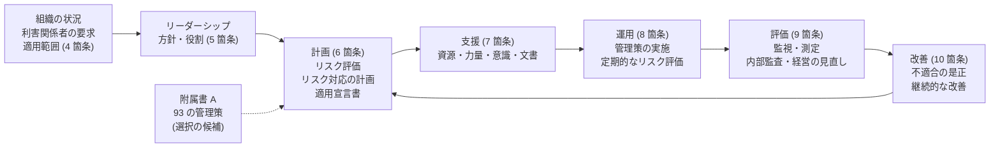
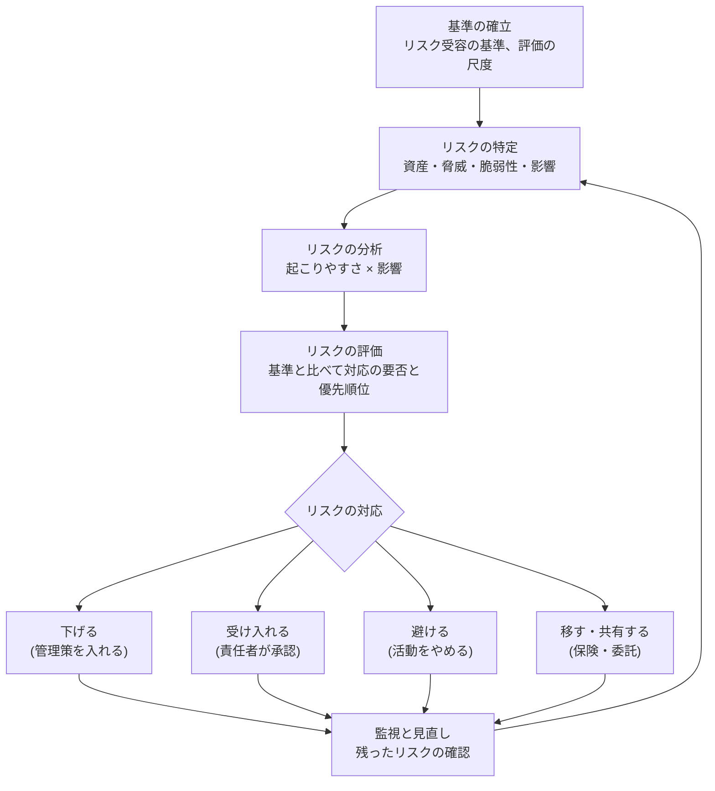

# ISMS とリスクマネジメント (ISMS & Security Risk Management: ISO/IEC 27001, Risk Assessment, NIST CSF & BCP)

## 概要 (Overview)

本ドキュメントは組織としてセキュリティを管理する仕組みを扱う。対象は情報セキュリティマネジメントシステム (ISMS) の国際規格 ISO/IEC 27001 とその管理策、リスクの特定・分析・評価・対応の手順 (ISO 31000、ISO/IEC 27005)、脅威モデリング、NIST Cybersecurity Framework (CSF) 2.0 と CIS Controls、事業継続 (BCP) と復旧の目標、第三者の保証 (認証、SOC 2) である。他のセキュリティの文書が個々の技術を扱ったのに対し、本書はそれらを「どれを、どの順に、どこまでやるか」を決める層を扱う。

中心テーゼは、**ISMS の本体は管理策の一覧ではなく、リスクにもとづいて管理策を選び、効果を測って見直し続ける循環である**ということである。ISO/IEC 27001 の附属書 A は 93 の管理策を並べているが、規格はそのすべてを実施することを求めていない。組織は自分の資産と脅威からリスクを評価し、受け入れられないリスクに対して管理策を選び、選ばなかった理由も含めて記録する (適用宣言書)。そして内部監査と経営の見直しで効果を確かめ、改善する。この循環が回っていれば、新しい脅威 (クラウド、AI、サプライチェーン) にも同じ手順で対応できる。

一方で、ISMS には形骸化という典型的な失敗がある。認証の取得そのものが目的になり、文書は整っているが実際の対策は変わらない、リスク評価は毎年同じ表を写すだけ、という状態である。認証は「管理の仕組みがある」ことを示すが、「攻撃に耐えられる」ことは示さない。NIST CSF 2.0 (2024 年) が 6 つ目の機能として「統治 (Govern)」を加え、サイバーセキュリティのリスクを経営のリスクとして扱うよう求めたのは、技術的な対策と経営の判断をつなぐ層の重要さを示している。分析深度は Level 3。

## 方法論 (Methodology)

- **一次資料**: 規格は ISO/IEC 27001:2022 (要求事項)、ISO/IEC 27002:2022 (管理策の手引き)、ISO 31000:2018 (リスクマネジメント)、ISO/IEC 27005:2022 (情報セキュリティのリスク管理)、ISO 22301:2019 (事業継続) を対象にする。ISO の規格本文は有償のため、構成と管理策の数は ISO の公開情報と認証機関・専門家の解説で相互に確認した。米国の枠組みは NIST CSF 2.0 と NIST SP 800-30 を使う。脅威モデリングは STRIDE と攻撃木の原典を使う。
- **国内の枠組み**: 日本の制度は経済産業省と IPA の「サイバーセキュリティ経営ガイドライン」(Ver 3.0、2023 年)、政府のクラウドサービスの評価制度 ISMAP を、所管機関の文書で扱う。
- **規格の位置づけを区別する**: 認証の対象になる要求事項 (27001) と、手引き (27002・27005) と、枠組み (CSF) と、具体的な対策の一覧 (CIS Controls) を区別して書く。それぞれ答える問いが違う。
- **担当範囲**: 個々の技術的な対策は本ディレクトリの他の文書、障害の確率と冗長化の数理は [`../../foundations/mathematics/probability-statistics/reliability-theory.md`](../../foundations/mathematics/probability-statistics/reliability-theory.md)、製品の開発でのリスク評価 (TARA) は [`../../engineering/automotive/cybersecurity-iso21434.md`](../../engineering/automotive/cybersecurity-iso21434.md)、制御システムの規格 (IEC 62443) は [`../../engineering/energy/plant-control-scada-security.md`](../../engineering/energy/plant-control-scada-security.md) に委ねる。

## 発見事項 (Findings)

1. **ISO/IEC 27001 は「何をするか」ではなく「どう決めて、どう回すか」を要求する規格である。** 本文 (4〜10 箇条) は組織の状況の理解、経営者の関与、リスクの評価と対応の計画、支援 (資源・力量・文書)、運用、パフォーマンスの評価 (監視・内部監査・経営の見直し)、改善を要求する。附属書 A の管理策はリスク対応で選ぶ候補の一覧であり、すべての実施を求めるものではない。他の ISO のマネジメントシステム規格 (品質の 9001 など) と共通の構造を持つため、組み合わせて運用できる。
2. **2022 年の改訂で、管理策は 93 に整理され、新しい脅威への対応が加わった。** 附属書 A は2013 年版の 14 分野 114 管理策から、組織 (37)、人 (8)、物理 (14)、技術 (34) の 4 つのテーマ・93 管理策に再編された。脅威インテリジェンス、クラウドサービスの利用のセキュリティ、設定の管理、データの削除、データのマスキング、データの漏えいの防止、監視の活動、セキュアコーディングなど 11 の管理策が新しく加わった。2013 年版の認証からの移行期限は 2025 年 10 月 31 日だった。
3. **リスクは「起こりやすさ」と「影響の大きさ」の組で表し、対応は 4 つの選択肢から選ぶ。** ISO 31000 と ISO/IEC 27005 の手順は、リスクの特定、分析、評価、対応、監視と見直しからなる。対応はリスクを下げる (管理策を入れる)、受け入れる (保有する)、避ける (その活動をやめる)、移す・共有する (保険、外部委託) のいずれかで、受け入れたリスクは責任者が承認して記録する。どの水準のリスクまで受け入れるか (リスク受容の基準) を経営が決めることが、評価の出発点になる。
4. **定性的な評価は手軽だが、比べられない。** 起こりやすさと影響を 5 段階などで評価して掛け合わせる定性的な方法は、広く使われているが、段階の付け方が評価者によってぶれ、異なるリスクの大きさを金額のように比べられない。FAIR のような定量的な方法は、損失の頻度と規模を確率分布で見積もり、金額の幅で表す。経営の投資判断にはつなげやすいが、データと手間がかかる。
5. **脅威モデリングは設計の段階でリスクを見つける手順である。** システムの構成とデータの流れを図にし、各要素に対して「何が起こりうるか」を体系的に洗い出す。STRIDE (なりすまし、改ざん、否認、情報漏えい、サービス拒否、権限昇格) は、Microsoft で 1999 年に考案された脅威の分類で、データフロー図の要素ごとに当てはめる。攻撃木 (Schneier 1999) は、攻撃者の目的を根に置き、それを達成する手段を枝に分解する。
6. **NIST CSF 2.0 はサイバーセキュリティを経営のリスクとして扱う枠組みになった。** 2024 年 2 月に公開された CSF 2.0 は、従来の特定・防御・検知・対応・復旧の 5 つの機能に、統治 (Govern) を加えた。統治は組織の状況、リスク管理の戦略、役割と責任、方針、監督、サプライチェーンのリスク管理を扱い、他の 5 つの機能をどう実施するかを方向づける。対象も重要インフラから、規模や業種を問わないすべての組織に広げた。インシデント対応の NIST SP 800-61 Rev. 3 も、この 6 つの機能にもとづいて描き直された ([`detection-incident-response.md`](detection-incident-response.md))。
7. **事業継続の目標は復旧の時間とデータの損失の許容量で決まる。** BCP では業務ごとに、止まってから再開するまでに許される時間 (RTO: Recovery Time Objective) と、失ってもよいデータの時間幅 (RPO: Recovery Point Objective) を決める。この 2 つが、バックアップの頻度、冗長化の構成、復旧の手順の要件になる。ランサムウェアではバックアップそのものが攻撃されるため、攻撃者が触れられない形での保存と、実際に戻せることの訓練が要る ([`attack-lifecycle.md`](attack-lifecycle.md))。
8. **認証は管理の仕組みの存在を示すが、攻撃への耐性は示さない。** ISO/IEC 27001 の認証や SOC 2 の報告書は、取引先に「管理の仕組みがあり、監査を受けている」ことを示す共通の手段である。ただし、評価されるのは規格の要求を満たす仕組みがあるかで、攻撃を防げるかではない。認証を持つ組織でも大規模な侵害は起きている。認証の範囲 (組織のどの部分が対象か) と、技術的な検査 (ペネトレーションテストなど、[`vulnerability-management.md`](vulnerability-management.md)) の結果を合わせて見る必要がある。

## アーキテクチャ (Architecture)

### ISMS の循環

凡例: 実線は ISMS の循環 (計画・実行・評価・改善)、点線は参照の関係。附属書 A はリスク対応で管理策を選ぶときに漏れがないかを確かめる一覧として使う。

### リスクマネジメントの手順 (ISO 31000 / ISO/IEC 27005)

### 枠組みと規格の役割分担

| 規格・枠組み | 答える問い | 性格 | 主な利用者 |
|---|---|---|---|
| ISO/IEC 27001:2022 | 管理の仕組みをどう作り、回すか | 認証の対象になる要求事項 | 認証を取る組織、取引先 |
| ISO/IEC 27002:2022 | 各管理策を具体的にどう実施するか | 手引き (認証の対象ではない) | 実務の担当者 |
| ISO 31000:2018 / ISO/IEC 27005:2022 | リスクをどう評価し、対応するか | 手引き | リスク管理の担当者 |
| NIST CSF 2.0 | 組織の現状と目標をどう表し、比べるか | 任意の枠組み (6 機能・カテゴリ・サブカテゴリ) | 経営、セキュリティの責任者 |
| NIST SP 800-53 Rev. 5 | どの管理策をどの水準で実施するか | 詳細な管理策のカタログ (米国連邦の基準) | 米国連邦機関、委託先 |
| CIS Controls v8.1 | まず何から手をつけるか | 優先順位を付けた具体的な対策の一覧 | 中小規模の組織、実務の担当者 |
| ISO 22301:2019 | 業務を止めないためにどう備えるか | 事業継続の要求事項 | 事業継続の担当者 |
| SOC 2 (AICPA) | 委託先の管理が有効に機能しているか | 監査人の保証の報告書 | SaaS などの委託先と利用者 |

## 技術詳細 (Technical Details)

### 1. ISO/IEC 27001 の要求事項

- **適用範囲**: ISMS をどの組織、拠点、業務、システムに適用するかを決める。範囲を狭くすれば認証は取りやすいが、範囲の外の部分は評価されない。取引先が認証を確かめるときは、範囲に自分が関わる業務が入っているかを見る必要がある。
- **リスク評価とリスク対応** (6 箇条): リスク評価の手順を決めて文書にし、繰り返し実施しても一貫した結果になるようにする。リスク対応では管理策を選び、附属書 A と比べて必要な管理策の漏れがないかを確かめる。採用した管理策と採用しなかった管理策、それぞれの理由を記録したものが適用宣言書 (SoA: Statement of Applicability) で、ISMS の中心の文書になる。リスク対応の計画と、残るリスク (残留リスク) は、リスクの責任者が承認する。
- **パフォーマンスの評価** (9 箇条): 何をどう測るかを決めて監視する。内部監査で、ISMS が規格と組織自身の決まりに合っているか、有効に運用されているかを確かめる。経営者は定期的に ISMS を見直し、資源の配分や方針の変更を判断する。
- **改善** (10 箇条): 不適合 (決まりどおりに行われていない状態) を見つけたら、原因を調べて是正し、再発を防ぐ。インシデントの事後対応で得た教訓も、ここで ISMS に戻す。

### 2. 附属書 A の管理策 (2022 年版)

- **4 つのテーマ**: 組織的管理策 (37。方針、役割、資産の管理、アクセス制御、供給者の管理、インシデント管理、事業継続、法令の順守など)、人的管理策 (8。採用前の審査、教育、懲戒、退職時の手続き、リモートワークなど)、物理的管理策 (14。入退室の管理、装置の保護、媒体の廃棄など)、技術的管理策 (34。利用者の端末、特権の管理、マルウェア対策、脆弱性の管理、ログの記録、ネットワークのセキュリティ、暗号、開発のセキュリティなど) である。
- **新しい管理策**: 2022 年版で加わった 11 の管理策は、脅威インテリジェンス、クラウドサービスの利用のセキュリティ、事業継続のための ICT の備え、物理的なセキュリティの監視、設定の管理、情報の削除、データのマスキング、データの漏えいの防止、監視の活動、Web のフィルタリング、セキュアコーディングである。クラウドの普及、データの保護、検知の重視という変化を反映している。
- **属性**: 各管理策には予防・検知・是正のどれか、機密性・完全性・可用性のどれに効くか、NIST CSF のどの機能に対応するか、といった属性が付けられた。組織は属性で管理策を絞り込み、自分の関心に合わせて見られる。
- **移行**: 2013 年版の認証からの移行期限は 2025 年 10 月 31 日で、期限後の 2013 年版の認証は無効になった。気候変動への配慮を組織の状況の検討に加える追補 (Amendment 1:2024) も出ている。国内では JIS Q 27001:2023 として日本産業規格になっている。

### 3. リスクの評価

- **資産の特定**: 守るべき資産 (情報、システム、サービス、人、評判) を洗い出し、機密性・完全性・可用性の観点で重要度を決める。資産の一覧がなければ、リスクの評価も脆弱性の管理も始められない ([`vulnerability-management.md`](vulnerability-management.md))。
- **脅威と脆弱性**: 資産ごとに、起こりうる脅威 (攻撃者、誤操作、障害、災害) と、それが成り立つ弱さ (脆弱性、管理策の欠如) を組み合わせて、リスクのシナリオを作る。脅威の情報は業界の動向、自組織のインシデントの記録、脅威インテリジェンスから得る ([`attack-lifecycle.md`](attack-lifecycle.md))。
- **定性的な評価**: 起こりやすさと影響をそれぞれ 3〜5 段階で評価し、表 (リスクマトリクス) の上で位置づける。手軽で関係者の合意を取りやすいが、段階の境目が曖昧で、評価者によって結果がぶれる。「中」と「中」を掛けた値が、別の「低」と「高」を掛けた値と同じとみなせるのか、といった問題もある。
- **定量的な評価**: 年間の損失の期待値を、1 回あたりの損失額 (SLE) と年間の発生回数 (ARO) の積 (ALE) で見積もる方法が古典的である。FAIR (Factor Analysis of Information Risk、The Open Group の標準) は、損失の頻度と規模をさらに要素に分解し、それぞれを確率分布で見積もって、損失額の分布をシミュレーションで求める。結果を金額の幅で示せるため、対策の費用と比べやすい。ただし、見積もりの根拠となるデータが乏しいと、精密に見えるだけの数字になる。
- **評価の更新**: リスクの評価は年に一度の行事ではなく、システムの変更、新しい脅威の出現、インシデントの発生をきっかけに見直す。前年の表を写すだけの評価は形骸化の典型である。

### 4. 脅威モデリング

- **手順**: (1) システムの構成とデータの流れを図にする (データフロー図)。信頼の境界 (権限やネットワークが変わる場所) を書き込む。(2) 図の要素ごとに脅威を洗い出す。(3) 脅威ごとに対策を決めるか、リスクとして受け入れる。(4) 図と対策が実装と合っているかを確かめる。設計の段階で行えば、実装の後に見つけるより安く直せる。
- **STRIDE**: なりすまし (Spoofing、認証で守る)、改ざん (Tampering、完全性)、否認 (Repudiation、記録)、情報漏えい (Information disclosure、機密性)、サービス拒否 (Denial of service、可用性)、権限昇格 (Elevation of privilege、認可) の 6 つの頭文字で、守りたい性質の裏返しになっている。Microsoft の Kohnfelder と Garg が 1999 年に社内向けに考案し、同社の開発手順 (SDL) に組み込まれた。
- **攻撃木** (Schneier 1999): 攻撃者の目的 (データを盗む) を根に置き、それを達成する手段を子の節点に分解していく。節点は「どれか 1 つでよい (OR)」か「すべてが要る (AND)」でつなぐ。各葉に費用や難しさを付ければ、最も安い攻撃経路を見つけられる。AD の攻撃経路のグラフ ([`enterprise-authentication.md`](enterprise-authentication.md)) は、攻撃木を実際の権限の関係から自動で作ったものと見ることができる。
- **他の分野との関係**: 自動車のセキュリティでは、ISO/SAE 21434 の TARA (Threat Analysis and Risk Assessment) が、脅威モデリングとリスク評価を製品の開発の手順として定めている ([`../../engineering/automotive/cybersecurity-iso21434.md`](../../engineering/automotive/cybersecurity-iso21434.md))。機能安全 (ISO 26262) の危険分析と同じく、設計の早い段階で行うことが前提である。

### 5. NIST CSF 2.0 と CIS Controls

- **CSF の構造**: CSF 2.0 (2024 年 2 月) は統治 (GV)、特定 (ID)、防御 (PR)、検知 (DE)、対応 (RS)、復旧 (RC) の 6 つの機能の下に、カテゴリとサブカテゴリ (達成すべき成果) を並べる。組織は現状の姿 (現在のプロファイル) と目指す姿 (目標のプロファイル) を書き、その差から取り組みの優先順位を決める。成果を書く枠組みで、どの製品や手法を使うかは指定しない。
- **統治の機能**: 2.0 で加わった統治は組織の状況 (使命、利害関係者、法令の要求)、リスク管理の戦略 (リスクの許容度)、役割と責任、方針、監督、サプライチェーンのリスク管理からなる。NIST は統治を他の 5 つの機能の中心に置いた図で示し、他の機能をどう実施するかを方向づけるものとしている。
- **CIS Controls**: Center for Internet Security が公開する、具体的な対策の一覧で、最新版の v8.1 (2024 年) は 18 の分野を持つ。組織の規模と資源に応じて、まず実施すべき基本の対策 (IG1) から段階的に広げる (IG2、IG3) 構成になっている。資産の一覧 (ハードウェアとソフトウェア) が最初の 2 つの分野であることが、資産の把握の重要さを示している。CSF が「何を達成するか」を書くのに対し、CIS Controls は「何をするか」を書く。
- **日本の枠組み**: 経済産業省と IPA の「サイバーセキュリティ経営ガイドライン」(Ver 3.0、2023 年 3 月) は、経営者が認識すべき 3 原則と、経営者が責任者に指示すべき 10 の重要項目を示す。サプライチェーン全体での対策と、インシデントからの復旧の備えを重視している。政府の情報システムで使うクラウドサービスは、ISMAP (政府情報システムのためのセキュリティ評価制度) で評価・登録されたものから選ぶ。

### 6. 事業継続と復旧の目標

- **事業影響度分析** (BIA): 業務ごとに、止まった時間に応じて損失がどう増えるかを分析し、どの業務をどの順で復旧するかを決める。業務が依存するシステム、人、拠点、供給者も洗い出す。
- **RTO と RPO**: RTO は業務が止まってから再開するまでに許される時間、RPO は失ってもよいデータの時間幅 (直近のどの時点まで戻れればよいか) である。RPO が 1 時間ならバックアップか複製を 1 時間以内の間隔で取る必要があり、RTO が数分なら待機系への自動の切り替えが要る。目標が厳しいほど費用は急に増えるため、業務の重要度に応じて段階を付ける ([`../cloud/multi-region-global-architecture.md`](../cloud/multi-region-global-architecture.md))。
- **サイバー攻撃を想定した継続計画**: 地震や火災を想定した計画は拠点の切り替えを中心にしている。ランサムウェアでは待機系やバックアップまで同時に暗号化されたり、侵害されたシステムに戻すと再び攻撃されたりする。書き換えできないバックアップ、侵害されていないことを確かめてから戻す手順、システムを使わずに業務を続ける手段 (紙の手順、別の連絡手段) を計画に含める。
- **訓練**: 計画は実際に試さなければ動くか分からない。机上演習で判断と連絡の流れを確かめ、バックアップからの復元を実際に行って、RTO と RPO が達成できるかを測る。

### 7. 第三者の保証と委託先の管理

- **ISMS の認証**: 認証機関が、組織の ISMS が ISO/IEC 27001 に適合しているかを審査し、認証を与える。認証の後も、毎年の維持審査と 3 年ごとの再認証の審査がある。日本では ISMS-AC が認証機関を認定している。
- **SOC 2**: 米国公認会計士協会 (AICPA) の基準にもとづき、監査人が委託先 (SaaS 事業者など) の管理を評価する報告書である。ある時点の設計を評価する Type 1 と、一定期間 (通常 6〜12 か月) の運用の有効性まで評価する Type 2 がある。利用者は報告書の範囲、例外の指摘、利用者の側で行うべき管理 (補完的な管理) を読む必要がある。
- **委託先のリスク**: クラウドサービスやソフトウェアの供給者の侵害は、利用者の侵害に直結する (MOVEit の事件、[`web-application-vulnerabilities.md`](web-application-vulnerabilities.md))。契約でのセキュリティの要求、認証や報告書の確認、インシデントの通知の義務、依存関係の把握 ([`software-supply-chain-security.md`](software-supply-chain-security.md)) を組み合わせる。CSF 2.0 がサプライチェーンのリスク管理を統治の機能に入れたのは、これが経営の判断の問題だからである。

## セキュリティ考察 (Security Considerations)

ISMS とリスクマネジメントの失敗は、技術の失敗とは違う形で現れる。

| 失敗の形 | 何が起きるか | 対策 |
|---|---|---|
| 認証の取得が目的になる | 文書は整うが、実際の対策は変わらない | 技術的な検査の結果と合わせて評価する、経営の見直しで実効性を問う |
| 適用範囲が狭すぎる | 重要な業務やシステムが範囲の外で評価されない | 範囲の妥当性の見直し、取引先が範囲を確かめる |
| リスク評価の形骸化 | 前年の表を写すだけで、新しい脅威が反映されない | 変化をきっかけにした再評価、インシデントの教訓の反映 |
| 受け入れたリスクの放置 | 承認したリスクが見直されないまま大きくなる | 受け入れの期限と責任者の記録、定期的な再承認 |
| 資産の一覧の欠落 | 把握していない資産がリスク評価からも対策からも漏れる | 資産の継続的な洗い出し、CIS Controls の最初の分野からの着手 |
| 復旧の計画が試されていない | 実際のインシデントで手順が動かない | 復元の訓練、RTO と RPO の実測 |
| 委託先への丸投げ | 委託先の侵害が自組織の侵害になる | 契約での要求、報告書の確認、依存関係の把握 |

- コンプライアンスとセキュリティは別の問いである。規格や法令に適合していることは、最低限の管理があることを示すが、攻撃者は規格を読んで攻撃を選ぶわけではない。規格は管理の仕組みを作る手段であり、その仕組みで実際のリスクを下げられているかを、インシデントの記録、検査の結果、検知の実績で確かめる必要がある。
- 経営とはリスクの言葉で話す。技術的な対策の必要性は「この脆弱性の CVSS が 9.8 だ」ではなく、「このリスクが現実になると、どの業務がどれだけ止まり、どれだけ損失が出るか」で経営に伝わる。CSF 2.0 の統治の機能と、定量的なリスク評価は、この翻訳のための道具である。
- ISMS の記録そのものが機密である。リスク評価の結果、適用宣言書、受け入れたリスクの一覧は、組織の弱点の一覧でもある。共有の範囲を限定し、取引先や監査人に渡すときは必要な範囲に絞る。

## 結論 (Conclusions)

- ISMS の本体は管理策の一覧ではなく、リスクにもとづいて管理策を選び、効果を測って見直し続ける循環である。ISO/IEC 27001 は「どう決めて、どう回すか」を要求し、附属書 A の 93 の管理策は選択の候補の一覧として使う。
- リスクは起こりやすさと影響の組で表し、下げる・受け入れる・避ける・移すの 4 つから対応を選ぶ。定性的な評価は手軽だが比べにくく、定量的な評価は経営の判断につなげやすいがデータを要する。脅威モデリングは設計の段階でリスクを見つける手順である。
- NIST CSF 2.0 は統治の機能を加え、サイバーセキュリティを経営のリスクとして扱う枠組みになった。事業継続では RTO と RPO が技術の要件を決め、ランサムウェアを想定した計画と、実際に戻せることの訓練が要る。
- 認証や報告書は管理の仕組みの存在を示すが、攻撃への耐性は示さない。形骸化を避けるには、技術的な検査の結果、インシデントの教訓、資産の把握と組み合わせて、仕組みが実際にリスクを下げているかを確かめ続ける必要がある。

### 次の接続先 (Related Topics)

- [`vulnerability-management.md`](vulnerability-management.md) — 資産の把握と脆弱性の優先順位付け。リスク評価の技術的な入力。
- [`detection-incident-response.md`](detection-incident-response.md) — CSF 2.0 にもとづくインシデント対応と、教訓の ISMS への反映。
- [`attack-lifecycle.md`](attack-lifecycle.md) — リスク評価の脅威のシナリオと、ランサムウェアを想定した事業継続。
- [`software-supply-chain-security.md`](software-supply-chain-security.md) — 委託先と依存関係のリスク管理。
- [`../../engineering/automotive/cybersecurity-iso21434.md`](../../engineering/automotive/cybersecurity-iso21434.md) — 製品の開発での TARA と、規格にもとづくリスク評価。
- [`../../foundations/mathematics/probability-statistics/reliability-theory.md`](../../foundations/mathematics/probability-statistics/reliability-theory.md) — 障害の確率と冗長化の数理。RTO・RPO を支える可用性の計算。
- [`../cloud/multi-region-global-architecture.md`](../cloud/multi-region-global-architecture.md) — RTO と RPO を実現する冗長化の構成。

## 参考文献 (References)

**一次資料 (規格・枠組み・原典)**

- ISO/IEC 27001:2022 *Information security, cybersecurity and privacy protection — Information security management systems — Requirements*. / ISO/IEC 27002:2022 *Information security controls*. — 本文は有償。構成と管理策の数は ISO の公開情報と下記の解説で確認した。
- ISO 31000:2018 *Risk management — Guidelines*. / ISO/IEC 27005:2022 *Guidance on managing information security risks*.
- ISO 22301:2019 *Security and resilience — Business continuity management systems — Requirements*.
- National Institute of Standards and Technology. (2024). *The NIST Cybersecurity Framework (CSF) 2.0*. NIST CSWP 29. https://doi.org/10.6028/NIST.CSWP.29
- Joint Task Force Transformation Initiative. (2012). *Guide for Conducting Risk Assessments*. NIST Special Publication 800-30 Rev. 1. https://doi.org/10.6028/NIST.SP.800-30r1
- Joint Task Force. (2020). *Security and Privacy Controls for Information Systems and Organizations*. NIST Special Publication 800-53 Rev. 5. https://doi.org/10.6028/NIST.SP.800-53r5
- Center for Internet Security. (2024). *CIS Critical Security Controls Version 8.1*.
- The Open Group. (2020). *Risk Taxonomy (O-RT), Version 3.0.1* / *Risk Analysis (O-RA), Version 2.0.1*. — FAIR の標準。
- Schneier, B. (1999). Attack Trees. *Dr. Dobb's Journal*, 24(12), 21–29.
- Shostack, A. (2014). *Threat Modeling: Designing for Security*. Wiley. — STRIDE の成り立ち (Kohnfelder & Garg, 1999) と脅威モデリングの手順。

**国内の制度・解説 (時期で変わる内容)**

- [サイバーセキュリティ経営ガイドライン Ver 3.0, 経済産業省・IPA (2023)](https://www.meti.go.jp/policy/netsecurity/mng_guide.html) — Accessed: 2026-10-18。
- [ISMAP (政府情報システムのためのセキュリティ評価制度)](https://www.ismap.go.jp/) — Accessed: 2026-10-18。
- [ISMS-AC (情報マネジメントシステム認定センター)](https://isms.jp/) — Accessed: 2026-10-18。
- [ISO 27001:2022 Annex A Controls: What Changed, Pyralink](https://blog.pyralink.co.uk/post/iso-270012022-annex-a-controls) — Accessed: 2026-10-18。附属書 A の 4 テーマ・93 管理策と新しい 11 管理策 (規格本文の代わりに構成の確認に使った解説)。
- [What is the ISO 27001:2022 transition deadline?, Presencis](https://presencis.com/questions/iso-27001-2022-transition-deadline/) — Accessed: 2026-10-18。2013 年版からの移行期限 2025-10-31。
