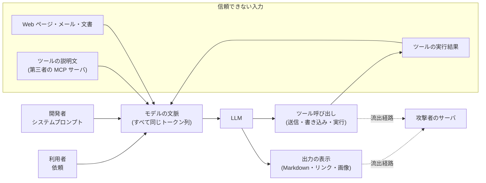
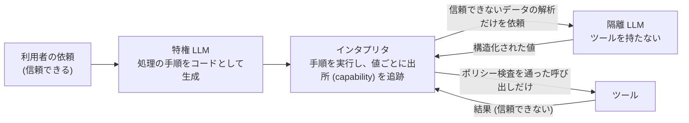

# LLM アプリケーションのセキュリティ (LLM Application Security)

## 概要 (Overview)

LLM を組み込んだアプリケーション、とくにツールを呼び出して外部に作用するエージェントには、従来のソフトウェアにはなかった種類の脆弱性がある。中心にあるのが**プロンプトインジェクション (prompt injection)** である。LLM は、開発者の指示も、利用者の依頼も、検索した文書やメールの本文も、すべて同じトークン列として読む。そのため、外部のテキストに埋め込まれた指示が、開発者や利用者の指示と同じように実行されてしまう ([`../ai/llm-internals-prompting.md`](../ai/llm-internals-prompting.md))。

この問題は、SQL インジェクションと似た構造を持つ。どちらも、命令とデータが同じ経路を流れることから生じる。ただし SQL インジェクションには、命令とデータを構文的に分けるパラメータ化クエリという根本的な解決策があった。LLM には、自然言語の命令とデータを確実に分ける仕組みが今のところ存在しない。2026-10 時点でも、プロンプトインジェクションはモデルの改良だけでは解決されておらず、システムの設計で被害を抑える問題として扱われている。

本ドキュメントは、(1) 脅威モデルと攻撃の分類、(2) 情報流出の経路、(3) 実際の事例、(4) 防御の層 (モデル、入力の区別、検出、設計、実行環境)、(5) 防御の評価方法、(6) ジェイルブレイクとの違い、(7) ツール接続 (MCP) に固有の攻撃面を分析する。エージェントの構成と「危険な三点セット」の定義は [`../ai/agent-architectures.md`](../ai/agent-architectures.md)、ハーネスの実装は [`../ai/agent-loop-engineering.md`](../ai/agent-loop-engineering.md)、RAG に固有の論点は [`../ai/rag-system-architecture.md`](../ai/rag-system-architecture.md) に委ね、本ドキュメントは攻撃と防御の全体像を扱う。分析深度は Level 3。

## 方法論 (Methodology)

- 攻撃を「誰が、どの経路でモデルに指示を届け、どの能力を使って、何を起こすか」で分解し、防御を「どの段で、どの程度の保証をもって止めるか」で整理する。
- 一次資料は、攻撃の原典 (Greshake et al. 2023)、防御の論文 (Instruction Hierarchy、Spotlighting、CaMeL、設計パターン)、評価の論文 (AgentDojo、適応的攻撃の研究)、脆弱性の開示 (EchoLeak、GitHub MCP)、および OWASP Top 10 for LLM Applications である。事例の詳細は開示した研究者の報告と報道に依拠し、その旨を明記する。
- 防御の効果は「非適応的な攻撃での値」と「適応的な攻撃での値」を区別する。前者だけで報告された防御の数値は、本ドキュメントでは安全性の保証として扱わない。

## 発見事項 (Findings)

1. **プロンプトインジェクションはモデルの欠陥というより、アーキテクチャの性質である。** 命令とデータが同じトークン列に載る限り、外部のテキストに含まれた指示をモデルが実行する可能性は残る。学習による改善は成功率を下げるが、ゼロにはしない。そのため防御の主体は、モデルではなくシステムの設計と実行環境に置く必要がある。
2. **被害の大きさは、インジェクションが成功するかではなく、エージェントが持つ能力で決まる。** 非公開データへのアクセス、信頼できないコンテンツの読み込み、外部への送信手段の3つが同じエージェントに揃うと、1回のインジェクションで情報流出が完成する[^trifecta]。Meta の "Agents Rule of Two" は、1つのセッションでこの3つのうち2つまでしか持たせないという設計規則として、同じ考え方を定式化した[^rule-of-two]。
3. **検出による防御は、適応的な攻撃者にはほぼ突破される。** Nasr ら (2025) は、最近提案された 12 の防御に対して、防御に合わせて攻撃を調整する適応的な攻撃を行い、大半で 90% を超える攻撃成功率を得た。元の論文では、それらの防御の多くが攻撃成功率をほぼゼロと報告していた[^attacker-second]。EchoLeak も、Microsoft のプロンプトインジェクション検出器を回避して成立した[^echoleak-aim]。
4. **設計による防御は、有用性と引き換えに保証を与える。** CaMeL は、信頼できる依頼から処理の手順 (制御フロー) を先に決め、信頼できないデータがその手順を変えられないようにする。この方式は、エージェントの評価基盤 AgentDojo で、証明可能な安全性を保ちながら 67% のタスクを達成した[^camel]。残りのタスクを諦めることが、保証の代償である。
5. **情報の流出経路で最も見落とされやすいのは、出力の表示である。** モデルが出力した Markdown の画像や URL を画面が自動で読み込むと、URL に埋め込まれたデータが攻撃者のサーバに送られる。ツールを使わなくても、表示するだけで送信が起きる。EchoLeak は、この種の経路と信頼されたドメインのプロキシを組み合わせて、コンテンツセキュリティポリシー (CSP) をすり抜けた[^echoleak-aim]。
6. **ツール接続の標準化は、ツールの説明文を新しい攻撃面にした。** MCP のツールの説明文はモデルの文脈に入るが、利用者には通常見えない。説明文に指示を埋め込むツールポイズニング (tool poisoning) や、承認後に説明文を書き換える手口が報告されている[^invariant-tp]。

## アーキテクチャ (Architecture)

### 信頼境界とデータの流れ



凡例: 実線はデータの流れ、破線は情報流出の経路。点線の枠の中が、攻撃者が内容を制御できる入力である。

LLM アプリケーションの信頼境界は、従来のアプリケーションとは違う場所に引かれる。従来のアプリケーションでは、信頼できない入力は検証されてから処理される。LLM アプリケーションでは、信頼できない入力も信頼できる指示も、同じ文脈に混ざってからモデルに渡る。モデルの中に、両者を確実に分ける仕組みはない。そのため境界は、モデルの入力側ではなく、出力側 (ツールの呼び出しと表示) に引くことになる。

### 防御の層

| 層 | 例 | 保証の性質 | 適応的な攻撃への耐性 |
|---|---|---|---|
| モデル | 指示の優先順位の学習 (Instruction Hierarchy)、敵対的な学習 | 確率的。成功率を下げる | 低い |
| 入力の区別 | 区切り記号、データの符号化 (Spotlighting) | 確率的。モデルが出所を区別しやすくなる | 低い |
| 検出 | インジェクション検出の分類器、出力の検査 | 確率的。既知の型に強い | 低い (技術詳細 5) |
| 設計 | 制御フローとデータフローの分離 (CaMeL)、二重 LLM、設計パターン | 条件付きで証明可能 | 高い。ただし有用性が下がる |
| 実行環境 | 最小権限のトークン、送信先の許可リスト、サンドボックス、人の承認 | 決定的。能力そのものを制限する | 高い |

上の3層は、攻撃が成功する確率を下げる。下の2層は、攻撃が成功しても被害が出ないようにする。確率を下げる層だけに頼ると、適応的な攻撃者に突破されたときに被害を止める手段が残らない。実務の構成は、下の2層で被害の上限を決め、上の3層で日常的な攻撃を減らす多層防御になる。

## 技術詳細 (Technical Details)

### 1. 攻撃の分類 (attack taxonomy)

| 攻撃 | 指示を届ける者と経路 | 典型的な被害 | OWASP 2025 の対応項目[^owasp] |
|---|---|---|---|
| 直接プロンプトインジェクション | 利用者が依頼の中に書く | システムプロンプトの上書き、想定外の機能の利用 | LLM01 |
| 間接プロンプトインジェクション | 第三者が Web ページ・メール・文書・ツール結果に埋め込む | 利用者の権限での情報流出や操作[^greshake] | LLM01 |
| システムプロンプトの漏洩 | 利用者が引き出す | 内部の指示や埋め込まれた秘密の露出 | LLM07 |
| 知識の汚染 | 第三者が検索対象の文書群に混入させる | 特定の質問への誤答の誘導[^poisonedrag] | LLM04, LLM08 |
| 学習データのバックドア | 学習データの提供者 | 特定の条件でだけ発現する振る舞い[^sleeper] | LLM04 |
| ツールポイズニング | ツールの提供者が説明文に埋め込む | 他のツールの悪用、情報流出[^invariant-tp] | LLM03, LLM06 |
| 出力の不適切な処理 | (上記の結果として) | 出力を HTML・SQL・シェルとしてそのまま実行 | LLM05 |

最も重要なのは**間接**プロンプトインジェクションである。直接の攻撃では、攻撃者は利用者自身なので、得られるのは利用者がもともと持つ権限の範囲にとどまる。間接の攻撃では、攻撃者は利用者とは別人であり、利用者の権限とデータを使って攻撃者のための操作を行わせる。Greshake ら (2023) は、検索機能付きのチャット (Bing Chat) などの実在のアプリケーションに対し、Web ページに埋め込んだ指示で、利用者から情報を引き出したり、利用者を誘導したりできることを示した[^greshake]。

### 2. 情報流出の経路 (exfiltration channels)

インジェクションで情報流出を起こすには、データを攻撃者に届ける経路が要る。

```text
経路                         仕組み                                         対策
Markdown の画像               を表示側が自動取得   外部画像の自動表示をしない / ドメインの許可リスト
リンク                       利用者がクリックすると URL のデータが送られる          リンク先の表示・確認、URL のパラメータの除去
ツールの送信機能              メール送信、HTTP リクエスト、Issue やコメントの投稿     送信先の許可リスト、送信前の人の承認
コード実行                    サンドボックス内からのネットワークアクセス              実行環境のネットワーク遮断
共有された保存先              攻撃者も読める場所 (公開リポジトリなど) への書き込み     書き込み先の権限の分離
```

最初の2つは、ツールを1つも持たないチャットアプリケーションでも成立する。画像の自動表示は、利用者が何も操作しなくても送信を起こすので、とくに危険である。EchoLeak は、リンクと画像による送信の経路、URL のマスキング処理の回避、信頼されたドメイン (Microsoft Teams) のプロキシを組み合わせて、CSP の制限をすり抜けた[^echoleak-aim]。

### 3. 事例 (case studies)

- **EchoLeak (Microsoft 365 Copilot, CVE-2025-32711)**: Aim Labs が発見し、2025-06-11 に公開した。攻撃者が細工したメールを送ると、利用者が後で Copilot に通常の質問をしたときに、そのメールが検索で文脈に取り込まれ、埋め込まれた指示が実行される。利用者のクリックは不要で、Copilot が参照できる社内の情報 (チャット、OneDrive、SharePoint など) が流出しうる。Microsoft はサーバ側で修正し、CVSS 9.3 の重大な情報漏洩の脆弱性として扱った。報告では、プロンプトインジェクションの検出器とリンクのマスキング処理の両方が回避されている[^echoleak-aim][^echoleak-news]。
- **GitHub MCP サーバ (2025-05)**: Invariant Labs が開示した。利用者が自分のエージェントに「公開リポジトリの Issue を確認して」と頼むと、攻撃者が公開リポジトリに書いた Issue の指示によって、エージェントが利用者の非公開リポジトリの内容を読み、公開リポジトリのプルリクエストに書き出す。GitHub の MCP サーバ自体の実装に誤りがあったわけではなく、利用者のトークンが非公開リポジトリと公開リポジトリの両方に権限を持っていたことが原因である。研究者は、これを実装の不具合ではなくアーキテクチャの問題と位置づけた[^invariant-gh]。非公開データ、信頼できない入力、外部への書き込みという三点セットが、1つのトークンに揃っていた例である。

どちらの事例でも、モデルやツールの「バグ」を直す修正だけでは、同じ種類の攻撃を防げない。EchoLeak の修正は特定の流出経路を塞いだものであり、GitHub MCP の推奨対策は「1セッションで扱うリポジトリを1つに限る」「権限を絞ったトークンを使う」という、能力の制限である。

### 4. モデルと入力の層の防御 (model-level and input-level defenses)

**指示の優先順位 (instruction hierarchy)** は、システムメッセージ、利用者のメッセージ、ツールの出力の順に指示の優先度を決め、低い優先度の入力にある指示が高い優先度の指示と矛盾したら従わないよう、モデルを学習させる方式である (Wallace et al. 2024)[^ih]。主要なモデルはこの種の学習を取り入れているが、効果は確率的であり、表現を変えた攻撃や長い文脈の中に紛れた指示を確実に拒否できるわけではない。

**Spotlighting** は、外部のデータに区切り記号を付けたり、データ全体を符号化 (base64 など) したりして、モデルが入力の出所を区別しやすくするプロンプトの技法である。Hines ら (2024) は、GPT 系のモデルで、攻撃成功率を 50% 超から 2% 未満に下げたと報告している[^spotlighting]。ただし、この値は防御を知らない固定の攻撃に対するものであり、防御に合わせて攻撃を変える場合の耐性は別に評価する必要がある (技術詳細 6)。

### 5. 検出の層の限界 (limits of detection)

インジェクションを検出する分類器は、入力に指示らしい文が含まれていないかを判定する。既知の攻撃のパターンには効くが、2つの理由で決定的な防御にならない。第一に、分類器自体も機械学習のモデルであり、それを欺く入力を探す最適化 (勾配法、強化学習、ランダム探索、人による試行錯誤) の対象になる。Nasr ら (2025) は、この種の適応的な攻撃で、検出器を含む 12 の防御の大半を 90% 超の成功率で突破した[^attacker-second]。第二に、自然言語の指示には決まった形がない。メールの依頼文と攻撃の指示は、文面だけでは区別できないことがある。

検出は、日常的に飛んでくる既知の攻撃を減らし、攻撃の試みを記録する役には立つ。しかし、検出をすり抜けた攻撃が成功しても被害が出ないよう、設計と実行環境の層を別に用意しておく必要がある。

### 6. 設計の層の防御 (design-level defenses)

設計の層の防御に共通する考え方は、**信頼できないデータが、エージェントが何をするかを決められないようにする**ことである。



凡例: CaMeL の構成の概略。特権 LLM は信頼できないデータを見ない。隔離 LLM はデータを見るが、ツールを呼べない。

- **二重 LLM (dual LLM) パターン**: ツールを使える「特権 LLM」には信頼できないデータを見せず、信頼できないデータは、ツールを持たない「隔離 LLM」にだけ処理させる。特権 LLM は、隔離 LLM の出力を中身を見ずに変数として扱う[^dual-llm]。
- **CaMeL**: 二重 LLM の考え方を発展させ、特権 LLM が利用者の依頼から処理の手順を Python 風のコードとして書き、専用のインタプリタがそれを実行する。インタプリタは各値の出所を追跡し、「信頼できない出所の値を、この送信先には渡せない」といったポリシーをツールの呼び出しのたびに検査する。信頼できないデータは処理の手順を変えられないので、プロンプトインジェクションで制御フローを乗っ取ることはできない。AgentDojo では 67% のタスクを証明可能な安全性のもとで達成した[^camel]。
- **設計パターン**: Beurer-Kellner ら (2025) は、アクションを決まった選択肢から選ぶだけにする方式、先に計画を固めてから実行する方式、信頼できないデータを個別に処理して結果を集約する方式、文脈から不要な入力を除く方式など、インジェクションに対して証明可能な耐性を持つ設計のパターンを整理し、それぞれの有用性との交換を分析した[^design-patterns]。

これらはいずれも、エージェントの汎用性を制限する。データの中身を見てから次の行動を決めるタスク (メールを読み、その内容に応じて返信先や処理を変えるなど) は、信頼できないデータが制御フローに影響することそのものなので、この種の設計では扱いにくい。設計の層の防御は、どのタスクを諦めるかを明示的に選ぶ方法だと言える。

### 7. 実行環境の層の防御 (environment-level defenses)

実行環境の層は、モデルが何を出力しても被害の上限が変わらないように、エージェントの能力そのものを制限する ([`sandbox-architectures.md`](sandbox-architectures.md))。

- **最小権限**: エージェントに渡すトークンは、タスクに必要なリソースと操作だけに絞る。GitHub MCP の事例は、1つのリポジトリに限ったトークンであれば成立しなかった。
- **能力の組み合わせの制限**: Rule of Two のように、信頼できない入力の処理、機密データへのアクセス、状態の変更や外部への送信のうち、1つのセッションに2つまでしか持たせない[^rule-of-two]。3つすべてが必要なタスクは、人の承認を挟むか、セッションを分割する。
- **送信先の制御**: ネットワークの出口を許可リストで制限し、表示側では外部の画像を自動で読み込まない。
- **人の承認**: 取り消せない操作 (送金、削除、外部への公開) の前に、操作の内容を人に示して承認を求める。ただし承認の要求が多すぎると、利用者は内容を読まずに承認するようになるので、承認の対象を絞る設計が要る。

### 8. 防御の評価 (evaluating defenses)

防御の評価には、有用性と安全性の両方を同じ環境で測る基盤が要る。**AgentDojo** は、メール、銀行、出張予約などのツールを持つ環境で、エージェントが利用者のタスクを達成できるか (有用性) と、ツールの結果に埋め込んだ攻撃に従ってしまうか (安全性) を同時に測る[^agentdojo]。

評価で最も重要なのは、攻撃者が防御を知っていると仮定することである。固定の攻撃文の集合で評価すると、その文面に過剰に適合した防御が高い数値を出す。Nasr ら (2025) は、防御の提案は適応的な攻撃 (防御の仕組みを知ったうえで最適化した攻撃) に対する成功率で評価すべきだと結論している[^attacker-second]。これは、敵対的サンプルの研究で以前から指摘されてきた評価の原則を、LLM に当てはめたものである ([`../ai/llm-evaluation-methodology.md`](../ai/llm-evaluation-methodology.md))。

### 9. ジェイルブレイクとの違い (jailbreaking versus prompt injection)

**ジェイルブレイク (jailbreak)** は、利用者がモデルの安全方針 (有害な内容を出力しない、など) を回避させる攻撃である。プロンプトインジェクションとは、攻撃者と被害者の関係が違う[^pi-vs-jb]。

```text
                 攻撃者          被害者                      破られるもの
ジェイルブレイク    利用者          モデルの開発者の方針          モデルの安全方針
インジェクション    第三者          利用者、アプリケーションの開発者  アプリケーションの意図
```

ジェイルブレイクの研究は、モデルの安全方針が確率的なものであることを示してきた。Zou ら (2023) は、勾配に基づく探索で作った意味の通らない接尾辞が、複数のモデルの拒否を回避し、別のモデルにも転用できることを示した[^gcg]。Anil ら (2024) は、長い文脈に多数の偽の問答例を並べるだけで、例の数に応じて拒否が崩れることを示した (many-shot jailbreaking)[^manyshot]。

この性質から、アプリケーションの設計上の結論が導かれる。モデルの拒否は、アプリケーションの認可の判定として使ってはならない。「この利用者にはこのデータを見せない」という判定は、モデルに指示するのではなく、モデルが参照できるデータの範囲そのものを、利用者の権限に合わせて絞ることで実装する。

### 10. ツール接続 (MCP) に固有の攻撃面 (MCP-specific attack surface)

MCP は、ツールの名前、説明文、引数の定義をサーバからエージェントに渡し、それをモデルの文脈に入れる ([`../ai/agent-architectures.md`](../ai/agent-architectures.md))。この仕組みから、次の攻撃面が生じる[^invariant-tp]。

- **ツールポイズニング**: ツールの説明文に、利用者には見えない指示を埋め込む。Invariant Labs は、足し算をするだけに見えるツールの説明文で、エージェントに SSH の秘密鍵などのファイルを読ませて引数に入れさせる例を示した。
- **承認後の書き換え (rug pull)**: 利用者がツールを確認して承認した後で、サーバが説明文を書き換える。承認時点の確認が意味を失う。
- **他のサーバのツールの乗っ取り**: 悪意のあるサーバの説明文が、同じエージェントに接続された別のサーバのツールの使い方を指示する。信頼できるサーバのツールが、悪意のあるサーバの指示どおりに使われる。

対策は、ソフトウェアのサプライチェーンの対策と同じ形になる ([`software-supply-chain-security.md`](software-supply-chain-security.md))。接続するサーバの出所を確認し、ツールの定義を承認時点のハッシュで固定して変更を検出し、ツールごとに権限を分ける。ツールの説明文は、ツールの提供者が書いた信頼できない入力として扱う。

## セキュリティ考察 (Security Considerations)

本ドキュメント全体がセキュリティを主題としているので、ここでは運用と研究の取り扱いに関わる論点をまとめる。

- **ログに残る秘密**: LLM アプリケーションは、プロンプトとツールの結果をデバッグや評価のために記録することが多い。記録には、利用者のデータ、システムプロンプトに埋め込んだ認証情報、ツールが取得した機密文書が含まれうる。ログ自体を機密データとして扱い、保存期間とアクセス権を制限する。システムプロンプトには秘密を置かない (OWASP LLM07)[^owasp]。
- **モデルのサプライチェーン**: 公開されたモデルの重みファイルには、読み込み時に任意のコードを実行できる形式 (Python の pickle など) がある。モデルの取得元と形式を確認し、実行を伴わない形式 (safetensors など) を使う ([`software-supply-chain-security.md`](software-supply-chain-security.md))。学習データに仕込まれたバックドアは、通常の安全性の学習では除去されない場合がある[^sleeper]。
- **未解決であることを前提にした設計**: 2026-10 時点で、汎用的なエージェントのプロンプトインジェクションを確実に防ぐ方法は知られていない。新しい防御の報告を受けて実行環境の制限を緩めると、その防御が適応的な攻撃に突破されたときに被害の上限がなくなる。防御の改善は、確率を下げる層の改善として扱い、能力の制限は維持する。
- **攻撃の研究と開示**: 本ドキュメントの事例は、研究者が事前に提供元へ報告し、修正後に公開されたものである。LLM アプリケーションの脆弱性も、従来の脆弱性と同じく協調的な開示の対象になる。

## 結論 (Conclusions)

LLM アプリケーションのセキュリティは、「モデルに正しく振る舞わせる」問題ではなく、「モデルが誤って振る舞っても被害が出ない構成にする」問題として扱うべきである。命令とデータが同じトークン列に載る以上、プロンプトインジェクションの成功率は下げられても、ゼロにはできない。検出器やモデルの学習は日常的な攻撃を減らすが、適応的な攻撃者には突破される。

被害の上限を決めるのは、エージェントに与えた能力である。非公開データ、信頼できない入力、外部への送信の3つを1つのセッションに揃えないこと、信頼できないデータに制御フローを決めさせないこと、送信と取り消せない操作の経路を絞ることが、現時点で保証を持つ防御である。これらはエージェントの汎用性を削るので、どのタスクでどの能力を諦めるかを設計として明示することが、LLM アプリケーションのセキュリティ設計の中心になる。

### 次の接続先 (Related Topics)

- [`../ai/agent-architectures.md`](../ai/agent-architectures.md) — エージェントの構成、危険な三点セット、MCP
- [`../ai/agent-loop-engineering.md`](../ai/agent-loop-engineering.md) — 権限層、人の承認、外部コンテンツの隔離の実装
- [`../ai/rag-system-architecture.md`](../ai/rag-system-architecture.md) — 間接プロンプトインジェクションと知識汚染の RAG 側の論点
- [`../ai/llm-internals-prompting.md`](../ai/llm-internals-prompting.md) — モデル内に特権分離がないことの根拠
- [`sandbox-architectures.md`](sandbox-architectures.md) — 実行環境の隔離境界
- [`software-supply-chain-security.md`](software-supply-chain-security.md) — ツールとモデルの出所の検証

## 参考文献 (References)

[^greshake]: Greshake, K. et al. (2023). Not What You've Signed Up For: Compromising Real-World LLM-Integrated Applications with Indirect Prompt Injection. *AISec '23*, 79–90. DOI: 10.1145/3605764.3623985 — 間接プロンプトインジェクションの原典。

[^owasp]: [OWASP Top 10 for LLM Applications 2025](https://genai.owasp.org/llm-top-10/) — OWASP GenAI Security Project. 2026-08 に 2026 年版の公開が報じられたが、2026-10 時点で公式ページの表記は 2025 年版。Accessed: 2026-10-11

[^trifecta]: [The lethal trifecta for AI agents](https://simonwillison.net/2025/Jun/16/the-lethal-trifecta/) — Simon Willison (2025-06-16). Accessed: 2026-10-11

[^rule-of-two]: [Simon Willison — New prompt injection papers: Agents Rule of Two and The Attacker Moves Second](https://simonw.substack.com/p/new-prompt-injection-papers-agents) — Meta AI が 2025-10-31 に公開した Agents Rule of Two の解説。Accessed: 2026-10-11

[^attacker-second]: Nasr, M., Carlini, N., Tramèr, F., et al. (2025). The Attacker Moves Second: Stronger Adaptive Attacks Bypass Defenses Against LLM Jailbreaks and Prompt Injections. arXiv:2510.09023. USENIX Security 2026 で発表。— 12 の防御を適応的な攻撃で突破。

[^camel]: Debenedetti, E., Shumailov, I., et al. (2025). Defeating Prompt Injections by Design. arXiv:2503.18813. — CaMeL。制御フローとデータフローの分離と出所の追跡。

[^design-patterns]: Beurer-Kellner, L., et al. (2025). Design Patterns for Securing LLM Agents against Prompt Injections. arXiv:2506.08837. — 証明可能な耐性を持つエージェントの設計パターンと、有用性との交換。

[^dual-llm]: [The Dual LLM pattern for building AI assistants that can resist prompt injection](https://simonwillison.net/2023/Apr/25/dual-llm-pattern/) — Simon Willison (2023-04-25). Accessed: 2026-10-11

[^ih]: Wallace, E., Xiao, K., Leike, R., Weng, L., Heidecke, J., & Beutel, A. (2024). The Instruction Hierarchy: Training LLMs to Prioritize Privileged Instructions. arXiv:2404.13208.

[^spotlighting]: Hines, K., Lopez, G., Hall, M., Zarfati, F., Zunger, Y., & Kiciman, E. (2024). Defending Against Indirect Prompt Injection Attacks With Spotlighting. arXiv:2403.14720.

[^agentdojo]: Debenedetti, E., Zhang, J., Balunović, M., Beurer-Kellner, L., Fischer, M., & Tramèr, F. (2024). AgentDojo: A Dynamic Environment to Evaluate Prompt Injection Attacks and Defenses for LLM Agents. *Advances in Neural Information Processing Systems 37 (Datasets and Benchmarks)*, 82895–82920.

[^echoleak-aim]: [CyberInsider — EchoLeak exploit enables silent data theft from Microsoft 365 Copilot](https://cyberinsider.com/echoleak-exploit-enables-silent-data-theft-from-microsoft-365-copilot/) — Aim Labs による発見と開示 (2025-06-11)、検出器とリンクのマスキングの回避。Accessed: 2026-10-11

[^echoleak-news]: [Infosecurity Magazine — Microsoft 365 Copilot: New Zero-Click AI Vulnerability Allows Corporate Data Theft](https://www.infosecurity-magazine.com/news/microsoft-365-copilot-zeroclick-ai) — CVE-2025-32711 の報道。Accessed: 2026-10-11

[^invariant-gh]: [Invariant Labs — GitHub MCP Exploited: Accessing private repositories via MCP](https://invariantlabs.ai/blog/mcp-github-vulnerability) — 2025-05-26 の開示。Accessed: 2026-10-11

[^invariant-tp]: [Invariant Labs — MCP Security Notification: Tool Poisoning Attacks](https://invariantlabs.ai/blog/mcp-security-notification) — 2025-04-01 の公開。ツールポイズニング、承認後の書き換え、他のサーバのツールの乗っ取り。Accessed: 2026-10-11

[^poisonedrag]: Zou, W., Geng, R., Wang, B., & Jia, J. (2025). PoisonedRAG: Knowledge Corruption Attacks to Retrieval-Augmented Generation of Large Language Models. *USENIX Security 2025*, 3827–3844. arXiv:2402.07867

[^sleeper]: Hubinger, E., et al. (2024). Sleeper Agents: Training Deceptive LLMs that Persist Through Safety Training. arXiv:2401.05566. — 安全性の学習で除去されないバックドア。

[^pi-vs-jb]: [Prompt injection and jailbreaking are not the same thing](https://simonwillison.net/2024/Mar/5/prompt-injection-jailbreaking/) — Simon Willison (2024-03-05). Accessed: 2026-10-11

[^gcg]: Zou, A., Wang, Z., Carlini, N., Nasr, M., Kolter, J. Z., & Fredrikson, M. (2023). Universal and Transferable Adversarial Attacks on Aligned Language Models. arXiv:2307.15043.

[^manyshot]: Anil, C., et al. (2024). Many-shot Jailbreaking. *Advances in Neural Information Processing Systems 37*.
