# メモリ安全性と exploit 緩和の系譜 (Memory Safety & the Genealogy of Exploit Mitigations)

## 概要 (Overview)

C と C++ は「プログラマがメモリを管理する」ことを性能と引き換えに選んだ言語である。この選択の代償が、40 年にわたって深刻な脆弱性の主要な源であり続けている**メモリ安全性 (memory safety)** の欠如である。ポインタは指す先の生存も境界も型も知らず、コンパイラはそれらを検査しない——**未定義動作 (undefined behavior, UB)** として「起きないと仮定してよい」と規定するからである。この仮定は最適化を可能にすると同時に、境界を越えた読み書きが「診断されないまま、攻撃者に観測・制御される状態」を作り出す。

本ドキュメントは、この構造的欠陥に対する半世紀の応答を**軍拡競争 (arms race)** として読む。ある緩和が特定の攻撃技法を無効化すると、攻撃側はそれを迂回する新技法を編み出し、防御側がさらに上を積む——code injection → stack canary/DEP → ROP → ASLR → CFI → shadow stack → PAC/MTE → CHERic、という螺旋である。個々の緩和は「バグを消す」のではなく「バグから exploit への距離を伸ばす」確率的・機構的な障壁であり、その積層が現代のプラットフォーム防御を成す。終着点として、緩和を積むのをやめて**言語で問題を消す**（Rust・マネージドランタイム）方向と、能力 (capability) をハードウェアに刻む **CHERI** という二つの「本命」を位置づける。

本書は一般論の系譜を扱い、iOS ([`../ios/security-architecture.md`](../ios/security-architecture.md)) と Android ([`../android/security-model.md`](../android/security-model.md)) の実装詳細は各文書に委ね、ここではそれらを系譜上の応用例として参照する。防御的観点に徹し、動作する exploit コードは示さない。分析深度は Level 3。

## 方法論 (Methodology)

- メモリ破壊を**空間的安全性 (spatial safety)**（境界違反: オーバーフロー）と**時間的安全性 (temporal safety)**（生存違反: use-after-free）の二軸で分類し、なぜ C/C++ の抽象機械がこの二つを検査しないかを UB の観点から説明する。
- 緩和技法を「攻撃技法 → 緩和 → 迂回 → 次の緩和」の応答連鎖として時系列に並べ、各緩和が**何を前提とし、その前提が破れると何が残るか**を明示する。孤立した技法の列挙はしない。
- 防御を三つの戦略層に分ける: (1) **確率的緩和**（ASLR: 秘密に依存）、(2) **機構的緩和**（CFI/shadow stack/PAC/MTE: 不変条件を強制）、(3) **根絶**（言語による安全性）。この分類が「なぜ緩和だけでは終わらないか」を貫く軸である。
- 定量的主張（メモリ安全バグの比率、Rust 導入効果）は一次に近い出典（Microsoft/Google/CISA）に紐づけ、桁感 (order of magnitude) として扱う。ベンダの目標値 (target) と実測値 (demonstrated) を区別する。
- 検出系（サニタイザ）と緩和系（本番投入される防御）を役割で峻別する。前者は開発時、後者は実行時という配備モデルの違いが性能予算を決める。

## 発見事項 (Findings)

1. **メモリ安全性の欠如は C/C++ の抽象機械の設計であり、バグではない。** 言語仕様は境界外アクセス・解放後使用・未初期化読みを **UB** と規定する——「診断せよ」ではなく「起きないと仮定して最適化してよい」という意味である。ゆえに検査は原理的に走らず、違反は静かに攻撃者制御下の状態へ落ちる。この一点からメモリ破壊脆弱性のすべてが導かれる。

2. **深刻な脆弱性のおよそ 7 割が今なおメモリ安全性の問題である。** Microsoft は毎年パッチする CVE の約 70% がメモリ安全性バグだと報告し (Miller, BlueHat IL 2019)、Chromium も深刻なセキュリティバグの約 70% が同種だと公表している。数十年の緩和投資の後もこの比率が動かなかったことが、「緩和では根絶できない」という結論を業界に強いた。

3. **緩和は攻撃を消さず、攻撃技法を次の形へ押し出す。** DEP (W^X) が注入コードの実行を封じると攻撃は既存コードを再利用する ROP へ、ASLR がアドレスを隠すと情報漏洩 (info leak) との二段構えへ、と一貫して「防御が閉じた扉の隣の扉」へ移る。緩和の価値は勝利ではなく、exploit の**コスト・信頼性・必要な前提バグ数**を上げることにある。

4. **検出系と緩和系は別物である。** AddressSanitizer 等のサニタイザは違反を**確実に**捕えるが 2 倍前後の速度・数倍のメモリを要し、原則として開発・ファジング時専用である。本番に置ける緩和 (ASLR/CFI/shadow stack) は数%級のコストに収める代わりに、保証は部分的・確率的になる。「捕捉率」と「常時実行可能性」は交換関係にある。

5. **確率的防御は情報漏洩に弱く、機構的防御へ収斂している。** ASLR はアドレスという秘密に依存するため、ポインタ 1 個の漏洩でモジュール単位に無効化される。ゆえに近年の重心は「秘密に依存せず不変条件を強制する」CFI・shadow stack・PAC・MTE へ移った。これらは info leak があっても壊れにくい。

6. **最終的な解決は緩和の外にある——言語とハードウェア能力である。** Rust の所有権・借用検査はコンパイル時に時間的・空間的安全性を証明し、マネージドランタイムは GC で時間的安全性を実行時に保証する。CHERI はポインタを**境界と権限を帯びた能力**へ格上げし、メモリ安全を ISA の不変条件にする。Android の実データ（新規コードの Rust 化でメモリ安全脆弱性比率が急減）は「言語選択はセキュリティ機構である」ことの最初の大規模実証となった。

## アーキテクチャ (Architecture)

### 攻撃と防御の軍拡競争 (arms race)

```mermaid
graph LR
    CI["code injection<br/>スタックに shellcode を置き実行"]
    DEP["DEP / W^X<br/>書込ページは実行不可"]
    ROP["ROP / JOP<br/>既存コード片(gadget)の連鎖"]
    ASLR["ASLR<br/>アドレスを乱択で隠す"]
    LEAK["info leak<br/>ポインタ漏洩で ASLR 迂回"]
    CFI["CFI (forward-edge)<br/>間接呼び出し先を型で制限"]
    SS["shadow stack (backward-edge)<br/>戻りアドレスを保護 (Intel CET)"]
    PAC["ARM PAC / BTI<br/>ポインタ署名・分岐先限定"]
    MTE["ARM MTE<br/>確率的タグ照合 (UAF/OOB 検出)"]
    LANG["言語による根絶<br/>Rust / GC / CHERI"]

    CI -->|"実行を封じる"| DEP
    DEP -->|"注入せず再利用"| ROP
    ROP -->|"gadget 位置を隠す"| ASLR
    ASLR -->|"秘密を漏らす"| LEAK
    LEAK -->|"制御フローを型で縛る"| CFI
    CFI -->|"戻り先も守る"| SS
    SS -->|"署名で改竄検出"| PAC
    PAC -->|"バグ自体を検出"| MTE
    MTE -->|"クラスを消す"| LANG
```



各矢印は「防御が閉じた扉に対し、攻撃が隣の扉を開く」応答である。系譜の右へ行くほど、防御は「アドレスを隠す確率的防御」から「不変条件を強制する機構的防御」、さらに「脆弱性クラスそのものの根絶」へ性質が変わる。

### 防御の三層と保証の性質

```
 [根絶 elimination]   Rust 所有権 / GC / CHERI 能力
    保証: バグクラスが原理的に存在しない/実行前に検出
    代価: 言語移行コスト・FFI/unsafe の境界・ハード要件
 ────────────────────────────────────────────────────
 [機構 enforcement]   CFI / shadow stack / PAC / BTI / MTE
    保証: 不変条件を強制。info leak に耐性
    代価: 数%〜のオーバーヘッド・一部はハード世代依存
 ────────────────────────────────────────────────────
 [確率 probabilistic]  ASLR / stack canary
    保証: 秘密(アドレス/カナリア値)を攻撃者が知らない前提
    代価: ほぼ無償。ただし漏洩 1 回で破れる
 ────────────────────────────────────────────────────
 [基盤 foundation]     DEP / W^X — 「書ける ⊕ 実行できる」
    注入コード実行という最古の技法を封じる前提条件
```

下ほど古く安価だが破りやすく、上ほど新しく強いが代価が高い。現代のプラットフォームはこれらを積層する——ASLR/PIE ([`../toolchain/linkers-loaders-elf.md`](../toolchain/linkers-loaders-elf.md)) を土台に、CFI と shadow stack を重ね、対応ハードでは PAC/MTE を足し、新規コードは Rust で書く。

## 技術詳細 (Technical Details)

### 1. メモリ破壊の分類 — なぜ C/C++ で構造的に生じるか

メモリ破壊は二つの安全性の破れに大別される。

- **空間的安全性の破れ (spatial)**: アクセスが確保領域の境界を越える。**スタックオーバーフロー**（ローカル配列への過剰書き込みが戻りアドレスを上書き）、**ヒープオーバーフロー**（隣接チャンクのメタデータや関数ポインタを破壊）、そして**整数オーバーフロー (integer overflow)** が `malloc(n * size)` の桁あふれを通じて過小確保を招き、後続の書き込みを境界外にする経路。
- **時間的安全性の破れ (temporal)**: アクセスが領域の生存期間を越える。**use-after-free (UAF)**（解放済みメモリへのアクセス。攻撃者が解放後に同サイズの制御オブジェクトを再確保すると、古いポインタ経由でそれを操れる）、二重解放、未初期化読み。
- **型混同 (type confusion)**: あるオブジェクトを別の型として解釈する。C++ の不正な `static_cast`・共用体の誤用・多相オブジェクトの vtable 誤読が典型で、型ごとにレイアウトが違うため「ある型のフィールド」が「別の型のポインタ」として書き換え可能になる。ブラウザ JIT の主要攻撃面でもある ([`../compilers-runtimes/managed-runtimes-gc-jit.md`](../compilers-runtimes/managed-runtimes-gc-jit.md))。

これらが**構造的に**生じるのは、C/C++ の抽象機械がポインタを「番地」としてしか持たず、指す先の**境界・生存・型**を実行時に随伴させないからである。仕様はこれらの違反を **UB** と規定する。UB は単なる「未規定」ではない: コンパイラは「UB は起きない」と仮定して最適化する権利を持つ——ゆえに `if (p + n < p)` のようなオーバーフロー検査は「符号付き加算は溢れない」という UB 仮定の下で**削除されうる**。安全のために書いた検査が最適化で消え、境界チェックの不在が exploit を生む、という倒錯がここに宿る。検査を随伴させない設計が性能を生み、同じ設計が脆弱性を生む——これは `../../hardware/hardware-security/side-channels-tee-secure-boot.md` の「最適化と隔離の対立」のソフトウェア版である。

### 2. 攻撃技法の進化と緩和の軍拡競争

- **code injection と stack canary / DEP**: 最古の技法は、オーバーフローで戻りアドレスをスタック上の shellcode に向ける (Aleph One, 1996)。二つの防御が応答した。**stack canary (スタックカナリア)** は戻りアドレスの手前に乱数の番兵を置き、関数復帰前に改竄を検出する（線形オーバーフローに有効、任意書き込みには無力）。**DEP / W^X (Data Execution Prevention / Write⊕eXecute)** はページを「書ける」か「実行できる」の排他にし、注入したデータの実行を不可能にする。
- **ROP / JOP**: DEP は「新しいコードを注入する」道を塞いだだけで、「既にある実行可能コードを使う」道は残した。**ROP (Return-Oriented Programming)** は `ret` で終わる既存コード断片 (gadget) を、スタック上に積んだ戻りアドレス列でチェーンし、任意計算をチューリング完全に組み立てる (Shacham, 2007)。間接ジャンプ版が **JOP (Jump-Oriented Programming)**。「コードを注入せず再利用する」この転換が、以後の緩和すべての標的を「制御フローの乗っ取り」に定めた。
- **ASLR とその迂回**: **ASLR (Address Space Layout Randomization)** は gadget やライブラリの番地を実行ごとに乱択し、ROP チェーンの前提（アドレス既知）を崩す。位置独立実行 (PIE) がその前提で、詳細は [`../toolchain/linkers-loaders-elf.md`](../toolchain/linkers-loaders-elf.md)。だが ASLR は**秘密（ベースアドレス）に依存する確率的防御**であり、(a) ポインタ 1 個の**情報漏洩 (info leak)** でモジュール全体の配置が割れる、(b) 32bit 環境ではエントロピー不足で総当たり可能、という構造的弱点を持つ。実 exploit は「info leak バグ + 制御フロー奪取バグ」の二段構成に進化した。
- **CFI (Control-Flow Integrity)**: 制御フローの乗っ取り自体を禁じる機構的防御 (Abadi et al., 2005)。**forward-edge**（間接呼び出し・間接ジャンプ）を「呼び出し先は正しい型・正しい標的集合に属す」と静的に算出した集合へ制限する。実装は Clang CFI（型シグネチャ単位のチェック、LTO 前提）、Windows **CFG (Control Flow Guard)**（有効な呼び出し先ビットマップ）。gadget へ「飛べなくする」ことで ROP/JOP の前提を崩す。
- **shadow stack (backward-edge)**: forward-edge を縛っても、`ret` が使う**戻りアドレス**の書き換え（backward-edge）は残る。**shadow stack** は戻りアドレスの複製を書き込み保護された別スタックに持ち、復帰時に照合する。**Intel CET (Control-flow Enforcement Technology)** がこれをハードウェアで実装し（shadow stack + IBT: Indirect Branch Tracking）、CFI の前方後方を CPU 機能で完成させた。
- **ARM PAC / BTI**: ARMv8.3 の **PAC (Pointer Authentication)** は、ポインタの未使用上位ビットに鍵付きの**署名 (PAC)** を埋め、使用前に検証する。戻りアドレスや関数ポインタの改竄を「署名照合の失敗」として検出し、shadow stack と同種の保護を暗号的に達成する。**BTI (Branch Target Identification)** は間接分岐の着地点を専用命令のある箇所に限定し、forward-edge を縛る。iOS は PAC を早期に全面採用した ([`../ios/security-architecture.md`](../ios/security-architecture.md))。
- **ARM MTE (Memory Tagging Extension)**: ここまでは制御フロー奪取という**症状**を防ぐが、MTE は原因たるメモリ破壊**そのもの**を検出する。ARMv8.5 の MTE は 16 バイト粒度のメモリに 4bit の**タグ**を付け、ポインタにも同じタグを載せ、アクセス時に照合する。解放時にタグを変えれば UAF が、隣接領域の異なるタグがオーバーフローが、確率的（15/16）に検出される。Android が Scudo アロケータと組み合わせて採用 ([`../android/security-model.md`](../android/security-model.md))。
- **CHERI（能力ベースの本命）**: 究極形は、ポインタを 128bit の**能力 (capability)** ——番地に加えて**境界・権限・有効ビット**を帯び、専用命令でしか作れず単調にしか縮小できない——へ格上げすることである。CHERI (Capability Hardware Enhanced RISC Instructions) はこれを ISA に組み込み、空間的安全性を全ポインタに強制し、時間的安全性も版付き能力等で射程に入れる。Arm **Morello** 試作ボードが実チップで検証中。既存 C/C++ コードをほぼそのまま再コンパイルでき、緩和の積層とは次元の異なる「アーキテクチャによる根絶」を狙う。

### 3. 検出系 — サニタイザとファジング

緩和とは目的が違う道具として、開発時に違反を**確実に捕える**サニタイザ群がある。

- **AddressSanitizer (ASan)**: コンパイラが全メモリアクセスに検査を挿入し、確保領域の周囲に**レッドゾーン**を、解放済み領域に**隔離 (quarantine)** を設けて、境界外アクセスと UAF を即座に捕える (Serebryany et al., 2012)。代償は約 2 倍の実行速度と数倍のメモリで、**本番投入は非現実的**——開発とテストの道具である。姉妹に MemorySanitizer (未初期化読み)、UBSanitizer (UB)、ThreadSanitizer (データ競合) がある。
- **ファジングとの組み合わせ**: サニタイザ単体は「実行した経路の違反」しか捕えない。**ファジング (fuzzing)**（AFL++・libFuzzer 等がカバレッジを誘導して膨大な入力を自動生成）と組み合わせると、「新しい経路を掘る fuzzer」と「掘った経路の違反を捕えるサニタイザ」が噛み合い、潜在バグを大量に発掘できる。Google の OSS-Fuzz はこの組み合わせを主要 OSS に継続適用している。
- **本番向けの軽量版**: 本番でも使える検出として、確率的サンプリングで低コスト化した **GWP-ASan** や、前述の MTE（ハード支援で常時オン可能）がある。「捕捉率 × 常時実行可能性」の交換関係の、本番側の解である。

### 4. 言語による解決

緩和の螺旋を降りる根本策は、メモリ安全性を**言語のレベルで保証する**ことである。

- **Rust の所有権と借用**: Rust は各値に唯一の**所有者 (owner)** を定め、**借用検査器 (borrow checker)** が「可変参照は同時に一つ・共有参照が生きている間は可変参照を作れない・参照は指す先より長生きしない」をコンパイル時に検証する。これにより UAF・二重解放・データ競合・境界外アクセスが、GC の実行時コストなしに**コンパイル時に排除**される（`../compilers-runtimes/managed-runtimes-gc-jit.md` の「所有権はメモリ管理コストをコンパイル時に払う第三の道」）。境界は `unsafe` ブロック（安全性の証明責任がプログラマに移る）と FFI（C との境界では保証が切れる）で、そこに検証を集中できる点が設計の要である。
- **マネージドランタイム (GC) の安全性と境界**: Java・C#・Go・JavaScript は GC で時間的安全性を、暗黙の境界チェックで空間的安全性を実行時に保証する。ただし安全性は**ランタイム実装の正しさに移譲される**だけで、消えたわけではない: JIT のバグは型混同として任意コード実行に至り (`../compilers-runtimes/managed-runtimes-gc-jit.md`)、GC のバリア取りこぼしは UAF を生み、FFI/JNI や `unsafe` は保証の外へ出る。「安全な言語の unsafe な下層」は攻撃面として残る。
- **業界・政府の方針転換**: Microsoft/Chromium の「約 7 割」という数字を背景に、CISA は業界横断で **memory safety roadmap** の策定を促し ("The Case for Memory Safe Roadmaps", 2023)、米 ONCD は新規コードをメモリ安全言語で書くよう求める報告書を出した ("Back to the Building Blocks", 2024)。**Android の実データ**が最強の裏付けである: 新規コードを Rust 中心に移行した結果、メモリ安全性脆弱性が Android の脆弱性全体に占める比率が 2019 年の約 76% から数年で大幅に低下したと Google は報告し、Rust コード自体からは事実上メモリ安全 CVE が出ていないとした (Google Security Blog, 2022 / 2024)。「新規コードをメモリ安全言語で」は理念でなく実測に基づく方針になった。

### 5. 実プラットフォームでの積層

同じ系譜が、実プロダクトでは制約（バッテリ・互換性・攻撃者クラス）に応じて選択的に積層される。詳細は各文書に委ね、ここでは系譜上の位置づけのみ示す。

- **iOS**: DEP/ASLR/stack canary を土台に、**PAC** を早期全面採用して制御フロー保護を暗号化し、さらにカーネルの上へ強制主体を積み上げ、最新世代では **MIE (Memory Integrity Enforcement)** として同期 MTE を常時有効化する方向へ進んだ。「制御フロー保護 (PAC) → メモリ破壊そのものの検出 (MTE 系)」という本系譜の右方向への移動を、プラットフォーム全体で体現している ([`../ios/security-architecture.md`](../ios/security-architecture.md))。
- **Android**: ASLR/W^X の上に CFI・ShadowCallStack（制御フローの型強制）を重ね、対応 Pixel で **MTE** を Scudo ヒープアロケータと結んで UAF/オーバーフローの検出保証へ進み、同時に新規コードの **Rust** 化でクラス根絶を狙う——「確率 → 機構 → 根絶」の三層を一プラットフォームで並走させる実例である ([`../android/security-model.md`](../android/security-model.md))。

## セキュリティ考察 (Security Considerations)

本ドキュメント全体が防御の体系化だが、系譜から導かれる横断的教訓を整理する。

- **緩和は残余リスク (residual risk) で評価する**: どの緩和も「何を封じ、何が残るか」で測るべきである。DEP は注入を封じるが再利用 (ROP) を残し、ASLR は配置を隠すが info leak を残し、CFI は間接呼び出しを縛るが「型的に正当な標的への誤誘導」(counterfeit object-oriented programming 等) や data-only 攻撃を残す。単独で完全な緩和は存在しない。
- **多層防御 (defense in depth) が前提**: ゆえに緩和は積層して初めて意味を持つ。攻撃者に「複数の独立した前提バグ（info leak + 制御フロー奪取 + CFI 迂回）」を同時に要求させることが目的であり、一層でも exploit の信頼性・コストを押し上げる。
- **確率的防御の限界を機構的防御が埋める**: ASLR・canary の弱点（漏洩・総当たり）は本質的であり、CET shadow stack・PAC・MTE のような「秘密に依存せず不変条件を強制する」機構への移行が近年の一貫した方向である。
- **検出系を本番防御と混同しない**: ASan の「確実な捕捉」は 2 倍の速度・数倍のメモリという配備制約と不可分であり、本番防御ではない。本番に置けるのは軽量な確率的検出 (MTE/GWP-ASan) か機構的緩和である。役割を取り違えると、性能予算を誤り防御を配備できない。
- **安全な言語は攻撃面を移動させる**: Rust/GC は脆弱性クラスを消すが、`unsafe`・FFI・ランタイム実装バグ・JIT に攻撃面が集中的に移る。「安全な言語だから安全」ではなく「危険の所在が絞れたから監査を集中できる」が正しい理解である。
- **サプライチェーンという別軸**: メモリ安全性はコード**内**の欠陥を扱うが、xz/liblzma 事件 ([`../toolchain/linkers-loaders-elf.md`](../toolchain/linkers-loaders-elf.md)) が示したように、依存関係の**注入**は本系譜のどの緩和も防げない。メモリ安全は必要条件であって十分条件ではない。

## 結論 (Conclusions)

- メモリ破壊脆弱性は C/C++ の抽象機械がポインタに境界・生存・型を随伴させない設計の帰結であり、UB という最適化の権利と表裏一体である。空間的・時間的安全性の欠如がすべての起点である。
- 40 年の緩和の歴史は軍拡競争であり、防御は「アドレスを隠す確率的防御 (ASLR/canary)」から「不変条件を強制する機構的防御 (CFI/shadow stack/PAC/MTE)」へ、性質を変えながら積層してきた。各緩和は勝利ではなく exploit のコストを上げる障壁である。
- 深刻な脆弱性の約 7 割が今なおメモリ安全性の問題という不動の統計が、「緩和では根絶できない」ことを証明した。ゆえに重心は**言語による根絶**（Rust の所有権、GC）と**能力ベースのハードウェア** (CHERI) へ移りつつある。
- Android の Rust 導入の実データと、CISA/ONCD の政策転換は、「言語の選択はセキュリティ機構である」という命題を理念から実証へ変えた。ただし `unsafe`/FFI/ランタイム/サプライチェーンという境界に攻撃面は残り、防御は依然として多層である。
- CHERI が示す「メモリ安全を ISA の不変条件にする」道は、緩和の螺旋を原理的に断ち切りうる本命だが、アーキテクチャ移行の巨大なコストと引き換えであり、緩和・言語・能力の三者は当面併存する。

### 次の接続先 (Related Topics)

- [`../toolchain/linkers-loaders-elf.md`](../toolchain/linkers-loaders-elf.md) — ASLR/PIE/RELRO の機構と xz サプライチェーン事件。本系譜の「基盤・確率」層の実装と、メモリ安全では防げない別軸。
- [`../ios/security-architecture.md`](../ios/security-architecture.md) — PAC → PPL → SPTM → MIE の積層。本系譜を「カーネルの上」へ拡張した応用。
- [`../android/security-model.md`](../android/security-model.md) — CFI/ShadowCallStack・MTE (Scudo)・Rust 化の実測効果。「確率→機構→根絶」の三層並走。
- [`../compilers-runtimes/managed-runtimes-gc-jit.md`](../compilers-runtimes/managed-runtimes-gc-jit.md) — GC の安全性境界、JIT の型混同攻撃面、Rust 所有権を「メモリ管理の第三の道」として。
- [`../../hardware/hardware-security/side-channels-tee-secure-boot.md`](../../hardware/hardware-security/side-channels-tee-secure-boot.md) — 「最適化と隔離の対立」というハードウェア側の対。MTE/PAC/CHERI が立つシリコンの基盤。

## 参考文献 (References)

**一次資料 (Primary — 論文・標準・一次報告)**

- Szekeres, L., Payer, M., Wei, T., & Song, D. (2013). SoK: Eternal War in Memory. *IEEE Symposium on Security and Privacy (S&P) 2013*, 48–62. DOI: 10.1109/SP.2013.13 — メモリ破壊攻撃と緩和の体系的整理 (systematization)。本ドキュメントの分類枠組みの基礎。
- Abadi, M., Budiu, M., Erlingsson, Ú., & Ligatti, J. (2005). Control-Flow Integrity. *ACM CCS 2005*, 340–353. DOI: 10.1145/1102120.1102165 — CFI の原論文。
- Shacham, H. (2007). The Geometry of Innocent Flesh on the Bone: Return-into-libc without Function Calls (on the x86). *ACM CCS 2007*, 552–561. DOI: 10.1145/1315245.1315313 — ROP の原論文。
- Serebryany, K., Bruening, D., Potapenko, A., & Vyukov, D. (2012). AddressSanitizer: A Fast Address Sanity Checker. *USENIX ATC 2012*, 309–318. — ASan の設計と性能特性。
- Watson, R. N. M., et al. (2019). *An Introduction to CHERI*. University of Cambridge Computer Laboratory Technical Report UCAM-CL-TR-941. — [www.cl.cam.ac.uk/techreports/UCAM-CL-TR-941.html](https://www.cl.cam.ac.uk/techreports/UCAM-CL-TR-941.html) — Accessed: 2026-07-06。CHERI 能力モデルの一次解説。
- Miller, M. (2019). Trends, Challenges, and Strategic Shifts in the Software Vulnerability Mitigation Landscape. *BlueHat IL 2019* (Microsoft Security Response Center). — Microsoft のパッチ済み CVE の約 70% がメモリ安全性バグという統計の出所。

**二次資料・公式文書 (Secondary / Official)**

- The Chromium Projects — Memory safety. — [www.chromium.org/Home/chromium-security/memory-safety/](https://www.chromium.org/Home/chromium-security/memory-safety/) — Accessed: 2026-07-06。深刻なセキュリティバグの約 70% がメモリ安全性問題という Chromium の集計。
- Google Security Blog (Vander Stoep, J., 2022). Memory Safe Languages in Android 13. — [security.googleblog.com/2022/12/memory-safe-languages-in-android-13.html](https://security.googleblog.com/2022/12/memory-safe-languages-in-android-13.html) — Accessed: 2026-07-06。メモリ安全性脆弱性比率の推移 (2019 年約 76% → 低下) と Rust コードの実績。
- Google Security Blog (Rebert, A., & Vander Stoep, J., 2024). Eliminating Memory Safety Vulnerabilities at the Source. — [security.googleblog.com/2024/09/eliminating-memory-safety-vulnerabilities-Android.html](https://security.googleblog.com/2024/09/eliminating-memory-safety-vulnerabilities-Android.html) — Accessed: 2026-07-06。新規コードのメモリ安全化による脆弱性密度低下の分析。
- CISA (2023). The Case for Memory Safe Roadmaps. — [www.cisa.gov/resources-tools/resources/case-memory-safe-roadmaps](https://www.cisa.gov/resources-tools/resources/case-memory-safe-roadmaps) — Accessed: 2026-07-06。メモリ安全言語移行ロードマップの政策提言。
- The White House ONCD (2024). Back to the Building Blocks: A Path Toward Secure and Measurable Software. — [www.whitehouse.gov/oncd/briefing-room/2024/02/26/press-release-technical-report/](https://www.whitehouse.gov/oncd/briefing-room/2024/02/26/press-release-technical-report/) — Accessed: 2026-07-06。米政府によるメモリ安全言語推奨の技術報告。
- Intel. *Control-flow Enforcement Technology Specification* — shadow stack と IBT の規定。Intel 64 and IA-32 Architectures Software Developer's Manual に統合。 — Accessed: 2026-07-06。
- Arm Ltd. *Armv8-A Architecture Reference Manual* — Pointer Authentication (PAC)、Branch Target Identification (BTI)、Memory Tagging Extension (MTE) の規範仕様。 — Accessed: 2026-07-06。
- Aleph One (1996). Smashing the Stack for Fun and Profit. *Phrack Magazine*, 7(49). — スタックオーバーフロー攻撃の古典的解説（歴史的一次資料）。
