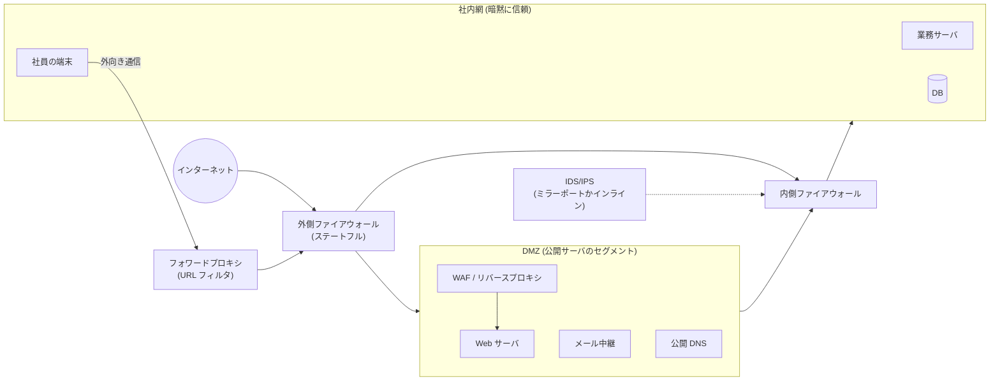
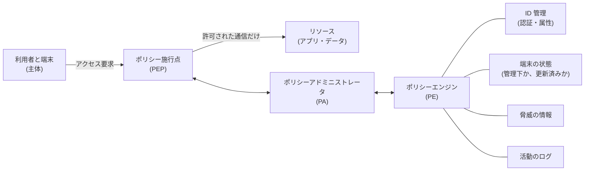

# 境界防御とゼロトラスト (Perimeter Defense & Zero Trust: Firewalls, WAF, IDS/IPS, Proxies, DMZ, ZTA & SASE)

## 概要 (Overview)

本ドキュメントはネットワークの上で通信を検査し、許可し、止める防御の仕組みを扱う。対象はファイアウォール (パケットフィルタ、ステートフルインスペクション、次世代ファイアウォール)、プロキシ、DMZ、IDS/IPS (侵入検知・防止)、WAF (Web Application Firewall)、そしてそれらの前提を見直したゼロトラストアーキテクチャ (ZTA) と SASE である。[`../networking/`](../networking/README.md) の文書群が扱った L2〜L7 のプロトコルを、防御する側から読み直す位置にある。

中心テーゼは、**境界防御は「内側は信頼できる」という前提の上に成り立っており、その前提が成り立たなくなったことへの応答がゼロトラストである**ということである。ファイアウォールは内と外の間に 1 本の線を引き、線を越える通信だけを検査した。この方式は、守るべきものが社内のデータセンターにあり、利用者も社内にいた時代には合理的だった。しかし利用者は社外から接続し、アプリケーションはクラウドに移り、攻撃者はフィッシングや VPN 装置の脆弱性で一度内側に入れば横に広がれるようになった。NIST SP 800-207 (2020) は、ネットワーク上の位置を理由に暗黙の信頼を与えないことをゼロトラストの中心に置いた。

ただしゼロトラストはファイアウォールや IDS を不要にする製品ではない。施行点を「境界の 1 か所」から「各リソースの手前」へ移し、判断の材料を「どこから来たか」から「誰が、どの端末で、何をしようとしているか」へ移す設計の考え方である。もう 1 つの論点は、防御装置そのものが攻撃面になったことである。ファイアウォールや VPN 装置はインターネットに公開され、権限が強く、中が見えにくい。2024〜2025 年にはこうした境界の機器が侵入の入口として繰り返し狙われ、各国の政府機関が共同で対策の指針を出した。分析深度は Level 3。

## 方法論 (Methodology)

- **一次資料**: ゼロトラストは NIST SP 800-207 (Rose et al. 2020) と、Google の BeyondCorp の論文 (Ward & Beyer 2014)、米国の CISA Zero Trust Maturity Model を使う。侵入検知はモデルの原典 (Denning 1987)、検知の限界を示した Axelsson (2000)、検知回避を示した Ptacek & Newsham (1998)、実装の原典 (Snort は Roesch 1999、Bro/Zeek は Paxson 1999) を使う。TLS の通信を解読して検査することの影響は Durumeric et al. (2017) の実測を使う。
- **用語の出どころを区別する**: 「次世代ファイアウォール」「SASE」「SSE」はベンダーや調査会社 (Gartner) が作った用語で、標準の定義はない。本書ではこれらを製品の分類名として扱い、何を組み合わせた呼び名かを示すにとどめる。
- **担当範囲**: 各プロトコルの仕組みは [`../networking/`](../networking/README.md) の文書、クラウドのセキュリティグループ (分散ファイアウォール) は [`../networking/virtual-networks-overlay.md`](../networking/virtual-networks-overlay.md)、サービス間の mTLS とワークロードの ID は [`../networking/service-mesh.md`](../networking/service-mesh.md)、クラウドの IAM による認可は [`../cloud/cloud-iam-authorization.md`](../cloud/cloud-iam-authorization.md)、ブラウザ側の Web セキュリティは [`../browsers/web-security-model.md`](../browsers/web-security-model.md) に委ねる。検知した事象をどう分析し対応するか (SIEM、EDR、インシデント対応) は、別の文書で扱う予定である。
- 各装置を「何を見て判断するか」「どこに置くか」「何を見落とすか」の 3 点で比べる。

## 発見事項 (Findings)

1. **ファイアウォールの進化は、判断に使う情報が増えていく歴史である。** パケットフィルタは 1 つのパケットのヘッダ (アドレス、ポート) だけを見た。ステートフルインスペクションは接続の状態を記録し、内側から始まった接続の戻りだけを通すようにした。プロキシはアプリケーションの通信を一度終端して中身を見た。次世代ファイアウォールはポート番号ではなく通信の中身からアプリケーションを識別し、利用者の ID と結びつけた。判断の材料が増えるほど細かく制御できるが、装置が理解しなければならないプロトコルも増える。
2. **IDS の限界を決めるのは、検知率よりも誤検知率である。** 攻撃は通信全体のごく一部でしかない。そのため、誤検知の率がわずかでも、警報の大半は誤検知になる。Axelsson (2000) は基準率の誤謬 (base-rate fallacy) としてこれを示し、警報の多くが本物であるためには、達成が難しいほど低い誤検知率が要ると論じた。警報の数が分析者の処理能力を超えれば、本物の警報も見落とされる。
3. **暗号化が進むほど、ネットワーク上の検査は見えなくなる。** TLS 1.3 や QUIC で通信の中身もメタデータも暗号化されると、経路上の IDS や WAF は中を見られない。検査を続けるには通信を一度復号する (TLS インスペクション) しかないが、Durumeric et al. (2017) は、調べた中間装置と端末の検査ソフトのほぼすべてが接続の安全性を下げ、多くが深刻な脆弱性を持ち込んでいたと報告した。検査のための復号は、それ自体が攻撃面になる。
4. **WAF は脆弱性を直す仕組みではなく、直すまでの時間を稼ぐ仕組みである。** WAF は HTTP のリクエストを規則と照合し、SQL インジェクションや XSS に見えるものを止める。既知の攻撃の型には効くが、アプリケーションの意味を知らないため、型を崩した入力には回避されやすく、正当な入力を誤って止めることもある。根本の対策はアプリケーションの修正であり、WAF はその修正が出るまでの暫定の防御 (仮想パッチ) として位置づけるのが現実的である。
5. **ゼロトラストの本質は施行点をリソースの手前へ移し、判断を要求ごとにすることである。** NIST SP 800-207 はゼロトラストを製品ではなく考え方の集まりとし、ネットワーク上の位置や資産の所有だけを理由に暗黙の信頼を与えないことを中心に置いた。論理的な構成は判断を下すポリシーエンジン (PE)、判断を実行に移すポリシーアドミニストレータ (PA)、通信の経路上で許可・拒否を行うポリシー施行点 (PEP) である。判断には利用者の ID、端末の状態、要求の内容、脅威の情報を組み合わせる。
6. **BeyondCorp はVPN をなくして社内アプリケーションを社外と同じ扱いにした実例である。** Google は 2011 年ごろから、社内網にいることを特別扱いせず、すべての社内アプリケーションへのアクセスを、利用者の認証と管理された端末の確認を経たプロキシ経由にした (Ward & Beyer 2014)。社内網も社外のネットワークと同じく信頼しないため、社員はどこからでも同じ方法で接続する。ゼロトラストという考え方が、大規模な組織で実際に動くことを示した。
7. **境界の機器は防御の要であると同時に、最も狙われる入口になった。** ファイアウォール、VPN 装置、ルータはインターネットに公開され、高い権限を持ち、EDR のような監視の仕組みを入れにくい。2025 年 2 月には、CISA と英国・豪州・カナダなどの機関が、境界の機器のセキュリティに関する共同の指針を公表した。境界の機器は「守る側」として信頼するのではなく、侵害されうる資産として監視の対象に含める必要がある。

## アーキテクチャ (Architecture)

### 境界型の配置 (DMZ を持つ構成)

凡例: 実線は通信の経路、点線は監視のための接続。DMZ はインターネットに公開するサーバを社内網から分けるセグメントで、外側と内側のファイアウォールの間に置く。外から DMZ へは許すが、DMZ から社内網へは必要な通信だけを許す。社内網の内側はここでは暗黙に信頼されている。

### ゼロトラストの論理構成 (NIST SP 800-207)

PE が要求ごとに許可・拒否を判断し、PA がその判断を PEP に伝えて通信の経路を開閉する。PE と PA をまとめてポリシー決定点 (PDP) と呼ぶ。境界型との違いは、施行点がリソースごとにあり、判断に位置ではなく ID と端末の状態を使い、判断を要求ごとにやり直す点である。

### 防御装置の比較

| 装置 | 判断に使う情報 | 置く場所 | 見落とすもの |
|---|---|---|---|
| パケットフィルタ | アドレス、ポート、プロトコル (1 パケット単位) | ルータ、ホスト | 接続の文脈、アプリケーションの中身 |
| ステートフルファイアウォール | 上記 + 接続の状態 | 境界、セグメントの間 | アプリケーションの中身、許可したポートの中の攻撃 |
| 次世代ファイアウォール | 上記 + アプリケーションの識別、利用者の ID、脅威のシグネチャ | 境界 | 暗号化された中身 (復号しない限り)、未知の攻撃 |
| フォワードプロキシ / SWG | URL、カテゴリ、ファイル、利用者 | 社内網の出口、クラウド | プロキシを経由しない通信 |
| リバースプロキシ / WAF | HTTP のリクエストとレスポンス | 公開 Web サーバの手前 | アプリケーションの論理の欠陥、型を崩した攻撃 |
| IDS (検知のみ) | シグネチャ、プロトコルの異常、振る舞い | 通信のコピーを受け取る場所 | 暗号化された中身、回避された攻撃、大量の警報に埋もれた本物 |
| IPS (遮断する) | IDS と同じ | 通信の経路上 (インライン) | IDS と同じ。誤検知が正当な通信を止める |
| ZTNA の PEP | 利用者の ID、端末の状態、要求の内容 | 各アプリケーションの手前 | 許可された利用者・端末の乗っ取り、アプリ自体の脆弱性 |

## 技術詳細 (Technical Details)

### 1. ファイアウォール

- **パケットフィルタ**: パケットのヘッダにある送信元・宛先のアドレスとポート、プロトコルを規則の一覧 (ACL) と上から照合し、最初に一致した規則で通すか捨てるかを決める。状態を持たないので、内側から始めた TCP 接続の戻りを通すには、宛先ポートが一時ポートの範囲 (1024 以上など) のパケットを広く許すしかなく、穴が大きくなる。
- **ステートフルインスペクション**: 接続ごとに (送信元, 宛先, ポート, プロトコル) と TCP の状態を表に記録し、表にある接続の続きのパケットだけを通す。内側から始めた接続の戻りは自動で通り、外から始まる接続は規則で明示的に許したものだけが通る。1990 年代半ばに商用製品で広まり、現在のファイアウォールの基本になった。クラウドのセキュリティグループもこの仕組みを各ホストで分散して行っている ([`../networking/virtual-networks-overlay.md`](../networking/virtual-networks-overlay.md))。状態の表は有限なので、大量の接続で表を埋める攻撃 (SYN フラッドなど) の対象になる。
- **規則の設計**: 既定で拒否し、必要な通信だけを許すのが原則である。外向きの通信も制限する (出口のフィルタリング)。侵入した攻撃者やマルウェアが外部の指令サーバ (C2) に接続したり、データを持ち出したりするのを難しくするためである。規則は年々増え、誰が何のために追加したか分からない規則が残りやすい。規則の棚卸しと、使われていない規則の削除が運用の中心になる。
- **次世代ファイアウォール (NGFW)**: ポート番号ではなく通信の中身の特徴からアプリケーションを識別し (443 番ポートの中のどのクラウドサービスか)、ディレクトリと連携して利用者ごとの規則を書けるようにした製品の分類名である。IPS、URL フィルタ、マルウェアの検査を 1 台に統合したものも多い (UTM: Unified Threat Management と呼ばれた系統)。1 台に機能を集めるほど、その装置の脆弱性の影響も大きくなる。

### 2. プロキシと DMZ

- **フォワードプロキシ**: 社内の端末の外向き通信を代わりに中継し、URL のカテゴリで閲覧を制限したり、ダウンロードするファイルを検査したりする。中継の記録は、侵害の調査で「どの端末がいつどこに接続したか」を知る手がかりになる。HTTPS の中身を見るには、プロキシが TLS を終端して自分の証明書で中継し直す (TLS インスペクション) 必要があり、端末にプロキシの認証局の証明書を入れておく。
- **リバースプロキシ**: 公開する Web サーバの手前に置き、外からの接続を代わりに受ける。TLS の終端、負荷分散、キャッシュ、WAF の機能を受け持ち、裏のサーバのアドレスや構成を外から隠す。負荷分散の観点からの仕組みは [`../networking/load-balancing-architecture.md`](../networking/load-balancing-architecture.md) で扱う。
- **DMZ**: インターネットに公開するサーバ (Web、メール中継、公開 DNS) を置く、社内網とは別のセグメントである。公開サーバは攻撃を受けやすいため、侵害されても社内網に直接届かないよう、DMZ から社内網への通信は必要なものだけに絞る。ファイアウォール 1 台の 3 つのポートで分ける構成と、外側と内側に 2 台を置く構成がある。DMZ の考え方は制御システムでも IT 網と OT 網の間の緩衝地帯として使われている ([`../../engineering/energy/plant-control-scada-security.md`](../../engineering/energy/plant-control-scada-security.md))。

### 3. IDS と IPS

- **検知の 2 方式**: シグネチャ型は既知の攻撃の特徴 (特定のバイト列、リクエストの形) と照合する。誤検知は少ないが、未知の攻撃や少し形を変えた攻撃は見逃す。異常検知型は平常時の振る舞いを学習し、そこから外れたものを警報にする。未知の攻撃を拾える可能性があるが、平常時の変化 (新しいサービスの導入など) も警報になり、誤検知が多い。侵入検知をこの 2 つの観点で定式化した原典は Denning (1987) である。
- **代表的な実装**: Snort (Roesch 1999) はシグネチャの規則でパケットを照合する軽量な IDS として広まった。Bro (現在の Zeek、Paxson 1999) は、通信をプロトコルごとに解析して出来事 (接続、HTTP のリクエスト、DNS の問い合わせ) の記録に変換し、その記録に対してスクリプトで方針を書く。現在の運用では警報よりも、この通信の記録を後から調べる用途の比重が大きい。Suricata はマルチスレッドで動く、Snort の規則と互換の実装である。
- **IDS と IPS**: IDS はスイッチのミラーポートなどで通信のコピーを受け取り、警報を出すだけで通信には触れない。IPS は通信の経路上に置き、攻撃と判断したパケットを捨てる。IPS は攻撃をその場で止められる代わりに、誤検知がそのまま正当な通信の遮断になり、装置の障害が通信の停止になる。
- **基準率の誤謬** (Axelsson 2000): 例として、検査する出来事 100 万件のうち攻撃が 10 件で、検知率が 100%、誤検知率が 0.1% だとする。警報は攻撃の 10 件と誤検知の約 1,000 件で、警報のうち本物は 1% ほどにすぎない。攻撃の割合 (基準率) が低いほど、誤検知率をさらに下げなければ警報は役に立たない。分析者が警報に慣れて無視するようになる「警報疲れ」は、この算術から必然的に生じる。
- **回避**: 攻撃者は、IDS と保護対象の端末がパケットを違う規則で組み立てることを利用して検知を逃れる (Ptacek & Newsham 1998)。断片化 ([`../networking/ip-addressing-icmp-dhcp-nat.md`](../networking/ip-addressing-icmp-dhcp-nat.md))、TCP の重なるセグメント、TTL の操作、文字の符号化の変化などが使われる。IDS は端末と同じ解釈をしなければならないが、端末の OS ごとに解釈が違うため、完全に一致させるのは難しい。
- **暗号化の影響**: 通信が暗号化されると、ネットワーク上の IDS は中身を見られない。暗号化されたままで分かるのは、接続先、通信量とタイミング、TLS のハンドシェイクの特徴 (クライアントの実装の指紋など) くらいで、TLS 1.3 と ECH (Encrypted Client Hello) はその一部も隠す ([`../networking/tls-internals.md`](../networking/tls-internals.md))。検知の重心はネットワークから端末 (EDR) とログへ移りつつある。

### 4. WAF

- **仕組み**: HTTP のリクエスト (URL、ヘッダ、本文) を規則と照合し、攻撃に見えるものを止めるか記録する。OWASP Core Rule Set (CRS) のような汎用の規則集は、SQL インジェクション、XSS、パストラバーサル、OS コマンドインジェクションなどの型を網羅する。規則の厳しさを段階 (CRS の paranoia level) で選び、厳しくするほど検知が増える代わりに誤検知も増える。
- **限界**: WAF はアプリケーションの意味を知らない。認可の欠陥 (他人の注文番号を指定すると見えてしまう) や業務の論理の欠陥は、リクエストの形からは区別できない。符号化を重ねる、パラメータを分割する、データベースごとの方言を使うなどの方法で型を崩した攻撃は、規則をすり抜けやすい。
- **仮想パッチ**: 脆弱性が公表されてからアプリケーションを修正するまでの間、その脆弱性を突くリクエストの形を WAF で止める。修正の代わりではなく、修正までの時間を稼ぐ手段である。WAF の規則の配布は全拠点へ即時に反映されることが多く、誤った規則が広範囲の障害を起こした事例もある ([`../cloud/deployment-safety-progressive-delivery.md`](../cloud/deployment-safety-progressive-delivery.md) の 2019 年の事例)。

### 5. ゼロトラストアーキテクチャ

- **前提の転換**: Forrester の Kindervag が 2010 年に「ゼロトラスト」という呼び名で、内側を信頼する境界型のモデルを批判した。NIST SP 800-207 (2020 年 8 月) は、ゼロトラストを「ネットワーク上の静的な境界から、利用者・資産・リソースへと防御の焦点を移す考え方の集まり」とし、ネットワーク上の位置や資産の所有だけを理由に暗黙の信頼を与えないことを中心に置いた。
- **原則** (SP 800-207 の考え方の要約): すべてのデータとサービスをリソースとみなす。ネットワーク上の位置によらず通信を保護する。アクセスはセッションごとに、必要な最小限だけ許す。許可の判断は利用者の ID、端末の状態、振る舞いなどを組み合わせた動的な方針で行う。すべての資産の状態を監視し、収集した情報で方針を改善し続ける。
- **配置の型**: SP 800-207 は端末に置いたエージェントとゲートウェイで施行する型、リソースのある区画の入口で施行する型 (マイクロセグメンテーション)、リソースの手前に置いたポータルで施行する型などを挙げている。社内アプリケーションへのリモートアクセスをこの考え方で実装した製品の分類が ZTNA (Zero Trust Network Access) で、VPN のように社内網全体に入れるのではなく、許可したアプリケーションにだけ接続させる ([`../networking/vpn-tunneling.md`](../networking/vpn-tunneling.md))。
- **BeyondCorp** (Ward & Beyer 2014): Google は社内網の特権をなくし、社内アプリケーションへのアクセスをすべてインターネットに面したアクセスプロキシ経由にした。判断には利用者の認証に加えて、端末の在庫データベース (管理下の端末か、証明書を持つか、更新されているか) を使う。社内網にいる端末も社外のカフェにいる端末と同じ扱いになる。
- **成熟度の段階**: CISA の Zero Trust Maturity Model (第 2 版、2023 年) は、ID、端末、ネットワーク、アプリケーションとワークロード、データの 5 つの柱ごとに、従来型から最適化までの段階で進み具合を測る。米国では行政管理予算局の覚書 M-22-09 (2022 年) が、連邦機関にゼロトラストへの移行の目標を課した。
- **ゼロトラストが解かないこと**: 正規の利用者の認証情報と端末を攻撃者が手に入れれば、要求ごとの判断も正当なアクセスとして通す。判断の材料 (ID 基盤、端末の管理、ログ) の品質がそのまま防御の質になり、ID 基盤が最も重要な攻撃対象になる。ポリシーエンジンと施行点が止まれば業務も止まるため、可用性の設計も要る。

### 6. SASE と SSE

- **呼び名の出どころ**: SASE (Secure Access Service Edge) は Gartner が 2019 年に提唱した分類名で、拠点の回線を束ねる SD-WAN と、クラウドで提供するセキュリティ機能を 1 つのサービスにまとめたものを指す。セキュリティ機能だけを指す呼び名が SSE (Security Service Edge) である。標準の定義はなく、各ベンダーの製品の範囲は少しずつ違う。
- **中身**: SSE の主な構成はWeb へのアクセスを中継して検査する SWG (Secure Web Gateway、クラウドで動くフォワードプロキシ)、クラウドサービスの利用を可視化して制御する CASB (Cloud Access Security Broker)、社内アプリケーションへのアクセスを仲介する ZTNA である。拠点や社員の端末からの通信を、最寄りのクラウドの拠点に送って検査する。
- **何を変えたか**: 境界型では、社外の社員の通信も VPN でいったん本社に戻し、本社のファイアウォールとプロキシで検査していた。SaaS への通信まで本社を経由すると遅く、本社の回線が詰まる。SASE はこの検査をクラウドの各地の拠点に分散し、利用者に近い場所で行う。検査の装置を持つ場所が社内からサービス事業者に移るため、その事業者の可用性と、事業者が通信の中身を見ることへの信頼が新しい前提になる。

## セキュリティ考察 (Security Considerations)

防御装置そのものも攻撃面であり、防御の仕組みにも固有の失敗の形がある。

| 失敗・攻撃 | 何が起きるか | 対策 |
|---|---|---|
| 境界の機器の脆弱性 | 公開されたファイアウォールや VPN 装置が認証前に乗っ取られ、社内網への入口になる | 迅速な更新、管理画面を公開しない、機器のログを外部に保存、侵害を前提にした調査 |
| 内側に入った攻撃者の横移動 | 境界の内側が平坦だと、1 台の侵害から全体へ広がる | セグメンテーションとマイクロセグメンテーション、内部の通信の監視、ゼロトラストの施行点 |
| TLS インスペクションの欠陥 | 検査装置の弱い TLS の実装や証明書の検証の不備が、端末の接続の安全性を下げる | 検査の対象を絞る、検査装置の TLS の設定の確認、証明書の検証を省かない |
| IDS の回避と警報疲れ | 型を崩した攻撃が通る、本物の警報が誤検知に埋もれる | 規則の調整、通信の記録 (Zeek など) と端末の検知の併用、警報の優先度付け |
| WAF の回避と誤遮断 | 型を崩した攻撃が通る、正当なリクエストが止まる | 根本の修正を優先、検知のみのモードでの事前の検証、段階的な規則の適用 |
| 規則の肥大化 | 誰も理由を知らない許可が残り、穴になる | 規則の所有者と期限の記録、定期的な棚卸し |
| 出口の制御の欠如 | マルウェアが外部の指令サーバに接続し、データを持ち出す | 外向き通信の既定拒否、プロキシの強制、DNS の監視 |
| ゼロトラストの判断材料の侵害 | ID 基盤や端末管理が乗っ取られると、すべての判断が攻撃者に有利になる | ID 基盤の強化 (フィッシングに強い認証)、管理者権限の分離、判断のログの監視 |

- 境界の機器は監視の死角になりやすい。ファイアウォールや VPN 装置は一般のサーバのように EDR を入れられず、内部のログも限られることが多い。2024 年 4 月に悪用が確認された Palo Alto Networks の PAN-OS の脆弱性 (CVE-2024-3400) のように、境界の機器の脆弱性は認証なしで装置上のコマンド実行につながる例が続いた。2025 年 2 月に CISA と各国の機関が公表した境界の機器に関する共同の指針は、境界の機器を製品の選定、設定、ログの収集、フォレンジックの観点から扱い、装置の外へのログの保存などを求めている。境界の機器は守る側の装置であると同時に、監視すべき資産である。
- 検査のための復号は、安全性を下げることがある。Durumeric et al. (2017) は、大手のサービスで観測した HTTPS の接続のうち、それまでの推定より 1 桁以上多い割合が途中で解読されていたことと、調べた中間装置と端末の検査ソフトのほぼすべてが接続の安全性を下げていたことを報告した。検査装置が古い暗号方式を許したり、接続先の証明書を正しく検証しなかったりすると、端末は本来の TLS より弱い接続で通信することになる。TLS インスペクションを導入するときは、何を検査するために復号するのかを絞り、検査装置の TLS の品質を確かめる必要がある。
- ゼロトラストは ID 基盤に攻撃を集中させる。位置による信頼をなくすと、攻撃者は ID と端末の信頼を手に入れようとする。フィッシングで認証情報とセッションを盗む、多要素認証の通知を大量に送って承認させる、ID 基盤の管理者権限を奪う、といった攻撃である。フィッシングに強い認証 (パスキーなど、[`../apis/webauthn-passkeys-specification.md`](../apis/webauthn-passkeys-specification.md)) と、ID 基盤の管理者権限の厳格な分離が、ゼロトラストの前提になる。
- 防御は重ねて使う。ファイアウォール、WAF、IDS、ゼロトラストの施行点は、それぞれ見ているものと見落とすものが違う。どれか 1 つが破られても他の層で止めるか、少なくとも記録が残るように重ねる。この考え方は [`README.md`](README.md) の「見つける・exploit させない・閉じ込める・出所を検証する」の四層と同じく、単一の失敗で崩れない防御を目指すものである。

## 結論 (Conclusions)

- 境界防御は内と外の間に線を引き、線を越える通信を検査するモデルである。ファイアウォールはパケット、接続の状態、アプリケーション、利用者の ID へと判断の材料を増やし、DMZ は公開サーバを社内網から切り離した。
- IDS と WAF は既知の攻撃の型に強いが、誤検知と回避という構造的な限界を持つ。IDS の価値は誤検知率で決まり、WAF は修正までの時間を稼ぐ仕組みである。暗号化の進展で、ネットワーク上の検査は見えなくなりつつあり、検査のための復号はそれ自体が攻撃面になる。
- ゼロトラストはネットワーク上の位置による暗黙の信頼をなくし、施行点をリソースの手前に、判断を要求ごとにした。SASE はその施行と検査を、社内の装置からクラウドのサービスへ移した。どちらもID 基盤と端末の管理という判断材料の品質に依存し、そこが新しい攻撃の焦点になる。
- 境界の機器そのものが最も狙われる入口になった今、防御装置は信頼の前提ではなく、監視し、侵害を想定する資産として扱う必要がある。

### 次の接続先 (Related Topics)

- [`../networking/virtual-networks-overlay.md`](../networking/virtual-networks-overlay.md) — セキュリティグループという分散ステートフルファイアウォールと、マイクロセグメンテーションの原型。
- [`../networking/vpn-tunneling.md`](../networking/vpn-tunneling.md) — 境界型のリモートアクセスである VPN と、VPN 装置の侵害。
- [`../networking/service-mesh.md`](../networking/service-mesh.md) — サービス間の mTLS とワークロードの ID。サービスの間で働くゼロトラスト。
- [`../networking/tls-internals.md`](../networking/tls-internals.md) — TLS 1.3 と ECH による暗号化の範囲と、検査が見えなくなる理由。
- [`../cloud/cloud-iam-authorization.md`](../cloud/cloud-iam-authorization.md) — 位置ではなく ID と属性で認可するクラウドの IAM。
- [`../apis/webauthn-passkeys-specification.md`](../apis/webauthn-passkeys-specification.md) — ゼロトラストの前提となるフィッシングに強い認証。
- [`../../engineering/energy/plant-control-scada-security.md`](../../engineering/energy/plant-control-scada-security.md) — 制御システムでのゾーンとコンジット、IT/OT 境界の DMZ。

## 参考文献 (References)

**一次資料 (標準・論文)**

- Rose, S., Borchert, O., Mitchell, S., & Connelly, S. (2020). *Zero Trust Architecture*. NIST Special Publication 800-207. https://doi.org/10.6028/NIST.SP.800-207
- Ward, R., & Beyer, B. (2014). BeyondCorp: A New Approach to Enterprise Security. *;login:*, 39(6), 6–11.
- Denning, D. E. (1987). An Intrusion-Detection Model. *IEEE Transactions on Software Engineering*, SE-13(2), 222–232. https://doi.org/10.1109/TSE.1987.232894
- Axelsson, S. (2000). The Base-Rate Fallacy and the Difficulty of Intrusion Detection. *ACM Transactions on Information and System Security*, 3(3), 186–205. https://doi.org/10.1145/357830.357849
- Ptacek, T. H., & Newsham, T. N. (1998). *Insertion, Evasion, and Denial of Service: Eluding Network Intrusion Detection*. Secure Networks, Inc. Technical Report.
- Roesch, M. (1999). Snort: Lightweight Intrusion Detection for Networks. *Proceedings of the 13th USENIX Conference on System Administration (LISA '99)*, 229–238.
- Paxson, V. (1999). Bro: A System for Detecting Network Intruders in Real-Time. *Computer Networks*, 31(23–24), 2435–2463. https://doi.org/10.1016/S1389-1286(99)00112-7
- Durumeric, Z., Ma, Z., Springall, D., Barnes, R., Sullivan, N., Bursztein, E., Bailey, M., Halderman, J. A., & Paxson, V. (2017). The Security Impact of HTTPS Interception. *Network and Distributed System Security Symposium (NDSS 2017)*.
- Cheswick, W. R., & Bellovin, S. M. (1994). *Firewalls and Internet Security: Repelling the Wily Hacker*. Addison-Wesley. — ファイアウォールとプロキシ (アプリケーションゲートウェイ) の古典。

**公的機関の文書・事例**

- [Zero Trust Maturity Model Version 2.0, CISA (2023)](https://www.cisa.gov/zero-trust-maturity-model) — Accessed: 2026-10-18。5 つの柱と成熟度の段階。
- [M-22-09: Moving the U.S. Government Toward Zero Trust Cybersecurity Principles, Office of Management and Budget (2022)](https://www.whitehouse.gov/wp-content/uploads/2022/01/M-22-09.pdf) — Accessed: 2026-10-18。
- [CISA, Partners (ASD's ACSC, CCCS, NCSC-UK, and Others) Release Guidance on Edge Devices, CISA (2025-02-04)](https://www.cisa.gov/news-events/alerts/2025/02/04/cisa-partners-asds-acsc-cccs-ncsc-uk-and-other-international-and-us-organizations-release-guidance) — Accessed: 2026-10-18。境界の機器のセキュリティに関する共同の指針。
- [Security Considerations for Edge Devices (ITSM.80.101), Canadian Centre for Cyber Security (2025)](https://cyber.gov.au/sites/default/files/2025-02/security-considerations-for-edge-devices-itsm-80-101.pdf) — Accessed: 2026-10-18。
- [CVE-2024-3400 PAN-OS: Arbitrary File Creation Leads to OS Command Injection Vulnerability in GlobalProtect, Palo Alto Networks](https://security.paloaltonetworks.com/CVE-2024-3400) — Accessed: 2026-10-18。
- [OWASP Core Rule Set](https://coreruleset.org/) — Accessed: 2026-10-18。WAF の汎用規則集と paranoia level。
