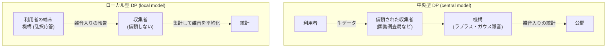

# プライバシー工学 (Privacy Engineering: Re-identification, Differential Privacy & PETs)

## 概要 (Overview)

本ドキュメントは、個人に関するデータを使いながら個人を守るための工学を扱う。対象は匿名化の失敗の歴史 (再識別)、k-匿名性 (k-anonymity) とその改良、差分プライバシー (differential privacy, DP) の定義と機構と予算の管理、実運用の例 (米国 2020 年国勢調査、Apple、Google RAPPOR)、機械学習のプライバシー (メンバーシップ推論、学習データの抽出、DP-SGD)、データ最小化と目的の制限、仮名化と匿名化の法的な区別 (GDPR と日本の個人情報保護法)、プライバシー強化技術 (PETs: Privacy-Enhancing Technologies) の位置づけ、プライバシーの脅威モデル (LINDDUN) である。

中心テーゼは、**「個人を特定する列を消せば匿名になる」という直感は繰り返し破られ、プライバシーはデータの属性ではなく出力が個人について漏らす情報の量として、数学的に予算を管理するものへ移った**ということである。氏名を消した医療記録は郵便番号・生年月日・性別で知事の記録と結びつけられた。番号に置き換えた検索ログからは本人が特定された。映画の評価は数件で人を区別した。k-匿名性はこの結合を防ぐために作られたが、そこにも同質性や背景知識による攻撃が見つかった。さらに、集計表を公開するだけでも、問い合わせが多ければ元のデータを再構成できる (Dinur & Nissim 2003)。差分プライバシーはこの流れに対する答えで、「ある個人がデータにいてもいなくても、出力の分布がほとんど変わらない」ことを ε で定量化する。ε は合成によって足し合わさるため、プライバシーは使えば減る予算になる。

ただし、数学的な保証は運用の選択を消さない。ε の値、保護の単位 (1 人か、1 件か、1 日か)、予算を毎日戻すかどうか、DP の外に置く値 (不変量) は、すべて人が決める。2020 年国勢調査の ε、Apple の 1 日あたりの予算、言語モデルの「1,024 トークンの列」という単位は、DP という名前が同じでも守っているものが大きく違うことを示している。分析深度は Level 3。

## 方法論 (Methodology)

- **一次資料**: 再識別は Sweeney (2002)、Golle (2006)、Narayanan & Shmatikov (2008)、匿名化のモデルは k-匿名性・l-多様性・t-近接性の原論文、差分プライバシーは Dwork, McSherry, Nissim & Smith (2006) と Dwork & Roth (2014) の教科書、実運用は米国国勢調査局の論文と発表、Apple の技術概要、RAPPOR の論文、それに対する独立の解析 (Tang ら 2017) を使う。機械学習は Shokri ら (2017)、Carlini ら (2021、2022)、Abadi ら (2016) を使う。
- **公称と実際を分ける**: ベンダーが公表する ε は「1 回の送信あたり」の値であることが多い。独立の解析が示した「1 日あたり」「累積」の値と並べて書き、どの単位の値かを明記する。
- **法令は条文と所管機関の資料で確かめる**: GDPR は EUR-Lex の条文、日本の個人情報保護法は個人情報保護委員会 (PPC) のガイドラインと法案の資料で確かめた。2026 年の改正 (令和 8 年改正) と EU の Digital Omnibus は時期で変わるため、2026-10 時点と書く。
- **担当範囲**: 暗号のプリミティブと鍵管理は [`applied-cryptography.md`](applied-cryptography.md)、TEE とクラウドの機密計算の実装は [`../cloud/cloud-kms-confidential-computing.md`](../cloud/cloud-kms-confidential-computing.md) と [`../../hardware/security/side-channels-tee-secure-boot.md`](../../hardware/security/side-channels-tee-secure-boot.md)、漏えい時の報告義務は [`detection-incident-response.md`](detection-incident-response.md) に委ねる。本書は「出力から何が漏れるか」を中心に扱う。

## 発見事項 (Findings)

1. **識別子を消しても、残った属性の組み合わせが識別子になる。** Sweeney は 1990 年の国勢調査から、米国の人口の 87% (2 億 4,800 万人中 2 億 1,600 万人) が 5 桁の郵便番号・性別・生年月日の組で一意になりうると推定し、氏名を除いたマサチューセッツ州の職員の医療データを 20 ドルで買った選挙人名簿と結合して、Weld 知事の記録を特定した[^sweeney-k]。Golle は 2000 年の国勢調査で同じ組の一意率を 63% と見積もった[^golle]。値は調査の年と方法で違うが、過半数が一意という結論は一致する。
2. **疎で高次元のデータは少しの背景知識で人を区別する。** Netflix Prize のデータ (48 万人、約 1 億件の評価) では、8 件の評価 (うち 2 件は間違っていてよい) と ±14 日の日付で 99% の記録が一意に定まり、2 件の評価と ±3 日の日付でも 68% が定まった[^netflix]。AOL が 2006 年に番号付きで公開した検索ログでは、検索の内容から利用者 4417749 が特定された[^aol]。属性の数が多いほど、「似た人」は少なくなる。
3. **k-匿名性は結合を防ぐが、属性の推測は防がない。** k-匿名性は準識別子 (quasi-identifier) が同じ記録を k 件以上にする。しかし同じ群の機微な属性がすべて同じなら、群を特定するだけで属性が分かる (同質性攻撃)。l-多様性はこれに機微な値の多様さを求め、t-近接性はさらに群の分布を全体の分布に近づけることを求めた[^ldiv][^tclose]。それぞれが前の定義の穴を塞ぐ形で作られ、どれも攻撃者の背景知識を仮定に置いている。
4. **差分プライバシーは背景知識を仮定しない保証として定義された。** 1 人だけ違う 2 つのデータベースに対して、出力のどの事象の確率も e^ε 倍以上には変わらない、という条件である[^dmns]。攻撃者が他の全員のデータを知っていても成り立ち、出力を後から加工しても弱くならない (後処理への耐性)。これによって「どの列を消すか」ではなく「どれだけ答えるか」が設計の対象になった。
5. **プライバシーの損失は合成で足し合わさるため、予算として管理するしかない。** ε₁ と ε₂ の 2 つの問い合わせに答えれば、合わせて最大 ε₁ + ε₂ の損失になる[^dwork-roth]。逆に、どんなに巧妙な仕組みでも、多くの問い合わせに正確に答えればデータは再構成される (Dinur & Nissim の再構成定理)[^dinur]。米国国勢調査局は 2010 年の公開表から 9,700 万人分の記録を確実に再構成できることを自ら示し、2020 年の調査に DP を導入した[^census-recon]。
6. **公表される ε の意味は単位と期間で大きく変わる。** 2020 年国勢調査の区割り用データは ε = 19.61 (人の表に 17.14、住宅に 2.47)[^census-params]、Apple は 1 回の送信あたり ε = 2〜8 と公表している[^apple-dp]。独立の解析は、macOS 10.12 では 1 日の上限が 16 で、予算が毎日戻るため累積の損失は日数に比例することを示した[^tang]。ε の値だけを比べても、守っている内容は比べられない。
7. **機械学習のモデルは学習データを覚え、出力から取り出される。** Carlini らは GPT-2 への問い合わせだけで 604 件の学習データをそのまま取り出し、その中には個人の氏名・メールアドレス・電話番号・住所が含まれていた[^carlini21]。DP-SGD は 1 件ごとの勾配を切り詰めて雑音を加えることで、この漏えいに上限を付ける[^abadi]。2025 年には 1,024 トークンの列を単位として ε ≤ 2.0 で学習した 10 億パラメータの言語モデルが公開された[^vaultgemma]。
8. **仮名化した情報は法的にも原則として個人情報のままである。** GDPR は仮名化 (pseudonymisation) を安全管理の手段と位置づけ、仮名化したデータは識別可能な人の情報として扱う (前文 26)[^gdpr]。日本の個人情報保護法も他の情報と照合すれば識別できる「仮名加工情報」と、識別も復元もできない「匿名加工情報」を分け、規律を変えている[^ppc-guideline]。「どこまで加工すれば匿名か」の判断は工学の問題であり、法はその水準を決めていない。
9. **PETs は「誰から何を隠すか」がそれぞれ違い、出力の漏えいは差分プライバシーでしか抑えられない。** 秘密計算 (secure multi-party computation)、準同型暗号 (homomorphic encryption)、TEE は計算の途中のデータを処理者から隠し、連合学習 (federated learning) は生のデータを端末に残す。しかし計算の結果 (統計やモデル) が個人について何を漏らすかは、これらの技術では変わらない。連合学習で送る勾配からは学習データを復元できることも示されている[^dlg]。

## アーキテクチャ (Architecture)

### 匿名化から予算管理への移行


凡例: 実線の矢印は「前の手法の限界が示され、次の手法が作られた」関係、矢印のラベルはその限界。点線は、定義が数学的でも運用の選択が残ることを示す。

### 中央型とローカル型の信頼の置き方



凡例: 実線はデータの流れ。中央型は収集者を信頼し、雑音を集計の結果に 1 回だけ加える。ローカル型は収集者を信頼せず、各端末が送る前に雑音を加える。同じ ε ならローカル型のほうが誤差がずっと大きい (技術詳細 7)。

### 手法の比較

| 手法 | 守る対象 | 誰から隠すか | 出力からの推測を抑えるか | 主な失敗 |
|---|---|---|---|---|
| 識別子の削除・仮名化 | 直接の識別子 | データを受け取る人 (弱く) | 抑えない | 準識別子・行動履歴による再識別 |
| k-匿名性・l-多様性・t-近接性 | 公開する表の記録 | 公開先 | 仮定した背景知識の範囲だけ | 同質性・背景知識・複数回の公開 |
| 差分プライバシー (中央型) | 統計・モデルの出力 | 出力を見る人 | 抑える (ε で上限) | ε の過大・予算の再設定・実装の欠陥 |
| 差分プライバシー (ローカル型) | 個々の報告 | 収集者を含む全員 | 抑える (ε で上限) | 誤差が大きい・繰り返しの送信による累積 |
| 秘密計算・準同型暗号 | 計算の途中のデータ | 計算をする当事者 | 抑えない | 出力そのものからの推測、性能 |
| TEE | 処理中のデータ | ホストの管理者・OS | 抑えない | サイドチャネル、attestation の信頼 |
| 連合学習 | 生データの所在 | サーバ | 抑えない | 勾配からの復元、更新の推測 |

## 技術詳細 (Technical Details)

### 1. 再識別の事例と仕組み

- **準識別子による結合 (Sweeney)**: マサチューセッツ州の Group Insurance Commission (GIC) は、約 13 万 5,000 人の州職員と家族の診療データを、氏名などを除いた形で研究者に提供した。Sweeney はケンブリッジ市の選挙人名簿を 20 ドルで購入し、郵便番号・生年月日・性別で結合した。名簿では知事と同じ生年月日の人は 6 人、そのうち男性は 3 人、同じ郵便番号は知事 1 人だった[^sweeney-k]。個々の列は識別子でなくても、組み合わせが識別子になる。この組を準識別子と呼ぶ。
- **検索ログ (AOL)**: AOL は 2006 年 8 月、3 か月分、約 2,000 万件の検索語を利用者ごとの番号付きで公開した。The New York Times は番号 4417749 の利用者の検索 (地名、姓、病気など) から、ジョージア州の 62 歳の女性を特定し、本人の確認を得て報じた[^aol]。番号への置き換えは同じ人の行動を束ねたまま残すため、束ねた内容そのものが識別子になる。
- **疎なデータ (Netflix Prize)**: Netflix は推薦アルゴリズムの懸賞のため、48 万 189 人の約 1 億件の映画評価を、利用者を番号にして公開した。Narayanan & Shmatikov は、評価の一部と日付の近さで記録を照合する、誤りに強い手法を作った。IMDb で公開されている評価と照合し、少数の利用者で Netflix の記録を特定できることを示した[^netflix]。Netflix は 2010 年、訴訟と連邦取引委員会 (FTC) の照会を受けて第 2 回の懸賞を取りやめた[^netflix2]。
- **共通する構造**: どの事例でも、公開した側は「識別子を消した」と考えていた。しかし攻撃者は公開データの外にある情報 (名簿、新聞、IMDb) を使う。何が外にあるかを公開する側は知りえないので、「この列は識別に使えない」とは判断できない。

### 2. k-匿名性・l-多様性・t-近接性

- **k-匿名性** (Sweeney 2002): 準識別子の値が同じ記録 (同値類) が、どれも k 件以上あるように表を加工する。郵便番号の下の桁を伏せる、年齢を 10 歳刻みにする (一般化)、外れた記録を消す (抑制) といった操作を使う[^sweeney-k]。Sweeney 自身が、表の並び順から対応が分かる攻撃、同じ元データから別の加工をした 2 つの表を突き合わせる攻撃 (相補的な公開)、時期を変えた公開を突き合わせる攻撃を挙げている。
- **l-多様性** (Machanavajjhala ら 2006/2007): 同値類の全員が同じ病名なら、k 人に紛れても病名は分かる (同質性攻撃)。攻撃者が「この人は心臓病になりにくい」と知っていれば、残りの候補が絞れる (背景知識攻撃)。l-多様性は、各同値類に「よく表された」機微な値が l 種類以上あることを求める[^ldiv]。
- **t-近接性** (Li ら 2007): l-多様性でも、全体で 1% しかない陽性が、ある同値類で 50% なら、その群に入ること自体が強い情報になる (偏りの攻撃)。値が違っても意味が近ければ (胃炎と胃潰瘍)、推測できる (類似性攻撃)。t-近接性は各同値類での機微な属性の分布と、表全体での分布の距離 (Earth Mover's Distance) を t 以下にすることを求める[^tclose]。
- **限界**: どれも「準識別子はどの列か」「攻撃者が何を知っているか」を公開する側が決める。高次元のデータでは、k を満たすために一般化すると情報がほとんど残らない。Netflix のような疎なデータでは、どの列も準識別子になりうる[^netflix]。

### 3. 再構成攻撃と情報回復の基本法則

- **Dinur & Nissim (2003)**: n 人の秘密のビットを持つデータベースに対して、部分集合の和を問い合わせる。各回答の誤差が o(√n) なら、多項式回の問い合わせでほぼすべてのビットを再構成できる[^dinur]。つまり、正確な回答を多く返す仕組みは、どう作ってもプライバシーを守れない。
- **情報回復の基本法則**: Dwork & Roth はこの結果を「多くの問い合わせに過度に正確に答えると、プライバシーは壊滅的に失われる」という基本法則として整理している[^dwork-roth]。雑音を加えることと、答える量を制限することは、避けられない。
- **2010 年国勢調査での実証**: 国勢調査局は 2010 年に公開した集計表だけから個人の記録 (区画、性別、年齢、人種、民族) を再構成する実験を行った。公開データだけで、全区画の 70% (9,700 万人分) の記録が完全に再構成されたことを確かめられた[^census-recon]。この結果に対しては、再構成の一致率の多くは偶然でも得られるという批判もある[^ruggles]。それでも、従来の手法 (記録の入れ替え) が再構成への耐性を示せないことが、DP の採用の理由として示された。

### 4. 差分プライバシーの定義

```text
Definition (ε, δ)-differential privacy  (Dwork, McSherry, Nissim & Smith 2006; Dwork & Roth 2014, Def. 2.4)

A randomized mechanism M is (ε, δ)-DP if for all neighboring databases D, D'
(differing in one individual's data) and every set of outputs S:

    Pr[M(D) ∈ S]  ≤  e^ε · Pr[M(D') ∈ S]  +  δ

δ = 0 gives pure ε-DP.
```

- **意味**: 出力を見た攻撃者が「ある人がデータにいる」と「いない」を見分ける力は、e^ε 倍で抑えられる。ε = 1 なら約 2.7 倍、ε = 8 なら約 2,981 倍である。仮説検定の言葉では、どんな攻撃でも「真陽性率 ≤ e^ε × 偽陽性率 + δ」となる[^kairouz]。ε が小さいほど保証は強く、大きな ε は意味のある保護にならないことがある[^nist226]。
- **δ の意味**: δ は ε の保証が破れてもよい確率の上限である。δ が 1/n より大きいと、「ランダムに選んだ 1 人のデータをそのまま公開する」仕組みも条件を満たしてしまう。そのため δ は 1/n よりずっと小さく取る[^dwork-roth]。
- **隣接の定義と保護の単位**: 「1 人違う」のか「1 件の記録が違う」のかで、守るものが変わる。1 人が多くの記録を持つデータ (購買履歴、文章) で記録単位の DP を使うと、その人全体は e^(kε) までしか守られない (集団プライバシー: k 件違えば kε)[^dwork-roth]。NIST SP 800-226 は、DP の保証は ε などの値と保護の単位の両方で決まるとしている[^nist226]。
- **後処理への耐性**: DP の出力をどう加工しても、ε は大きくならない。国勢調査で雑音の入った値を非負の整数に直すような処理は、プライバシーを損なわない[^dwork-roth]。

### 5. 機構

- **感度 (sensitivity)**: 関数 f の値が隣接するデータの間で最大どれだけ変わるか。件数の問い合わせなら 1 人で最大 1 変わるので、L1 感度は 1 である。和や平均では各人の値の範囲を切り詰めて (clipping) 感度を有限にする。
- **ラプラス機構**: f(D) に尺度 Δ₁f/ε のラプラス雑音を加えると ε-DP になる[^dmns]。件数なら標準偏差は √2/ε で、ε = 1 なら ±1.4 人程度の誤差である。大きな集計では誤差は相対的に小さく、小さな地域や少数の集団では相対誤差が大きくなる。
- **ガウス機構**: L2 感度 Δ₂f に対し、σ ≥ Δ₂f · √(2 ln(1.25/δ)) / ε の正規雑音を加えると (ε, δ)-DP になる (ε < 1 の範囲)[^dwork-roth]。多数の値を同時に出すときは L2 感度が L1 感度より小さくなりやすく、合成の会計とも相性がよい。国勢調査は整数値の離散ガウス機構を使った[^tda]。
- **乱択応答 (randomized response)**: 回答者がコインを投げて、ある確率で本当の答え、残りで乱数を答える方法で、Warner (1965) の調査手法に起源がある[^warner]。本当の答えを確率 3/4 で返す設計なら ε = ln 3 になる[^rappor]。ローカル型 DP の基本の部品である。
- **指数機構**: 出力が数値でない場合 (最も多い項目を選ぶなど) に、各候補のスコアに応じた確率で候補を選ぶ。スコアの感度で ε が決まる[^dwork-roth]。

### 6. 合成とプライバシー予算

- **基本の合成**: (ε₁, δ₁) と (ε₂, δ₂) の機構を同じデータに使うと、全体で (ε₁ + ε₂, δ₁ + δ₂)-DP になる。k 回なら kε である[^dwork-roth]。
- **高度な合成**: k 回の ε-DP の合成は、ある δ' を許せば、およそ ε√(2k ln(1/δ')) で抑えられる (Dwork, Rothblum & Vadhan 2010)。k に対して √k でしか増えない[^dwork-roth]。
- **集中 DP と Rényi DP**: ガウス雑音の合成をより正確に数えるため、ゼロ集中 DP (zCDP, ρ で表す) や Rényi DP が作られた。zCDP の ρ は合成で単純に足し合わさる。国勢調査は ρ で予算を配分し、説明のために (ε, δ) に換算した[^tda]。DP-SGD の moments accountant も同じ発想で、ε を大幅に小さく見積もれる。Abadi らの例では、同じ学習の ε が強い合成定理の 9.34 から 1.26 になった[^abadi]。
- **予算の管理**: 予算は「このデータから、この期間に、合計でどれだけ漏らしてよいか」の上限である。決める項目は全体の ε (と δ)、各問い合わせへの配分、予算を使い切ったら何をするか、期間で予算を戻すかどうかである。予算を毎日戻せば、長期の累積は上限を持たない (技術詳細 8)。

### 7. 中央型・ローカル型・シャッフル型

- **中央型**: 信頼された収集者が生データを持ち、出力にだけ雑音を入れる。件数の誤差は n によらず O(1/ε) で済む。収集者が侵害されれば、生データはそのまま漏れる。
- **ローカル型**: 各端末が送る前に雑音を入れるので、収集者も個々の値を知らない。代わりに、雑音が n 人分たまるため、件数の誤差は概ね √n/ε に比例する[^bassily]。NIST SP 800-226 も、ローカル型は信号の強い問い合わせ (最も人気のある絵文字など) にしか役立たないとしている[^nist226]。RAPPOR の論文の Chrome の例では、約 1,400 万件の報告から、全体の 0.1% (約 1 万 4,000 人) 以上が設定している値しか検出できなかった[^rappor]。
- **繰り返しの送信**: 同じ値を何度も新しい雑音で送ると、平均を取れば本当の値が分かる。RAPPOR は雑音を加えた値を端末に固定して使い回す「永続的な乱択応答」で長期の上限 ε∞ を作り、その上に毎回の乱択応答を重ねた[^rappor]。値が時間で変わる場合や相関がある場合は、この上限は弱まる。
- **シャッフル型**: 報告を送り主から切り離して混ぜる中継者を置くと、ローカル型の雑音で中央型に近い ε が得られる (プライバシー増幅)[^shuffle]。中継者が収集者と結託しないことが前提になる。

### 8. 実運用の例と ε の実際

| 事例 | 型 | 公表された予算 | 保護の単位・期間 | 補足 |
|---|---|---|---|---|
| 米国 2020 年国勢調査 区割り用データ (P.L. 94-171) | 中央型 (zCDP、離散ガウス) | ε = 19.61 (人 17.14、住宅 2.47)。ρ = 2.63 (人 2.56、住宅 0.07) | 1 人 (1 戸)。1 回の公開 | 州の総人口などを不変量として DP の外に置く[^census-params][^tda] |
| Apple (iOS・macOS) | ローカル型 (Count Mean Sketch など) | 1 回の送信あたり ε = 2 (Health)、4 (絵文字・Lookup Hints・Safari の高負荷ドメイン)、8 (QuickType・Safari の自動再生) | 1 日 1〜2 回の送信。データは最長 3 か月保持 | 独立の解析では 1 日の上限 16、毎日予算が戻る[^apple-dp][^tang] |
| Google RAPPOR (Chrome のホームページ) | ローカル型 (Bloom filter + 乱択応答) | 1 回の報告で ε₁ ≈ 0.53。長期の上限 ε∞ ≈ 2.04 (論文の式から計算) | 1 端末。同じ値の繰り返し | 128 ビット、ハッシュ 2 個、f = 0.75[^rappor] |
| VaultGemma 1B (Google) | 中央型 (DP-SGD) | ε ≤ 2.0、δ ≤ 1.1 × 10⁻¹⁰ | 1,024 トークンの列 | 1 人の文章が多くの列にまたがれば、人単位の保証はそれより弱い[^vaultgemma] |

- **国勢調査の TopDown アルゴリズム**: 国、州、郡、国勢調査区 (tract)、区画群 (block group)、区画 (block) の階層の各段で、雑音入りの集計 (noisy measurements) を作る。その後、上の段から順に、不変量と論理的な制約 (親子の年齢関係など) を満たし、非負の整数になるよう最小二乗法と丸めで調整する[^tda]。不変量は (1) 州・DC・プエルトリコの総人口、(2) 区画ごとの住宅数、(3) 区画ごとの入居している集団居住施設の数と種類である。不変量は ε を無限大にしたのと同じで、DP の保証の外にある[^tda]。
- **国勢調査への批判**: 予算は 2021 年 4 月のデモデータの ε = 12.2 から 19.61 に上げられた[^census-params]。Kenny らは 2021 年の論文で、雑音が人種や党派の混ざった地域を系統的に少なく数え、選挙区の人口を等しくする要件の確認を難しくすると分析した[^kenny]。精度とプライバシーの交換が、政治的な選択として表に出た例である。
- **Apple への批判**: Apple は 1 回の送信あたりの ε と 1 日の送信回数を公表している[^apple-dp]。Tang らは macOS 10.12 のコードを解析し、1 回の ε は 1 か 2 だが、最初の 4 つの用途で 1 日に最大 16 を使い、予算が毎日戻るため、累積の損失は「16 × 参加してからの日数」になりうると指摘した[^tang]。識別子を付けない、IP アドレスを保存しない、3 か月で消すという運用の保護は、DP の数学とは別の層で効いている。
- **ε の選び方**: 上の表の値は 0.5 から約 20 まで広がっている。NIST SP 800-226 は、大きな ε は意味のある保護にならないことを落とし穴の 1 つに挙げ、ε の決め方はまだ研究課題だとしている。そのうえで、ε と保護の単位を合わせて DP の保証の強さとし、信頼の置き方 (中央型かローカル型か) やサイドチャネルなどの実装の安全性も評価するよう求めている[^nist226]。

### 9. 機械学習とプライバシー

- **メンバーシップ推論 (membership inference)**: あるデータが学習に使われたかを、モデルの出力から推測する攻撃である。Shokri らは標的と同じ方法で影のモデル (shadow model) を学習させ、「学習に使ったデータへの出力」と「使っていないデータへの出力」の違いを分類器に覚えさせた[^shokri]。Carlini らの LiRA は攻撃の評価を「低い偽陽性率での真陽性率」で行うべきだと示し、平均の正解率では弱く見える攻撃でも、一部の記録を高い確信度で当てられることを明らかにした[^lira]。病院の患者データで学習したモデルなら、学習に使われたこと自体が病歴を漏らす。
- **学習データの抽出**: Carlini ら (2021) は GPT-2 に大量の文章を生成させ、モデルが特に自信を持つ文を選んで、1,800 件の候補のうち 604 件が学習データの逐語的な複製であることを確かめた。大きいモデルほど多く覚えていた[^carlini21]。Nasr ら (2023) は同じ単語を繰り返させてモデルを通常の応答から外す攻撃で、整合済みの ChatGPT から学習データを出力させる頻度を約 150 倍に上げた[^nasr23]。LLM のアプリケーションでの漏えいの経路は [`llm-application-security.md`](llm-application-security.md) が扱う。
- **DP-SGD** (Abadi ら 2016): ミニバッチの勾配を計算するとき、(1) 例ごとの勾配を L2 ノルム C で切り詰め、(2) 和に標準偏差 σC のガウス雑音を加え、(3) その平均で更新する。切り詰めで 1 件の影響に上限を付け、雑音でそれを隠す。MNIST では δ = 10⁻⁵ で ε = 0.5、2、8 のとき正解率 90%、95%、97% だった[^abadi]。例ごとの勾配が要るため、計算とメモリの負担が増える ([`../ai/ml-training-systems.md`](../ai/ml-training-systems.md) のメモリの会計)。
- **DP と攻撃の関係**: ε-DP はどんなメンバーシップ推論でも真陽性率を e^ε × 偽陽性率 + δ 以下に抑える[^kairouz]。DP は抽出の上限も与えるが、それは保護の単位の中だけで成り立つ。VaultGemma の保証は 1,024 トークンの列についてのもので、同じ事実が多くの列に繰り返し現れれば、モデルはそれを覚えうる[^vaultgemma]。
- **実装の監査**: DP-SGD の実装の誤り (例ごとの切り詰めの漏れ、サンプリングの仮定の違い) は、宣言した ε を守らない。意図的に目立つデータ (canary) を入れて推論の成功率を測り、ε の下限を実験で見積もる監査が行われている[^jagielski]。

### 10. データ最小化・目的の制限と法的な区別

- **原則**: GDPR 第 5 条 1 項は特定された目的のために集め、それと両立しない処理をしない (目的の制限、(b))、目的に必要な範囲に限る (データ最小化、(c))、必要な期間を超えて識別できる形で保存しない (保存の制限、(e)) ことを求める。第 25 条は設計と初期設定によるデータ保護 (data protection by design and by default) を求め、その例に仮名化とデータ最小化を挙げる[^gdpr]。最小化は、集めないデータは漏れないという最も確実な対策である。
- **GDPR の仮名化と匿名化**: 第 4 条 5 項は仮名化を「追加の情報を使わなければ特定のデータ主体に結びつけられないように処理すること」で、追加の情報を分けて管理するものと定義する。前文 26 は、仮名化したデータは識別可能な人の情報とみなし、識別に「合理的に用いられる可能性のある手段」を考慮して判断するとし、匿名の情報には GDPR が適用されないとする[^gdpr]。
- **識別可能性の相対性**: EU 司法裁判所は 2025 年 9 月 4 日の EDPS 対 SRB 事件 (C-413/23 P) で、仮名化したデータが受け手にとって常に個人データとは限らず、受け手が識別する手段を合理的に持つかで判断すると示した[^srb]。欧州委員会は 2025 年 11 月の Digital Omnibus の提案で、この考え方を個人データの定義 (第 4 条 1 項) に入れることを提案した。EDPB と EDPS は 2026 年 2 月の共同意見でこれに反対した[^edpb-omnibus]。2026-10 時点で、この改正は立法の審議中で確定していない。
- **日本の個人情報保護法**: 2015 年の改正 (2017 年施行) で匿名加工情報、2020 年の改正 (2022 年 4 月施行) で仮名加工情報が設けられた[^ppc-2026]。

| 区分 (条文) | 定義の要点 | 第三者提供 | 主な規律 |
|---|---|---|---|
| 仮名加工情報 (第 2 条 5 項、第 41 条・42 条) | 他の情報と照合しない限り特定の個人を識別できないように加工 | 原則として禁止 (委託・共同利用などを除く) | 識別行為の禁止。利用目的の変更の制限 (第 17 条 2 項)、漏えい等の報告 (第 26 条)、開示等の請求 (第 32〜39 条) は適用しない (第 41 条 9 項) |
| 匿名加工情報 (第 2 条 6 項、第 43〜46 条) | 特定の個人を識別できず、復元もできないように加工 | 本人の同意なしで可。項目と提供の方法を公表し、匿名加工情報であることを明示 | 作成時に含まれる項目を公表。識別行為の禁止。加工方法の安全管理 |

出典: 個人情報保護委員会のガイドライン (仮名加工情報・匿名加工情報編)[^ppc-guideline]。

- **令和 8 年改正**: 2026 年 7 月 10 日に成立し、7 月 17 日に公布された改正法は、統計情報等の作成 (統計作成等と整理できる AI 開発を含む) にのみ使う場合に、個人データの第三者提供と公開されている要配慮個人情報の取得で本人の同意を不要にする。そのために、提供元と提供先の書面の合意と、一定の事項の公表を求める。顔特徴データの規律、16 歳未満の者の保護、課徴金も設けた。施行は原則として公布から 2 年以内である[^ppc-2026]。目的の制限を緩める代わりに「統計にのみ使う」ことを担保する設計で、その担保が技術的に何を意味するか (統計の出力から個人が推測されない水準) は、法文では定まっていない。

### 11. PETs の位置づけ

- **秘密計算** (secure multi-party computation): 複数の当事者が互いの入力を見せずに関数の値だけを計算する。秘密分散や garbled circuit を使う。参加者は結果以外を知らないが、結果から入力を推測できる場合は防げない。
- **準同型暗号**: 暗号文のまま加算や乗算ができ、復号すると平文で計算した結果になる。Gentry (2009) が任意の計算を可能にする完全準同型暗号を初めて構成した[^gentry]。計算を委託する相手からデータを隠せるが、計算は平文より桁違いに重い。暗号の基礎は [`applied-cryptography.md`](applied-cryptography.md) を参照。
- **TEE (Trusted Execution Environment)**: ハードウェアで隔離した領域で処理し、ホストの OS や管理者からデータを隠す。attestation で、どのコードが動いているかを相手に証明する ([`../cloud/cloud-kms-confidential-computing.md`](../cloud/cloud-kms-confidential-computing.md))。弱点はサイドチャネルとハードウェアの供給元への信頼である ([`../../hardware/security/side-channels-tee-secure-boot.md`](../../hardware/security/side-channels-tee-secure-boot.md))。
- **連合学習** (McMahan ら 2017): 端末で学習した更新だけをサーバに送り、サーバは更新を平均する[^fedavg]。生データは端末に残るが、更新 (勾配) から学習データを復元する攻撃が示されている[^dlg]。そのため、更新を個別に見せない安全な集約 (secure aggregation)[^secagg] と、更新への DP の雑音を組み合わせるのが一般的である。
- **組み合わせの原則**: 秘密計算・準同型暗号・TEE は「計算の途中」を守り、DP は「計算の結果」を守る。両方の層がそろって初めて、収集から公開までの経路が覆われる。

### 12. プライバシーの脅威モデル (LINDDUN)

- **成り立ち**: LINDDUN は KU Leuven の研究者が STRIDE にならって作ったプライバシーの脅威モデリング手法で、データフロー図の要素ごとに脅威の種類を当てはめる[^linddun-2011]。STRIDE ([`isms-risk-management.md`](isms-risk-management.md)) がセキュリティの性質の裏返しであるのと同じく、LINDDUN はプライバシーの性質の裏返しになっている。
- **7 つの脅威の種類**: 現行の公式の分類では次の 7 つである[^linddun]。
  - **結合 (Linking)**: データや行動を結びつけて、個人や集団について多くを知ること。
  - **識別 (Identifying)**: 漏えい、推論、推測によって個人の身元を知ること。
  - **否認不可 (Non-repudiation)**: 主張や行動を個人に帰属できること。内部告発者や投票では、否認できることが守るべき性質になる。
  - **検知 (Detecting)**: 観察から、個人が関わっていることを推測すること (通信の有無、記録の存在)。
  - **データの開示 (Data disclosure)**: 個人データの過剰な収集・保存・処理・共有。
  - **認知と介入の欠如 (Unawareness & unintervenability)**: 本人への説明、関与、操作の手段が足りないこと。
  - **不遵守 (Non-compliance)**: セキュリティやデータ管理の慣行、規格、法令から外れること。
- **使い分け**: LINDDUN GO はカードを使う軽量な手順、LINDDUN PRO はデータフロー図の要素ごとに体系的に調べる手順である[^linddun]。本書の再識別 (技術詳細 1〜3) は結合と識別、機械学習の推論 (技術詳細 9) は識別と検知、最小化と目的の制限 (技術詳細 10) はデータの開示と不遵守に対応する。

## セキュリティ考察 (Security Considerations)

- **「匿名化済み」は検証できない主張である。** 再識別の可能性は公開した後に世の中にある補助情報で決まる。公開する時点で安全と判断した表も、後から公開された名簿や SNS で破られうる。一度公開したデータは取り消せないため、公開の判断では最悪の補助情報を仮定する必要がある。
- **DP の実装には固有の欠陥がある。** 浮動小数点で生成したラプラス雑音は、下位ビットの分布の偏りから元の値を見分けられることが示された (Mironov 2012)[^mironov]。雑音の生成時間の違いによるタイミングのサイドチャネル、感度の切り詰めの漏れ、浮動小数点の丸めも宣言した ε を壊す。NIST SP 800-226 は浮動小数点とタイミングの経路をサイドチャネルとして取り上げている[^nist226]。
- **予算の再設定と単位のずれが、保証を形だけにする。** 予算を毎日戻す、記録単位の DP で 1 人の多数の記録を守ったことにする、製品ごとに別の予算を使う、といった運用では、宣言した ε と実際の損失が離れる。評価するときは「1 人について、全期間で、全製品を合わせて」の損失を問う。
- **不変量と公開される外部データは DP の外にある。** 国勢調査の州人口や区画の住宅数のように、正確に公開する値は ε が無限大の問い合わせと同じである[^tda]。DP の出力と、DP でない別の公開データを組み合わせた推論は、DP の保証の範囲外になる。
- **仮名化の鍵は識別子そのものと同じ重さで守る。** 仮名化の対応表や、ハッシュに使う秘密の値が漏れれば、仮名化は外れる。電話番号やメールアドレスのような値の空間が小さいデータを、秘密の値なしにハッシュするだけでは、全探索で元に戻せる。対応表は別の権限で管理し、鍵の管理 ([`applied-cryptography.md`](applied-cryptography.md)) と同じ規律を適用する。
- **モデルは学習データの複製として扱う。** 機微なデータで学習したモデルの重みを公開・共有することは、学習データの一部を公開することに近い。DP-SGD を使わない場合は、モデルへのアクセスの制限、出力のフィルタ、抽出への耐性の評価が必要になる。DP-SGD を使う場合も、保護の単位を確かめる。
- **データの保存と削除も漏えいの経路である。** 消したはずのデータがログ、バックアップ、学習済みモデルに残れば、目的の制限と保存の制限は破れる。ストレージの層で削除が物理的な消去にならないことは [`../databases/storage-engines.md`](../databases/storage-engines.md) が扱う。漏えいしたときの報告義務は [`detection-incident-response.md`](detection-incident-response.md) を参照。

## 結論 (Conclusions)

匿名化の歴史は、「どの列が危ないか」を公開する側が決める方式の失敗の歴史である。郵便番号と生年月日と性別、番号を付けた検索ログ、数件の映画の評価は、どれも公開した側が識別子と考えていなかった。k-匿名性とその改良は攻撃者の知識を仮定する限り、その仮定の外から破られた。さらに再構成定理は集計だけを公開しても、正確に答えすぎれば元のデータが戻ることを示した。

差分プライバシーは攻撃者の知識を仮定せず、出力が個人について漏らす量を ε で上から抑える。この量は合成で足し合わさるため、プライバシーは「データを加工したら終わり」の性質から、問い合わせのたびに減る予算になった。これが本書の中心テーゼである。

ただし、DP は選択を数学に置き換えたのではなく選択を見える形にした。ε の値、保護の単位、予算の期間、DP の外に置く不変量を決めるのは人である。国勢調査の ε = 19.61 と不変量、Apple の毎日戻る予算、言語モデルの 1,024 トークンという単位は、その選択の例である。プライバシーの設計では、データ最小化と目的の制限で集める量を減らし、秘密計算や TEE で計算の途中を守り、DP で出力を守り、LINDDUN で漏れの種類を洗い出す。そのうえで、ε を「1 人について、全期間で」問うことが求められる。

### 次の接続先 (Related Topics)

- [`applied-cryptography.md`](applied-cryptography.md) — 準同型暗号や秘密計算が使う暗号と、仮名化の鍵の管理。
- [`llm-application-security.md`](llm-application-security.md) — LLM アプリケーションでの情報流出の経路。学習データの抽出と組み合わさる。
- [`isms-risk-management.md`](isms-risk-management.md) — STRIDE と攻撃木。LINDDUN を組み込むリスク評価の手順。
- [`detection-incident-response.md`](detection-incident-response.md) — 個人情報の漏えい時の報告義務 (個人情報保護法・GDPR)。
- [`../cloud/cloud-kms-confidential-computing.md`](../cloud/cloud-kms-confidential-computing.md) — TEE (Nitro Enclaves) と attestation による計算の途中の保護。
- [`../ai/ml-training-systems.md`](../ai/ml-training-systems.md) — DP-SGD の例ごとの勾配が増やす計算とメモリの負担、学習データの来歴。
- [`../../hardware/security/side-channels-tee-secure-boot.md`](../../hardware/security/side-channels-tee-secure-boot.md) — TEE のサイドチャネル。
- [`../../foundations/mathematics/probability-statistics/probability-random-variables.md`](../../foundations/mathematics/probability-statistics/probability-random-variables.md) — ラプラス分布・正規分布と確率の不等式。
- [`../../foundations/mathematics/probability-statistics/estimation-hypothesis-testing.md`](../../foundations/mathematics/probability-statistics/estimation-hypothesis-testing.md) — 推定と仮説検定。ε を検定の誤りの率として読む見方とメンバーシップ推論の評価。
- [`../../foundations/information-theory/entropy-source-coding.md`](../../foundations/information-theory/entropy-source-coding.md) — 相互情報量と KL ダイバージェンス。出力が漏らす情報の量を測る別の尺度。

## 参考文献 (References)

**再識別と匿名化のモデル**

[^sweeney-k]: Sweeney, L. (2002). k-Anonymity: A Model for Protecting Privacy. *International Journal of Uncertainty, Fuzziness and Knowledge-Based Systems*, 10(5), 557–570. DOI: 10.1142/S0218488502001648 — GIC のデータと Weld 知事の再識別、87% の推定 (Sweeney 2000 の引用)、k-匿名性への攻撃。

[^golle]: Golle, P. (2006). Revisiting the Uniqueness of Simple Demographics in the US Population. *Proceedings of the 5th ACM Workshop on Privacy in Electronic Society (WPES '06)*, 77–80. DOI: 10.1145/1179601.1179615 — 2000 年の国勢調査で 63%。

[^netflix]: Narayanan, A., & Shmatikov, V. (2008). Robust De-anonymization of Large Sparse Datasets. *2008 IEEE Symposium on Security and Privacy*, 111–125. DOI: 10.1109/SP.2008.33 (プレプリント: [arXiv:cs/0610105](https://arxiv.org/abs/cs/0610105) — Accessed: 2026-10-24)

[^netflix2]: [Netflix Cancels Contest over Privacy Concerns](https://archive.epic.org/2010/03/netflix-cancels-contest-over-p.html) — EPIC (2010-03). Accessed: 2026-10-24

[^aol]: Barbaro, M., & Zeller, T., Jr. (2006, August 9). A Face Is Exposed for AOL Searcher No. 4417749. *The New York Times*. — 本文は取得できず、題名・日付・特定の経緯は複数の二次資料で照合した。

[^ldiv]: Machanavajjhala, A., Kifer, D., Gehrke, J., & Venkitasubramaniam, M. (2007). ℓ-Diversity: Privacy Beyond k-Anonymity. *ACM Transactions on Knowledge Discovery from Data*, 1(1), Article 3. DOI: 10.1145/1217299.1217302 (初出は ICDE 2006)

[^tclose]: Li, N., Li, T., & Venkatasubramanian, S. (2007). t-Closeness: Privacy Beyond k-Anonymity and ℓ-Diversity. *Proceedings of the 23rd IEEE International Conference on Data Engineering (ICDE 2007)*, 106–115.

**差分プライバシーの理論**

[^dmns]: Dwork, C., McSherry, F., Nissim, K., & Smith, A. (2006). Calibrating Noise to Sensitivity in Private Data Analysis. *Theory of Cryptography Conference (TCC 2006)*, LNCS 3876, 265–284. DOI: 10.1007/11681878_14

[^dwork-roth]: Dwork, C., & Roth, A. (2014). The Algorithmic Foundations of Differential Privacy. *Foundations and Trends in Theoretical Computer Science*, 9(3–4), 211–407. DOI: 10.1561/0400000042 — 定義、ラプラス・ガウス・指数機構、合成定理、集団プライバシー、情報回復の基本法則。

[^dinur]: Dinur, I., & Nissim, K. (2003). Revealing Information while Preserving Privacy. *Proceedings of the 22nd ACM SIGMOD-SIGACT-SIGART Symposium on Principles of Database Systems (PODS 2003)*, 202–210. DOI: 10.1145/773153.773173

[^kairouz]: Kairouz, P., Oh, S., & Viswanath, P. (2015). The Composition Theorem for Differential Privacy. *Proceedings of the 32nd International Conference on Machine Learning (ICML 2015)*, PMLR 37, 1376–1385. — DP の仮説検定による解釈。

[^warner]: Warner, S. L. (1965). Randomized Response: A Survey Technique for Eliminating Evasive Answer Bias. *Journal of the American Statistical Association*, 60(309), 63–69.

[^shuffle]: Erlingsson, Ú., Feldman, V., Mironov, I., Raghunathan, A., Talwar, K., & Thakurta, A. (2019). Amplification by Shuffling: From Local to Central Differential Privacy via Anonymity. *Proceedings of the 30th ACM-SIAM Symposium on Discrete Algorithms (SODA 2019)*, 2468–2479. DOI: 10.1137/1.9781611975482.151

[^bassily]: Bassily, R., & Smith, A. (2015). Local, Private, Efficient Protocols for Succinct Histograms. *Proceedings of the 47th Annual ACM Symposium on Theory of Computing (STOC 2015)*, 127–135. DOI: 10.1145/2746539.2746632

[^mironov]: Mironov, I. (2012). On Significance of the Least Significant Bits for Differential Privacy. *Proceedings of the 2012 ACM Conference on Computer and Communications Security (CCS '12)*, 650–661. DOI: 10.1145/2382196.2382264

[^nist226]: Near, J. P., Darais, D., Lefkovitz, N., & Howarth, G. (2025). *Guidelines for Evaluating Differential Privacy Guarantees*. NIST Special Publication 800-226. DOI: 10.6028/NIST.SP.800-226 — 差分プライバシーのピラミッドとプライバシーの落とし穴。[公式ページ](https://csrc.nist.gov/pubs/sp/800/226/final) — Accessed: 2026-10-24

**実運用**

[^census-recon]: Abowd, J. M., Adams, T., Ashmead, R., et al. (2023). A Simulated Reconstruction and Reidentification Attack on the 2010 U.S. Census. [arXiv:2312.11283](https://arxiv.org/abs/2312.11283) (Harvard Data Science Review に採録)。— Accessed: 2026-10-24。全区画の 70%、9,700 万人分の完全な再構成。

[^ruggles]: Ruggles, S., & Van Riper, D. (2022). The Role of Chance in the Census Bureau Database Reconstruction Experiment. *Population Research and Policy Review*, 41, 781–788. DOI: 10.1007/s11113-021-09674-3 — 再構成の一致率は偶然でもかなり得られるという批判。

[^census-params]: [Census Bureau Sets Key Parameters to Protect Privacy in 2020 Census Results](https://www.census.gov/newsroom/press-releases/2021/2020-census-key-parameters.html) — U.S. Census Bureau (2021-06-09). Accessed: 2026-10-24。ε = 19.61 (人 17.14、住宅 2.47)、デモデータの 12.2 からの引き上げ。

[^tda]: Abowd, J. M., Ashmead, R., Cumings-Menon, R., Garfinkel, S., Heineck, M., Heiss, C., Johns, R., Kifer, D., Leclerc, P., Machanavajjhala, A., Moran, B., Sexton, W., Spence, M., & Zhuravlev, P. (2022). The 2020 Census Disclosure Avoidance System TopDown Algorithm. *Harvard Data Science Review*, Special Issue 2. DOI: 10.1162/99608f92.529e3cb9 — zCDP、ρ = 2.63 (人 2.56、住宅 0.07)、離散ガウス機構、不変量の一覧、地理の階層と後処理。

[^kenny]: Kenny, C. T., Kuriwaki, S., McCartan, C., Rosenman, E. T. R., Simko, T., & Imai, K. (2021). The Use of Differential Privacy for Census Data and Its Impact on Redistricting: The Case of the 2020 U.S. Census. *Science Advances*, eabk3283. DOI: 10.1126/sciadv.abk3283

[^apple-dp]: [Differential Privacy Overview](https://www.apple.com/privacy/docs/Differential_Privacy_Overview.pdf) — Apple. Accessed: 2026-10-24。用途ごとの ε と 1 日の送信回数、Count Mean Sketch と Hadamard Count Mean Sketch、保持期間 3 か月。

[^tang]: Tang, J., Korolova, A., Bai, X., Wang, X., & Wang, X. (2017). Privacy Loss in Apple's Implementation of Differential Privacy on MacOS 10.12. [arXiv:1709.02753](https://arxiv.org/abs/1709.02753) — Accessed: 2026-10-24。1 回の ε は 1 か 2、1 日の上限 16、予算は毎日戻る。

[^rappor]: Erlingsson, Ú., Pihur, V., & Korolova, A. (2014). RAPPOR: Randomized Aggregatable Privacy-Preserving Ordinal Response. *Proceedings of the 2014 ACM SIGSAC Conference on Computer and Communications Security (CCS '14)*, 1054–1067. DOI: 10.1145/2660267.2660348 — 永続的な乱択応答と ε∞ = 2h ln((1 − f/2)/(f/2))、Chrome のホームページの収集 (約 1,400 万件、ε₁ = 0.5343、f = 0.75、h = 2)。

**機械学習**

[^shokri]: Shokri, R., Stronati, M., Song, C., & Shmatikov, V. (2017). Membership Inference Attacks Against Machine Learning Models. *2017 IEEE Symposium on Security and Privacy*, 3–18. DOI: 10.1109/SP.2017.41

[^lira]: Carlini, N., Chien, S., Nasr, M., Song, S., Terzis, A., & Tramèr, F. (2022). Membership Inference Attacks From First Principles. *2022 IEEE Symposium on Security and Privacy*, 1897–1914. DOI: 10.1109/SP46214.2022.9833649

[^carlini21]: Carlini, N., Tramèr, F., Wallace, E., Jagielski, M., Herbert-Voss, A., Lee, K., Roberts, A., Brown, T., Song, D., Erlingsson, Ú., Oprea, A., & Raffel, C. (2021). Extracting Training Data from Large Language Models. *30th USENIX Security Symposium*. [USENIX](https://www.usenix.org/conference/usenixsecurity21/presentation/carlini-extracting) / [arXiv:2012.07805](https://arxiv.org/abs/2012.07805) — Accessed: 2026-10-24。1,800 件の候補中 604 件が学習データの複製。

[^nasr23]: Nasr, M., Carlini, N., Hayase, J., Jagielski, M., Cooper, A. F., Ippolito, D., Choquette-Choo, C. A., Wallace, E., Tramèr, F., & Lee, K. (2023). Scalable Extraction of Training Data from (Production) Language Models. [arXiv:2311.17035](https://arxiv.org/abs/2311.17035) — Accessed: 2026-10-24

[^abadi]: Abadi, M., Chu, A., Goodfellow, I., McMahan, H. B., Mironov, I., Talwar, K., & Zhang, L. (2016). Deep Learning with Differential Privacy. *Proceedings of the 2016 ACM SIGSAC Conference on Computer and Communications Security (CCS '16)*, 308–318. DOI: 10.1145/2976749.2978318

[^jagielski]: Jagielski, M., Ullman, J., & Oprea, A. (2020). Auditing Differentially Private Machine Learning: How Private is Private SGD? *Advances in Neural Information Processing Systems 33 (NeurIPS 2020)*.

[^vaultgemma]: [VaultGemma: The world's most capable differentially private LLM](https://research.google/blog/vaultgemma-the-worlds-most-capable-differentially-private-llm/) — Google Research (2025-09-12). Accessed: 2026-10-24。技術報告: Sinha, A., et al. (2025). VaultGemma: A Differentially Private Gemma Model. [arXiv:2510.15001](https://arxiv.org/abs/2510.15001)

**PETs**

[^gentry]: Gentry, C. (2009). Fully Homomorphic Encryption Using Ideal Lattices. *Proceedings of the 41st Annual ACM Symposium on Theory of Computing (STOC 2009)*, 169–178. DOI: 10.1145/1536414.1536440

[^fedavg]: McMahan, B., Moore, E., Ramage, D., Hampson, S., & Agüera y Arcas, B. (2017). Communication-Efficient Learning of Deep Networks from Decentralized Data. *Proceedings of the 20th International Conference on Artificial Intelligence and Statistics (AISTATS 2017)*, PMLR 54, 1273–1282.

[^dlg]: Zhu, L., Liu, Z., & Han, S. (2019). Deep Leakage from Gradients. *Advances in Neural Information Processing Systems 32 (NeurIPS 2019)*. [arXiv:1906.08935](https://arxiv.org/abs/1906.08935) — Accessed: 2026-10-24

[^secagg]: Bonawitz, K., Ivanov, V., Kreuter, B., Marcedone, A., McMahan, H. B., Patel, S., Ramage, D., Segal, A., & Seth, K. (2017). Practical Secure Aggregation for Privacy-Preserving Machine Learning. *Proceedings of the 2017 ACM SIGSAC Conference on Computer and Communications Security (CCS '17)*, 1175–1191. DOI: 10.1145/3133956.3133982

**脅威モデル**

[^linddun-2011]: Deng, M., Wuyts, K., Scandariato, R., Preneel, B., & Joosen, W. (2011). A Privacy Threat Analysis Framework: Supporting the Elicitation and Fulfillment of Privacy Requirements. *Requirements Engineering*, 16(1), 3–32. DOI: 10.1007/s00766-010-0115-7

[^linddun]: [LINDDUN — Privacy Threat Types](https://linddun.org/threat-types/) — DistriNet, KU Leuven. Accessed: 2026-10-24

**法令・制度 (時期で変わる内容)**

[^gdpr]: [Regulation (EU) 2016/679 (General Data Protection Regulation)](https://eur-lex.europa.eu/legal-content/EN/TXT/HTML/?uri=CELEX:32016R0679) — EUR-Lex. Accessed: 2026-10-24。前文 26、第 4 条 5 項、第 5 条 1 項、第 25 条。

[^srb]: Court of Justice of the European Union, Judgment of 4 September 2025, *European Data Protection Supervisor v Single Resolution Board*, Case C-413/23 P. — 判決文は直接取得できず、要旨は複数の法律事務所の解説 (例: [Jones Day](https://www.jonesday.com/de/insights/2025/09/cjeu-clarifies-scope-of-personal-data-in-edps-v-srb-decision) — Accessed: 2026-10-24) で照合した。

[^edpb-omnibus]: [EDPB-EDPS Joint Opinion 2/2026 on the Proposal for a Regulation as regards the simplification of the digital legislative framework (Digital Omnibus)](https://www.edpb.europa.eu/system/files/documents/2026-02/edpb_edps_jointopinion_202602_digitalomnibus_en.pdf) — EDPB / EDPS (2026-02). Accessed: 2026-10-24

[^ppc-guideline]: [個人情報の保護に関する法律についてのガイドライン (仮名加工情報・匿名加工情報編)](https://www.ppc.go.jp/personalinfo/legal/guidelines_anonymous/) — 個人情報保護委員会 (令和 8 年 4 月一部改正)。Accessed: 2026-10-24

[^ppc-2026]: [令和8年 改正個人情報保護法について](https://www.ppc.go.jp/personalinfo/legal/r8kaiseihogohou) および [個人情報の保護に関する法律等の一部を改正する法律案について (令和 8 年 4 月)](https://www.ppc.go.jp/files/pdf/260407_kisyahaifusiryou.pdf) — 個人情報保護委員会。Accessed: 2026-10-24。令和 2 年改正の全面施行 (2022-04-01)、令和 8 年改正の成立 (2026-07-10)・公布 (2026-07-17)・概要・施行期日。
