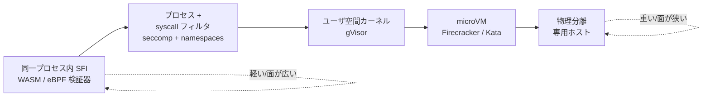

# サンドボックス設計比較 (Sandbox Architectures)

## 概要 (Overview)

サンドボックス (sandbox) とは、**「このコードは侵害されうる、あるいは最初から悪意がある」という前提**の下で、そのコードが到達できる資源と API を最小に絞り込む隔離機構である。`memory-safety-exploit-mitigations.md` が「バグを exploit にさせない」層だとすれば、サンドボックスは「exploit が成立しても被害をその区画に閉じ込める」次の層であり、現代のプラットフォーム防御は必ずこの二層を重ねる。

本リポジトリではサンドボックスが各所に断片的に現れてきた——ブラウザのレンダラ隔離 (`../browsers/browser-architecture.md`)、Android の per-UID アプリ隔離 (`../android/security-model.md`)、iOS のコンテナと entitlements (`../ios/security-architecture.md`)、コンテナと gVisor・microVM (`../virtualization/hardware-virtualization-containers.md`)、eBPF 検証器 (`../operating-systems/ebpf-kernel-programmability.md`)。本ドキュメントはそれらを **「隔離境界をどこに引くか」という一つの設計変数**で束ね直し、同一プロセス内の SFI (WASM) からプロセス + システムコールフィルタ (seccomp)、ユーザ空間カーネル (gVisor)、microVM (Firecracker) までを、信頼計算基盤 (TCB)・攻撃面・脱出の意味・性能コストの4軸で比較する。防御的観点に徹し、分析深度は Level 3。

## 方法論 (Methodology)

- すべての方式を「**サンドボックス内コードから見える攻撃面はどこか**」で規格化する。隔離の強さは壁の厚さではなく、壁に開いた**窓（API 面）の広さと質**で決まる、という観点を貫く。
- 各方式に (1) 隔離境界の位置、(2) TCB（何が壊れたら全崩壊か）、(3) 脱出 (escape) が意味するもの、(4) 性能・互換性コスト、を対で付す。
- 実プラットフォーム（Chrome・Android・iOS・クラウドのマルチテナント基盤）を「複数方式の積層」として読み、単一方式の優劣比較で終わらせない。
- ハードウェア起因の境界破り（Spectre 系）は境界設計を変えた事件として扱い、詳細は `../../hardware/security/side-channels-tee-secure-boot.md` に委ねる。

## 発見事項 (Findings)

1. **サンドボックスの実体は「攻撃面の縮小」である。** 通常のプロセスから見えるカーネルは数百のシステムコールという広大な攻撃面であり、カーネル脆弱性が1つあれば隔離は終わる。seccomp でシステムコールを数十に絞る、gVisor でカーネルを作り直す、microVM で面を仮想ハードウェアに変える——どの方式も「悪意あるコードがバグを探せる場所」を狭める操作として統一的に読める。
2. **「見えなくする」と「触れなくする」は別物である。** Linux の namespaces はプロセスから他者を*見えなく*するが、カーネルは全コンテナで共有されたままであり、コンテナ脱出とはカーネル exploit のことである（`../virtualization/` の議論）。コンテナが「軽い VM」ではなく「装飾されたプロセス」だという理解が、マルチテナント設計の出発点になる。
3. **実プラットフォームは必ず積層する。** Chrome のレンダラは「特権分離された別プロセス + seccomp-BPF + namespaces + 低権限ユーザ」の重ね掛けであり[^chromium]、攻撃者はレンダラ侵害（メモリ破壊）→ サンドボックス脱出（ブラウザプロセスか カーネルの別のバグ）→ 権限昇格、という**バグの連鎖 (exploit chain)** を要求される。緩和（`memory-safety-exploit-mitigations.md`）が単一バグのコストを上げ、サンドボックスが**必要バグ数**を上げる——この掛け算が現代の防御経済である。
4. **Spectre は「プロセス内の境界」を過去のものにした。** 投機実行のサイドチャネルにより、同一アドレス空間内の秘密は言語レベルの隔離では守れないことが示され、Chrome はサイト分離 (site isolation)——**信頼境界とプロセス境界の一致**——へ移行した[^site-isolation]。「境界はどこに引けるか」の答えがハードウェアの性質で書き換えられた事例であり、境界設計が `../../hardware/cpu/` の投機の理解なしに完結しないことを示す。
5. **gVisor と microVM は「カーネルという TCB を作り直す」二つの方法である。** gVisor はシステムコールをユーザ空間の別カーネル (Sentry) で受け、ホストカーネルへの面を数十コールに絞る[^gvisor]。Firecracker は面を virtio の仮想デバイスに変え、VMM 自体を Rust で小さく書き直した[^firecracker]。どちらも「Linux の全システムコール面を悪意あるコードに晒さない」という同じ結論への別解であり、互換性コスト（gVisor: 未実装コール・性能、microVM: ゲストカーネルの起動と管理）が使い分けを決める。
6. **WASM は境界を「命令セットと型システム」に引く。** 線形メモリの境界検査・構造化制御フロー・関数テーブル経由の間接呼び出しにより、**同一プロセス内でメモリ安全な隔離 (SFI)** を成立させる[^wasm]。さらに重要なのは**既定権限ゼロ (no ambient authority)** の設計で、ファイルもネットワークも、ホストが明示的に import として渡した能力 (capability) しか使えない——`../embedded/rtos-architectures.md` で見た seL4 のケーパビリティと同じ原理が、ここでは言語ランタイムの層で現れる。
7. **検証器ベースの隔離（eBPF・WASM）は「実行前に証明し、実行時に払わない」— ただし検証器が単一障害点になる。** eBPF はロード時の検証器がメモリ安全性・停止性を証明することで、カーネル内実行という最も危険な場所を成立させる（`../operating-systems/`）。代償は検証器自体が TCB の要になることで、検証器のバグは即カーネル権限に等しい。加えて Spectre 対策として検証器は投機的な実行経路まで解析する必要が生じた——静的検証と マイクロアーキテクチャの軍拡が交差する最前線である。

## アーキテクチャ (Architecture)

### 隔離境界のスペクトラム



| 方式 | 隔離境界 | ゲストに見える攻撃面 | TCB（壊れたら全崩壊） | 「脱出」の意味 | 主なコスト |
|---|---|---|---|---|---|
| WASM (SFI) | 命令セット・検証器 | ホストが渡した import のみ | ランタイム + JIT + 検証器 | ランタイム/JIT のバグ | 境界検査・JIT 品質 |
| eBPF | 検証器 | 許可されたヘルパ関数のみ | カーネル内検証器 | 検証器のバグ = カーネル権限 | 表現力の制限 |
| プロセス + seccomp | アドレス空間 + フィルタ | 許可した syscall 集合 | カーネル（絞った面のみ） | カーネル/ブローカの exploit | 互換性(方針作成) |
| コンテナ (namespaces) | 名前空間・cgroups | **ほぼ全 syscall 面** | 共有カーネル全体 | カーネル exploit | 低（それゆえ弱い） |
| gVisor | ユーザ空間カーネル | Sentry の syscall 実装 | Sentry + 絞られたホスト面 | Sentry と ホストの二段 | syscall 性能・互換性 |
| microVM | 仮想ハードウェア | virtio デバイス面 + VMM | VMM + KVM (`../virtualization/`) | VMM/KVM の exploit | メモリ・起動時間・管理 |

### 積層の実例 — Chrome のレンダラ

```
Web コンテンツ（最も敵対的な入力）
  └─ V8 / Blink のメモリ安全バグ …………… ここまでは起きる前提
      └─ [緩和層] CFI・PartitionAlloc 等 …… exploit のコストを上げる
          └─ [プロセス境界] サイト分離 ……… 他サイトの秘密はこのプロセスに無い
              └─ [OS サンドボックス] seccomp-BPF + namespaces + 低権限
                  └─ 残る攻撃面: ブローカ IPC と 許可済み syscall のみ
                      └─ 脱出には ブラウザ/カーネルの第二・第三のバグが必要
```

- Android・iOS も同型である: 全アプリを相互不信として、UID 分離 + SELinux（Android）、コンテナ + entitlements + コード署名（iOS）を**プラットフォームの既定**として課す。デスクトップ OS が「アプリは信頼する」から出発して後付けでサンドボックスを足したのと対照的に、モバイルは最初から「サンドボックスの外にアプリは存在しない」設計である（各論は `../android/security-model.md`・`../ios/security-architecture.md`）。

## 技術詳細 (Technical Details)

### 1. seccomp-BPF — システムコール面の縮小 (Syscall Filtering)

- seccomp-BPF は、プロセスが発行できるシステムコールを BPF プログラム（`../operating-systems/` の古典的 cBPF）で記述されたフィルタで制限する。判定は許可・拒否 (errno)・強制終了・ユーザ空間への通知 (user notification) など。
- 設計の急所は**方針の作成**にある: 絞りすぎれば互換性が壊れ、緩めれば意味がない。実務では「起動時に広く・サービス開始後に狭く」の段階適用や、対象プログラムの実行トレースからの方針生成が定石。引数の中身（ポインタの指す先）は検査できないため、パス等の判定は**ブローカプロセス**——特権側で要求を検査して代行する別プロセス——に委ねる。Chrome のサンドボックスはまさに「seccomp で面を絞り、必要な操作はブローカ IPC に集約する」構造である[^chromium]。
- namespaces（mount/pid/net/user）と cgroups は「見える資源」を絞る補助線であり、seccomp（呼べる操作を絞る）と直交する。user namespace は非特権ユーザにサンドボックス構築を許す一方、それ自体がカーネルの新しい攻撃面を開いた——**隔離機構の追加が攻撃面の追加でもある**という、この分野に普遍の緊張である。

### 2. gVisor と microVM — カーネルの二重化 (Rebuilding the TCB)

- **gVisor**: ゲストの syscall を Sentry（Go 実装のユーザ空間カーネル）が捕捉・実装し、ファイルアクセスは Gofer プロセスに分離する。ホストカーネルに対して Sentry 自身は絞られた syscall 集合しか使わない。二段の境界（ゲスト→Sentry、Sentry→ホスト）を得る代わりに、syscall 密度の高いワークロードでの性能低下と、Linux 互換性の永遠の追いかけを払う[^gvisor]。
- **Firecracker**: KVM 上の最小 VMM（Rust、仮想デバイスは virtio-net/block 等ごく少数、BIOS/PCI 列挙なし）で、数百 ms 級の起動と VM あたり数 MB 級のオーバーヘッドを達成し、「関数単位のマルチテナント（AWS Lambda）」を成立させた[^firecracker]。境界はハードウェア仮想化（`../virtualization/hardware-virtualization-containers.md` の VT-x/EPT）であり、ゲストがカーネルを持つため互換性は完全に近い。
- 使い分けの経験則: **信頼できないコードを常時大量に回す**（CI・FaaS・マルチテナント）なら microVM、**Linux 互換の壁を薄く保ちたい**コンテナ基盤の強化なら gVisor、**自社コードの多層防御**なら seccomp 直接、が現在の相場である。

### 3. WASM — 検証器と能力による同一プロセス隔離 (SFI & Capabilities)

- メモリは**線形メモリ**という単一の可変長領域に閉じ、すべてのロード/ストアが境界検査される（64 bit ではガードページによる検査省略が可能）。制御フローは構造化命令と型付き関数テーブルに限定され、任意アドレスへのジャンプが存在しない——`memory-safety-exploit-mitigations.md` の CFI が「後付けの強制」だったものを、**命令セットの設計で最初から不可能にした**形である[^wasm]。
- ホスト API は import 経由でのみ与えられ、WASI はファイル記述子をケーパビリティとして事前に開いて渡す。**「何ができるか」がコードではなくホストの合意で決まる**ため、プラグイン・スマートコントラクト・エッジ実行など「他人のコードを自分のプロセスで走らせる」用途の標準になりつつある。
- 残る攻撃面は (1) ランタイム/JIT 実装のバグ、(2) ホストが渡した import の意味的な悪用、(3) 同一プロセスゆえのサイドチャネル（Spectre——高感度の秘密は同居させないのが原則）。「WASM だから安全」ではなく「攻撃面が import 列に還元されるから監査可能」が正しい理解である。

### 4. 検証器という賭け — eBPF との対比 (Verifier-Based Isolation)

- eBPF は WASM と同じ「実行前検証」族だが、走る場所がカーネル内である分、賭け金が大きい。検証器は全経路のレジスタ状態・境界・停止性を追跡し、通ったプログラムだけが JIT される（`../operating-systems/ebpf-kernel-programmability.md`）。
- 検証器の脆弱性はサンドボックス方式の中で最も高価な失敗（即カーネル権限）になるため、Linux は非特権 eBPF を事実上封印する方向に振れた。**検証器ベース隔離は「TCB を薄くする」のではなく「TCB を検証器という一点に集約する」方式**であり、その一点の品質がすべてを決める——seL4（`../embedded/rtos-architectures.md`）が証明で解いた問題を、eBPF/WASM は工学的品質で支えているという対比で見ると位置づけが明確になる。

## セキュリティ考察 (Security Considerations)

- **サンドボックスは kill chain の一環として評価する。** 単体の強度ではなく「攻撃者に何個のバグを要求するか・各バグの市場価格をどれだけ上げるか」で測る。レンダラ RCE + サンドボックス脱出 + 権限昇格のフルチェーンが要求される構造は、攻撃を不可能にはしないが、費用対効果で大多数の攻撃者を排除する。
- **サイドチャネルはすべてのソフトウェア境界を貫通しうる。** Spectre 系はプロセス内境界を破り、共有 LLC・帯域のチャネルは VM 境界すら漏らす（`../../hardware/security/side-channels-tee-secure-boot.md`）。防御の原則は「秘密と敵対コードの同居自体を避ける」（サイト分離、コア専有）であり、これは `../embedded/realtime-fundamentals.md` の干渉分離と同じ処方箋に帰着する——**時間・空間の分離は、安全・リアルタイム・機密性の三方に効く共通インフラ**である。
- **ブローカと import が「意味の攻撃面」として残る。** syscall 面を完璧に絞っても、ブローカ IPC・WASI import の**意味的な**悪用（許可された操作の想定外の組合せ）は残る。攻撃面の縮小は監査対象の縮小であって、監査の不要化ではない。
- **サンドボックスの構成は完全性保護の対象である。** seccomp 方針・entitlements・コンテナのケーパビリティ設定は「コードを変えずに防御を無効化できる」設定値であり、`../../engineering/robotics/control-systems.md` のパラメータ完全性と同じ扱い——構成のコード化・レビュー・監査——を要する。

## 結論 (Conclusions)

サンドボックスの設計空間は「隔離境界をどこに引くか」の一問に還元でき、その答えは**ゲストに見える攻撃面の位置と広さ**——import 列（WASM）、syscall 集合（seccomp）、ユーザ空間カーネル（gVisor）、仮想デバイス（microVM)——として定量的に比較できる。実プラットフォームは必ずこれらを積層し、緩和（exploit の単価を上げる）× サンドボックス（必要バグ数を増やす）の掛け算で防御経済を成立させる。そして Spectre 以降、境界設計はソフトウェア単独では完結せず、マイクロアーキテクチャの性質（`../../hardware/`）まで含めた設計問題になった。

本ドキュメントで束ねた「境界の設計」は、`software-supply-chain-security.md`（そもそも走らせるコードの出所を検証する、境界の**手前**の問題）と `fuzzing-program-analysis.md`（境界を構成するコード自体のバグを潰す、境界の**品質**の問題）と三位一体で機能する。

---

## 参考文献 (References)

[^chromium]: The Chromium Projects. *Sandbox — Design Documents*（Linux Sandboxing, seccomp-BPF ほか）. https://chromium.googlesource.com/chromium/src/+/main/docs/design/sandbox.md — Accessed: 2026-07-13. — 積層サンドボックスとブローカ構造の一次資料。

[^site-isolation]: Reis, C., Moshchuk, A. & Oskov, N. (2019). Site Isolation: Process Separation for Web Sites within the Browser. *Proc. USENIX Security 2019*, 1661–1678. — Spectre 後の「信頼境界=プロセス境界」への移行の一次文献。

[^gvisor]: Google. *gVisor Documentation — Architecture Guide*. https://gvisor.dev/docs/ — Accessed: 2026-07-13. — Sentry/Gofer の二段境界と互換性・性能特性の一次資料。

[^firecracker]: Agache, A. et al. (2020). Firecracker: Lightweight Virtualization for Serverless Applications. *Proc. USENIX NSDI 2020*, 419–434. — microVM の設計目標（最小デバイス面・Rust VMM・起動時間）の一次文献。

[^wasm]: Haas, A. et al. (2017). Bringing the Web up to Speed with WebAssembly. *Proc. ACM PLDI 2017*, 185–200. DOI: 10.1145/3062341.3062363 — 線形メモリ・構造化制御フロー・型検証による SFI の設計原典。

その他の標準的典拠を挙げる。

- Barth, A., Jackson, C., Reis, C. & the Google Chrome Team (2008). *The Security Architecture of the Chromium Browser*. Stanford Technical Report. — 特権分離ブラウザの原型。
- Linux Kernel Documentation. *Seccomp BPF (SECure COMPuting with filters)*. https://www.kernel.org/doc/html/latest/userspace-api/seccomp_filter.html — Accessed: 2026-07-13.
- WASI — The WebAssembly System Interface. https://wasi.dev/ — Accessed: 2026-07-13. — ケーパビリティベース API の設計。
