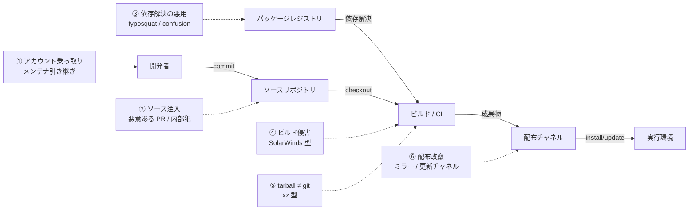

# ソフトウェアサプライチェーンセキュリティ (Software Supply Chain Security)

## 概要 (Overview)

現代のソフトウェアは書かれるより**組み立てられる**。典型的なアプリケーションは数百〜数千の直接・推移的依存を取り込み、それらはパッケージレジストリ・ビルドシステム・CI・配布チャネルという長いパイプラインを経て実行環境に届く。サプライチェーンセキュリティ (software supply chain security) とは、脅威モデルを「コードの中の欠陥」から「**コードの出所と経路の信頼**」へ拡張する分野である——攻撃者はあなたのコードを破る必要がない。あなたが信頼して取り込むものに**なる**ことができるからだ。

この転換を決定づけたのが、`../compilers-runtimes/linkers-loaders-elf.md` でロード時実行点の観点から触れた **xz/liblzma バックドア事件 (2024)**——年単位のソーシャルエンジニアリングでメンテナ権限を得て、レビューされる git リポジトリの**外側**（リリース tarball のビルドスクリプト）に注入する攻撃——と、ビルドサーバ侵害で正規署名済み製品にバックドアを仕込んだ **SolarWinds 事件 (2020)** である。本ドキュメントは、パイプライン各点の攻撃分類から、検証可能性を回復する機構——再現可能ビルド (reproducible builds)・来歴 (provenance) と SLSA・署名 (Sigstore)・SBOM——までを扱い、理論的な底として Thompson の「信頼の信頼 (Trusting Trust)」に降りる。防御的観点に徹し、分析深度は Level 3。

## 方法論 (Methodology)

- 攻撃を**パイプラインの図の上に**分類する（開発者 → ソースリポジトリ → 依存解決 → ビルド → 配布 → 実行）。「どの矢印を乗っ取るか」で整理すると、雑多に見える事件が少数の型に収まる。
- 防御機構を「何の問いに答えるか」で対応づける: 署名は**誰が**、来歴は**どこから・どう作られたか**、再現可能ビルドは**ソースとバイナリは一致するか**、SBOM は**何が入っているか**。答えられない問いを明示し、銀の弾丸として扱わない。
- 実事件（xz・SolarWinds・event-stream・依存関係かく乱）を型の実例として使い、手口の詳細な再現手順は示さない。
- 本リポジトリ内の実例——AUTOSAR の多社分業 (`../embedded/autosar-vehicle-software.md`)、ROS 2 の OSS 集合体 (`../../engineering/robotics/robot-software-stack.md`)——に接続し、ドメインごとの現れ方の差を見る。

## 発見事項 (Findings)

1. **信頼の単位が「ベンダ」から「グラフ」に変わった。** 依存グラフの推移閉包に入るすべてのパッケージ・メンテナ・ビルド基盤が実質的な信頼対象であり、その大半を開発者は名前すら知らない。攻撃面はコード行数ではなく**信頼グラフの辺の数**で測るべきであり、防御の第一歩はグラフを固定し (lockfile)、見えるようにする (SBOM) ことである。
2. **攻撃はパイプラインの最も弱い矢印を突く——そして最も弱いのは多くの場合「人」である。** 依存関係かく乱 (dependency confusion) は内部パッケージ名と同名の公開パッケージで解決器を騙し[^birsan]、タイポスクワッティングは打ち間違いを拾い、event-stream (2018) と xz (2024) は**燃え尽きたメンテナからの権限引き継ぎ**という OSS の持続可能性問題そのものを突いた[^xz]。技術的防御と同じ重みで、メンテナンス体制がセキュリティ属性である。
3. **xz 事件の核心は「レビューが見る場所と、ビルドが使う場所のずれ」である。** 悪意あるコードは git 上のソースには現れず、リリース tarball にのみ含まれるビルドスクリプト断片と、テストデータを装ったバイナリ列に分割されていた[^xz]。「ソースはレビューされている」という信頼は、**ビルドがそのソースから作られていること**の検証なしには成立しない——これが再現可能ビルドと来歴が解こうとする正確な問題である。
4. **SolarWinds は「正規の署名」が何を証明しないかを示した。** 攻撃者はビルドサーバ内でコンパイル直前のソースを差し替えたため、成果物はベンダの正規鍵で署名された[^solarwinds]。署名は「鍵の保有者がこのバイナリを承認した」ことしか言わず、**ビルド過程の完全性は別の証明を要する**。SLSA が署名ではなく「ビルドの来歴」を中心に据えるのはこの教訓による[^slsa]。
5. **再現可能ビルドは「ソース→バイナリ」の対応を第三者が検証可能にする。** 同じソースから誰がビルドしてもビット単位で同一の成果物が出るなら、独立した複数ビルダーの一致によってビルド基盤への信頼を分散できる[^repro]。敵は非決定性——タイムスタンプ・ビルドパス・並列順序・ロケール——であり、Debian 等が積んだ実務は「決定性はアーキテクチャ特性であり、後付けは高くつく」ことを示した。
6. **SLSA は「どこまで証明できているか」の等級である。** ビルドが署名付き来歴を発行する (L1)、ホスト型ビルドで来歴の偽造が困難 (L2)、ビルド環境が強化され外部影響を排除 (L3) と、**来歴の信頼性**を段階化する[^slsa]。Sigstore は鍵管理を OIDC と透明性ログ（Certificate Transparency の応用——`../networking/tls-internals.md`）に置き換えて署名の運用コストを崩し[^sigstore]、in-toto がパイプライン全体の手順証明を束ねる。共通の設計思想は「**信頼を、検証可能な記録に置き換える**」である。
7. **理論的な底は Thompson (1984) が示した「信頼はコードの検査では閉じない」である。** コンパイラ自体が細工されていれば、ソースを全行読んでも検出できない——自分をコンパイルするとき細工を再挿入するからだ[^thompson]。対抗策として提案された多様二重コンパイル (diverse double-compiling) は、独立系統のコンパイラを使った交差検証で自己再生型の細工を検出する[^wheeler]。実務のすべての機構（再現可能ビルド・来歴・多様ビルダー）は、この「単一の信頼点を独立な検証で置き換える」原理の応用として読める。

## アーキテクチャ (Architecture)

### パイプラインと攻撃の分類

### 防御機構と「答えられる問い」の対応

| 機構 | 答える問い | 答えられない問い | 主に塞ぐ矢印 |
|---|---|---|---|
| lockfile / ピン留め | 解決結果は前回と同一か | その依存自体が安全か | ③ |
| コード署名 | 鍵の保有者が承認したか | ビルド過程は健全か（④に無力） | ⑥ |
| 来歴 + SLSA | 何から・どこで・どうビルドされたか | ソース自体の悪意（①②） | ④⑤ |
| 再現可能ビルド | このバイナリはこのソースから出たか | ソース自体の悪意（①②） | ④⑤ |
| SBOM | 何が入っているか（脆弱性対応の索引） | 入っているものが安全か | （検知・対応の基盤） |
| レビュー・2人ルール | ソースへの単独注入の困難化 | レビュー外の経路（⑤） | ①② |

- 表が示すとおり**単独で全矢印を塞ぐ機構は存在しない**。「署名済みだから安全」「SBOM があるから安全」は、それぞれ④と①〜⑥を無視した誤読である。組合せの最小構成は「グラフの固定 (lockfile) + ビルドの来歴 (SLSA) + 出所の検証 (署名/再現性) + 対応の索引 (SBOM)」になる。

## 技術詳細 (Technical Details)

### 1. 依存解決という攻撃面 (Dependency Resolution as Attack Surface)

- **依存関係かく乱**: 社内レジストリと公開レジストリを併用する解決器が「より新しいバージョン」を公開側から取る挙動を突き、内部パッケージ名を公開側に登録して社内ビルドに侵入する手法。2021 年に大手数十社への到達が実証された[^birsan]。対策はスコープ/名前空間の予約、レジストリ優先順位の固定、解決結果の完全性検証 (lockfile のハッシュ)。
- **タイポスクワッティング・星の偽装**: 登録が自由なレジストリ (npm/PyPI) の構造的性質であり、レジストリ側の防御（類似名検出・2FA 強制・出版時の来歴要求）と、取り込み側の審査（内部ミラー経由のみ許可）が両輪になる。
- **インストールフックという実行点**: 多くのパッケージマネージャは install 時スクリプトを許し、「依存を追加した」時点でコード実行が起きる。`../compilers-runtimes/linkers-loaders-elf.md` のロード時実行点（ifunc・コンストラクタ）と同型の「本体より先に走る場所」であり、xz が ifunc を使ったのは偶然ではない——**実行点の列挙と最小化**が横断的な防御になる。

### 2. 再現可能ビルド (Reproducible Builds)

- 目標は決定論: 同一ソース + 同一ツールチェーン → ビット同一の成果物。非決定性の源は既知の型に収まる——タイムスタンプ (`SOURCE_DATE_EPOCH` で固定)、ビルドパス（パス埋め込みの正規化）、ファイル順序（アーカイバのソート）、並列リンクの順序、ロケール・環境変数[^repro]。
- 検証モデルは「独立な複数ビルダーの一致」である: 異なる組織・異なるインフラでビルドして同一ハッシュなら、単一ビルド基盤の侵害（④型）では成果物を汚染できない。Thompson 攻撃への実務的応答である多様二重コンパイル[^wheeler]と同じ**独立性による信頼の分散**が原理にある。
- コストは実在する: ビルドの全入力の固定（ツールチェーンのバージョンまで）はビルド環境のアーカイブ問題になり、`../embedded/rtos-architectures.md` の認証（構成の凍結）と同じ運用課題——「凍結と更新の緊張」——に合流する。

### 3. 来歴と署名の基盤 (Provenance, SLSA & Sigstore)

- **SLSA の来歴 (provenance)** は「この成果物は、このソースリビジョンから、このビルド定義で、このビルダー上で作られた」という署名付きの主張 (attestation) であり、消費側は**方針**（例: 「L3 ビルダー製で、想定リポジトリ由来のものだけ配備する」）で強制して初めて意味を持つ[^slsa]。来歴の発行だけで止まっている組織は、証明書を発行して検証しない TLS に等しい。
- **Sigstore** は署名の三大運用負担（鍵生成・保管・失効）を、短命証明書 (Fulcio が OIDC 身元に対して発行) + 透明性ログ (Rekor) で置き換える。署名行為が公開ログに残るため、**事後監査可能性**が鍵の秘匿より前に出る設計であり、`../networking/tls-internals.md` の Certificate Transparency で実証されたパターンの再利用である[^sigstore]。
- **SBOM (SPDX / CycloneDX)** は成果物の部品表であり、脆弱性公表時の「うちは影響を受けるか」を数時間で答えるための索引である。限界も明確で、SBOM は**内容の列挙**であって**内容の保証ではない**——xz は SBOM に正しく「xz-utils 5.6.x」と載ったはずである。

### 4. ドメインごとの現れ方 (Domain Variations)

- **車載** (`../embedded/autosar-vehicle-software.md`): 多社分業（OEM/Tier-1/BSW ベンダ）が構造的にサプライチェーンであり、ISO/SAE 21434 と UN-R156 が SBOM・更新管理を型式認可の条件として制度化した。ツール適格性 (tool qualification) は「コンパイラを信頼してよいか」という Thompson の問いの規格版である。
- **ロボティクス** (`../../engineering/robotics/robot-software-stack.md`): ROS 2 は数千 OSS パッケージの集合体で、物理的危害に直結する系が npm 型のエコシステム構造を持つ。内部ミラー・依存固定・実行点の監査が、IT より一段重い意味を持つ。
- **基盤モデル・ML** (`../ai/ml-inference-systems.md`): 重みファイル・データセット・学習パイプラインという新しい「成果物」が加わり、シリアライズ形式の実行点（pickle 等）や学習データ汚染という、従来分類の自然な拡張が起きている。来歴の考え方（何から・どう作られたか）がモデルカードへ持ち込まれつつある。

## セキュリティ考察 (Security Considerations)

> 本ドキュメント全体がセキュリティ分析であるため、本節は**残余リスク**——上記の機構を全部積んでも残るもの——に絞る。

- **ソース自体の悪意（①②型）は来歴では防げない。** 正規メンテナが正規の手順で悪意あるコードをコミットすれば、SLSA L3 の来歴付きで完璧に署名されたバックドアが出荷される。残る防御はレビューの質と多様性、挙動監視、そして**OSS メンテナンスの持続可能性への投資**——xz の根本原因は技術ではなく、無償労働の一点に文明が寄りかかる構造だった。
- **信頼の自己言及は完全には閉じない。** 検証ツール・透明性ログ・ビルダー自体もソフトウェアであり、それらのサプライチェーンという再帰が続く。実務の答えは Thompson 的な悲観ではなく**独立性の確保**——単一障害点をなくし、攻撃者に「複数の独立系統の同時侵害」を要求する——であり、これは `sandbox-architectures.md` の「必要バグ数を増やす」防御経済と同じ論理である。
- **内部犯とビルド基盤の特権**: CI は定義上「全製品にコードを注入できる場所」であり、その認証情報・実行環境の防御は本番環境と同格以上に扱う必要がある。SolarWinds 後の実務（ビルドの隔離・一時性・最小権限）は、`sandbox-architectures.md` の隔離技術（microVM でのビルド実行）の直接の適用先である。
- **緊急更新との緊張**: 検証の層を増やすほど、脆弱性対応の更新は遅くなる。埋め込み・車載（認証済み構成）では「速いパッチ」と「検証された出荷」が正面衝突する——`rtos-architectures.md` で述べた凍結と更新の衝突が、サプライチェーンの文脈で再演される。

## 結論 (Conclusions)

サプライチェーンセキュリティの全体像は、「**暗黙に信頼していた矢印を、検証可能な記録に置き換えていく運動**」として整理できる。lockfile がグラフを固定し、再現可能ビルドと来歴がソースと成果物の対応を証明し、署名と透明性ログが承認を監査可能にし、SBOM が対応の索引を与える——どれも単独では部分的で、xz と SolarWinds はそれぞれ「レビューとビルドのずれ」「署名とビルドのずれ」という**機構間の隙間**こそが突かれることを示した。理論的な底（Thompson）が教えるとおり、信頼は検査では閉じず、**独立な系統の交差検証**によってのみ分散できる。この「単一の信頼点を消す」という原理は、本領域のサンドボックス（単一バグで壊れない）・`../embedded/`（単一故障で壊れない）と同じ骨格であり、セキュリティ・安全・信頼性が同じ設計原理の三つの顔であることを示している。

---

## 参考文献 (References)

[^thompson]: Thompson, K. (1984). Reflections on Trusting Trust. *Communications of the ACM*, 27(8), 761–763. DOI: 10.1145/358198.358210 — 自己再生するコンパイラ細工の原典（Turing 賞講演）。

[^wheeler]: Wheeler, D. A. (2005). Countering Trusting Trust through Diverse Double-Compiling. *Proc. ACSAC 2005*, 33–48. DOI: 10.1109/CSAC.2005.17 — 独立コンパイラ系統による交差検証。

[^xz]: Openwall oss-security — Freund, A. (2024-03-29). *backdoor in upstream xz/liblzma leading to ssh server compromise*. https://www.openwall.com/lists/oss-security/2024/03/29/4 — Accessed: 2026-07-13. — xz バックドアの発見報告（一次資料）。

[^solarwinds]: CISA. *Alert AA20-352A: APT Compromise of Government Agencies, Critical Infrastructure, and Private Sector Organizations* (2020). https://www.cisa.gov/news-events/cybersecurity-advisories/aa20-352a — Accessed: 2026-07-13. — SUNBURST/ビルド侵害の公的分析。

[^birsan]: Birsan, A. (2021). *Dependency Confusion: How I Hacked Into Apple, Microsoft and Dozens of Other Companies*. https://medium.com/@alex.birsan/dependency-confusion-4a5d60fec610 — Accessed: 2026-07-13. — 依存関係かく乱の実証報告（防御目的の開示）。

[^slsa]: OpenSSF. *SLSA — Supply-chain Levels for Software Artifacts, v1.0*. https://slsa.dev/spec/v1.0/ — Accessed: 2026-07-13. — 来歴とビルドレベルの仕様一次資料。

[^sigstore]: Sigstore Project. *Sigstore Documentation*（Fulcio / Rekor / Cosign）. https://docs.sigstore.dev/ — Accessed: 2026-07-13. — キーレス署名と透明性ログの一次資料。

[^repro]: Reproducible Builds Project. *Documentation — Achieving Reproducibility*. https://reproducible-builds.org/docs/ — Accessed: 2026-07-13. — 非決定性の分類と対策の実務集成。

その他の標準的典拠を挙げる。

- Ohm, M., Plate, H., Sykosch, A. & Meier, M. (2020). Backstabber's Knife Collection: A Review of Open Source Software Supply Chain Attacks. *Proc. DIMVA 2020*, 23–43. DOI: 10.1007/978-3-030-52683-2_2 — 攻撃事例の体系的サーベイ。
- in-toto. *Specification*. https://in-toto.io/ — Accessed: 2026-07-13. — パイプライン手順の証明フレームワーク。
- NIST SP 800-218 (2022). *Secure Software Development Framework (SSDF)*. — 開発ライフサイクル防御の公的枠組み。
