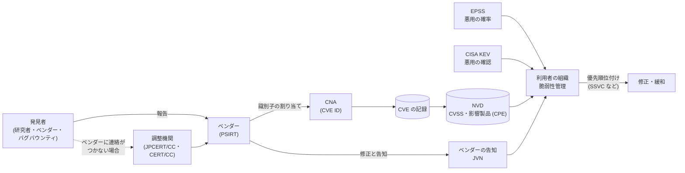

# 脆弱性管理 (Vulnerability Management: CVE, CWE, CVSS, EPSS, SSVC, KEV & Security Testing)

## 概要 (Overview)

本ドキュメントは脆弱性を見つけ、名前を付け、深刻さと緊急度を評価し、直すまでの仕組みを扱う。対象は脆弱性の識別子と分類 (CVE、CWE)、深刻度と悪用の可能性の評価 (CVSS、EPSS、SSVC、CISA KEV)、脆弱性の情報を発見者からベンダー、利用者へ届ける調整の仕組み (協調的な開示、JVN)、そして自組織の脆弱性を探す検査 (脆弱性診断、ペネトレーションテスト、レッドチーム) である。[`fuzzing-program-analysis.md`](fuzzing-program-analysis.md) が「脆弱性を見つける技術」を扱ったのに対し、本書は見つかった脆弱性を組織として扱う運用を扱う。

中心テーゼは、**脆弱性管理の難しさは脆弱性を知ることではなく、多すぎる脆弱性の中から先に直すものを選ぶことにある**ということである。CVE の登録件数は年々増え、NIST によれば 2020 年から 2025 年の間に 263% 増えた。どの組織もすべてを直ちに直すことはできない。CVSS の基本値は「悪用されたらどれだけ深刻か」を表すが、「実際に悪用されそうか」は表さない。そこで、悪用の確率を推定する EPSS、すでに悪用されている脆弱性の一覧である CISA KEV、組織の状況から対応の判断を導く SSVC が加わった。

脆弱性の情報の流れそのものも限られた機関に支えられた仕組みである。2025 年 4 月には、CVE を運営する MITRE と米国政府の契約が切れる寸前になり、CISA が直前に延長した。NIST の NVD (National Vulnerability Database) は登録の増加に追いつけず、2026 年 4 月から、すべての CVE ではなく、悪用されている脆弱性や重要なソフトウェアの脆弱性を優先して情報を付け加える方針に変えた。分析深度は Level 3。

## 方法論 (Methodology)

- **一次資料**: 評価の仕組みは仕様を定める機関の文書を使う。CVSS と EPSS は FIRST、SSVC は CMU SEI と CISA、KEV は CISA の拘束的運用指令 BOD 22-01、協調的な開示は ISO/IEC 29147 と ISO/IEC 30111 である。セキュリティ検査は NIST SP 800-115 を使う。
- **運営の変化は日付を付ける**: CVE の契約や NVD の方針は 2025〜2026 年に大きく動いた。報道と機関の発表で確かめ、確認できた時点を明記する。確認できなかった事項 (2026 年 3 月以降の CVE の契約の扱い) は、確認できなかったと書く。
- **悪用までの日数は出どころと定義を明記する**: Mandiant の分析のように、外れ値の扱いで値が変わる統計 (平均 5 日と 47 日) は、その扱いも併記する。
- **担当範囲**: 脆弱性を見つける技術 (ファジング、静的解析) は [`fuzzing-program-analysis.md`](fuzzing-program-analysis.md)、依存関係の脆弱性と SBOM は [`software-supply-chain-security.md`](software-supply-chain-security.md)、修正を安全に配布する仕組みは [`../cloud/deployment-safety-progressive-delivery.md`](../cloud/deployment-safety-progressive-delivery.md)、修正が出るまでの暫定の防御 (WAF の仮想パッチ) は [`perimeter-defense-zero-trust.md`](perimeter-defense-zero-trust.md) に委ねる。

## 発見事項 (Findings)

1. **CVE は脆弱性の名前であって、評価ではない。** CVE (Common Vulnerabilities and Exposures) は、公開された脆弱性 1 件ごとに `CVE-2024-3400` のような一意の識別子を付ける仕組みである。識別子は、ベンダーやセキュリティ企業など世界の数百の CNA (CVE Numbering Authority) が割り当てる。同じ脆弱性を、ベンダーの告知、スキャナの結果、脅威レポートで同じ名前で呼べることが価値であり、深刻さや悪用の有無は CVE そのものには含まれない。
2. **CVSS の基本値は「深刻さ」であって「危険度」ではない。** CVSS (Common Vulnerability Scoring System) の基本値は、攻撃の経路、複雑さ、必要な権限、利用者の操作の要否、影響の大きさから、脆弱性そのものの深刻さを 0〜10 で表す。実際に悪用されているか、自組織の環境でどれだけ重要かは基本値に入らない。2023 年 11 月の CVSS v4.0 は、脅威の状況を表す Threat 指標と環境の指標を組み合わせた値 (CVSS-BTE) を使うよう明示したが、実務では基本値だけが使われることが多い。
3. **悪用されるのは脆弱性のごく一部であり、その一部を先に見つけることが優先順位付けの中心になる。** EPSS (Exploit Prediction Scoring System) は、脆弱性の特徴と実際の悪用の観測データから、今後 30 日以内に悪用が観測される確率を推定する。CISA の KEV (Known Exploited Vulnerabilities) は、実際に悪用が確認された脆弱性の一覧で、米国の連邦機関に期限内の修正を義務づけている。「深刻か」に加えて「悪用されそうか」「すでに悪用されているか」を見ることで、直すべきものを大きく絞れる。
4. **SSVC は点数ではなく判断を出す。** SSVC (Stakeholder-Specific Vulnerability Categorization) は、悪用の状況、自動化できるか、技術的な影響、業務への影響といった問いに順に答える決定木で、「追跡する」「注意する」「対応する」のような対応の区分を直接出す。CVSS の点数をしきい値で区切って対応を決める方式に比べて、なぜその判断になったかを説明しやすい。CISA は自らの判断にこの決定木を使っている。
5. **悪用までの時間は修正の時間より短くなっている。** Mandiant の分析では、2023 年に公表された脆弱性が悪用されるまでの平均日数は 5 日 (外れ値を除いた値。外れ値を含めると 47 日) で、2021〜2022 年の 32 日から縮んだ。悪用が初めて確認された脆弱性の 70% は、公表前に悪用されたゼロデイだった。月 1 回の定期的な更新では公開された機器の脆弱性に間に合わないことがある。
6. **脆弱性の情報の基盤は少数の機関に支えられている。** CVE は MITRE が米国政府の資金で運営してきた。2025 年 4 月 16 日に契約が切れる寸前、CISA は契約の延長の選択肢を行使し、11 か月の延長を決めた。同じ時期に、CVE の理事会のメンバーらが非営利の CVE Foundation を立ち上げた。NIST の NVD は2026 年 4 月 15 日から、KEV に載った脆弱性、連邦政府が使うソフトウェア、重要なソフトウェアの脆弱性を優先して情報 (影響を受ける製品の一覧など) を付け加え、それ以外は後回しにする方針に変えた。
7. **協調的な開示は発見者・ベンダー・利用者の間の時間の調整である。** 脆弱性の発見者は、修正が出る前に詳細を公表すると利用者を危険にさらし、公表を待ちすぎると利用者が対策の必要を知る機会を奪う。協調的な開示 (CVD: Coordinated Vulnerability Disclosure) は、発見者がまずベンダーに知らせ、修正の準備ができた時点で公表する手順である。日本では IPA と JPCERT/CC が調整を担い、修正の情報を JVN (Japan Vulnerability Notes) で公表している。EU のサイバーレジリエンス法 (CRA) は、2026 年 9 月 11 日から、製造者に悪用されている脆弱性の 24 時間以内の早期警告を義務づけた。

## アーキテクチャ (Architecture)

### 脆弱性の情報の流れ

凡例: 実線は通常の流れ、点線は例外の経路。利用者の組織は識別子 (CVE)、深刻度 (CVSS)、悪用の確率 (EPSS)、悪用の確認 (KEV)、ベンダーの告知を組み合わせて、直す順番を決める。

### 評価の仕組みの比較

| 仕組み | 問い | 出力 | 運営 | 限界 |
|---|---|---|---|---|
| CVE | これは何という脆弱性か | 識別子 | MITRE と CNA | 評価を含まない |
| CWE | どんな種類の欠陥か | 欠陥の分類 (CWE-79 は XSS など) | MITRE | 個別の脆弱性の深刻さは表さない |
| CVSS v4.0 | 悪用されたらどれだけ深刻か | 0〜10 の点数とベクタ | FIRST | 基本値は悪用の有無と環境を含まない |
| EPSS v4 | 30 日以内に悪用される確率は | 確率 (0〜1) と百分位 | FIRST | 観測データの偏り、標的型の攻撃は捉えにくい |
| CISA KEV | すでに悪用されているか | 一覧への掲載と修正期限 | CISA | 確認された悪用だけで、網羅的ではない |
| SSVC | 自組織はどう対応すべきか | 対応の区分 (Track、Track*、Attend、Act) | CMU SEI、CISA | 問いへの答えに組織の判断が要る |

### 検査の種類

| 検査 | 目的 | 範囲 | 結果 |
|---|---|---|---|
| 脆弱性スキャン | 既知の脆弱性と設定の不備を網羅的に探す | 広い (全資産) | 脆弱性の一覧 (誤検知を含む) |
| 脆弱性診断 | 専門家が対象のシステムの脆弱性を調べる | 対象を決めて深く | 確認された脆弱性と対策 |
| ペネトレーションテスト | 脆弱性を組み合わせて目的 (データへの到達など) を達成できるか試す | 合意したシナリオ | 侵入の経路と影響 |
| レッドチーム演習 | 実際の攻撃者を模して、検知と対応も含めた組織の防御を試す | 組織全体、事前の通知は限定 | 防御・検知・対応の弱点 |

## 技術詳細 (Technical Details)

### 1. CVE と CWE

- **CVE の記録**: CVE の記録は識別子、脆弱性の説明、影響を受ける製品、参考の URL を持つ。識別子は CNA が割り当て、CNA はベンダー自身 (自社製品の脆弱性)、セキュリティ企業、調整機関などで、世界に数百ある。CNA が割り当てられない脆弱性は、MITRE や調整機関が最後の受け皿として扱う。1 つの CVE が複数の製品にまたがることも、1 つの製品の欠陥に複数の CVE が付くこともある。
- **NVD の役割**: NIST の NVD はCVE の記録に CVSS の点数、欠陥の分類 (CWE)、影響を受ける製品とバージョンの機械可読な一覧 (CPE) を付け加えて公開してきた。脆弱性スキャナの多くはこの情報に頼っている。NVD は 2024 年ごろから登録の増加に追いつけず、情報の付け加えを待つ CVE が積み上がった。2026 年 4 月 15 日から、KEV に載った脆弱性、連邦政府が使うソフトウェア、重要なソフトウェアの脆弱性を優先し、それ以外の多くは「予定なし」の扱いにした。NIST は、2020 年から 2025 年の間に CVE の登録が 263% 増えたことと、2025 年に約 4 万 2 千件に情報を付け加えたことを理由に挙げている。スキャナや管理ツールが NVD の情報だけに頼っていると、優先されない脆弱性の影響製品が分からないまま残る。
- **CVE の運営の不安定さ**: CVE は MITRE が米国政府 (現在は CISA) との契約で運営している。2025 年 4 月、MITRE は契約が 4 月 16 日に切れると CVE の理事会に通知した。CISA は直前に契約の延長の選択肢を行使して 11 か月の延長を決め、新しい CVE の公開は止まらなかった。同じ時期に理事会のメンバーらが非営利の CVE Foundation を設立し、単一の資金源に頼らない運営を目指している。延長期間が終わる 2026 年 3 月以降の契約の扱いについては、本書の執筆時点で一次資料を確認できなかった。
- **CWE**: CWE (Common Weakness Enumeration) は、脆弱性の原因となる欠陥の種類の分類である (CWE-79 はクロスサイトスクリプティング、CWE-787 は範囲外への書き込み、CWE-89 は SQL インジェクション)。個別の脆弱性ではなく欠陥の型を数えるため、開発の段階でどの種類の欠陥を減らすべきかの指標になる。MITRE と CISA は実際の CVE を集計して最も危険な欠陥の種類を毎年 CWE Top 25 として公表している。メモリ安全性の欠陥が上位に並び続けることが、メモリ安全な言語への移行の根拠の 1 つになっている ([`memory-safety-exploit-mitigations.md`](memory-safety-exploit-mitigations.md))。

### 2. CVSS

- **基本値の指標** (v4.0): 攻撃の経路 (ネットワーク・隣接・ローカル・物理)、攻撃の複雑さ、攻撃の前提条件、必要な権限、利用者の操作の要否と、脆弱なシステムとその先のシステムへの機密性・完全性・可用性の影響から計算する。v3.x の「スコープ」の指標は脆弱なシステムと後続のシステムへの影響を分けて書く形に置き換えられた。
- **v4.0 の指標群**: 基本 (Base)、脅威 (Threat)、環境 (Environmental)、補足 (Supplemental) の 4 つに分かれる。脅威の指標は v3.x の現状評価 (Temporal) を置き換えたもので、悪用のコードが出回っているかを表す。環境の指標は自組織でのシステムの重要度や緩和策を反映する。使った指標群を明示するため、点数を CVSS-B (基本のみ)、CVSS-BT、CVSS-BE、CVSS-BTE と呼び分ける。補足の指標 (自動化できるか、復旧の難しさなど) は点数を変えず、ベクタの文字列に記録するだけである。
- **限界**: 基本値の 9.0 以上 (Critical) は毎年数千件あり、基本値だけで優先順位を付けると、直すべきものが多すぎて意味がなくなる。基本値は同じ脆弱性ならどの組織でも同じだが、インターネットに公開されたサーバと、隔離された検証環境の同じ製品では危険度がまったく違う。FIRST 自身が基本値だけを危険度として使うことを誤用としている。

### 3. EPSS、KEV、SSVC

- **EPSS** (FIRST): 脆弱性の特徴 (ベンダー、CWE、公開されている悪用のコードの有無、説明文の語句など) と、侵入検知や観測網で集めた実際の悪用の試みのデータから、機械学習で「今後 30 日以内に悪用の試みが観測される確率」を毎日推定する。2025 年 3 月 17 日に第 4 版が公開された。確率の低い脆弱性が大半で、確率の高い少数に対応を集中できる。ただし、観測網が捉えるのは主に広く自動化された攻撃で、特定の組織を狙う標的型の攻撃は確率に表れにくい。
- **CISA KEV**: CISA が、実際の悪用の確かな証拠があり、明確な修正や緩和の方法がある脆弱性を一覧にしたものである。2021 年 11 月の拘束的運用指令 BOD 22-01 で、米国の連邦の民間機関は掲載された脆弱性を期限内 (新しい掲載は原則 2 週間) に修正することを義務づけられた。民間の組織にとっても、「すでに悪用されている」という最も強い優先順位の根拠として使われる。ランサムウェアでの悪用が知られているかどうかの印も付いている。網羅的な一覧ではなく、掲載されていないことは悪用されていないことを意味しない。
- **SSVC** (CMU SEI、CISA): 脆弱性ごとに、悪用の状況 (なし・概念実証あり・活発な悪用)、攻撃を自動化できるか、技術的な影響 (部分的か全面的か)、自組織での業務への影響を順に判断し、決定木の葉で対応の区分を得る。CISA の版では、区分は Track (通常の更新の周期で対応)、Track* (注視しつつ通常の周期)、Attend (上位者に知らせ、通常より早く対応)、Act (最優先で直ちに対応) である。判断の根拠が木のどの枝を通ったかで説明できるため、組織内で優先順位の合意を取りやすい。
- **組み合わせ方**: 実務では、KEV に載っていれば最優先、EPSS が高く公開された資産にあれば次、CVSS の基本値と資産の重要度で残りを並べる、といった組み合わせが使われる。どの方式も、自組織の資産の一覧 (どこに何がどのバージョンで動いているか) がなければ使えない。資産の一覧と SBOM ([`software-supply-chain-security.md`](software-supply-chain-security.md)) は、脆弱性管理の前提になる。

### 4. 協調的な開示と調整

- **国際規格**: ISO/IEC 29147 は、ベンダーが外部から脆弱性の報告を受け付け、修正の情報を公表する手順を定める。ISO/IEC 30111 は受け付けた脆弱性をベンダーの中で調べ、修正するまでの手順を定める。脆弱性の報告の窓口をはっきり示すため、Web サイトに `security.txt` (RFC 9116) を置く方法もある。
- **公表までの期間**: 発見者とベンダーが合意した期間 (90 日が目安として広く使われている) が過ぎたら、修正の有無にかかわらず公表する方針を取る研究者や組織が多い。修正の準備を促しつつ、利用者が無期限に知らされないことを防ぐためである。すでに悪用が確認されている場合は、期間を縮めることが多い。
- **日本の枠組み**: 経済産業省の告示にもとづく「情報セキュリティ早期警戒パートナーシップ」で、IPA が脆弱性の届出を受け付け、JPCERT/CC がベンダーとの調整を行い、修正の情報を JVN で公表する。JVN は独自の識別子 (JVN#、JVNVU#) を持ち、CVE の識別子とも対応づけている。
- **バグバウンティ**: 脆弱性を報告した外部の研究者に報奨金を払う制度である。外部の多くの目で探してもらえる一方、報告の受付、再現の確認、重複の判断、修正の優先順位付けの体制がないと、報告が処理されずに溜まる。対象の範囲と、報告者を法的に訴えないこと (セーフハーバー) を明示する必要がある。
- **法令による報告義務**: EU のサイバーレジリエンス法 (Regulation (EU) 2024/2847) は、デジタル要素を持つ製品の製造者に、悪用されている脆弱性と重大なインシデントの報告を義務づける。報告の義務は 2026 年 9 月 11 日から適用され、気づいてから 24 時間以内に早期警告、72 時間以内に通知、修正や緩和の手段が出てから 14 日以内に最終報告を、ENISA の報告基盤を通じて行う。製品の他の義務の多くは 2027 年 12 月 11 日から適用される。

### 5. 修正の運用

- **資産の把握**: 脆弱性管理は、組織が持つ機器、ソフトウェア、クラウドの資源、外部に公開している入口の一覧から始まる。組織が把握していない資産 (古い検証環境、部門が独自に契約したクラウド) が、攻撃の入口になることが多い。外部から見える資産を継続的に洗い出す ASM (Attack Surface Management) は、この問題への対策である。
- **修正の期限**: 脆弱性の区分ごとに修正の期限 (SLA) を決める。悪用が確認され、インターネットに公開されている資産は数日以内、それ以外は区分に応じて数週間〜数か月、といった形である。Mandiant の分析が示すように、公開された機器の脆弱性は公表から数日で悪用されることがあり、月 1 回の定期更新だけでは間に合わない。緊急の更新の手順を別に用意しておく。
- **直せないとき**: 修正が出ていない、業務の都合ですぐに更新できない、製品のサポートが終わっている、という場合がある。機能の無効化、ネットワークでの到達の制限、WAF の仮想パッチ ([`perimeter-defense-zero-trust.md`](perimeter-defense-zero-trust.md))、監視の強化で危険を下げ、例外として期限と責任者を記録する。
- **更新の危うさ**: 修正の適用そのものが障害を起こすことがある。段階的に適用し、問題があれば戻せるようにする ([`../cloud/deployment-safety-progressive-delivery.md`](../cloud/deployment-safety-progressive-delivery.md))。更新を避け続けると、脆弱性を抱えたまま、まとめて更新するときの障害の危険も大きくなる。

### 6. セキュリティ検査

- **脆弱性スキャン**: 既知の脆弱性の特徴とバージョン情報をもとに、ネットワーク越しに機器やサービスを調べる。ログインせずに外から調べる方法と、認証情報を使って中のソフトウェアのバージョンまで調べる方法 (認証付きスキャン) があり、後者のほうが正確である。依存しているライブラリの既知の脆弱性を調べる SCA (Software Composition Analysis)、ソースコードを調べる SAST、動いているアプリケーションに外から入力を送る DAST も、開発の段階での検査として使われる ([`fuzzing-program-analysis.md`](fuzzing-program-analysis.md))。スキャンの結果は誤検知を含み、深刻度の高い項目が大量に出るため、上の優先順位付けと組み合わせる。
- **ペネトレーションテスト**: 専門家が合意した範囲と規則の中で、実際に侵入を試みる。個々の脆弱性の一覧ではなく、複数の弱点を組み合わせて目的 (顧客データへの到達、管理者権限の取得) を達成できるかを示す。NIST SP 800-115 は計画、発見、攻撃、報告の段階と、検査の規則を事前に文書で合意することを求めている。
- **レッドチーム演習**: 実在する攻撃者の手口 ([`attack-lifecycle.md`](attack-lifecycle.md) の ATT&CK) を模して、組織の防御、検知、対応を含めて試す。防御側 (ブルーチーム) には事前に知らせないことが多い。両者が協力して、攻撃の手口ごとに検知できるかを確かめる演習をパープルチームと呼ぶ。EU の金融機関向けの規則 DORA は、一定の金融機関に脅威情報にもとづくペネトレーションテスト (TLPT) を課している。
- **検査の法的な前提**: 許可なく他人のシステムに侵入を試みることは、日本では不正アクセス禁止法などの違反になりうる。検査の範囲、期間、手法、連絡先を、システムの所有者と書面で合意してから行う。クラウドの上のシステムを検査するときは、クラウド事業者の検査の方針も確かめる。

## セキュリティ考察 (Security Considerations)

| 失敗・攻撃 | 何が起きるか | 対策 |
|---|---|---|
| CVSS の基本値だけでの優先順位付け | 直すべきものが多すぎ、本当に危険なものが埋もれる | KEV・EPSS・資産の重要度と組み合わせる、SSVC で判断する |
| 資産の一覧の欠落 | 把握していない資産の脆弱性が放置される | 資産の継続的な洗い出し、ASM、SBOM |
| NVD の情報の遅れ | スキャナが影響製品を判定できず、脆弱性を見落とす | ベンダーの告知と CVE の記録を直接参照、複数の情報源の併用 |
| 公表から悪用までの短さ | 定期更新の前に悪用される | 公開資産の緊急更新の手順、KEV の監視、暫定の緩和 |
| 修正パッチの差分の解析 | 修正の公開そのものが、攻撃者に脆弱性の場所を教える | 公開後の迅速な適用、自動更新 |
| 偽の脆弱性の報告と AI の生成した報告 | バグバウンティや OSS の窓口が処理しきれなくなる | 再現手順の要求、報告の選別の体制 |
| 検査の範囲の逸脱 | 合意していないシステムへの検査が障害や法的な問題を起こす | 範囲と規則の書面の合意、緊急停止の連絡手段 |

- 修正の公開は攻撃者への情報でもある。ベンダーが修正を公開すると、攻撃者は修正の前後の差分を解析して脆弱性の場所を特定し、悪用のコードを作れる。修正が公開されてから利用者が適用するまでの期間は、脆弱性の存在が公になった最も危険な期間である。自動更新と、公開された資産への迅速な適用がこの期間を縮める。
- 情報源の単一障害点にも備える。CVE と NVD は世界の脆弱性管理の多くが頼る基盤だが、限られた機関の予算と人員に支えられている。2025 年の CVE の契約の問題と、NVD の方針の変更は、この基盤が止まりうることを示した。ベンダーの告知、調整機関 (JVN など)、OSV のような別の脆弱性データベースを併用し、1 つの情報源が止まっても判断できるようにしておく。
- 脆弱性の情報そのものが機密である。自組織のスキャン結果や診断の報告書は、攻撃者にとって侵入の地図になる。保管と共有の範囲を限定する。ベンダーとして脆弱性の報告を受けた場合も、修正の前に情報が漏れないよう、報告の扱いを限られた担当者に絞る。

## 結論 (Conclusions)

- 脆弱性管理の難しさは多すぎる脆弱性の中から先に直すものを選ぶことにある。CVE は名前、CWE は欠陥の型、CVSS の基本値は深刻さを表すが、どれも「自組織にとってどれだけ危険か」を単独では表さない。
- 悪用されるのは脆弱性のごく一部であり、EPSS (悪用の確率)、KEV (悪用の確認)、SSVC (判断の決定木) を組み合わせることで、直すべきものを絞れる。どの方式も、自組織の資産の一覧がなければ使えない。
- 悪用までの時間は縮み、ゼロデイの割合が増えている。公開された資産には定期更新とは別の緊急の手順が要り、直せない場合の緩和と例外の管理も要る。
- 脆弱性の情報の基盤 (CVE、NVD) は限られた機関に支えられ、2025〜2026 年にその不安定さが表に出た。協調的な開示は発見者・ベンダー・利用者の間の時間の調整であり、EU の CRA のように法令で報告の期限を定める動きも始まっている。

### 次の接続先 (Related Topics)

- [`fuzzing-program-analysis.md`](fuzzing-program-analysis.md) — 脆弱性を見つける技術 (ファジング、静的解析、サニタイザ)。
- [`software-supply-chain-security.md`](software-supply-chain-security.md) — 依存関係の脆弱性、SBOM と VEX。
- [`memory-safety-exploit-mitigations.md`](memory-safety-exploit-mitigations.md) — CWE Top 25 の上位に並ぶメモリ安全性の欠陥と、その根絶。
- [`perimeter-defense-zero-trust.md`](perimeter-defense-zero-trust.md) — 修正までの暫定の防御 (WAF の仮想パッチ) と、境界の機器の脆弱性。
- [`attack-lifecycle.md`](attack-lifecycle.md) — 脆弱性の悪用が初期侵入の最多の手口であること、レッドチームが模す手口。
- [`../cloud/deployment-safety-progressive-delivery.md`](../cloud/deployment-safety-progressive-delivery.md) — 修正を段階的に安全に配布する仕組み。

## 参考文献 (References)

**一次資料 (標準・仕様・公的文書)**

- FIRST. (2023). *Common Vulnerability Scoring System Version 4.0: Specification Document*. https://www.first.org/cvss/v4.0/specification-document
- FIRST. *Exploit Prediction Scoring System (EPSS)*. https://www.first.org/epss/ — Accessed: 2026-10-18。第 4 版 (2025-03-17)。
- Jacobs, J., Romanosky, S., Edwards, B., Adjerid, I., & Roytman, M. (2021). Exploit Prediction Scoring System (EPSS). *Digital Threats: Research and Practice*, 2(3), 1–17. https://doi.org/10.1145/3436242
- Spring, J., Hatleback, E., Householder, A., Manion, A., & Shick, D. (2019). *Prioritizing Vulnerability Response: A Stakeholder-Specific Vulnerability Categorization*. Carnegie Mellon University Software Engineering Institute.
- [Stakeholder-Specific Vulnerability Categorization Guide, CISA (2022)](https://www.cisa.gov/stakeholder-specific-vulnerability-categorization-ssvc) — Accessed: 2026-10-18。Track、Track*、Attend、Act の区分。
- [BOD 22-01: Reducing the Significant Risk of Known Exploited Vulnerabilities, CISA (2021-11-03)](https://www.cisa.gov/news-events/directives/bod-22-01-reducing-significant-risk-known-exploited-vulnerabilities) — Accessed: 2026-10-18。
- ISO/IEC 29147:2018 *Information technology — Security techniques — Vulnerability disclosure*. / ISO/IEC 30111:2019 *Information technology — Security techniques — Vulnerability handling processes*.
- Foudil, E., & Shafranovich, Y. (2022). A File Format to Aid in Security Vulnerability Disclosure. *RFC 9116*.
- Scarfone, K., Souppaya, M., Cody, A., & Orebaugh, A. (2008). *Technical Guide to Information Security Testing and Assessment*. NIST Special Publication 800-115. https://doi.org/10.6028/NIST.SP.800-115
- [Regulation (EU) 2024/2847 (Cyber Resilience Act)](https://eur-lex.europa.eu/eli/reg/2024/2847/oj) — Accessed: 2026-10-18。報告の義務 (2026-09-11 から) と期限。
- [CWE Top 25 Most Dangerous Software Weaknesses, MITRE](https://cwe.mitre.org/top25/) — Accessed: 2026-10-18。
- [情報セキュリティ早期警戒パートナーシップ, IPA](https://www.ipa.go.jp/security/vuln/partnership/index.html) — Accessed: 2026-10-18。/ [JVN](https://jvn.jp/) — Accessed: 2026-10-18。

**運営の変化と統計 (時期で変わる値)**

- [CISA Throws Lifeline to CVE Program with Last-Minute Contract Extension, Infosecurity Magazine (2025-04)](https://www.infosecurity-magazine.com/news/cisa-cve-program-mitre-contract/) — Accessed: 2026-10-18。契約の延長と CVE Foundation の設立。
- [NIST Prioritizes NVD Enrichment for CVEs in CISA KEV, Critical Software, SecurityWeek (2026-04)](https://www.securityweek.com/nist-prioritizes-nvd-enrichment-for-cves-in-cisa-kev-critical-software/) — Accessed: 2026-10-18。2026-04-15 からの優先の基準、CVE の登録の 263% 増。
- [How Low Can You Go? An Analysis of 2023 Time-to-Exploit Trends, Google Cloud (Mandiant) (2024-10-15)](https://cloud.google.com/blog/topics/threat-intelligence/time-to-exploit-trends-2023) — Accessed: 2026-10-18。悪用までの平均 5 日 (外れ値を含めると 47 日)、ゼロデイの割合 70%。
- [EU Cyber Resilience Act: 24-Hour Reporting Duties Start September 11, 2026, Jones Day (2026-07)](https://www.jonesday.com/en/insights/2026/07/eu-cyber-resilience-act-24hour-reporting-duties-start-september-11-2026) — Accessed: 2026-10-18。報告の期限の要約。
