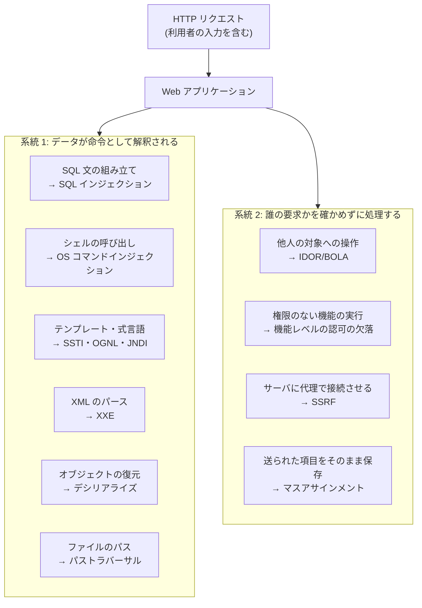

# サーバ側の Web アプリケーション脆弱性 (Server-Side Web Application Vulnerabilities: Injection, Access Control, SSRF, Sessions & Request Smuggling)

## 概要 (Overview)

本ドキュメントはWeb アプリケーションのサーバ側で生じる脆弱性の仕組みと対策を扱う。対象は SQL インジェクションや OS コマンドインジェクションなどのインジェクション、パストラバーサルとファイルのアップロード、アクセス制御の欠陥 (IDOR)、SSRF、XXE、デシリアライズ、セッション管理、HTTP リクエストスマグリング、競合状態、そしてそれらを防ぐセキュアコーディングの原則である。ブラウザの側の防御 (同一生成元ポリシー、XSS と CSP、CSRF と Cookie の属性) は [`../browsers/web-security-model.md`](../browsers/web-security-model.md) が扱っており、本書はその対になるサーバの側を受け持つ。

中心テーゼは、**サーバ側の脆弱性の多くは「データとして受け取ったものが、コードや命令として解釈される」ことと「誰の要求かを確かめずに処理する」ことの 2 つに分けられる**ということである。前者がインジェクションの系統である。利用者の入力を文字列としてつないで SQL 文やシェルのコマンドを組み立てると、入力の中の記号が文の構造を変え、攻撃者の命令が実行される。後者がアクセス制御の系統である。ログインしていることだけを確かめて、その利用者が要求した注文やファイルの持ち主であるかを確かめなければ、番号を変えるだけで他人のデータが見える。

対策の方向も 2 つに分かれる。インジェクションには入力を命令の構造から切り離す仕組み (プレースホルダ、引数の配列、自動エスケープのテンプレート) を使う。入力を検査して危険な文字を取り除くやり方は、文脈ごとに危険な文字が違うため漏れが出やすい。アクセス制御にはすべての要求で「この利用者はこの対象にこの操作をしてよいか」をサーバ側で判断する仕組みを、個々の処理ではなく共通の層に置く。OWASP Top 10:2025 では、アクセス制御の欠陥が引き続き 1 位で、SSRF もこの分類に統合された。分析深度は Level 3。

## 方法論 (Methodology)

- **一次資料**: インジェクションの定式化は Su & Wassermann (2006)、分類は Halfond, Viegas & Orso (2006) を使う。HTTP リクエストスマグリングは Linhart et al. (2005) と Kettle (2019)、競合状態の新しい攻撃手法は Kettle (2023) の発表を使う。脆弱性の分類は CWE と OWASP Top 10:2025 を使う。
- **事例は公的な記録で確かめる**: 被害の規模は脆弱性の告知 (CVE)、規制当局への届け出、被害を集計した調査 (Emsisoft の MOVEit の集計など) を使い、集計の時点を明記する。
- **攻撃の手順は扱わない**: 本書は脆弱性が生じる仕組みと、それを防ぐ設計を説明する。攻撃に使う具体的な入力の一覧は載せない (AGENTS.md の Security & Ethics)。
- **担当範囲**: ブラウザ側の防御は [`../browsers/web-security-model.md`](../browsers/web-security-model.md)、トークンと OAuth の脆弱性は [`../apis/authentication-tokens-specification.md`](../apis/authentication-tokens-specification.md)、クラウドの資格情報と IMDS は [`../cloud/cloud-iam-authorization.md`](../cloud/cloud-iam-authorization.md)、シリアライズの形式は [`../networking/rpc-serialization.md`](../networking/rpc-serialization.md)、WAF による暫定の防御は [`perimeter-defense-zero-trust.md`](perimeter-defense-zero-trust.md)、脆弱性を見つける検査は [`fuzzing-program-analysis.md`](fuzzing-program-analysis.md) と [`vulnerability-management.md`](vulnerability-management.md) に委ねる。

## 発見事項 (Findings)

1. **インジェクションとは、入力が命令の構文の構造を変えることである。** Su & Wassermann (2006) は、利用者の入力が組み立てられた問い合わせの構文木の中で 1 つの完全な部分 (値) に収まらず、構文の構造そのものを変えたときにインジェクションが起きると定式化した。SQL、OS のシェル、LDAP、テンプレートエンジン、XML のパーサなど、文字列を解釈する仕組みがあればどこでも同じ問題が生じる。LLM のプロンプトインジェクションも、命令とデータが同じ経路を流れるという同じ構造の問題である ([`llm-application-security.md`](llm-application-security.md))。
2. **根本の対策は命令とデータを別の経路で渡すことである。** SQL ではプレースホルダ (プリペアドステートメント) を使えば、SQL 文の構造が先に確定し、入力は常に値として扱われる。OS のコマンドではシェルを通さずに引数を配列で渡す。HTML の出力では文脈に応じて自動でエスケープするテンプレートを使う。入力から危険な文字を取り除く方法は、データベースの方言や文字コードの違い、文脈の取り違えで漏れが出るため、補助の対策にとどまる。
3. **アクセス制御の欠陥は最も多く、自動の検査で見つけにくい。** 要求された注文番号やファイル名が、ログインしている利用者のものかを確かめないと、番号を変えるだけで他人のデータに届く (IDOR: Insecure Direct Object Reference、API では BOLA と呼ばれる)。どのデータが誰のものかはアプリケーションの意味に依存するため、スキャナや WAF は欠陥を判断できない。OWASP Top 10:2025 では、アクセス制御の欠陥 (A01) が 2021 年版に続いて 1 位になった。
4. **SSRF はサーバを攻撃者の代理にして内側へ届かせる。** 利用者が指定した URL にサーバが接続する機能 (画像の取得、Webhook、URL のプレビュー) で、宛先を検証しないと、攻撃者はサーバに内部のサービスやクラウドのメタデータサービスへ接続させられる。2019 年の Capital One の事件では、設定の誤った WAF を経由した SSRF でクラウドのメタデータサービスから一時的な資格情報が盗まれ、約 1 億人分の情報が流出した。OWASP Top 10:2025 では、SSRF はアクセス制御の欠陥の分類に統合された。
5. **大規模な被害の多くは、古典的なインジェクションから起きている。** 2017 年の Equifax の侵害は、Apache Struts の脆弱性 (CVE-2017-5638) を突かれたものだった。この脆弱性は、HTTP ヘッダの値が式言語 (OGNL) として評価されるインジェクションである。2021 年の Log4Shell (CVE-2021-44228) は、ログに書いた文字列の中の参照記法が解釈されて外部からコードを読み込むものだった。2023 年の MOVEit Transfer の脆弱性 (CVE-2023-34362) は認証なしで突ける SQL インジェクションで、Emsisoft の集計 (2024 年 6 月時点) では約 2,770 の組織と約 9,580 万人が影響を受けた。
6. **同じ要求を 2 つの実装が違う規則で区切ると、検査をすり抜けられる。** HTTP リクエストスマグリングは、前段のプロキシと後段のサーバが、リクエストの終わりを違う規則 (Content-Length と Transfer-Encoding のどちらを優先するか) で判断することを突く。前段が 1 つのリクエストとみなしたものを、後段は 2 つに分けて処理し、2 つ目は前段の検査を経ていない。Kettle (2019) はこれを現代のサーバで再現し、多くの大手サイトで実証した。メールの SMTP smuggling、IP の断片化を使った IDS の回避と同じ型である。
7. **セッションの安全性はID の生成、受け渡し、寿命の 3 点で決まる。** セッション ID は推測できない乱数で作り、ログインの前後で作り直し (セッション固定化の防止)、Cookie の属性 (`Secure`、`HttpOnly`、`SameSite`) で受け渡しを守り、一定時間で失効させ、ログアウトでサーバ側からも無効にする。フレームワークのセッション管理の仕組みを使えば多くは既定で満たされるが、独自に作ると漏れが出やすい。

## アーキテクチャ (Architecture)

### 脆弱性の 2 つの系統

凡例: 系統 1 は「入力がどの解釈器に渡るか」で、系統 2 は「どの判断が欠けているか」で分類している。実際の脆弱性は両方にまたがることがある (SSRF は宛先の検証の欠落であり、内部への到達という権限の問題でもある)。

### 対策の対応

| 脆弱性 | 根本の対策 | 補助の対策 |
|---|---|---|
| SQL インジェクション | プレースホルダ (プリペアドステートメント)、ORM の安全な API | 入力の型の検査、DB アカウントの最小権限、WAF |
| OS コマンドインジェクション | シェルを使わず、引数を配列で渡す。そもそも外部コマンドを呼ばない | 許可した値だけを受け付ける |
| テンプレートインジェクション | 利用者の入力をテンプレートとして評価しない | サンドボックス化したテンプレートエンジン |
| パストラバーサル | 利用者の入力をパスに使わず、ID からサーバ側で対応づける | 正規化したパスが許可したディレクトリの中かを確かめる |
| XXE | XML パーサの外部実体と DTD を無効にする | JSON など外部参照のない形式を使う |
| デシリアライズ | 信頼できない入力を任意の型に復元しない。データだけの形式を使う | 復元できる型を許可リストで限定、署名 |
| IDOR/BOLA | すべての要求で所有者と権限をサーバ側で確かめる共通の層 | 推測しにくい ID (補助にすぎない) |
| SSRF | 宛先を許可リストで限定、内部への到達をネットワークで遮断 | IMDSv2、名前解決の結果の検証 |
| リクエストスマグリング | 前段と後段で同じ解釈をする (曖昧なリクエストを拒否)、HTTP/2 を端から端まで使う | 前段で正規化 |
| セッション固定化 | ログインの成功時にセッション ID を作り直す | Cookie の属性、短い寿命 |

## 技術詳細 (Technical Details)

### 1. インジェクション

- **SQL インジェクション**: 利用者の入力を文字列としてつないで SQL 文を作ると、入力の中の引用符やコメントの記号が文の構造を変える。検索条件が常に真になって全件が返る、別の表の内容が結果に混ざる、データの変更や削除の文が実行される、といった被害になる。結果が画面に出ない場合も、応答の違いや時間差から 1 ビットずつ情報を引き出せる (ブラインド SQL インジェクション)。Halfond et al. (2006) は、攻撃の手法と対策を体系的に分類している。対策はSQL 文の構造を先に確定させ、値を後から渡すプレースホルダである。表名や列名、並び順のように値として渡せない部分は、許可した名前の一覧から選ぶ。
- **OS コマンドインジェクション**: 外部のプログラムをシェル経由で呼び出すと、入力の中のシェルの記号 (コマンドの区切り、パイプ、置換) が解釈され、別のコマンドが実行される。シェルを介さず、プログラムのパスと引数を配列で直接渡せば、入力は 1 つの引数としてしか扱われない。引数がオプションとして解釈されないよう、区切りの記号を置くなどの注意も要る。多くの場合、外部のコマンドを呼ばずにライブラリの関数で同じ処理ができる。
- **テンプレートと式言語**: テンプレートエンジンや式言語 (OGNL、SpEL、JNDI の参照) は、文字列の中の記法を評価して値を埋め込む。利用者の入力そのものをテンプレートとして評価すると、テンプレートの機能を通じて任意のコードが実行される (SSTI: Server-Side Template Injection)。Equifax の侵害の原因となった Struts の脆弱性 (CVE-2017-5638) は、エラー処理の中で HTTP ヘッダの値が OGNL の式として評価されるものだった。Log4Shell (CVE-2021-44228) は、ログに書いた文字列の中の `${jndi:...}` という参照が解釈され、外部のサーバからクラスを読み込んで実行するものだった。どちらも、データとして扱うべき文字列を評価する機能が、意図しない場所で有効になっていた。
- **その他の解釈器**: LDAP の検索フィルタ、XPath、NoSQL のクエリ (演算子を表すオブジェクトを入力として受け取ってしまう)、メールのヘッダ (改行による別のヘッダの挿入)、HTTP のレスポンスヘッダ (改行の挿入によるレスポンスの分割) も、同じ構造のインジェクションを起こす。
- **出力の側のインジェクション**: 利用者の入力を HTML に埋め込むときの XSS も、HTML とスクリプトの解釈器へのインジェクションである。文脈 (HTML の本文、属性、JavaScript の中、URL) ごとにエスケープの規則が違うため、文脈を自動で判断してエスケープするテンプレートを使う。ブラウザの側の多層防御 (CSP) は [`../browsers/web-security-model.md`](../browsers/web-security-model.md) で扱う。

### 2. ファイルとパス

- **パストラバーサル**: ファイル名を利用者から受け取ってパスにつなぐと、`../` のような上位ディレクトリへの移動で、公開するつもりのないファイル (設定ファイル、鍵) を読まれる。符号化を重ねる、別の区切り文字を使う、といった表現の違いで単純な検査は回避されやすい。利用者にはファイルの ID だけを渡し、サーバ側の表で実際のパスに対応づけるのが確実である。パスを使う場合は、正規化した絶対パスが許可したディレクトリの中にあることを確かめる。
- **ファイルのアップロード**: アップロードされたファイルが Web サーバの公開ディレクトリに置かれ、サーバ側のスクリプトとして実行されると、攻撃者は任意のコードを実行できる (Web シェル)。拡張子や Content-Type は送信者が自由に書けるため、それだけで種類を判断しない。保存先を公開ディレクトリの外にし、ファイル名をサーバ側で付け直し、実行の権限を与えず、配信するときは別のドメインから `Content-Disposition: attachment` で返す。
- **XXE** (XML External Entity): XML の DTD の外部実体の機能を有効にしたまま信頼できない XML を解析すると、外部実体の参照でサーバのファイルを読まれたり、内部のサーバに接続させられたり (SSRF)、実体の展開で大量のメモリを使わされたりする。XML パーサの外部実体と DTD の処理を無効にするのが対策で、最近のライブラリの多くは既定で無効にしている。Office の文書や SVG のように、XML を中に含む形式にも注意が要る。

### 3. デシリアライズ

- **仕組み**: Java の `ObjectInputStream`、Python の `pickle`、PHP の `unserialize` のように、任意の型のオブジェクトを復元する仕組みは、復元の過程でオブジェクトのメソッド (初期化、比較、破棄の処理) を呼ぶ。攻撃者は、アプリケーションが読み込んでいるライブラリのクラスを組み合わせて、復元するだけでコマンドが実行される入力 (ガジェットチェーン) を作れる (Frohoff & Lawrence 2015)。
- **対策**: 信頼できない入力を、任意の型を復元する仕組みで扱わない。JSON や Protocol Buffers のように、データだけを表す形式を使い、決まった型に読み込む ([`../networking/rpc-serialization.md`](../networking/rpc-serialization.md))。どうしても使う場合は、復元できるクラスを許可リストで限定し、データに署名して改ざんを検知する。

### 4. アクセス制御

- **IDOR / BOLA**: URL や API のパラメータに含まれる対象の ID (注文番号、利用者 ID、ファイル ID) について、要求した利用者がその対象を操作してよいかを確かめない欠陥である。ID を推測しにくい乱数 (UUID) にしても、ID が別の場所 (共有 URL、ログ、他の API の応答) から漏れれば同じことが起きるため、補助にしかならない。
- **機能レベルの認可の欠落**: 管理者用の画面やボタンを一般の利用者に表示しないだけで、サーバ側の API で権限を確かめていないと、API を直接呼べば管理者の操作ができる。画面の表示の制御はセキュリティの境界ではない。
- **マスアサインメント**: 送られてきた項目をまとめてデータのモデルに保存する機能で、利用者が変えてはいけない項目 (権限、所有者、価格) まで送られてくると書き換えられる。保存してよい項目を許可リストで明示する。
- **設計の原則**: 認可の判断を各処理に散らばらせず、共通の層 (ミドルウェア、ポリシーエンジン) に集める。既定で拒否し、許可を明示する。データを取得するクエリに所有者の条件を必ず含める。認可の判断は利用者の属性と対象の属性と操作から決める (ABAC) か、利用者と対象の関係から決める (ReBAC、Google の Zanzibar 型) 設計が使われる ([`../cloud/cloud-iam-authorization.md`](../cloud/cloud-iam-authorization.md))。自動の検査で見つけにくいため、「別の利用者の ID で同じ要求を送ると拒否されるか」を試験として書いておく。

### 5. SSRF

- **仕組み**: サーバが利用者の指定した URL に接続する機能で、宛先の検証が不十分だと、攻撃者はサーバに、外から届かない内部のサービス (管理画面、データベースの API) や、クラウドのメタデータサービス (`169.254.169.254`) へ接続させられる。サーバの資格情報で、サーバのネットワーク上の位置から接続することになるため、境界のファイアウォールを内側から越えられる。
- **検証の難しさ**: URL の文字列でホスト名を検査しても、DNS の名前解決の結果が内部のアドレスを指していれば防げない。検査のときと接続のときで名前解決の結果を変える攻撃 (DNS リバインディング)、リダイレクトでの内部への転送、IP アドレスの表記の違い (10 進数の 1 つの数、IPv6 に埋め込んだ IPv4) もある。名前解決した後のアドレスを検査して、そのアドレスに接続する、リダイレクトを追わない、許可した宛先の一覧に限る、といった対策を組み合わせる。
- **ネットワークの側の対策**: 外部の URL に接続する処理を、内部のネットワークに届かない専用の環境 (外向きの通信だけを許すプロキシ) に分ける。クラウドではメタデータサービスを、トークンを取得してから使う方式 (AWS の IMDSv2) にし、転送のホップ数を制限して、単純な SSRF で資格情報を取られないようにする ([`../cloud/cloud-iam-authorization.md`](../cloud/cloud-iam-authorization.md))。
- **Capital One の事件 (2019 年)**: 設定の誤った WAF に SSRF の脆弱性があり、攻撃者は WAF のサーバにメタデータサービスへ接続させて、WAF に割り当てられた一時的な資格情報を取得した。その資格情報に広いストレージの読み取り権限があったため、約 1 億人分の申込者の情報が流出した。SSRF、過剰な権限、メタデータサービスの古い方式が重なった事例である。

### 6. セッション管理

- **ID の生成**: セッション ID は暗号学的に安全な乱数で、十分な長さ (128 ビット以上が目安) で作る。連番や時刻から作った ID は推測できる。
- **セッション固定化**: 攻撃者があらかじめ用意したセッション ID を被害者に使わせ、被害者がログインした後にその ID で被害者として振る舞う攻撃である。ログインに成功した時点でセッション ID を作り直せば防げる。権限が変わるとき (管理者の操作への切り替え) も作り直す。
- **受け渡しと寿命**: セッション ID は Cookie で渡し、`Secure` (HTTPS のときだけ送る)、`HttpOnly` (スクリプトから読めない)、`SameSite` (他のサイトからの要求で送らない) の属性を付ける。URL に入れると、ログやリファラで漏れる。一定時間操作がなければ失効させ、ログアウトではサーバ側の記録も消す。トークン型の認証 (JWT) では、サーバ側で無効にしにくいという別の問題がある ([`../apis/authentication-tokens-specification.md`](../apis/authentication-tokens-specification.md))。
- **CSRF のサーバ側の対策**: ログイン済みの利用者のブラウザに、他のサイトから状態を変える要求を送らせる攻撃である。`SameSite` の属性に加えて、状態を変える要求ではフォームに埋めた推測できないトークンを確かめ、`Origin` ヘッダを検証する。GET の要求で状態を変えない。

### 7. HTTP の解釈の食い違い

- **リクエストスマグリング** (Linhart et al. 2005、Kettle 2019): HTTP/1.1 ではリクエストの本文の長さを `Content-Length` か `Transfer-Encoding: chunked` で示す。両方があるとき、仕様は後者を優先して前者を無視するよう求めているが、実装によって扱いが違う。前段のプロキシ (CDN、ロードバランサ) と後段のサーバの解釈が食い違うと、前段が 1 つのリクエストとみなした本文の一部を、後段は次のリクエストの始まりとして処理する。その「次のリクエスト」は前段の認証や WAF の検査を経ておらず、別の利用者のリクエストに結合されて、その利用者の応答を攻撃者に返させることもある。対策は曖昧なリクエスト (両方のヘッダを持つ、不正な形式の長さ) を前段で拒否すること、前段と後段で同じ実装を使うか、HTTP/2 を端から端まで使うことである ([`../networking/load-balancing-architecture.md`](../networking/load-balancing-architecture.md))。
- **HTTP/2 から HTTP/1.1 への変換**: 前段が HTTP/2 で受けて後段に HTTP/1.1 で送る構成では、HTTP/2 のヘッダの値に含まれた改行や長さの指定が、変換の後に別の意味を持つことがある。プロトコルの変換は解釈の食い違いが生じやすい場所である ([`../networking/http-quic-evolution.md`](../networking/http-quic-evolution.md))。

### 8. 競合状態と業務の論理

- **競合状態**: 「残高を確かめてから引き落とす」「クーポンが未使用かを確かめてから使用済みにする」処理を、確認と更新の間に同時に複数のリクエストで実行されると、確認をすり抜けて二重に処理される (TOCTOU: Time-of-Check to Time-of-Use)。Kettle (2023) は複数のリクエストを 1 つのパケットにまとめて同時に届け、ネットワークの遅延の揺らぎをなくして競合を確実に起こす手法を示した。対策は確認と更新を 1 つの不可分な操作にする (データベースの制約、条件付きの更新、行のロック) ことである ([`../databases/transactions-isolation.md`](../databases/transactions-isolation.md))。
- **業務の論理の欠陥**: 手順の途中の段階を飛ばす (支払いの前に完了の画面に進む)、数量に負の値を入れる、割引を重ねて適用する、といった欠陥は、プロトコルや入力の形式としては正しいリクエストで起きる。どのような順序と値が正しいかはアプリケーションの意味で決まるため、WAF やスキャナでは見つからない。設計の段階で、状態の遷移と値の範囲をサーバ側で必ず検証する。

### 9. セキュアコーディングの原則

- 入力の検証と出力の処理は分けて考える。入力の検証 (型、長さ、範囲、許可した値) は、業務上の正しさを確かめるために行う。インジェクションを防ぐのは、入力を渡す先の解釈器ごとの安全な渡し方 (プレースホルダ、引数の配列、文脈に応じたエスケープ) であり、入力の検証では代わりにならない。同じ入力が SQL にも HTML にもシェルにも渡りうるため、入力の時点では、どの文字が危険かを決められない。
- フレームワークの既定に乗る。現代の Web フレームワークはプレースホルダを使う ORM、自動エスケープのテンプレート、CSRF のトークン、安全なセッション管理を既定で備えている。脆弱性の多くは、その既定を外した箇所 (生の SQL を書く、エスケープを無効にする、独自のセッションを作る) で生じる。既定を外す箇所をコードレビューで重点的に見る。
- **最小権限と多層防御**: アプリケーションのデータベースのアカウントに必要な権限だけを与えれば、SQL インジェクションが起きても被害の範囲が限られる。アプリケーションのプロセスに不要なファイルやネットワークへのアクセスを与えないことも同じである ([`sandbox-architectures.md`](sandbox-architectures.md))。
- **エラーの扱い**: 例外の詳細やスタックトレースを利用者に返すと、内部の構造や SQL 文が漏れる。例外の処理の誤りで、認可の確認が飛ばされたまま処理が続くこともある。OWASP Top 10:2025 は例外的な状態の誤った扱いを新しい分類 (A10) として加えた。

## セキュリティ考察 (Security Considerations)

| 脆弱性の系統 | 典型的な原因 | 見つけ方 | 防ぎ方 |
|---|---|---|---|
| インジェクション | 文字列の連結による命令の組み立て、評価機能の有効化 | SAST (危険な API の使用の検出)、DAST、ファジング | プレースホルダ、引数の配列、自動エスケープ、評価機能の無効化 |
| アクセス制御 | 所有者の確認の欠落、画面の表示だけの制御 | 別の利用者での試験、コードレビュー | 共通の認可の層、既定で拒否 |
| SSRF | 利用者指定の URL への接続 | 宛先の検証のコードレビュー、試験 | 許可リスト、ネットワークの分離、IMDSv2 |
| 解釈の食い違い | 前段と後段の異なる実装 | 専用の検査ツール、構成の確認 | 曖昧なリクエストの拒否、端から端まで同じプロトコル |
| 競合状態・業務の論理 | 確認と更新の分離、状態の遷移の検証の欠落 | 設計のレビュー、同時実行の試験 | 不可分な操作、サーバ側での状態の検証 |

- WAF は根本の対策の代わりにならない。インジェクションの典型的な型は WAF で止められるが、型を崩した入力には回避されやすく、アクセス制御や業務の論理の欠陥はリクエストの形からは区別できない ([`perimeter-defense-zero-trust.md`](perimeter-defense-zero-trust.md))。WAF は、修正が出るまでの時間を稼ぐ仮想パッチとして使う。
- 依存するライブラリも攻撃面である。Struts と Log4j の事例はアプリケーション自身のコードではなく、広く使われるライブラリの機能が脆弱性の原因だった。どのライブラリのどのバージョンを使っているかを把握し (SBOM、[`software-supply-chain-security.md`](software-supply-chain-security.md))、脆弱性が公表されたらすぐに影響を判断できるようにしておく ([`vulnerability-management.md`](vulnerability-management.md))。
- 公開されたファイル転送製品やアプライアンスは重点的に狙われる。MOVEit Transfer の事件では、認証なしで突ける SQL インジェクションが、多数の組織のファイル転送の基盤で一斉に悪用された。インターネットに公開され、機密のファイルを扱う製品は、1 つの脆弱性が多数の組織のデータ流出に直結する。
- ログに個人情報や認証情報を残さない。入力をそのままログに書くと、パスワードやトークンが残るうえ、Log4Shell のようにログの処理そのものが攻撃の経路になることもある。ログに書く値は必要なものに絞り、利用者の入力はデータとして扱われる形で記録する。

## 結論 (Conclusions)

- サーバ側の脆弱性の多くは、データが命令として解釈されるインジェクションの系統と、誰の要求かを確かめずに処理するアクセス制御の系統に分けられる。前者は SQL、シェル、テンプレート、XML、デシリアライズに共通の構造であり、後者は IDOR、機能レベルの認可の欠落、SSRF に共通の構造である。
- インジェクションの根本の対策は命令とデータを別の経路で渡すことである。入力の検証は業務上の正しさのためのもので、解釈器ごとの安全な渡し方の代わりにはならない。
- アクセス制御の欠陥は最も多く、アプリケーションの意味に依存するため自動の検査で見つけにくい。認可の判断を共通の層に集め、既定で拒否し、別の利用者での試験を書いておく。
- 前段と後段の解釈の食い違い (リクエストスマグリング) と、確認と更新の間の競合は、個々の部品が正しくても組み合わせで生じる。大規模な被害の多くは古典的なインジェクションから起きており、フレームワークの既定に乗ること、依存ライブラリを把握することが、新しい攻撃手法への対策と同じくらい重要である。

### 次の接続先 (Related Topics)

- [`../browsers/web-security-model.md`](../browsers/web-security-model.md) — ブラウザ側の防御 (同一生成元ポリシー、XSS と CSP、CSRF と Cookie)。
- [`../apis/authentication-tokens-specification.md`](../apis/authentication-tokens-specification.md) — トークンによる認証と、JWT・OAuth の実装の落とし穴。
- [`../cloud/cloud-iam-authorization.md`](../cloud/cloud-iam-authorization.md) — SSRF で狙われるメタデータサービスと、認可のモデル (ABAC・Zanzibar)。
- [`../networking/rpc-serialization.md`](../networking/rpc-serialization.md) — シリアライズの形式とデシリアライズ攻撃。
- [`llm-application-security.md`](llm-application-security.md) — 命令とデータが同じ経路を流れる LLM 版のインジェクション。
- [`perimeter-defense-zero-trust.md`](perimeter-defense-zero-trust.md) — WAF による仮想パッチとその限界。
- [`vulnerability-management.md`](vulnerability-management.md) — 依存ライブラリの脆弱性の優先順位付けと修正の運用。

## 参考文献 (References)

**一次資料 (論文・発表・分類)**

- Su, Z., & Wassermann, G. (2006). The Essence of Command Injection Attacks in Web Applications. *Proceedings of the 33rd ACM SIGPLAN-SIGACT Symposium on Principles of Programming Languages (POPL '06)*, 372–382. https://doi.org/10.1145/1111037.1111070
- Halfond, W. G. J., Viegas, J., & Orso, A. (2006). A Classification of SQL-Injection Attacks and Countermeasures. *Proceedings of the IEEE International Symposium on Secure Software Engineering (ISSSE)*.
- Linhart, C., Klein, A., Heled, R., & Orrin, S. (2005). *HTTP Request Smuggling*. Watchfire Corporation.
- Kettle, J. (2019). HTTP Desync Attacks: Request Smuggling Reborn. *Black Hat USA 2019*. PortSwigger Research.
- Kettle, J. (2023). Smashing the State Machine: The True Potential of Web Race Conditions. *Black Hat USA 2023*. PortSwigger Research.
- Frohoff, C., & Lawrence, G. (2015). Marshalling Pickles: How Deserializing Objects Will Ruin Your Day. *AppSecCali 2015*.
- Fielding, R., Nottingham, M., & Reschke, J. (Eds.). (2022). HTTP/1.1. *RFC 9112*. — メッセージの本文の長さの決め方 (Transfer-Encoding と Content-Length)。
- [OWASP Top 10:2025](https://owasp.org/Top10/2025/) — Accessed: 2026-10-18。A01 アクセス制御の欠陥 (SSRF を統合)、A03 ソフトウェアサプライチェーンの失敗、A10 例外的な状態の誤った扱い。
- [CWE (Common Weakness Enumeration), MITRE](https://cwe.mitre.org/) — Accessed: 2026-10-18。CWE-89 (SQL インジェクション)、CWE-78 (OS コマンドインジェクション)、CWE-22 (パストラバーサル)、CWE-639 (IDOR)、CWE-918 (SSRF)、CWE-502 (デシリアライズ)、CWE-444 (リクエストスマグリング)。

**事例**

- [CVE-2017-5638 (Apache Struts)](https://www.cve.org/CVERecord?id=CVE-2017-5638) — Accessed: 2026-10-18。Equifax の侵害の原因となった OGNL の評価。
- [CVE-2021-44228 (Apache Log4j, Log4Shell)](https://www.cve.org/CVERecord?id=CVE-2021-44228) — Accessed: 2026-10-18。
- [CVE-2023-34362 (Progress MOVEit Transfer)](https://www.cve.org/CVERecord?id=CVE-2023-34362) — Accessed: 2026-10-18。
- [Unpacking the MOVEit Breach: Statistics and Analysis, Emsisoft](https://www.emsisoft.com/en/blog/44123/unpacking-the-moveit-breach-statistics-and-analysis/) — Accessed: 2026-10-18。約 2,773 組織、約 9,580 万人 (2024-06-28 時点の集計)。
- Novaes Neto, N., Madnick, S., Moraes G. de Paula, A., & Malara Borges, N. (2020). A Case Study of the Capital One Data Breach. *MIT Sloan School of Management, Working Paper*. — SSRF、過剰な権限、メタデータサービスの重なり。
