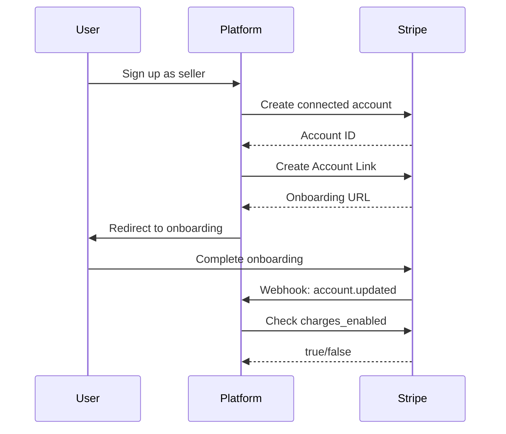

# Stripe Connect Specification

**Version**: 1.0
**Last Updated**: 2025-12-26
**Status**: Research Complete

---

## Overview / 概要

**English**: Stripe Connect is a payment infrastructure solution for platforms and marketplaces that need to manage multi-party payments. It enables businesses to accept payments from customers and distribute funds to multiple sellers, service providers, or vendors.

**日本語**: Stripe Connect は、マルチパーティ決済を管理する必要があるプラットフォームやマーケットプレイス向けの決済インフラソリューションです。顧客からの支払いを受け付け、複数の販売者、サービスプロバイダー、またはベンダーに資金を分配することができます。

---

## Why Stripe Connect? / なぜStripe Connectが必要か

### The Problem: Marketplace Payments Are Complex / 問題：マーケットプレイス決済は複雑

**English**:
Traditional payment processors assume money flows in a straight line: Customer → Business. However, marketplaces and platforms have fundamentally different payment flows where a single transaction must be split among multiple parties (platform, sellers, service providers).

**日本語**:
従来の決済プロセッサは、資金が一直線に流れることを前提としています：顧客 → 事業者。しかし、マーケットプレイスやプラットフォームでは、1つの取引を複数の当事者（プラットフォーム、販売者、サービスプロバイダー）に分割する必要があり、根本的に異なる決済フローが必要です。

```
Traditional Payment:
  Customer ──────────────────────► Business
                 Simple

Marketplace Payment:
  Customer ──► Platform ──┬──► Seller A (70%)
                          ├──► Seller B (20%)
                          └──► Platform Fee (10%)
                 Complex: Split, Compliance, Payouts
```

### Stripe vs Stripe Connect / 通常のStripeとConnectの違い

| Aspect | Stripe (Standard) | Stripe Connect |
|--------|-------------------|----------------|
| **Purpose** | Single business payments | Multi-party platform payments |
| **Fund Flow** | Customer → Business | Customer → Platform → Multiple Recipients |
| **Split Payments** | Not supported | Native support |
| **Seller Onboarding** | N/A | Built-in KYC/AML |
| **Compliance** | Business handles own | Stripe handles for all parties |
| **Tax Reporting** | Manual | Automated (1099s, etc.) |

### Challenges Connect Solves / Connectが解決する課題

#### 1. Money Transmission Regulations / 資金移動規制

**English**:
When a business transfers money between third parties, it may be classified as a "money transmitter" under financial regulations. This requires:
- Registration with financial authorities (e.g., FinCEN in the US)
- State-by-state licensing (US has 50+ different requirements)
- Compliance with Bank Secrecy Act (BSA) and AML laws
- Significant legal and operational overhead

With Stripe Connect, **Stripe acts as the licensed money transmitter**, so platforms can facilitate split payments without taking on that regulatory burden.

**日本語**:
事業者が第三者間で資金を移動する場合、金融規制上「資金移動業者」として分類される可能性があります。これには以下が必要です：
- 金融当局への登録（米国ではFinCENなど）
- 州ごとのライセンス取得（米国は50以上の異なる要件）
- 銀行秘密法（BSA）およびAML法への準拠
- 多大な法的・運用上のオーバーヘッド

Stripe Connectでは、**Stripeがライセンスを持つ資金移動業者として機能**するため、プラットフォームはその規制負担を負わずに分割決済を実現できます。

#### 2. Seller Verification & Compliance / 販売者の本人確認とコンプライアンス

**English**:
Platforms must verify every seller's identity (KYC - Know Your Customer) and screen for money laundering (AML). Without Connect, this means:
- Building custom verification flows
- Collecting and securely storing sensitive documents
- Ongoing monitoring and re-verification
- Adapting to changing regulations in each country

Connect provides **automated KYC/AML** that updates automatically as regulations change.

**日本語**:
プラットフォームはすべての販売者の本人確認（KYC）とマネーロンダリングのスクリーニング（AML）を行う必要があります。Connectがなければ、以下が必要です：
- カスタム確認フローの構築
- 機密文書の収集と安全な保管
- 継続的な監視と再確認
- 各国の規制変更への対応

Connectは、規制変更時に自動更新される**自動KYC/AML**を提供します。

#### 3. Split Payment Complexity / 分割決済の複雑さ

**English**:
Manual payment splitting creates operational nightmares:
- Calculating each party's share per transaction
- Handling different fee structures (fixed, percentage, hybrid)
- Managing timing mismatches (credit cards settle in days, bank transfers vary)
- Processing refunds across multiple recipients
- Tracking and reconciling all movements

Connect handles all of this **automatically at the transaction level**.

**日本語**:
手動での決済分割は運用上の悪夢を生みます：
- 取引ごとに各当事者の分配額を計算
- 異なる手数料体系（固定、パーセンテージ、ハイブリッド）の処理
- タイミングの不一致の管理（クレジットカードは数日で決済、銀行振込は様々）
- 複数の受取人にまたがる返金処理
- すべての資金移動の追跡と照合

Connectはこれらすべてを**トランザクションレベルで自動的に**処理します。

#### 4. Dispute & Refund Management / 紛争・返金管理

**English**:
When a customer requests a refund or files a chargeback on a split payment:
- Without Connect: Platform must manually contact each seller, calculate their portion, and coordinate the return
- With Connect: Stripe **automatically pulls back the correct amounts** from each party

**日本語**:
顧客が分割決済で返金を要求したりチャージバックを申請した場合：
- Connectなし：プラットフォームは各販売者に手動で連絡し、分配額を計算し、返金を調整する必要がある
- Connectあり：Stripeが各当事者から**正しい金額を自動的に回収**

#### 5. Global Expansion / グローバル展開

**English**:
Expanding internationally without Connect requires:
- Local bank accounts in each country
- Understanding local payment regulations
- Currency conversion logistics
- Local tax compliance

Connect enables **135+ currencies and 40+ payment methods** with automatic currency conversion and local payouts.

**日本語**:
Connectなしで国際展開するには以下が必要：
- 各国でのローカル銀行口座
- 各地域の決済規制の理解
- 通貨変換のロジスティクス
- 現地税務コンプライアンス

Connectは、自動通貨変換とローカル送金で**135以上の通貨と40以上の決済方法**を実現します。

### When You Need Connect / Connectが必要なケース

**English**:
You need Stripe Connect when your business model involves:
- Collecting payments on behalf of others (marketplace model)
- Splitting a single payment among multiple recipients
- Onboarding sellers/providers who need to receive payouts
- Operating a platform where users transact with each other

You do NOT need Connect for:
- Simple e-commerce (single seller)
- SaaS subscriptions (single recipient)
- Donations to a single organization

**日本語**:
以下のビジネスモデルにはStripe Connectが必要です：
- 他者に代わって決済を受け付ける（マーケットプレイスモデル）
- 1つの支払いを複数の受取人に分割
- 支払いを受け取る必要がある販売者/プロバイダーのオンボーディング
- ユーザー同士が取引するプラットフォームの運営

以下の場合はConnectは不要です：
- シンプルなEコマース（単一販売者）
- SaaSサブスクリプション（単一受取人）
- 単一組織への寄付

### Real-World Examples / 実例

| Platform | Why They Need Connect |
|----------|----------------------|
| **Shopify** | Enables merchants to accept payments; Shopify takes platform fees |
| **Airbnb** | Splits payment between host (accommodation) and platform (service fee) |
| **DoorDash** | Splits payment between restaurant, driver, and platform |
| **Instacart** | Complex split: grocery store, shopper, delivery partner, platform |
| **Kickstarter** | Holds funds until goal met, then distributes to project creators |

---

## Key Features / 主要機能

**English**:
- Multi-party payment processing and fund distribution
- 135+ currencies and 40+ payment methods supported
- Automated fee splitting (fixed, percentage, or hybrid)
- Built-in compliance (PCI, AML, local tax requirements)
- Sales tax, VAT, and GST support in 100+ countries
- Fraud detection via Stripe Radar
- Same-day transfers in multiple regions

**日本語**:
- マルチパーティ決済処理と資金分配
- 135以上の通貨と40以上の決済方法をサポート
- 自動手数料分割（固定、パーセンテージ、またはハイブリッド）
- 組み込みコンプライアンス（PCI、AML、各地域の税要件）
- 100以上の国で消費税、VAT、GSTをサポート
- Stripe Radar による不正検知
- 複数地域での即日送金

---

## Architecture / アーキテクチャ

### System Components / システム構成

```
┌─────────────────────────────────────────────────────────────────┐
│                         Platform                                 │
│                    (Your Application)                            │
└─────────────────────────────────────────────────────────────────┘
                              │
                              ▼
┌─────────────────────────────────────────────────────────────────┐
│                     Platform Stripe Account                      │
│                   (Manages Connect Integration)                  │
└─────────────────────────────────────────────────────────────────┘
                              │
              ┌───────────────┼───────────────┐
              ▼               ▼               ▼
┌──────────────────┐ ┌──────────────────┐ ┌──────────────────┐
│ Connected Acct 1 │ │ Connected Acct 2 │ │ Connected Acct N │
│    (Seller A)    │ │    (Seller B)    │ │    (Seller N)    │
└──────────────────┘ └──────────────────┘ └──────────────────┘
              │               │               │
              ▼               ▼               ▼
         [Payout]        [Payout]        [Payout]
              │               │               │
              ▼               ▼               ▼
        Bank Account    Bank Account    Bank Account
```

### Payment Flow / 決済フロー

```
Customer ──► Payment ──► Platform Account ──► Fee Deduction ──► Connected Account ──► Payout
   │                          │                    │                   │               │
   └── Card/Payment Method    └── Receives funds   └── Platform fee    └── Seller      └── Bank
```

---

## Account Types / アカウントタイプ

### Comparison Table / 比較表

| Aspect | Standard | Express | Custom |
|--------|----------|---------|--------|
| **Implementation Effort** | Very Low | Low | Very High |
| **Dashboard Access** | Full Stripe Dashboard | Express Dashboard (Limited) | None |
| **Onboarding** | Stripe handles | Stripe handles | Platform handles |
| **Identity Verification** | Stripe handles | Stripe handles | Platform handles |
| **Fraud/Dispute Responsibility** | Connected Account | Platform | Platform |
| **Branding** | Stripe branded | Co-branded | White-label |
| **Additional Fees** | None | ¥200/month + payout fees | ¥200/month + payout fees |

### Standard Account / Standard アカウント

**English**:
- Best for: SaaS platforms, store builders (e.g., Shopify)
- Connected accounts have full Stripe Dashboard access
- Minimal integration effort required
- Stripe handles all compliance and user support
- No additional Connect fees

**日本語**:
- 最適な用途: SaaSプラットフォーム、ストアビルダー（例: Shopify）
- 接続アカウントは完全なStripeダッシュボードにアクセス可能
- 最小限の実装工数
- Stripeがすべてのコンプライアンスとユーザーサポートを担当
- Connect追加料金なし

### Express Account / Express アカウント

**English**:
- Best for: Marketplaces, ride-sharing, home rentals (e.g., Airbnb, Lyft)
- Lightweight Express Dashboard for connected accounts
- Stripe handles onboarding and verification
- Platform controls payout timing and fees
- Platform responsible for fraud losses

**日本語**:
- 最適な用途: マーケットプレイス、ライドシェア、民泊（例: Airbnb、Lyft）
- 接続アカウント用の軽量なExpressダッシュボード
- Stripeがオンボーディングと本人確認を担当
- プラットフォームが支払いタイミングと手数料を制御
- プラットフォームが不正損失の責任を負う

### Custom Account / Custom アカウント

**English**:
- Best for: Large enterprises requiring white-label solutions
- Complete control over user experience
- Platform handles all account interactions
- No dashboard access for connected accounts
- Requires significant engineering resources

**日本語**:
- 最適な用途: ホワイトラベルソリューションが必要な大企業
- ユーザーエクスペリエンスを完全に制御
- プラットフォームがすべてのアカウント操作を担当
- 接続アカウントはダッシュボードにアクセス不可
- 相当なエンジニアリングリソースが必要

**Important Note / 重要事項**: Account type cannot be changed after creation. / アカウントタイプは作成後に変更できません。

---

## Charge Types / 決済タイプ

### Direct Charges / 直接課金

**English**:
- Charges created on the connected account
- Funds appear in connected account's balance
- Platform collects fees via `application_fee_amount`
- Best for: SaaS platforms, independent seller marketplaces

**日本語**:
- 接続アカウントで課金を作成
- 資金は接続アカウントの残高に表示
- プラットフォームは `application_fee_amount` で手数料を徴収
- 最適な用途: SaaSプラットフォーム、独立系販売者マーケットプレイス

```javascript
// Example: Direct Charge
const paymentIntent = await stripe.paymentIntents.create({
  amount: 10000,
  currency: 'jpy',
  application_fee_amount: 1000, // Platform fee
}, {
  stripeAccount: 'acct_connected_account_id',
});
```

### Destination Charges / 送金先課金

**English**:
- Charges created on platform account
- Funds transferred to connected account automatically
- Platform keeps the difference as fee
- Best for: Marketplaces, ride-sharing, delivery platforms

**日本語**:
- プラットフォームアカウントで課金を作成
- 資金は自動的に接続アカウントに送金
- プラットフォームは差額を手数料として保持
- 最適な用途: マーケットプレイス、ライドシェア、デリバリープラットフォーム

```javascript
// Example: Destination Charge
const paymentIntent = await stripe.paymentIntents.create({
  amount: 10000,
  currency: 'jpy',
  transfer_data: {
    destination: 'acct_connected_account_id',
    amount: 9000, // Amount to connected account
  },
});
```

### Separate Charges and Transfers / 分離課金と送金

**English**:
- Charges and transfers are independent operations
- Maximum flexibility for multi-party scenarios
- Can split payments across multiple connected accounts
- Best for: Delivery platforms (split between restaurant and driver)

**日本語**:
- 課金と送金が独立した操作
- マルチパーティシナリオで最大の柔軟性
- 複数の接続アカウントに支払いを分割可能
- 最適な用途: デリバリープラットフォーム（レストランとドライバーに分割）

```javascript
// Example: Separate Charge and Transfer
// Step 1: Create charge
const paymentIntent = await stripe.paymentIntents.create({
  amount: 10000,
  currency: 'jpy',
});

// Step 2: Transfer to multiple accounts
await stripe.transfers.create({
  amount: 7000,
  currency: 'jpy',
  destination: 'acct_restaurant_id',
});

await stripe.transfers.create({
  amount: 2000,
  currency: 'jpy',
  destination: 'acct_driver_id',
});
```

---

## Onboarding Flow / オンボーディングフロー

### Options / オプション

| Option | Description | Best For |
|--------|-------------|----------|
| **Stripe-Hosted** | Redirect to Stripe's co-branded form | Quick implementation |
| **Embedded** | Onboarding component in your app | Seamless UX |
| **API** | Build custom UI with Stripe API | Full customization |

### Implementation Steps / 実装ステップ



### Code Example / コード例

```javascript
// Step 1: Create connected account
const account = await stripe.accounts.create({
  type: 'express',
  country: 'JP',
  email: 'seller@example.com',
  capabilities: {
    card_payments: { requested: true },
    transfers: { requested: true },
  },
});

// Step 2: Create account link for onboarding
const accountLink = await stripe.accountLinks.create({
  account: account.id,
  refresh_url: 'https://example.com/reauth',
  return_url: 'https://example.com/return',
  type: 'account_onboarding',
});

// Step 3: Redirect user to accountLink.url

// Step 4: Handle webhook for account.updated
// Check account.charges_enabled === true
```

---

## Pricing / 料金体系

### Japan Pricing (2025) / 日本の料金（2025年）

#### Model 1: Stripe Handles Pricing / Stripeが料金を設定

**English**: Stripe directly bills connected accounts for payment processing fees. Platform pays no additional Connect fees and may qualify for revenue share.

**日本語**: Stripeが接続アカウントに決済処理手数料を直接請求。プラットフォームはConnect追加料金なし、収益シェアの対象となる可能性あり。

| Item | Fee |
|------|-----|
| Base Payment Processing | 3.6% + ¥30 |
| Connect Fees | None |
| Revenue Share | Eligible platforms may earn |

#### Model 2: You Handle Pricing / プラットフォームが料金を設定

**English**: Platform is responsible for processing fees and can set custom pricing for connected accounts.

**日本語**: プラットフォームが処理手数料を負担し、接続アカウントに対して独自の料金を設定可能。

| Item | Fee |
|------|-----|
| Monthly Active Account | ¥200/account |
| Per Payout | 0.25% + ¥250 |
| Account Debits | 1.5% of debit volume |

#### Additional Fees / 追加料金

| Item | Fee |
|------|-----|
| Currency Conversion (non-US) | 2% |
| Alternative Currency Payouts | 1% |
| JCT (Japan Consumption Tax) | Applied at prevailing rate |

---

## Security Considerations / セキュリティ考察

**English**:
1. **PCI Compliance**: Stripe handles PCI DSS compliance for payment data
2. **Identity Verification**: KYC/AML checks performed automatically
3. **Fraud Detection**: Stripe Radar included for fraud prevention
4. **Webhook Security**: Always verify webhook signatures
5. **API Key Management**: Use restricted keys with minimal permissions

**日本語**:
1. **PCIコンプライアンス**: Stripeが決済データのPCI DSS準拠を担当
2. **本人確認**: KYC/AMLチェックが自動的に実行
3. **不正検知**: 不正防止のためStripe Radarが含まれる
4. **Webhook セキュリティ**: 常にWebhook署名を検証
5. **APIキー管理**: 最小限の権限を持つ制限付きキーを使用

---

## Use Cases / ユースケース

| Platform Type | Account Type | Charge Type | Example |
|---------------|--------------|-------------|---------|
| E-commerce SaaS | Standard | Direct | Shopify, Thinkific |
| Marketplace | Express | Destination | Airbnb, Etsy |
| Ride-sharing | Express | Destination | Uber, Lyft |
| Delivery | Express/Custom | Separate | DoorDash, Uber Eats |
| Crowdfunding | Express | Destination | Kickstarter |

---

## References / 参考文献

- [Stripe Connect Documentation](https://docs.stripe.com/connect)
- [How Connect Works](https://docs.stripe.com/connect/how-connect-works)
- [Connect Account Types](https://docs.stripe.com/connect/accounts)
- [Connect Onboarding](https://docs.stripe.com/connect/onboarding)
- [Connect Pricing (Japan)](https://stripe.com/en-jp/connect/pricing)
- [Stripe vs Stripe Connect - Preczn](https://www.preczn.com/blog/stripe-vs-stripeconnect-everything-you-need-to-know)
- [Split Payments Implementation - Stripe](https://stripe.com/resources/more/how-to-implement-split-payment-systems-what-businesses-need-to-do-to-make-it-work)
- [Stripe Connect Comparison - ChargeKeep](https://www.chargekeep.com/stripe-connect-accounts-comparison/)
- [Stripe Connect Overview - Sharetribe](https://www.sharetribe.com/academy/marketplace-payments/stripe-connect-overview/)
- [Money Transmission Laws - Modern Treasury](https://www.moderntreasury.com/journal/how-do-money-transmission-laws-work)

---

## Document History / 更新履歴

| Version | Date | Changes |
|---------|------|---------|
| 1.0 | 2025-12-26 | Initial research and documentation |
| 1.1 | 2025-12-26 | Add "Why Stripe Connect?" section, remove integration checklist |
